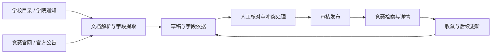
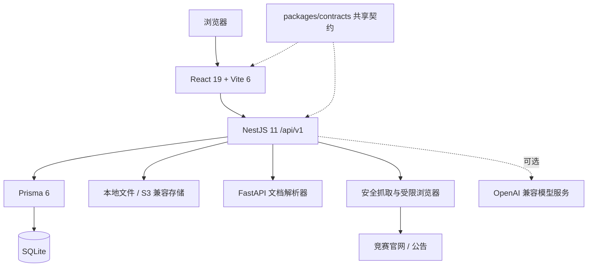

# 方湖观澜 · 学科竞赛信息智能感知平台

> 把分散在学校文件、竞赛官网和官方通知中的信息，整理成可检索、可核对来源、可审核发布、可追溯变更的竞赛资料库。


## 项目简介

方湖观澜面向高校竞赛参与者、竞赛管理老师和资料维护人员，解决三个高频问题：

1. **比赛在哪里**：把学校目录、学院通知、竞赛官网的信息统一收集到竞赛库。
2. **信息是否可信**：关键字段保留来源、原文片段、核验时间和适用年份。
3. **今年怎么报名**：区分赛事系列、届次、赛道和报名阶段，避免把历史通知当成当年安排。

系统不是“自动报名”工具，也不替代学校对竞赛等级、学分或评优资格的认定。它负责信息采集、结构化、核验、查询和更新提示，最终报名动作仍由官方渠道或学校组织流程完成。

当前源码版本为 `0.1.0`，采用 Web + API + Parser 三进程结构。源码整理和线上部署记录停留在 2026-11-17；本 README 于 2026-11-18 重新整理。

## 核心能力

| 模块 | 能做什么 | 当前状态 |
| --- | --- | --- |
| 总览分析 | 收录量、待审核量、临近截止、分类分布、质量概览 | 已有实现 |
| 文档录入 | 上传 PDF / DOCX / XLSX / CSV / TXT / Markdown，按指纹去重 | 已有实现 |
| 文档解析 | 提取文字层、段落、表格行和页/行位置；规则提取与可选模型增强 | 已有实现，扫描件 OCR 未接入 |
| 官网采集 | 发现竞赛官网和公告，读取正文，选择字段写回候选 | 已有实现，部分站点需人工核对 |
| 信息源管理 | 新增、探测、启停、手动采集、健康检查 | 已有实现 |
| 字段核对 | 字段状态、缺失原因、原文依据、冲突提示、重复候选 | 已有实现 |
| 审核发布 | 草稿、待审核、发布、退回、下架、恢复、版本与变更记录 | 已有实现 |
| 竞赛检索 | 关键词、分类、级别、报名状态、可信度、截止时间、资格条件 | 已有实现，检索有 500 条候选上限 |
| 对话检索 | 规则识别查询条件、库内检索、动作确认 | 部分实现 |
| 收藏与订阅 | 收藏切换；订阅规则与推送数据结构 | 收藏可用，完整推送未开放 |
| 配置中心 | 分组配置、版本、回滚、就绪检查、凭据引用、连接测试 | 已有实现 |
| 安全与审计 | 开发身份模拟、部署身份、角色守卫、审计记录、凭据脱敏 | 部分实现，尚非完整多用户体系 |

## 业务闭环



闭环是否成立，不看“抓取了多少网页”，而看用户能否找到一项竞赛、理解适用对象和报名阶段，并定位到支撑关键字段的原始资料。

## 系统架构



几个关键边界：

- **Web** 只负责页面状态、布局和调用 API，不直接连接数据库或模型服务。
- **API** 承担鉴权、业务事务、审核状态机、配置中心、审计和采集编排。
- **Parser** 只做“文件到文本/结构”的转换，不发布竞赛、不调用业务写接口。
- **模型调用** 通过配置中心维护，API Key 只保存为加密凭据引用，不进入前端产物。
- **生产网关** 由 Nginx 提供 HTTPS、子路径、Basic Auth，并清除外部伪造的身份请求头。

## 技术栈

| 层次 | 技术 |
| --- | --- |
| 包管理与工作区 | pnpm `10.32.1`、Node.js `>=22.14.0` |
| Web | React `19`、React Router `7`、Vite `6`、ECharts `5`、TypeScript `5.7` |
| API | NestJS `11`、Prisma `6`、SQLite、Playwright Core |
| Parser | Python `>=3.11`、FastAPI、Uvicorn、PyMuPDF、python-docx、openpyxl |
| 共享契约 | `packages/contracts`：类型、枚举、错误码、配置结构 |
| 测试 | Vitest、pytest，另有配置门禁与验收脚本 |

## 目录结构

```text
competition-sj/
├─ apps/
│  ├─ api/                 # NestJS API、Prisma schema、领域与平台服务
│  ├─ parser/              # FastAPI 文档解析器
│  └─ web/                 # React 管理工作台
├─ packages/
│  └─ contracts/           # 前后端共享类型、枚举、错误码
├─ deploy/                 # Nginx、systemd、生产配置与安装脚本
├─ docs/
│  ├─ 01_requirements/     # 原始需求、设计、任务清单
│  ├─ 02_architecture/     # 综合说明书、源码核查、深入解析
│  ├─ 06_infra/            # 部署与运维记录
│  └─ 99_progress/         # 需求与交付日志
├─ project-os/             # 任务状态、决策、交接
├─ scripts/                # 构建、检查、验收与数据维护脚本
├─ tests/                  # 验收规格
├─ package.json
├─ pnpm-workspace.yaml
└─ README.md
```

## 快速开始

### 1. 环境要求

- Node.js `>= 22.14.0`
- pnpm `10.32.1`（推荐用 Corepack 固定版本）
- Python `>= 3.11`（仅文档解析器需要）
- 可选：OpenAI 兼容模型服务地址、模型名与 API Key

检查版本：

```powershell
node --version
pnpm --version
py -3.11 --version
```

### 2. 安装 JavaScript 依赖

```powershell
corepack enable
corepack prepare pnpm@10.32.1 --activate
pnpm install
pnpm --filter @competition/contracts build
pnpm --filter @competition/api prisma:generate
```

### 3. 初始化本地数据库

本项目默认使用 SQLite。Windows 下 Prisma 的 schema engine 对相对路径较敏感，建议先创建空数据库文件，并把 `DATABASE_URL` 设为绝对路径。

```powershell
$db = Join-Path (Get-Location) 'apps\api\prisma\dev.db'
New-Item -ItemType File -Force -Path $db | Out-Null
$env:DATABASE_URL = 'file:' + ($db -replace '\\','/')
pnpm --filter @competition/api db:push
pnpm --filter @competition/api db:seed
```

> `db:seed` 会先清空业务表，再写入一个空的演示信息源。**只对全新的本地开发库执行**，不要对生产库或需要保留数据的库执行。
>
> 如果使用 Linux 或容器，也可以用相对路径，但必须确认数据库文件存在，且运行 API 时使用同一个 `DATABASE_URL`。

### 4. 启动 Python 解析器

另开一个终端：

```powershell
cd apps/parser
py -3.11 -m venv .venv
.\.venv\Scripts\python.exe -m pip install --upgrade pip
.\.venv\Scripts\python.exe -m pip install -e .
.\.venv\Scripts\python.exe -m uvicorn app.main:app --host 127.0.0.1 --port 8000
```

验证：

```powershell
curl.exe http://127.0.0.1:8000/healthz
```

### 5. 启动 Web 与 API

回到项目根目录，另开一个终端：

```powershell
$env:APP_ENV = "dev"
$env:DATABASE_URL = 'file:' + ((Join-Path (Get-Location) 'apps\api\prisma\dev.db') -replace '\\','/')
$env:PARSER_URL = "http://127.0.0.1:8000"
pnpm dev
```

默认地址：

| 服务 | 地址 |
| --- | --- |
| Web | `http://127.0.0.1:5173/` |
| API | `http://127.0.0.1:3000/api/v1` |
| Parser | `http://127.0.0.1:8000` |

首次打开 Web 会落到 `/overview`。Vite 开发服务器会把 `/api` 代理到 `127.0.0.1:3000`。

## 登录说明

### 本地开发

本地没有独立登录页。`APP_ENV=dev` 时，API 的 `AuthGuard` 会启用开发身份模拟，默认身份为 `u-demo`，默认角色为 `admin`。这是开发便利机制，不是真实认证。

需要测试低权限页面时，可在浏览器 `localStorage` 设置：

```js
localStorage.setItem('actorId', 'u-viewer');
localStorage.setItem('actorName', '只读用户');
localStorage.setItem('actorRoles', 'viewer');
```

清除后刷新页面即可恢复默认管理员身份。

### 线上部署

线上入口使用 Nginx Basic Auth。由于本仓库是公开仓库，**生产账号和密码不写入 README、源码或 Git 历史**；请从部署方私有凭据中获取。

如果需要公开评审账号，建议单独创建只读角色并配置访问限流，不要把生产管理员密码放进公开仓库。若密码曾进入公开提交历史，应立即轮换。

## 环境变量

当前 API 通过进程环境变量读取配置。`.env.example` 只是模板；Nest 启动入口没有自动加载 `.env`，请在 PowerShell、systemd、容器编排或密钥管理系统中注入。

| 变量 | 默认值 | 说明 |
| --- | --- | --- |
| `APP_ENV` | `dev` | `dev` / `test` / `prod`；生产必须关闭开发身份模拟 |
| `DATABASE_URL` | 见上文 | Prisma 数据库连接串；Windows 建议使用绝对路径 |
| `SERVER_LISTEN_HOST` | `127.0.0.1` | API 监听地址 |
| `PORT` | `3000` | API 监听端口 |
| `PUBLIC_BASE_URL` | `http://localhost:3000` | 对外访问基地址 |
| `CORS_ORIGINS` | `http://localhost:5173,http://127.0.0.1:5173` | 允许的前端来源，逗号分隔 |
| `PARSER_URL` | `http://127.0.0.1:8000` | Python 解析器地址 |
| `PARSER_TIMEOUT_MS` | `15000` | 解析器读取超时 |
| `LLM_BASE_URL` | 空 | 可选，OpenAI 兼容模型服务地址 |
| `LLM_MODEL` | 空 | 可选，默认模型标识 |
| `LLM_TIMEOUT_MS` | `30000` | 模型调用超时 |
| `LLM_DAILY_LIMIT` | `500` | 模型日调用上限；`0` 表示当日不允许调用 |
| `CREDENTIAL_VAULT_KEY` | 空 | 可选，base64 编码的 32 字节密钥；未设置时本地生成 `.credentials/vault.key` |
| `DEV_IDENTITY_ENABLED` | `true` | 仅开发/测试环境使用 |
| `DEV_IDENTITY_ROLE` | `admin` | 开发身份默认角色 |
| `AUTH_TEAM_ID` | `team-demo` | 团队/租户标识 |

## API 脱敏与密钥管理

本仓库不包含真实模型 API Key、数据库密码、SSH 私钥或线上 Basic Auth 密码。

### 模型凭据如何保存

1. 管理员在「系统设置 → 模型接入」中录入 API Key。
2. API 只把密文写入 `.credentials/vault.enc.json`，使用 AES-256-GCM 加密。
3. 配置表只保存 `secretRefId`、`maskedTail`、`configured` 和更新时间。
4. 接口、前端页面、日志、审计和导出不返回明文，只显示“已配置”和末四位。
5. 生产环境通过 `CREDENTIAL_VAULT_KEY` 或受保护的密钥文件提供主密钥。
6. 未配置 `storage.secretRef` 时，开发环境使用进程级随机签名密钥；进程重启后旧下载签名会失效，生产环境应配置持久凭据。

### 不要提交

以下内容已被 `.gitignore` 排除，仍请在提交前检查：

```text
.env
.env.*（.env.example 除外）
.credentials/
vault.key
vault.enc.json
*.pem
*.key
*access*.json
competition-sj-access.json
数据库文件、上传原件、日志与构建产物
```

### 网关侧防护

Nginx 模板会在反向代理前清除 `Authorization`、`X-Actor-Id`、`X-Actor-Name`、`X-Actor-Roles`、`X-Team-Id`，避免外部请求伪造内部身份。API 在生产环境也会拒绝开发身份头。

## API 概览

统一前缀：`/api/v1`。

成功响应通常为：

```json
{ "data": {}, "meta": { "asOf": "2026-11-18T00:00:00.000Z" } }
```

错误响应为：

```json
{
  "error": {
    "code": "CONF_VALUE_INVALID",
    "message": "配置值不合法",
    "details": {},
    "traceId": "..."
  }
}
```

### 主要接口分组

| 分组 | 代表接口 | 说明 |
| --- | --- | --- |
| 健康检查 | `GET /healthz`、`GET /readyz` | 存活与数据库/解析器就绪 |
| 客户端引导 | `GET /system/client-bootstrap` | 下发 API 基地址、运行环境、配置版本 |
| 文档 | `POST /documents`、`GET /documents`、`DELETE /documents/:id` | 上传、列表、删除 |
| 解析 | `POST /documents/:id/parse`、`GET /parse-tasks/:id/preview`、`POST /parse-tasks/:id/confirm` | 解析、预览、确认 |
| 目录导入 | `POST /parse-tasks/:id/catalog/confirm` | 学校竞赛目录批量确认 |
| 官网发现 | `POST /agent/discovery-runs`、`GET /agent/discovery-runs/:runId` | 启动与读取发现进度 |
| 字段补采 | `POST /competitions/:id/discovery-fields` | 保存人工选择的采集字段 |
| 检索 | `POST /search/competitions`、`GET /search/facets` | 条件检索与分布 |
| 竞赛详情 | `GET /competitions/:id`、`GET /competitions/:id/versions` | 详情、版本、变更 |
| 审核 | `GET /reviews/queue`、`POST /competitions/:id/publish`、`POST /competitions/:id/reject` | 审核队列与发布状态机 |
| 信息源 | `GET /sources`、`POST /sources`、`POST /sources/:id/crawl` | 信息源管理与手动采集 |
| 验证批次 | `POST /verification-batches`、`POST /verification-batches/:id/promote` | 测试数据转正式 |
| 对话检索 | `POST /agent/query`、`POST /agent/actions/:id/confirm` | 规则检索与写动作确认 |
| 仪表盘 | `GET /dashboard/overview`、`GET /dashboard/deadlines` | 总览与截止提醒 |
| 报表导出 | `GET /reports/quality`、`GET /exports/competitions` | 质量报告与 CSV |
| 配置中心 | `GET /system-settings`、`GET /system-settings/groups/:group` | 分组配置、版本、就绪 |
| 配置变更 | `PUT /system-settings/groups/:group/items/:key`、`POST /system-settings/rollback` | 单项保存、回滚 |
| 凭据 | `PUT /system-settings/credentials/:secretRefId`、`DELETE /system-settings/credentials/:secretRefId` | 写入/撤销凭据引用 |
| 连接测试 | `POST /system-settings/tests`、`POST /system-settings/model-setup` | 数据库/存储/解析器/模型测试与快速启用 |

### 调用示例

```powershell
curl.exe -s http://127.0.0.1:3000/api/v1/healthz

curl.exe -s -X POST http://127.0.0.1:3000/api/v1/search/competitions `
  -H "Content-Type: application/json" `
  -d "{\"scope\":\"published\",\"keyword\":\"蓝桥\",\"limit\":20}"
```

开发环境也可用身份头模拟角色：

```powershell
curl.exe -s http://127.0.0.1:3000/api/v1/reviews/queue `
  -H "x-actor-id: reviewer-1" `
  -H "x-actor-roles: reviewer"
```

生产环境 `profile=prod` 时会拒绝 `x-actor-*` 模拟头。

## 数据模型

`apps/api/prisma/schema.prisma` 当前定义 **50 个 model**。结构存在不代表对应子系统已经完整验收。

| 分组 | 主要模型 |
| --- | --- |
| 赛事身份 | `CompetitionSeries`、`CompetitionEdition`、`CompetitionTrack`、`CompetitionGroup` |
| 赛事资料 | `Competition`、`Organizer`、`RegistrationStage`、`SignupEntry`、`SourceMaterial` |
| 文档与提取 | `CompetitionDocument`、`ParseTask`、`ParseResultVersion`、`FieldEvidence`、`Draft` |
| 审核与历史 | `ReviewRecord`、`CompetitionVersion`、`ChangeEvent`、`TrackSplitRecord` |
| 采集 | `SourceDefinition`、`CrawlTask`、`Candidate`、`VerificationBatch`、`RequestEvidence`、`RawPageSnapshot` |
| 对话与个人 | `AgentSession`、`AgentTurn`、`Favorite` |
| 订阅投递 | `SubscriptionRule`、`PushBatch`、`PushItem` |
| 可靠性与审计 | `AuditEntry`、`OutboxEvent`、`IdempotencyRecord`、`DeadLetterTask`、`ProcessingCheckpoint` |
| 模型运行 | `ModelProviderConfig`、`ModelCallRecord` |
| 配置中心 | `ConfigItemDefinition`、`SystemConfigVersion`、`SystemConfigValue`、`ConfigChangeRecord`、`CredentialRef` 等 |

关键关系：赛事系列 → 届次 → 赛道；竞赛 → 报名阶段 / 报名入口 / 字段依据 / 审核记录 / 版本 / 变更；文档 → 解析任务 / 解析结果 / 文档竞赛关联。

## 检查与测试

```powershell
# 类型检查
pnpm typecheck

# API 单元与服务回归
pnpm --filter @competition/api test

# 构建 contracts、API、Web
pnpm build
```

解析器测试需要安装 test 可选依赖：

```powershell
cd apps/parser
.\.venv\Scripts\python.exe -m pip install -e ".[test]"
.\.venv\Scripts\python.exe -m pytest
```

说明：

- Web 的 `test` 脚本目前只输出提示，不代表已有完整端到端覆盖。
- `pnpm build` 会先执行环境变量门禁 `pnpm gate:env`。
- `scripts/` 下包含部署、修复和数据变更脚本，执行前请先阅读用途；不要为了“检查项目”无差别运行全部脚本。

## 部署

生产部署模板在 `deploy/`：

- `deploy/nginx-locations.conf`：`/competition/` 子路径、HTTPS、Basic Auth、API 反向代理与身份头清理。
- `deploy/competition-api.service`：API systemd 单元。
- `deploy/competition-parser.service`：Parser systemd 单元。
- `deploy/install-server.sh`：服务器安装与权限初始化。
- `deploy/configure-production.cjs`：写入生产配置版本。

生产部署的外部地址通过环境变量提供：

```powershell
$env:COMPETITION_PUBLIC_BASE_URL = "https://<your-domain>/competition"
$env:COMPETITION_CORS_ORIGINS = "https://<your-domain>"
```

典型生产布局：

```text
/opt/competition-sj/
├─ current/                 # 指向当前 release
├─ releases/                # 不可变发布目录
├─ shared/
│  ├─ competition.db        # SQLite 持久数据
│  ├─ uploads/              # 上传原件
│  ├─ logs/
│  └─ credentials/          # 加密凭据，权限 600
└─ runtime/                 # Node / Python 运行时
```

注意：

- 生产升级不要使用 `db:push`；应使用明确的数据库迁移/恢复流程。
- SQLite 备份需要一致性快照，或停写后复制；启用 WAL 时不要只复制主文件。
- 程序回滚和数据回滚要分开；切换 release 不应覆盖新写入的数据。
- 详细部署与回滚记录见 [DEPLOYMENT_STATUS.md](DEPLOYMENT_STATUS.md) 和 [运维记录](docs/06_infra/runbook/cleanup-deployment-20261117.md)。

## 已知限制

| 限制 | 影响 | 建议 |
| --- | --- | --- |
| 身份体系以开发模拟/部署身份为主 | 不是完整多用户登录，缺少会话、撤销和对象级授权 | 接入学校 SSO 或统一身份代理 |
| 对话写动作与部分写接口授权不统一 | 存在治理旁路风险 | 统一业务命令、角色和对象校验 |
| 检索先取 500 条再内存过滤 | 数据量大时可能漏结果 | 将过滤、排序、计数、分页下推数据库 |
| 官网发现任务部分保存在内存 | 进程重启可能丢失运行上下文 | 引入持久任务表与 Worker |
| 普通文档模型只发送正文前 8000 字符 | 长文档尾部信息可能遗漏 | 分块提取并做证据对齐 |
| 模型片段未完全校验回原文 | 字段依据可能不充分 | 增加 snippet 定位与字段规范化校验 |
| 图片/扫描件 OCR 未接入 | 扫描 PDF 和图片无法稳定提取文字 | 接入 OCR 并独立验收 |
| 旧 DOC/XLS 走 OOXML 路径 | 旧二进制格式可能解析失败 | 提示用户转 DOCX/XLSX |
| 订阅推送未完整开放 | 目前以规则和记录结构为主 | 补齐调度、去重、退订与失败补偿 |
| Nginx 模板 25 MB 与 API 批次 50 MiB 不一致 | 合法批次可能在网关被拒绝 | 统一网关与后端限制并做端到端测试 |
| Parser 要求 Python 3.11+ | 3.10 环境无法直接运行 | 使用 3.11 或更高版本创建虚拟环境 |

## 文档入口

- [产品功能与技术设计说明书](docs/02_architecture/方湖观澜-产品功能与技术设计说明书.md)
- [源码核查索引](docs/02_architecture/SOURCE_AUDIT.md)
- [运行流程、技术优势与优化设计](docs/02_architecture/deep-dive/README.md)
- [工程规则与约束](docs/02_architecture/RULES_AND_CONVENTIONS.md)
- [文档地图](docs/MAP.md)
- [需求与交付记录](docs/99_progress/REQUIREMENTS_LOG.md)
- [部署状态](DEPLOYMENT_STATUS.md)
- [源码整理与部署运维记录](docs/06_infra/runbook/cleanup-deployment-20261117.md)

## 安全提醒

- 不要把 `.env`、`.credentials/`、SSH 私钥、访问配置或生产密码提交到 Git。
- 模型 API Key 只通过系统设置页面录入，禁止写入源码、README、截图或日志。
- 如果发现凭据曾进入公开仓库，请立即轮换，并检查 Git 历史与构建产物。
- 生产环境必须保持 `APP_ENV=prod`、`DEV_IDENTITY_ENABLED=false`，并由外层网关限制访问。
