# 竞赛信息收集智能体 · 技术设计文档（design.md）

| 项目 | 内容 |
|---|---|
| 需求基线 | `.codeartsdoer/specs/competition_info/spec.md`（2589 行，6 章、13 个核心能力模块、211 条需求编号、25 组数据约束） |
| 本次设计基线 | 自动采集提升为本期；空库交付；蓝桥杯真实验证批次；REQ-CRAWL-21～29；REQ-AGENT-15～20；系列→届次→赛道→组别四层模型；**5.13 系统运行配置 REQ-CONF-01～22、6.25 配置数据约束 14 条、13 个配置异常场景**；**M6 增量：REQ-CONF-23～26、6.25.16～19、5.13 异常场景 14～20、ADR-17～20（本次已编码落地，设计按实现补齐）**；**M7 增量：REQ-CONF-27～30、6.23.16、6.25.20～23、5.13 异常场景 21～25、ADR-21～24（默认模型固定 DeepSeek、单一接入路径、国产模型预设、未验证缺口标注；不新增配置项/二级页/接口/SDK）** |
| 本期闭环 | ①真实自动采集→AI/规则提取→质量校验→四要素去重→审核发布→检索展示；②文档/人工录入→解析确认→审核发布→检索与报名入口 |
| 后续阶段 | 订阅推送与截止提醒执行链路仍为二期；首版仅保留模型、接口和幂等约束。完整监控看板为二期，但本期必须留存验收指标数据 |
| 技术基线 | NestJS + TypeScript strict + Prisma；Python FastAPI；React；SQLite 本地可运行、PostgreSQL 生产切换；本地文件/MinIO 原件库；可替换任务队列 |
| 设计原则 | 领域驱动、模块化单体、端口适配器、确定性程序掌握执行权、原始材料不可变、验证数据默认隔离、全链路版本化追溯 |
| 文档性质 | 架构与契约级设计，不包含逐行实现代码；接口示例仅用于明确类型和调用约束 |

> **范围纠正**：旧版中“自动采集二期、首版仅预留端口”的标注全部废止。本期必须交付真实联网自动采集、AI 页面理解与详情抽取、附件和快照留存、断点续采、模型配置与降级、空库和蓝桥杯验证批次；只有订阅推送仍保持二期。

---

# 一、需求与存量功能关系分析

## 1.1 需求功能与存量功能对比

本次按最新 `spec.md` 重新检查 `apps/api`、`apps/parser`、`apps/web`、`packages/contracts` 与 Prisma 模型。旧设计“工程不存在业务源代码”的判断已不再成立，以下以当前代码为准。

### 1.1.1 已实现功能

“匹配度”依据需求所需的输入、输出、业务规则、异常处理和可验收证据综合判定；仅存在数据表或页面不等于能力完成。

| 需求功能 | 存量功能 | 代码位置 | 匹配度 |
|---|---|---|---|
| 既定前后端与解析服务技术骨架 | NestJS 模块化 API、React 工作台、FastAPI 解析服务、共享契约包 | `apps/api/src/app.module.ts:1-48`；`apps/web/src/App.tsx:1-147`；`apps/parser/app/main.py:1-225`；`packages/contracts/src/types.ts:1-413` | 75% |
| Prisma + SQLite 本地数据层 | 当前 Prisma provider 为 SQLite，已有核心表；生产 PG 尚无并行迁移与方言隔离 | `apps/api/prisma/schema.prisma:1-9` | 50% |
| 基础枚举、状态文案与 API 类型 | 发布、完整性、报名、可信度、官网、字段状态等共享类型已统一一部分 | `packages/contracts/src/enums.ts:1-195`；`packages/contracts/src/types.ts:18-247` | 50% |
| 文档上传、指纹复用与本地原件保存 | 20MB/50MB 限制、部分魔数校验、SHA-256、同归属复用、短时签名下载 | `apps/api/src/services/document.service.ts:19-127`；`apps/api/src/domain/file-security.ts:5-129`；`apps/api/src/platform/storage.module.ts:11-53` | 50% |
| 文档基础解析与定位 | PDF/Word/Excel/文本提取及页码、段落、工作表位置；尚无有效 OCR 和完整安全前置 | `apps/parser/app/main.py:38-148`；`apps/api/src/services/parse.service.ts:74-149` | 50% |
| 规则字段提取与基础 AI 字段提取 | 规则抽取名称、时间、机构、资格、入口；OpenAI 兼容字段抽取可按环境变量启用 | `apps/api/src/domain/rule-extractor.ts:108-371`；`apps/api/src/services/extraction.service.ts:21-120` | 50% |
| 系列—届次—赛道基础关联 | 已有三张层级表及竞赛引用，可支撑单层赛道展示 | `apps/api/prisma/schema.prisma:11-46`；`apps/api/prisma/schema.prisma:69-121` | 50% |
| 发布状态主路径 | 草稿、待审核、发布、下架及恢复的状态转换与部分自动发布条件 | `apps/api/src/domain/publish-state-machine.ts:4-62`；`apps/api/src/services/competition.service.ts:502-650` | 75% |
| 竞赛检索、详情、审核与基础看板 | 已发布过滤、部分筛选、分页、详情、版本、审核队列和指标口径 | `apps/api/src/services/competition.service.ts:283-500`；`apps/api/src/services/dashboard.service.ts:10-179` | 50% |
| 信息源创建、规范化、探测和启停 | 作用域唯一、基础 SSRF/DNS/重定向检查、探测后启用、健康字段 | `apps/api/src/services/source.service.ts:29-181`；`apps/api/src/platform/safe-fetch.ts:16-142` | 50% |
| 报名入口配置与校验入口 | 入口创建、校验、可信域名和跳转保护 API 已存在 | `apps/api/src/controllers/signup-source.controller.ts:22-62` | 50% |
| 订阅二期只读边界 | 订阅、推送记录、提醒返回 `featurePhase=2`，无真实投递执行 | `apps/api/src/controllers/misc.controller.ts:49-82` | 75% |
| 审计与业务事件基础模型 | 审计哈希链字段、Outbox、幂等记录和死信表已建模 | `apps/api/prisma/schema.prisma:374-420` | 50% |
| 通用异步与空态 UI 组件 | 加载、错误、空、部分成功、无权限、过期状态有统一组件 | `apps/web/src/components/ui.tsx:218-270` | 75% |
| 运行参数的基础读取 | `PORT`、`PARSER_URL`、`LLM_BASE_URL/API_KEY/MODEL/TIMEOUT/DAILY_LIMIT`、`DEV_ACTOR_*` 均由进程环境变量读取；模型接入已有独立表 `ModelProviderConfig` | `apps/api/src/main.ts:21`；`apps/api/src/services/parser-client.service.ts:29-30`；`apps/api/src/services/llm.service.ts:22-85`；`apps/api/src/platform/auth.module.ts:23-27`；`apps/api/prisma/schema.prisma:618-628` | 25% |

### 1.1.2 需要扩展的功能

| 需求功能 | 存量功能 | 差异说明 | 扩展方向 |
|---|---|---|---|
| 真实自动采集闭环 | `CrawlTask`、`Candidate` 只有简表；`AppModule` 无采集编排服务或 Worker | 无调度、游标、列表/详情抓取、过滤、候选自动流转、报告和检查点；不能产生真实采集结果 | 新增采集应用服务、任务 Worker、请求证据、阶段状态机、候选与审核流水线；复用信息源和安全出口 |
| AI 页面理解与链接发现 | 现有 AI 仅接收纯文本做字段补全 | 无 DOM/链接清单、页面类型、公告/分页链接、原文位置；模型可直接返回 URL 文本，缺少虚构链接拦截 | 程序先构建真实链接与文本块清单，模型只选择清单标识；输出经锚点、范围、robots、SSRF、限流逐层校验 |
| AI 详情正文与多赛道字段抽取 | `ExtractionService` 仅处理 8000 字文本并合并少数字段 | 无正文区域、导航/广告排除、赛道/组别、逐字段定位、阶段独立结果、Schema 强校验 | 建立页面理解结果模型、分块正文抽取、版本化 Schema、证据定位器和多子项字段归属 |
| 公告附件自动下载与原件库 | 用户上传文档可保存到本地目录 | 无附件线索绑定、流式下载、隔离区、安全放行、父公告关联；当前保存接口会直接把字节写入可访问目录 | 统一上传/采集附件安全门；隔离下载→安全校验→不可变原件库→统一解析；拒绝件仅留审计元数据 |
| 原始 HTML/RSS 快照留存 | `safeFetch` 只返回最多 2000 字预览 | 原始响应字节、实际 URL、内容指纹、请求证据均未持久化，不能作为采集依据 | 安全出口返回流式响应与证据；先保存完整原始快照，再创建 AI/规则分析任务 |
| 断点续采与检查点 | 文档任务只在进程内更新 `stage/progress` | 进程重启丢失执行；无公告/附件级检查点、租约、阶段产物复用和配置指纹 | 新增统一阶段检查点、 fencing token、输入/配置指纹和结果版本；本地与生产队列共享恢复语义 |
| 模型服务可配置接入 | 仅从 `LLM_BASE_URL/API_KEY/MODEL` 读取，直接调用 `/chat/completions` | 无管理员配置、六类任务分配、凭据引用、配额原子控制、成本未知语义、调用审计 | 新增模型配置聚合、`LlmPort`、配额预留、调用账本、任务路由、凭据引用和管理界面 |
| 规则降级与 AI 失败转人工 | 捕获异常后返回规则结果，未记录充分降级原因 | 无分类降级、重试计额、输出失败与规则结果区分；可能把降级结果误标为成功 | 每阶段记录处理模式、原因、规则/模型版本；AI 输出失败禁止自动发布；无可靠规则时明确失败而非零公告 |
| 四层竞赛模型与四要素去重 | 有系列、届次、赛道，赛道与届次可空；无组别和拆分记录 | 不能防止跨赛道/组别/届次误合并；现有按规范化名称更新记录会误覆盖 | 增加组别、合法父子链、无组别哨兵键、有效记录唯一索引、拆分计划/执行/撤销及人工结论 |
| 空库交付与统一空态 | `AsyncState` 只有“暂无数据”；看板和搜索无库级空态元数据 | 无法区分空库、条件无匹配、仅验证批次、仅草稿；`seed.ts` 当前定义并写入 12 条静态竞赛及关联对象 | 移除竞赛种子和启动写入；新增空库计算服务、统一 `EmptyStateMeta`、无占位图表与六类入口引导 |
| 蓝桥杯验证批次隔离 | 无验证批次模型；现有蓝桥杯为静态种子 | 无真实验证触发、批次继承、公开范围排除、转正式/整批清除和泄露检测 | 新增验证批次聚合、批次作用域仓储、独立验证视图与原子处置；蓝桥杯数据只能由真实采集生成 |
| 全链路依据可追溯 | `FieldEvidence` 有片段和模糊位置，但来源关联可空 | 无快照/附件版本、请求证据、页面理解结果、处理模式与字段实际来源的完整链 | 引入材料版本和结果版本引用，发布前执行依据链守卫；任何关键字段缺定位或材料不完整均转人工 |
| 接口幂等、权限与审计 | 有部分角色守卫、审计和幂等表 | 默认请求头可伪造管理员；写接口未统一幂等/`If-Match`；新增配置和批次权限缺失 | 生产强制 OIDC/JWT；应用层对象授权；统一写契约、错误码和审计动作；验证/模型配置仅授权角色 |
| 系列聚合与赛道卡片 UI | 搜索页仅平铺卡片，显示可空系列/届次/赛道 | 无聚合切换、组别筛选、独立子项计数、共用入口提示、验证标识 | 新增子项/聚合双视图、四层面包屑、独立报名与截止卡片、拆分预览和验证分组 |
| 运行配置集中管理 | 环境变量分散读取；仅模型配置有页面化雏形且字段不全 | 无分组/作用域/取值来源、无版本号与 `If-Match`、无生效方式与待重启、无变更历史与回滚、无测试连接、无就绪检查；`PARSER_URL`、采集间隔、留存期限、蓝桥杯接口地址均为代码常量 | 新增配置中心（分组、版本、作用域、来源）、`ConfigResolver` 运行快照、测试连接、审计/回滚、就绪检查；所有运行期读取改走配置快照；`.env` 降级为首次默认与紧急回退 |

### 1.1.3 需要新增的功能或接口

#### A. 真实采集与 AI 页面理解

| 功能点 | 输入 → 输出 | 核心逻辑 | 依赖 |
|---|---|---|---|
| 采集调度与互斥 | 启用信息源、总开关、采集窗口 → 唯一采集任务或跳过事件 | 程序校验开关、来源、引导、robots、单源互斥和幂等窗口；关闭时不创建任务、不发请求 | 调度器、信息源、任务引擎 |
| 真实链接清单构建 | 已保存原始 HTML/RSS → 带定位的真实链接清单 | 普通程序解析 `<a href>`、RSS 条目及合法相对地址，生成不可伪造的 `linkCandidateId`；不访问模型拼接 URL | HTML/RSS 解析器、快照库 |
| AI 页面理解与公告发现 | 安全分析文档、真实链接清单 → 页面类型、公告/分页选择、时间、依据和置信度 | 模型只返回清单标识与语义判断；程序过滤导航、广告、越范围链接并决定实际请求 | `LlmPort`、页面理解结果库 |
| AI 详情正文抽取 | 详情快照、文本块清单 → 正文范围、附件线索、竞赛字段与赛道/组别候选 | 模型只选择正文块并给字段建议；程序执行 Schema、证据定位和字段归属校验 | 字段规范、文本块清单、模型输出校验器 |
| 候选自动流转 | 已保存快照、合规附件、请求证据 → 抽取、去重、拆分、审核任务 | 材料齐全后自动推进，无需逐条人工触发；失败保留原文和规则草稿并转人工 | 检查点、解析编排、质量与审核 |

#### B. 原件库、检查点与追溯

| 功能点 | 输入 → 输出 | 核心逻辑 | 依赖 |
|---|---|---|---|
| 请求证据与原始快照 | 真实响应流、最终 URL、状态、字节数 → 不可变快照和证据引用 | 原始内容先落盘并核对指纹，再允许分析；保存失败阻断对应候选 | 安全出口、`BlobStorePort` |
| 附件隔离下载与放行 | 页面真实附件链接 → 合规原件或安全拒绝记录 | 逐个执行范围/robots/SSRF/大小/数量/真实类型/结构/宏检查；只有放行件进入原件库和解析 | 下载器、文件安全服务、隔离存储 |
| 公告/附件级检查点 | 任务、材料指纹、处理配置、阶段结果 → 最近有效恢复点 | 阶段原子提交，重启复用同指纹同配置产物；内容变化新建版本，禁止旧依据挂接新内容 | 任务引擎、材料版本库 |
| 全链路依据视图 | 竞赛/子项或字段 → 请求、快照、附件、解析版本、模型/规则记录 | 通过稳定标识串联完整 lineage；缺任一必需环节禁止自动发布 | 来源材料、字段依据、模型调用账本 |

#### C. 模型治理

| 功能点 | 输入 → 输出 | 核心逻辑 | 依赖 |
|---|---|---|---|
| 模型接入与任务路由 | 服务类型、地址、模型、凭据引用、六类任务策略 → 生效配置和运行状态 | 管理员配置；按任务类型选择模型，缺省走默认模型，无可用模型则规则降级 | 配置中心、密钥引用、`LlmPort` |
| 配额预留与调用账本 | 日/任务/公告/附件配额及一次调用意图 → 允许调用或配额降级 | 调用前原子占用，首次和重试均计额；并发下不得突破上限；耗时、令牌、费用按实际返回记录 | 数据库事务、模型调用记录 |
| 分类降级与成本报告 | 未配置、停用、超时、限流、配额、凭据、非法输出 → 规则草稿或人工事项 | 保留已完成材料；规则结果标注原因；无规则可降级则明确失败；成本未知不得记 0 | 规则引擎、审核队列、指标服务 |

#### D. 空库、初始化与验证批次

| 功能点 | 输入 → 输出 | 核心逻辑 | 依赖 |
|---|---|---|---|
| 空白库交付 | 全新数据库和启动配置 → 仅基础字典与运行状态 | 禁止竞赛、候选、草稿、收藏、推送和演示统计种子；`db:seed` 不得写业务条目 | 迁移、启动流程、交付检查 |
| 空库状态计算 | 正式数据、候选就绪状态、来源配置 → 空库标识、原因与引导动作 | 单一服务统一判定，区分空库与查询无匹配；验证批次不计入正式范围 | 空库服务、各只读接口 |
| 蓝桥杯验证触发 | 固定验证对象、真实官方源、批次名、上限/时长 → 隔离采集批次 | 仅授权用户可发起；所有下游对象继承批次；非蓝桥杯或混源录入触发隔离异常 | 采集编排、验证批次聚合 |
| 转正式与整批清除 | 批次、二次确认、幂等键 → 原子处置结果 | 前置隔离/证据校验；转正式只改来源标识与批次状态；清除只命中批次并保留报告审计 | 事务、权限、审计 |
| 泄露防护 | 公共检索、看板、导出、订阅、问答查询 → 仅正式可见数据 | 统一 `FormalDataScope` 仓储过滤和跨模块泄露测试；默认拒绝缺失来源标识 | 数据范围策略、所有查询模块 |

#### E. 四层模型与多赛道拆分

| 功能点 | 输入 → 输出 | 核心逻辑 | 依赖 |
|---|---|---|---|
| 系列/届次/赛道/组别聚合 | 四层标识和原文依据 → 合法层级与无组别规范键 | 校验父子引用；空组别按独立规范值处理，不能与具体组别等同 | 知识模型、唯一索引 |
| 拆分计划与预览 | 赛道/组别候选、各自字段与依据 → 子项计划、共用/专属归属 | 明确独立条件才拆组别；边界不清只建“未分赛道”待确认项，不臆造 | 拆分规划器、赛道字典 |
| 幂等拆分执行与撤销 | 拆分计划、结果版本、操作人 → 子项集合或可恢复撤销记录 | 四要素唯一；重复执行复用；保留拆分前快照、来源分配和人工结论 | 竞赛聚合、审计、版本服务 |
| 双视图与独立报名 | 子项查询条件 → 子项列表或系列聚合树 | 子项独立阶段、截止、状态、资格和入口；共用入口显式标注适用集合 | 检索服务、React 页面 |

#### F. 系统运行配置（5.13 / 6.25）

| 功能点 | 输入 → 输出 | 核心逻辑 | 依赖 |
|---|---|---|---|
| 配置分组与作用域 | 8 个分组、22 条规则 → 带作用域与取值来源的配置项集合 | 部署级 > 团队级 > 内置默认值；强制只读项无编辑控件且服务端拒绝修改 | 配置中心、团队上下文 |
| 配置版本与保存冲突 | 读取版本号、保存请求基础版本 → 新版本或冲突明细 | 版本单调递增；整批校验 `If-Match`，任一冲突整批不提交；保存与审计同事务 | 配置仓储、事务 |
| 生效方式与运行快照 | 生效方式标注、已保存值 → 运行快照与生效状态 | 立即生效改快照，下次任务生效随任务创建取新值，需重启项保持旧值并标记待重启；启动校验保存值与运行值 | `ConfigResolver`、启动钩子 |
| 凭据引用与脱敏 | 明文或引用输入 → 引用标识、末四位、“已配置/未配置” | 明文只落密钥存储后立即丢弃；响应、日志、审计、导出、前端存储均无明文；轮换保留历史引用 | `SecretRefPort`、`CredentialVault` |
| 受控测试连接 | 目标类型、地址、凭据引用 → 分类结果与耗时 | 服务端发起、统一安全出口、≤10s、同目标 1 分钟 1 次、逐跳复核；失败不改当前配置 | `ConfigTestService`、`SafeEgressPort` |
| 变更审计与回滚 | 保存/测试/回滚 → 不可变变更记录与可回滚版本 | 记录前后值（密钥仅引用）、生效方式、结果与来源地址；保留≥10 个可回滚版本；回滚复用保存校验并生成新版 | 审计哈希链、配置版本 |
| 配置就绪检查 | 服务地址、存储、解析服务、模型、信息源、总开关 → 逐项状态与整体结论 | 模型未配置为“可选未配置”不阻断；数据存储/解析服务未就绪时空库原因改为“系统配置未就绪”并优先引导系统设置 | 就绪服务、空库服务、引导 |
| 硬编码消除 | 蓝桥杯渠道、解析地址、模型参数、采集间隔、留存期限 → 配置读取 | 运行期只从配置快照取值；保留 `.env` 为首次默认与紧急回退并显式标注来源 | 采集、解析、模型、留存、前端导航 |

### 1.1.4 M6 增量（REQ-CONF-23～26）与存量功能关系

本节只描述本次增量四项落地与现有代码的关系，不重复 1.1.1～1.1.3 已确认的配置中心基线（REQ-CONF-01～22、ADR-11～16）。判定依据为当前代码实际行为，而非任务清单勾选状态。

**（1）已实现功能（与需求 100% 或高度匹配）**

| 需求功能 | 存量功能 | 代码位置 | 匹配度 |
|---|---|---|---|
| REQ-CONF-23 客户端引导只读接口、ETag/304、未加载完成 503 | 由运行快照生成基地址、来源、版本、环境、下发时间与 60 秒缓存上限，支持 `If-None-Match` | `apps/api/src/controllers/system-settings.controller.ts:51-84` | 100% |
| REQ-CONF-23 前端运行期获取与同源兜底 | 启动前获取、60 秒缓存、单飞请求、失败回退同源并记录原因，业务请求统一走解析后的基地址 | `apps/web/src/lib/api.ts:23-122`；`apps/web/src/main.tsx:8-17` | 100% |
| REQ-CONF-23 基地址来源展示与不一致告警 | 顶栏标签、服务与环境页只读卡片、来源不一致红色告警 | `apps/web/src/App.tsx:128-137`；`apps/web/src/pages/SettingsPage.tsx:176-263` | 100% |
| REQ-CONF-24 环境变量静态扫描与构建阻断 | 扫描后端、前端与构建配置，三类白名单外命中即退出码 1，报告落文件；构建脚本前置调用 | `scripts/check-env-usage.mjs:1-147`；`config.env-allowlist.json:1-49`；`package.json:18-19` | 100% |
| REQ-CONF-24 管理员查看最近一次门禁报告、无记录 404 | 读取报告文件并做管理员校验 | `apps/api/src/config/config-gate.service.ts:17-25`；`system-settings.controller.ts:86-95`；`packages/contracts/src/config.ts:181-194` | 100% |
| REQ-CONF-25 启动前按配置快照组装数据库连接串 | Nest 容器创建前读取最新配置版本，组装连接数、TLS 与凭据引用；SQLite 显式标注不切换 | `apps/api/src/config/database-bootstrap.ts:29-160`；`apps/api/src/main.ts:10-12` | 75% |
| REQ-CONF-25 脱敏运行期连接来源 | 数据库与对象存储各返回脱敏目标、配置版本、连接时间、TLS、状态与最近失败分类，并与健康检查同源 | `apps/api/src/config/connection-runtime.service.ts:16-119`；`packages/contracts/src/config.ts:144-153` | 75% |
| REQ-CONF-25 `storage.*` 保存返回历史原件影响数量 | 保存的数据存储分组含 `storage.*` 变更时统计快照、附件与上传文档总数并返回提示 | `apps/api/src/config/config.service.ts:557-575`；`connection-runtime.service.ts:105-119` | 75% |
| REQ-CONF-26 同目标并发测试仅一次真实外发 | 先占位后外发，其余命中 60 秒冷却并返回剩余秒数与上次时间 | `apps/api/src/config/config-test.service.ts:39-67` | 100%（单实例） |
| REQ-CONF-26 并发生成版本返回 409 而非 503 | 版本唯一约束冲突后回查最新版本，映射为 `CONF_VERSION_CONFLICT`；仅真实持久化失败才 503 | `apps/api/src/config/config.service.ts:397-400`、`:483-516` | 100% |
| REQ-CONF-26 测试结果含证据、测试时间与有效期 | 响应增加 `evidence/testedAt/validUntil/lastTestedAt`，冷却响应附上次时间 | `config-test.service.ts:73-127`；`packages/contracts/src/config.ts:282-298` | 100% |

**（2）需要扩展的功能**

| 需求功能 | 存量功能 | 差异说明 | 扩展方向 |
|---|---|---|---|
| REQ-CONF-24 同源取值断言（页面值/健康检查值/日志值来自同一版本与快照指纹） | 脚本仅以“源码是否引用 `ConfigResolver` 与 `snapshotFingerprint`”做静态包含断言，`versions` 固定为 0 | 只能证明“读取入口同一”，不能证明运行期三处取值同版本同指纹；不满足“人为制造不一致必须失败” | 由静态包含断言升级为运行期断言：门禁产物附带一次运行快照的版本与指纹，配置页、`configuration-health` 与运行日志导出同一指纹后比对；三方不一致时给出三个版本号 |
| REQ-CONF-25 对象存储切换后新写入落到新目标 | 远端适配器未启用；`storage.type` 非 local 时状态固定 `degraded` 并注明“尚未切换到远端适配器” | 端点、桶、区域与访问策略尚未作用于实际读写，只作用于展示与探测 | 增加远端对象存储适配器与写入路由；切换只影响新写入，旧对象保留原目标；未启用时不得声称已切换 |
| REQ-CONF-25 历史原件读取逐项标注可用性 | 保存时返回受影响总数与“不删除、不改指纹”提示 | 无逐项的“可用/已迁移/不可访问（存储目标已变更）”状态；总数提示不能替代逐项标注 | 原件视图增加可用性状态与原因、受影响数量与旧目标只读回退入口；不新建或改写原件记录 |
| REQ-CONF-25 凭据轮换后新连接使用新引用、旧连接空闲回收 | 轮换更新引用与版本；数据库连接串在启动时一次组装 | 运行期不重建连接，旧连接随进程生命周期存在；无“空闲回收后释放”的可核验状态 | 以“下次重启切换 + 显式待重启状态”作为本期口径；记录轮换前后引用版本，避免新旧引用同时用于同一连接 |
| REQ-CONF-26 六类并发场景全覆盖 | 已覆盖同目标并发测试与两名管理员并发保存；回滚、凭据轮换、就绪重算、采集运行中改配置未纳入脚本 | 验收报告只能证明两类场景 | 扩展并发脚本与验收 YAML；未执行项结论必须为 `blocked` 或 `partial`，不得记为通过 |
| REQ-CONF-26 多实例冷却与限流 | 冷却占位存于进程内 `Map` | 多实例部署时同一目标可能被多个实例各外发一次 | 生产多实例改共享冷却存储（数据库或队列），本期单实例口径需在报告中显式标注 |

**（3）需要新增的功能或接口**

| 功能点 | 输入 → 输出 | 核心逻辑 | 依赖 |
|---|---|---|---|
| 客户端引导记录聚合（6.25.17） | 每次下发 → 可聚合的下发记录（地址、来源、版本、环境、时间、缓存上限、是否兜底与原因） | 当前实现为结构化日志，不新增数据表；按版本与来源可聚合计数；不含键名、配置值、凭据与内部地址 | 日志管道、审计口径 |
| 配置门禁报告契约（`ConfigGateReport`） | 扫描结果文件 → 管理员可读报告 | 报告为构建产物文件，接口只读不改写；无报告返回 404 | 构建流水线、文件存储 |
| 运行期连接来源契约（`RuntimeConnectionView`） | 启动引导结果 + 实时探测 → 脱敏连接视图 | 只由服务端生成，页面与健康检查共用；不含口令与完整连接串 | `database-bootstrap`、`ConfigResolver` |
| 真实联网与并发证据报告 | 脚本执行 → `artifacts/config-gate/*.json` 与验收 YAML 结论 | 五类目标逐项外发证据；并发断言以计数与状态码为准；受限环境标注阻塞 | 验收环境网络、测试账号 |

### 1.1.5 M7 增量（REQ-CONF-27～30）与存量功能关系

本节只描述模型接入四项增量（默认模型固定 DeepSeek、单一接入路径、国产模型预设、未验证缺口标注）与现有代码的关系，不重复 1.1.1～1.1.3 的模型治理与配置中心基线（REQ-CONF-01～26、REQ-AGENT-15～20、ADR-11～24 中 ADR-21 之前条目）。基线口径固定为：`model_access` 16 项配置、16 个配置接口（14 个既有 + 2 个只读）、七个二级页、八分组 78 项。判定依据为当前代码实际行为。

**（1）已实现功能（与需求 100% 或高度匹配）**

| 需求功能 | 存量功能 | 代码位置 | 匹配度 |
|---|---|---|---|
| `model_access` 16 项配置定义 | serviceType、baseUrl、model、secretRef、timeoutMs、maxRetries、dailyQuota、taskQuota、enabled、6 个 `taskModel.*`、fallbackPolicy 均已登记，含区间、枚举、作用域与生效方式 | `apps/api/src/config/config-items.ts:437-627` | 100% |
| 配置分组读取、保存、版本与审计 | 分组读写、`If-Match`/`baseVersion`、全局版本、变更记录与回滚；`model_access` 已是其中普通分组 | `apps/api/src/config/config.service.ts`；`apps/api/src/config/config-resolver.service.ts`；`apps/api/src/controllers/system-settings.controller.ts:109-188` | 100% |
| 凭据只保存引用与末四位 | `secret_ref` 项只返回 `configured/maskedTail/lastUpdatedAt`；明文一次性写入 Vault | `apps/api/src/config/credential-vault.service.ts`；`apps/web/src/pages/SettingsPage.tsx:47-55` | 100% |
| 任务模型键读取与默认值回退 | 六类任务经 `TASK_MODEL_KEY` 读取 `taskModel.*`，为空时回退 `model.model`；字段抽取读取 `taskModel.document` 后回退默认 | `apps/api/src/services/llm.service.ts:24-31`、`:68-70`；`apps/api/src/services/extraction.service.ts:62-64` | 100%（读取），50%（统一解析与来源标注） |
| 未配置/停用时规则降级 | `configured=false` 直接返回 `not_configured` 降级；字段抽取 `llmEnabled=false` 时走规则 | `apps/api/src/services/llm.service.ts:47-65`；`apps/api/src/services/extraction.service.ts:33-47` | 100% |
| OpenAI 兼容请求形态 | 两处均以 `POST {baseUrl}/chat/completions`、Bearer 凭据、JSON 响应格式调用 | `apps/api/src/services/llm.service.ts:104-121`；`apps/api/src/services/extraction.service.ts:67-90` | 100%（协议），50%（路径唯一） |
| 模型服务测试连接 | 目标类型 `model_service`，以 `GET {baseUrl}/models` 探测并返回七类结果分类 | `apps/api/src/config/config-test.service.ts:150-157`、`:200-215` | 75% |
| 模型接入页基础维护 | 七个二级页之一，统一按 `ConfigItemView` 渲染 16 项；提供测试连接入口 | `apps/web/src/pages/SettingsPage.tsx:26`、`:814-815` | 50% |

**（2）需要扩展的功能**

| 需求功能 | 存量功能 | 差异说明 | 扩展方向 |
|---|---|---|---|
| REQ-CONF-27 默认模型内置默认值为 DeepSeek 预设登记值 | `model.baseUrl`、`model.model` 的 `defaultValue` 均为空字符串 | 默认口径为空，页面不显示“内置默认值 + DeepSeek”；不满足“禁止继续以空值作为默认口径” | 内置默认值改为预设登记值；首启初始化写入 `version=1` 并标 `builtin_default`；已保存值不回填、不被预设清单更新静默改写 |
| REQ-CONF-27 全任务统一解析与来源可核对 | 两个服务各自读取任务键并各自回退默认值，无解析来源、无统一入口、无“为什么降级” | 同一任务在不同调用点可能得到不同结论；页面无法预览逐任务解析结果 | 新增 `ModelResolver` 统一解析并输出 `resolvedTaskModels`（任务类型、配置键、解析模型、解析来源、降级原因、协议、配置版本）；两个服务只消费解析结果 |
| REQ-CONF-28 单一业务调用路径 | 存在两条独立 `fetch` 业务调用实现，各自组装请求、超时与记录 | 协议一致但实现重复，任何一处改动都会形成两套超时/重试/记录口径，违反“唯一调用路径” | 抽出 `OpenAiCompatibleClient` 作为 `LlmPort` 唯一实现；`LlmService` 与 `ExtractionService` 改为消费端口；门禁扫描模型调用点，白名单仅允许端口实现 |
| REQ-CONF-22/30 任务级覆盖校验 | 任务模型值按字符串直接读取，任意内容均可保存和生效 | 非法模型标识不会在保存期拒绝；与服务地址/协议不匹配时只能在调用期失败 | 保存期校验：任务级模型必须属于“当前可用预设模型集合 ∪ 当前默认模型标识”，格式合法且与当前 `baseUrl`/协议匹配；非法返回 `CONF_TASK_MODEL_OVERRIDE_INVALID` |
| REQ-CONF-29 预设清单与表单填充 | 前端无预设概念，只按 16 项逐行编辑 | 无服务端下发清单、无“将写入的键与值”预览、无二次确认 | 新增 `ProviderPresetService` 与版本化清单；前端新增预设选择、填充预览、未保存修改二次确认；预设不得预填凭据 |
| REQ-CONF-30 测试连接验证范围 | 响应有 `result/evidence/testedAt/validUntil`，无预设标识与验证范围 | 受限环境下无法区分“真实外发失败”与“未验证” | 响应只增 `presetId`、`verificationScope`、`gapReason`、`substituteEvidence`；`blocked`/`substitute` 不得映射 `success` |
| REQ-CONF-30 调用记录可核对解析来源 | `ModelCallRecord` 有 `model/configVersion/degradeReason`，无解析来源与协议 | 无法从调用记录判断该次调用来任务级覆盖还是默认模型 | 新增可空列 `resolveSource/protocol/presetId`，旧记录保持空值表示“未标注”，不改写历史 |

**（3）需要新增的功能或接口**

| 功能点 | 输入 → 输出 | 核心逻辑 | 依赖 |
|---|---|---|---|
| `ProviderPresetService` | 版本化预设清单 + 当前配置快照 → `providerPresets[]` 与清单版本、可用性、不可用原因 | 只读加载清单并计算可用性；不读写凭据、不产生配置版本；地址仍需通过安全校验 | 预设定义文件、`ConfigResolver`、地址安全校验 |
| `ModelResolver` | 当前快照 + 任务类型 → 逐任务解析结果与默认模型视图 | 任务级覆盖 > 默认模型 > 规则/人工降级；结果唯一且可重复计算；解析期不发网络请求 | `ConfigResolver`、`ProviderPresetService` |
| `OpenAiCompatibleClient` | 解析结果 + 提示词 → 模型响应、用量与调用记录 | `LlmPort` 唯一实现，承载请求组装、超时、重试与协议错误分类 | `SecretRefPort`、`ModelQuotaService` |
| 契约字段（只增） | 分组读取/保存/测试/调用记录 → 新增响应字段与可选请求字段 | `providerPresets`、`presetListVersion`、`defaultModel`、`resolvedTaskModels`、`protocol`、`presetId`、`appliedPresetId`、`unverifiedItems`、`verificationScope`、`gapReason`；不新增接口 | 共享契约包 |
| 前端预设与解析组件 | 预设清单与解析结果 → 表单填充、预览弹窗、解析预览表、未验证徽标、切换确认 | 只填表单不生效；二次确认覆盖未保存值；不内置地址与模型常量 | `SettingsPage` 模型接入页 |
| 治理与证据 | 构建与验收执行 → 调用点门禁报告、预设清单报告、解析矩阵、验证报告、验收 YAML | 模型调用点唯一性、配置项与接口数量不变、受限环境三态标注 | `scripts/`、`tests/acceptance/`、`artifacts/` |

**（4）与 M6 增量的边界**：M7 不改写 M6 的引导、门禁、连接与并发语义；门禁脚本只新增“模型调用点”规则并写入同一报告文件（`ConfigGateReport.violations[].type` 新增取值），不新增报告接口；`presetId` 只进入审计与响应字段，不落为配置项、不产生配置版本、不计入 78 项与 16 项。

## 1.2 存量功能详细分析

### 1.2.1 可复用接口契约与约束

| 存量点 | 可复用契约 | 必须修正的约束 |
|---|---|---|
| 共享类型包 | `ApiSuccess<T>`、`ApiFailure`、分页、时间值、竞赛卡片及状态文案可作为契约基础 | 去除宽松索引签名对关键契约的遮蔽；补齐 29 组枚举、空库/批次/模型/材料/检查点类型，禁止 `any` |
| 文档服务 | 内容指纹、归属唯一、逐文件结果、短时签名和自动解析触发可复用 | 总量/数量异常不能覆盖逐文件部分成功语义；安全通过前不得进入正式原件区；采集附件必须走同一端口 |
| 解析任务 | `ParseTask`、`ParseResultVersion` 可承载分阶段结果 | 当前 `void run()` 不具备重启恢复；自动采用新版本会覆盖人工语义，需改为幂等复用、显式采用与阶段检查点 |
| 规则提取器 | 正则、词典、冲突候选、字段状态和依据块可成为降级实现 | 规则结果不能伪装 AI；无依据名称兜底和模糊定位需收紧；新增赛道/组别与附件定位 |
| 发布状态机 | 合法转换及六类基础自动发布判断可复用 | 增加来源身份、真实请求、原件完整、AI 各阶段成功、字段依据链、验证状态和四要素冲突守卫 |
| 搜索与看板 | 已发布过滤、状态独立、统计口径与 `asOf` 可复用 | 当前最多取 500 条后内存分页不满足 10 万条红线；改数据库稳定游标与索引；所有查询强制正式数据范围 |
| 安全出口 | 协议、DNS、手动重定向、响应上限的基础结构可复用 | 当前仅返回文本预览且无 DNS pinning、robots、完整字节流、下载限额与请求证据，需升级为唯一出口 |
| 本地存储 | 私有目录、路径清理和 HMAC 签名可作为本地 `BlobStorePort` 实现 | 增加隔离区、不可变材料版本、指纹复核、批次访问范围、过期删除和 MinIO 生产实现 |

### 1.2.2 必须移除或阻断的存量行为

1. **演示种子**：`apps/api/prisma/seed.ts:39-245` 定义静态竞赛，`:247-537` 清库并写入竞赛、层级、来源、草稿和收藏。标准交付必须删除这些业务写入；不得仅将蓝桥杯条目改名后当作验证数据。
2. **开发库交付**：`apps/api/prisma/dev.db` 不得作为交付数据资产或验证证据；验证报告只能来自新空库上的真实请求与材料。
3. **演示身份兜底**：`apps/api/src/platform/auth.module.ts:23-59` 默认全角色演示用户且信任请求头，仅限显式本地开发模式；生产构建必须拒绝该模式并强制上游鉴权。
4. **名称覆盖式入库**：`apps/api/src/services/competition.service.ts:115-162` 按规范化名称查找并更新，可能覆盖不同届次/赛道/组别，必须替换为四要素与明确人工合并流程。
5. **模型输出直接合并**：`apps/api/src/services/extraction.service.ts:80-120` 缺少完整 Schema、权限、依据定位与任务级审计，不能继续作为采集字段入库通道。
6. **不安全的自动采用解析版本**：`apps/api/src/services/parse.service.ts:109-145` 自动将最新版本置为采用，必须尊重人工确认值、输入指纹与配置版本。

### 1.2.3 现有技术栈与本地/生产约束

- 保持 NestJS、Prisma、FastAPI、React，不引入与既定栈平行的另一套业务服务。
- SQLite 与 PostgreSQL 的 Prisma provider 不能仅靠环境变量动态切换。采用**单一领域模型定义 + SQLite/PostgreSQL 两份生成 schema 与各自迁移 + 模型一致性契约测试**；领域层不直接处理 JSON 方言。
- SQLite 的 JSON 文本、PG 的 `Json/JSONB`、PG 部分索引与 trigram 索引均封装在基础设施层；领域规则不得依赖数据库专有函数。
- 本地默认可无 Docker 运行：SQLite、私有本地原件目录、数据库任务表单 Worker；生产使用 PostgreSQL、Redis/BullMQ、MinIO，共享同一 `JobQueuePort` 与 `BlobStorePort` 语义。生产 DFX 以生产配置验收，本地配置不承担 10 万条压测结论。
- 所有外部网页和模型响应仍为不可信输入；AI 服务没有采集调度、网络、文件、数据库、权限、配额执行和状态推进权限。

### 1.2.4 现存硬编码与运行参数清单（REQ-CONF-21 整改基线）

| 参数/硬编码 | 当前取值与位置 | 现状与约束 | 目标归属 |
|---|---|---|---|
| API 监听地址与端口 | 仅 `app.listen(port)`，CORS `true`（允许全部来源），`process.env.PORT`；`apps/api/src/main.ts:10,21` | 无监听地址、无前端来源白名单、无启动占用校验 | 服务与环境（需重启） |
| 对外访问基地址/健康检查路径 | 无配置，健康检查固定 `/healthz`、`/readyz`；`apps/api/src/controllers/health.controller.ts:8-30` | 对外基地址缺失导致回调/分享链接不可配置 | 服务与环境（立即生效） |
| 运行环境标识与开发身份 | `DEV_ACTOR_*` 默认 `admin,reviewer,editor,viewer` 全角色；`apps/api/src/platform/auth.module.ts:23-27`，请求头可覆盖角色 `:50-58` | 无环境标识、生产未阻断、无“模拟中”标识与有效期 | 认证与开发身份（立即生效，生产强制只读） |
| 解析服务地址/超时/开关 | `PARSER_URL`、`PARSER_ENABLED`、`PARSER_TIMEOUT_MS`；`apps/api/src/services/parser-client.service.ts:29-43`；健康检查另读 `PARSER_URL` 且默认值重复 `apps/api/src/controllers/health.controller.ts:22` | 两处默认值可能不一致，无并发上限、无降级策略配置、无健康检查路径配置 | Python 解析服务（地址/端口需测试连接） |
| 模型地址/密钥/模型/超时/日配额 | `LLM_BASE_URL`、`LLM_API_KEY`、`LLM_MODEL`、`LLM_TIMEOUT_MS`、`LLM_DAILY_LIMIT`；`apps/api/src/services/llm.service.ts:22-85`；`apps/api/src/services/extraction.service.ts:21-69` | 两套读取语义；密钥明文在环境变量；配额只有全局日上限，无任务/公告/附件上限；无按任务模型分配 | 模型接入（配置页唯一入口） |
| 蓝桥杯公告列表/详情接口 | 列表 `https://www.guoxinlanqiao.com/api/news/find?...`、详情 `https://www.guoxinlanqiao.com/api/web/news/selectone?nnid=`、详情页 `https://dasai.lanqiao.cn/notices/${nnid}`；`apps/api/src/services/crawler.service.ts:192,251-252` | 硬编码在服务中，换渠道必须改代码；未纳入适配规则版本与候选追溯 | 采集运行 → 蓝桥杯官方渠道（新规则版本） |
| 蓝桥杯识别与验证对象 | 正则匹配 `lanqiao.cn` 或“蓝桥杯”；`apps/api/src/services/crawler.service.ts:180`、`apps/api/src/services/verification.service.ts:23` | 识别规则散落，验证对象写死 `lanqiao_official_series` | 采集运行 / 验证配置（只读固定值） |
| 采集间隔、并发与单轮上限 | 单源默认 `86400` 秒、允许 `600`～`604800` 秒；`apps/api/src/services/source.service.ts:43-47`；域间 `2000ms`、同 URL `60000ms`、429 冷却 `30s`；`apps/api/src/platform/rate-limiter.service.ts:7-39`；单轮 `MAX_DETAIL_PER_RUN=12`、单页 `5MB`、附件 `20MB/3 个`；`apps/api/src/services/crawler.service.ts:19-23` | 常量散落，页面不可见、不可调整；无总开关的统一前置校验 | 采集运行（间隔区间/并发/请求间隔/单轮时长） |
| 留存期限 | 快照 `RETENTION_DAYS=180`；`apps/api/src/services/artifact.service.ts:9,79`；文档 `DOCUMENT_RETENTION_DAYS=180`；`apps/api/src/services/document.service.ts:21,78` | 单一常量，无分类、无生效口径、无最短期限校验 | 留存与审计（分类期限） |
| 安全开关 | SSRF/文件安全/提示词防护均为代码路径，无配置表达；`apps/api/src/platform/safe-fetch.ts:16-142`、`apps/api/src/domain/file-security.ts` | 无可审计的“强制开启”声明，仍满足“不可关闭”要求，但需页面只读展示与拒绝接口 | 留存与审计/安全开关（强制只读） |
| 前端 API 基地址 | `VITE_API_BASE` 构建期变量；`apps/web/src/lib/api.ts:19` | 构建期决定，无法运行期调整 | 部署级只读（说明来源，不进入业务配置项） |
| 主题/本地身份 | `localStorage` 读取演示身份；`apps/web/src/lib/api.ts:21-27` | 生产必须禁用，前置条件同认证配置 | 认证与开发身份（生产不可用） |

**整改原则**：以上运行参数在 P1 全部改为“配置快照读取”，`process.env` 只保留三类用途——首次初始化默认值、紧急回退开关（启动参数显式指定）、密钥后端自身连接参数；业务代码不得再直接读取配置类环境变量。

**M7 补充（REQ-CONF-27/28/29）**：

1. `model.baseUrl`、`model.model` 的内置默认值改为“从 `ProviderPresetService` 的 DeepSeek 预设项登记值读取”，只用于首次初始化与未保存状态展示；运行期仍只读配置快照，禁止以代码常量或环境变量覆盖已保存值。
2. 预设清单是**唯一允许登记服务地址与模型标识常量的载体**，且只允许存在于服务端定义文件；前端源码与构建产物中不得出现可执行的服务地址或模型常量。该文件必须登记进 `config.env-allowlist.json` 的“首启初始化默认值”白名单条目，未登记即门禁失败。
3. 全部模型业务调用点收敛为 `OpenAiCompatibleClient` 一处；`check-env-usage.mjs` 新增“模型调用点”检查类型，白名单只允许该实现与 `ConfigTestService`（测试通道），其余命中判定为 `CONF_MODEL_ACCESS_PATH_VIOLATION`。

---
# 二、增量设计方案

## 2.0 设计目标、技术选型与关键决策

### 2.0.1 设计目标

1. **真实优先**：任何采集候选都能回溯到本次真实 HTTP 请求和不可变原始材料，静态种子、缓存快照和模型文本不得冒充新采集。
2. **两条闭环同属本期**：自动采集与文档/人工录入均可独立走通；采集总开关关闭或模型未配置不影响上传、录入、检索、详情和报名跳转。
3. **程序掌握执行权**：模型仅做语义理解与建议，所有可能产生网络、文件、数据库、权限、费用或状态副作用的动作由普通程序执行。
4. **材料先于分析**：原始 HTML/RSS 先保存，合规附件先安全放行并保存，之后才能 AI/规则分析；清洗正文和摘要永不覆盖原件。
5. **隔离默认开启**：空库不生成占位数据；验证批次默认不进入公共检索、看板、导出、订阅与智能体回答。
6. **四要素业务边界**：竞赛子项由系列、届次、赛道、组别定位；空组别是独立规范值，跨任一要素不得自动或人工合并。
7. **恢复不重复**：所有网络、模型和入库阶段按输入指纹与配置版本幂等，重启和并发重试不重复下载、解析、建候选或建子项。
8. **成本可解释**：每次模型首次调用和重试均计量，超时也占配额；费用与令牌未知显式为未知，不估算、不归零。

### 2.0.2 技术选型与运行配置

| 层次 | 选择 | 选择理由与约束 |
|---|---|---|
| 主服务 | Node.js 22 + TypeScript strict + NestJS 11 | 延续现有工程；模块化单体承载事务与权限，独立 Worker 承载采集/解析执行 |
| 数据访问 | Prisma 6 + 仓储端口 | 延续当前模型；所有多数据库差异封装在基础设施层，禁止领域层拼接 SQL |
| 本地数据库 | SQLite | 空库初始化即可运行；支持本地事务、唯一索引和任务租约；不作为 10 万条性能验收环境 |
| 生产数据库 | PostgreSQL 16 | 支持 JSONB、部分唯一索引、trigram/FTS、分区与可靠并发配额 |
| 双库 schema | 单一领域定义生成 `schema.sqlite.prisma` 与 `schema.postgresql.prisma` | Prisma provider 不可动态切换；两套迁移分别管理，CI 对表、字段、关系与关键索引做等价检查 |
| 本地任务执行 | 数据库任务表 + Outbox + 单 Worker 轮询 | 无 Redis 也能本地运行和验证断点恢复；只用于开发与小规模功能验收 |
| 生产任务执行 | Redis + BullMQ + 独立 Worker | 延迟任务、分队列限流、并发和重试；通过 `JobQueuePort` 与本地执行语义一致 |
| 本地原件库 | 私有文件目录（非 Web 静态目录） | 满足本地快照、附件和上传文档留存；经授权接口流式读取 |
| 生产原件库 | MinIO/S3 兼容私有桶 | 不可变对象、内容指纹、短时签名、生命周期和多实例共享 |
| 文档/附件解析 | Python 3.13 + FastAPI + PyMuPDF + python-docx + openpyxl + PaddleOCR | 复用现有解析服务；安全预检与业务解析端点分离；无外网、资源限额、类型标注 |
| AI 页面理解 | 服务端 `LlmPort` 唯一实现（OpenAI 兼容协议适配层）+ JSON Schema | 模型可配置、可替换；不支持模型工具联网或文件访问；六类任务独立路由与审计；**不新增第二套模型 SDK 或协议适配器；国产模型预设只提供表单填充值，不是第二条调用路径** |
| 网页确定性解析 | Node HTML/XML 解析器构建链接、文本块与附件清单 | 原始链接锚点由程序掌握，避免模型虚构 URL；规则降级复用同一清单 |
| 前端 | React + Vite + TypeScript + TanStack Query/Router + ECharts | 延续现有工作台；新增空库、采集验证、模型配置、材料追溯与四层聚合视图 |
| 可观测与测试 | Pino + OpenTelemetry + Prometheus；Vitest + pytest + Playwright + k6 | 真实请求证据与指标分离；真实联网验收禁止 mock 替代，单元测试可使用受控假服务 |
| 运行配置中心 | 配置表 + 版本表 + 进程内不可变配置快照（`ConfigResolver`）+ 启动校验 | 页面值为运行期唯一事实来源，环境变量仅首次默认与紧急回退；快照读无额外查询开销；变更发布采用单写者 + 版本比对，避免分布式锁 |
| 密钥引用 | `CredentialVault` 适配器（本地 AES-GCM 加密文件 / 生产 KMS）+ `SecretRefPort` | 表中只存引用、末四位与更新时间；运行时按需取用并短期缓存，绝不回传前端 |

### 2.0.3 关键架构决策（ADR）

| 编号 | 决策 | 理由 | 代价与约束 |
|---|---|---|---|
| ADR-01 | 自动采集由“预留端口”调整为本期一级核心模块 | 最新规格要求真实采集完整闭环 | 与录入模块并列，必须独立验收，不得沿用旧 P2 标记 |
| ADR-02 | 采集采用任务编排器 + 不可变材料版本 + 阶段检查点 | 同时满足真实性、恢复和全链路追溯 | 阶段模型较多；以统一模板降低公告/附件差异 |
| ADR-03 | 模型只能选择程序提供的链接/文本块标识，不直接提供可执行 URL | 从结构上保证虚构链接请求为 0 | 需保留足够 DOM 上下文；未进入清单的链接不能由模型补造 |
| ADR-04 | 原始快照与附件先保存后分析，附件采用隔离区—放行区两段状态 | 防止 AI 失败或恶意文件导致依据丢失/进入解析 | 增加一次状态流转和存储管理；拒绝件字节及时销毁 |
| ADR-05 | 本地数据库任务表、生产 BullMQ，共用 `JobQueuePort` | 同时满足 SQLite 本地可跑与生产吞吐 | 两种适配器必须通过同一幂等/租约/恢复契约测试 |
| ADR-06 | 正式与验证数据采用统一表 + 强制数据来源/批次作用域，不建两套业务库 | 转正式只改来源标识和状态，保留 ID、业务字段和证据 | 查询遗漏会造成泄露；通过仓储基类、数据库索引与跨模块测试强制 |
| ADR-07 | 四层实体显式建模，空组别转换稳定哨兵键 | 解决 SQL NULL 不参与唯一冲突及“无组别≠具体组别” | 冗余四要素引用需事务内校验父子一致性 |
| ADR-08 | AI 失败或规则降级的采集候选默认全部转人工 | 保证 AI 失败自动发布为 0，避免降级成为绕过审核的通道 | 人工量增加；后续只能在有新的量化证据后调整策略 |
| ADR-09 | 蓝桥杯验证批次允许多赛道拆分预览，默认人工确认后入库 | 防止多赛道字段错配；转正式前可审计拆分质量 | 首轮需人工操作；单赛道且证据完整的普通源可按自动策略处理 |
| ADR-10 | 空库、查询无匹配、无权限、异常是四种独立语义 | 防止空库显示错误或示例占位 | 各只读接口需统一返回 `EmptyStateMeta`，前端使用统一组件 |
| ADR-11 | 配置以数据库版本化记录为唯一事实来源，进程内快照为运行期读取入口，`.env` 仅首次初始化默认与紧急回退 | 满足 REQ-CONF-21“页面值与运行值一致”，消除多点环境变量读取；快照读取不增加请求延迟 | 启动必须先加载并校验配置，加载失败拒绝启动并给出具体项；紧急回退需显式启动参数与安全审计，不能成为常态通道 |
| ADR-12 | 保存/回滚采用配置版本号 + `If-Match`，整批事务提交 | 防止两管理员静默覆盖；REQ-CONF-15/22 要求任一项冲突整批不提交 | 需要对“逐项结果”在事务回滚后仍返回明细；版本号按分组或全局单序列需统一口径（本设计取全局单调序列） |
| ADR-13 | 凭据只保存引用、末四位与更新时间，明文仅允许一次性写入密钥存储 | REQ-CONF-13 与 6.25.6 明确禁止落库/回显明文；密钥轮换不影响历史调用 | 引入 `CredentialVault` 与本地加密实现；轮换需保留旧引用可用性，删除引用前必须校验无启用配置引用 |
| ADR-14 | 每项配置标注生效方式，立即生效只替换快照对应键，需重启项保持旧值直至重启 | REQ-CONF-16 禁止“保存成功=已生效”，也禁止新旧值混用 | 需维护“已保存值/运行值/待重启起始时间”三元状态，并在启动时做一致性校验 |
| ADR-15 | 五项安全开关为强制只读常量，服务端拒绝任何关闭请求并记安全事件 | REQ-CONF-11 与 6.25.13 要求安全开关不得因配置缺失而关闭 | 配置表仅保存展示与审计用固定值；校验器在任何保存路径中硬编码拦截，不能依赖前端只读 |
| ADR-16 | 配置变更与业务数据完全解耦，保存/回滚不写任何竞赛、候选、材料或统计对象 | REQ-CONF-19 禁止配置页产生业务数据；回滚不得级联修改业务数据 | 需要跨表断言测试；配置变更审计与业务审计共用哈希链但对象类型区分 |
| ADR-17 | 前端 API 基地址只由运行期快照下发，服务端不可用时回退同源相对地址并显式标记，构建期基地址变量彻底退出运行链路 | REQ-CONF-23 禁止构建期变量或前端常量决定基地址；同源兜底保证下发失败时业务仍可用 | 每次引导必须读取运行值而非待重启保存值；缓存不得超过 60 秒；兜底不得被视为下发成功，必须展示来源与告警 |
| ADR-18 | 配置类环境变量访问采用“静态扫描 + 三类白名单逐条登记 + 同源断言”作为构建与发布门禁，违规即失败 | REQ-CONF-24 要求覆盖面可重复、不可降级为告警、不可人工跳过；白名单登记使例外可审计 | 扫描基于源码模式匹配，存在误报与漏报成本；新增配置项必须先登记定义与读取入口；运行期同源证明需额外产物 |
| ADR-19 | 数据库连接在 Nest 容器创建前按配置快照一次性组装；运行期连接来源由启动引导结果与实时探测派生，不按已保存值另建并行连接 | Prisma 连接串只在启动前注入，运行期无法安全热切换；REQ-CONF-25 要求配置真正作用于连接且新旧不混用 | 需重启才能切换数据存储；本地 SQLite 只能标注不可切换；多实例必须各自在启动时读取同一版本 |
| ADR-20 | 测试连接采用“冷却占位先于外发”的令牌式限流；配置版本唯一约束冲突统一映射为 409 冲突而非 503 | REQ-CONF-26 要求同目标并发仅 1 次真实外发，REQ-CONF-15 要求并发保存返回冲突 | 冷却令牌当前为进程内状态，多实例需共享存储；被限流请求仍须写审计；不得把上次结果当作本次结果 |
| ADR-21 | 默认模型统一由“预设登记默认值 + 页面保存值 + 单一 `ModelResolver`”决定：任务级分配非空 → 任务级模型；为空 → 默认模型；默认模型不可用 → 按 `fallbackPolicy` 规则或人工降级。降级是失败处理，不是第三个模型候选 | REQ-CONF-27 与 6.23.16 要求提供方固定 DeepSeek、覆盖关系唯一且可解释；现状 `LlmService` 与 `ExtractionService` 各自读取任务键与默认值，无法对外核对来源 | 默认地址与模型的内置默认值随预设清单版本变化，但只影响未保存状态与首启初始化，不得静默改写已保存值；任务级覆盖只覆盖模型标识、不能覆盖地址与凭据（16 项配置约束），因此跨提供方覆盖不支持；需为调用记录新增可空的解析来源列 |
| ADR-22 | 模型调用统一收敛到 OpenAI 兼容协议适配层的唯一实现（`LlmPort` → `OpenAiCompatibleClient`），配置事实来源唯一为 `model_access` 分组；预设、兼容适配器与测试连接都不构成第二调用路径 | REQ-CONF-28 要求只有一个可视化入口、一张配置表、一条业务调用链；现状存在 `llm.service.ts` 与 `extraction.service.ts` 两处 `fetch`，属必须整改的偏差 | 需改动既有调用点并补表征测试；门禁新增“模型调用点”白名单；内部私有化模型必须提供 OpenAI 兼容端点；测试连接走 `ConfigTestService` 的测试通道，标注 `test=true`、不计业务配额，不算业务路径 |
| ADR-23 | 国产模型预设由服务端版本化清单下发，前端只渲染与填充表单，不内置任何可执行地址或模型常量；选择预设不改运行值，保存并经服务端校验后才生成新配置版本；存在未保存修改时切换预设必须二次确认 | REQ-CONF-29 要求预设可版本化、只填表单、不绕过保存校验与 SSRF；前端不得成为第二事实来源 | 清单不可用时只能使用自定义模式；预设“推荐参数”必须落在既有超时、重试、单日配额、单任务配额四项的既有区间内，跨项依赖仍由服务端校验；自定义模式保留，但默认地址偏离预设登记值时页面与审计必须标注 |
| ADR-24 | 未验证缺口采用“三态验证范围（`real_outbound`/`substitute`/`blocked`）+ 缺口原因 + 替代证据路径 + 责任人”记录；只有 `real_outbound` 且判据满足才记 `verified`，`substitute`/`blocked` 不映射 `success`、不计入通过 | REQ-CONF-30 与 REQ-CONF-26 一致要求不得以模拟响应、桩服务或缓存结果冒充真实连通；三家国产模型预设的连通验证常受环境限制 | 页面、测试响应与验收报告需同时显示“未验证”徽标；替代证据的可复核性依赖脚本产物归档；有效期与责任人需人工维护，过期后不得展示为“当前可用” |

## 2.1 实现模型

### 2.1.1 上下文视图

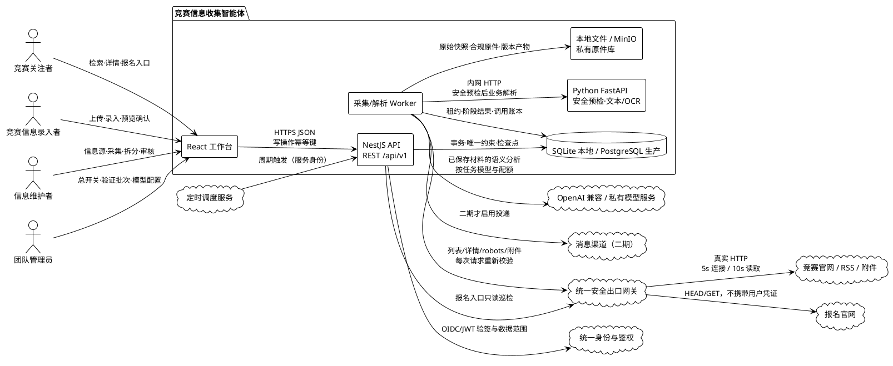

**上下文硬约束**：

- 网页、RSS、robots、重定向和附件请求都只能经安全出口；Worker 不得使用普通 `fetch` 绕过。模型服务调用走独立内网/受控模型通道，不属于公告抓取通道。
- 每次公告抓取先产生 `RequestEvidence`，原始响应保存为 `RawPageSnapshot` 后才能调用模型；AI 没有 `SafeEgressPort`、`BlobStorePort`、`JobQueuePort` 或数据库连接。
- 内部私有模型地址允许内网时，必须由管理员显式确认并记录依据；该例外只适用于模型适配器，不能放宽公告采集的 SSRF 规则。
- 订阅推送的外部渠道和投递 Worker 在二期启用，本期不写真实投递成功记录。

### 2.1.2 服务/组件总体架构

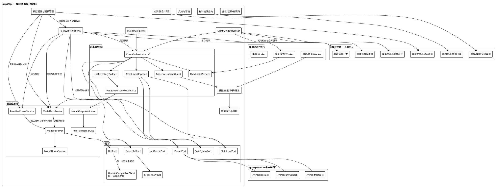

| 组件 | 单一职责 | 禁止事项 |
|---|---|---|
| `CrawlOrchestrator` | 任务创建、范围、阶段编排、终态和统计 | 不让模型决定调度、状态或发布 |
| `LinkInventoryBuilder` | 从原始快照提取真实链接和文本块标识 | 不执行脚本，不把隐藏指令当系统命令 |
| `PageUnderstandingService` | 组装页面理解输入、保存各阶段结果 | 不直接联网或下载模型建议地址 |
| `AttachmentPipeline` | 附件下载、隔离、安全放行、原件登记、解析触发 | 不把拒绝件写入可访问原件库或创建解析任务 |
| `CheckpointService` | 阶段幂等、租约、恢复、指纹和配置匹配 | 不跨内容指纹复用旧依据 |
| `ModelQuotaService` | 原子预留、用量结算、降级判定、成本汇总 | 不把未知用量/费用估算为 0 |
| `FormalDataScope` | 所有公共查询的统一正式数据谓词 | 不允许调用方传入开关绕过验证/演示排除 |
| `EvidenceLineageGuard` | 入库和发布前校验完整依据链 | 不用模型补写缺失证据 |
| `ConfigCenter` | 分组定义、取值校验、版本生成、作用域解析、保存/回滚事务 | 不写任何业务数据；不返回明文密钥；不允许关闭强制安全开关 |
| `ConfigResolver` | 启动加载与校验、不可变运行快照、热生效替换、待重启标记、一致性校验 | 不从 `process.env` 二次读取业务参数；不混用新旧值 |
| `ConfigTestService` | 数据库/对象存储/解析服务/模型/对外基地址的真实受控探测与结果分类 | 复用统一安全出口；不改当前配置；不做固定成功或示例响应 |
| `ReadinessService` | 六项就绪判定与整体结论，驱动空库原因与引导跳转 | 不把模型未配置算作未就绪；不隐藏具体未就绪项 |
| `CredentialVault` | 密文存储、引用签发/轮换/吊销、末四位与时间 | 不向调用方返回明文；不删除仍被启用配置引用的引用 |
| `ClientBootstrapHandler`（M6） | 从运行快照生成基地址、来源、版本、环境与缓存上限；ETag 由版本与快照指纹派生 | 不读取待重启的已保存值；不返回键名、配置值、凭据与内部地址；未加载完成不得返回 200 |
| `ConfigGateService`（M6） | 只读加载最近一次扫描报告，供管理员查询 | 不在请求期执行扫描；不返回源码内容与环境变量值；无报告返回 404 |
| `DatabaseBootstrap`（M6） | 容器创建前读取配置快照，组装 PostgreSQL 连接串与启动校验结果 | 不在运行期热重建连接；不在缺凭据时退回明文或空口令；SQLite 场景不得声称配置已驱动连接 |
| `ConnectionRuntimeService`（M6） | 派生数据库与对象存储的脱敏连接来源、状态与最近失败分类；统计存储切换影响数量 | 不返回口令、完整连接串、对象清单与拓扑；不把未启用的远端适配器标为已切换 |
| `ModelResolver`（M7） | 按“任务级覆盖 → 默认模型 → 规则/人工降级”解析每个任务的模型，输出解析来源、降级原因、协议与配置版本；供调用前路由与页面预览共用 | 不内置任何默认模型、地址、凭据或降级链；不在解析期发起网络请求；不因调用失败静默切换提供方 |
| `ProviderPresetService`（M7） | 加载版本化国产模型预设清单，计算可用性与不可用原因，向页面下发预设字段、推荐参数与清单版本 | 不读写凭据；不把预设当配置项或配置版本；不绕过地址安全校验；不在前端内置清单 |
| `OpenAiCompatibleClient`（M7） | `LlmPort` 的唯一业务实现：按解析结果组装 OpenAI 兼容请求、应用超时重试、回填用量与错误分类 | 不读取配置中心以外来源；不承载业务字段语义；不得被第二个业务调用点复制实现 |
| `ModelVerificationRecorder`（M7） | 记录预设验证范围、是否实际外发、替代证据路径、缺口原因与有效期；向页面与验收报告提供未验证清单 | 不把 `substitute`/`blocked` 映射为成功；不以模拟响应或缓存结果冒充真实连通 |

### 2.1.3 实现设计文档

#### （1）普通程序与模型职责边界

| 能力 | 普通程序（唯一执行方） | 模型可输出的建议 | 服务端采用条件 |
|---|---|---|---|
| 调度/启停/范围 | 总开关、来源状态、引导、采集窗口、验证对象、单源互斥 | 无 | 确定性配置和权限通过 |
| robots/频率/合规 | robots 获取与缓存、路径判定、域名/URL 限流、验证码/登录/付费墙识别 | 不得提供规避建议 | 每次真实请求前重新校验；网络无法确认 robots 时延后，404 按无禁止处理，401/403 拒绝 |
| SSRF/重定向 | 协议、IP/DNS pinning、逐跳目标、响应限额、凭证隔离 | 无 | 全部跳数和最终地址均通过 |
| 链接存在性 | 从原始 `<a href>`、RSS 条目建立清单并核对 ID、锚点和上下文 | 选择公告、分页、附件候选 ID，返回语义与依据 | 必须引用真实清单项；任何自由文本 URL 均不进入请求 |
| 页面/正文理解 | 提供安全分析文档、保存结果、执行 Schema 与定位校验 | 页面类型、正文块、标题时间、字段草稿、置信度 | 证据可定位、字段合规、输入指纹一致 |
| 下载/文件安全 | 流式下载、限额、魔数、压缩/路径/宏/可执行内容检查、隔离区清理 | 附件用途和类别建议 | 链接真实 + 安全放行 + 指纹一致 |
| 文本/OCR | FastAPI 执行格式解析和 OCR，保存定位块 | 不直接执行 OCR | 文件已放行且资源预算充足 |
| 存储/指纹/去重 | 不可变对象、SHA-256、唯一键、四要素判定 | 相似或拆分建议 | 程序唯一约束与人工合并规则通过 |
| 任务/检查点/重试 | 状态机、租约、重试、结果版本、死信 | 无 | 原子状态转换与 fencing token 匹配 |
| 配额/成本 | 调用前预留、计次、令牌和费用记录、配额熔断 | 无 | 所有首次和重试调用均先占用配额 |
| 权限/发布 | 数据范围、审核状态机、白名单与依据链守卫 | 修正/合并/发布建议 | 用户明确确认（写建议）+ 权限 + 全部发布条件 |

**工具白名单**：模型侧只暴露逻辑上的页面理解、公告链接发现、正文抽取、附件线索识别、竞赛检索、字段读取、解析任务提交和写操作建议；这些“工具”实际是由服务端函数包裹的输入输出转换，不授予模型自主调用能力。模型不得生成 SQL/Prisma 查询，不得直接读取服务器路径。

#### （2）AI 页面理解、链接发现与详情抽取流程

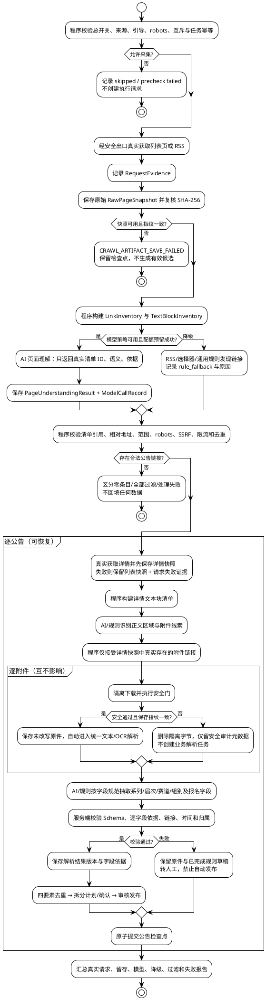

**链接发现的防幻觉契约**：

1. `LinkInventoryBuilder` 对原始 DOM 中的每个真实链接生成稳定 `linkCandidateId`，保存原始 `href`、锚文本、上下文文本块、DOM 位置和所在快照指纹。相对链接暂不请求，由程序以最终响应 URL 为基准解析。
2. AI 输入包含安全化文本与清单，不授予新增清单项的能力；AI 输出只接受 `linkCandidateId`、候选类别、发布时间线索、证据块和置信度。
3. 若模型返回页面不存在的 URL、无法匹配的快照指纹、越范围 ID 或附件名称，输出校验记为拒绝，忽略该项，合法项继续。该项不得进入 `SafeEgressPort`，从机制上保证“虚构链接请求次数=0”。
4. 采集范围默认限定信息源登记域名及明确配置的路径前缀；跨域官方报名平台只能登记为后续人工核验线索，不能因模型建议自动扩展采集范围。
5. 真实链接召回率以人工标注的真实公告链接 ID 为分母、通过程序校验且进入合法候选集的链接 ID 为分子；因安全拒绝而未抓取的链接另行统计，不用虚构请求补召回。

**详情抽取契约**：

- 正文抽取、附件线索识别、字段抽取分别产生 `PageUnderstandingResult`，不得用字段抽取成功覆盖前序页面理解失败。
- 字段依据至少包含材料版本、文本块 ID、字符区间（网页/RSS）或页码/工作表单元格/段落/图片区域（附件），并记录处理模式与模型/规则版本。
- 模型只返回候选值和证据定位，服务端重新计算并核对原文片段；不能只凭“片段看起来相似”放行。模糊定位只能降级为待确认，不能自动发布。
- 原文未提及费用、奖项或资格时必须返回对应字段状态，不能补“免费”“无限制”等推测值。
- 长页面按语义区块确定性分块，保留块序与上下文；达到上下文预算时记录截断范围，不得静默丢弃未完成部分。

#### （3）原始快照、附件原件库与安全门

**材料状态分离**：

| 状态维度 | 取值与用途 |
|---|---|
| 安全状态 | `pending / passed / rejected / check_failed`；决定能否进入业务解析 |
| 原件可用状态 | `available / expired / deleted / save_failed / fingerprint_mismatch`；决定能否下载和定位 |
| 解析状态 | `queued / processing / succeeded / partial / failed / cancelled`；只描述处理，不反推安全通过 |
| 访问范围 | 个人/团队/公共摘要 + 验证批次；继承父来源，不被模型或下载链接改变 |
| 留存状态 | 到期时间、保留策略版本、删除原因；默认 180 天且配置不得少于 30 天 |

**处理顺序**：

1. **HTML/RSS**：安全出口流式读取原始响应，限制 5MB；写入私有原件区后以保存字节重新计算 SHA-256，与请求证据一致才标记 `available`。原始脚本不执行，预览以文本/沙箱方式提供。
2. **附件发现**：只从详情快照的真实链接清单取得候选，模型或规则可补充分类，不可补地址。单公告最多 10 个、合计 50MB，单文件 20MB；流式达到限制立即中止。
3. **隔离下载**：先写隔离对象，记录原始附件地址、父公告快照、请求证据、已接收字节和指纹；隔离对象无业务下载接口。
4. **安全校验**：Node 完成大小、扩展名/魔数、加密和基础结构检查；FastAPI `/v1/security/check` 在沙箱中完成 OOXML 关系、压缩层级/比率、路径穿越、宏、嵌入可执行对象、PDF 活动内容和结构完整性检查。
5. **放行或拒绝**：通过后计算最终指纹并保存到不可变原件区，创建 `CrawlAttachment` 和统一 `ParseTask`；失败或拒绝时删除隔离字节，只保留审计元数据、可获得指纹和原因，不创建业务解析任务。
6. **统一解析**：上传文档与采集附件调用同一字段规范、分块定位、AI/规则降级和结果版本服务；通过 `intakeChannel` 区分上传与采集，不复制两套逻辑。
7. **留存到期**：删除原始字节但保留来源地址、请求证据、指纹、依据摘要、结果版本和处置审计；界面显示“原文已过期”，不伪造高亮或下载。

**失败隔离**：单附件拒绝/失败不影响其他合规附件与正文；但依赖该附件关键字段且无其他直接依据时，信息完整性和发布守卫必须将其转人工。保存失败或指纹异常对应候选不得入库或自动发布。

#### （4）断点续采、检查点与事务设计

**检查点粒度**：信息源游标、公告、附件三级。公告阶段覆盖列表/详情快照、链接发现、正文抽取、附件发现、字段抽取、结果校验、拆分、去重和入库；附件阶段覆盖下载、安全校验、原件保存、文本提取/OCR 和字段结果引用。

| 检查点键/字段 | 语义 |
|---|---|
| `taskId + scopeType + scopeId + stage` | 阶段执行单元，公告与附件互不串扰 |
| `inputFingerprint` | 原始页面/附件或规范化输入内容指纹；变化时不得复用旧结果 |
| `processingConfigHash` | 模型分配、提示词、规则、字段规范、拆分和安全配置版本的规范化摘要 |
| `leaseOwner + fencingToken + heartbeatAt` | 只有一个 Worker 能提交当前阶段；过期执行者提交会被拒绝 |
| `artifactRefs + resultVersionId` | 已完成阶段的不可变材料与结果引用 |
| `status + attempt + failureCode` | 待处理/执行中/成功/失败/跳过及恢复原因 |

**恢复规则**：

- 每阶段采用“读取有效检查点 → 执行副作用 → 写材料/结果 → 原子完成检查点”的顺序；对象存储与数据库采用可重放键和补偿对账，不能依赖分布式事务。
- 同指纹、同配置且检查点成功：直接复用，不重新请求、下载、调用模型或创建有效结果版本。强制重新处理必须生成新 `processingRunId` 和新结果版本，旧版本保留。
- 指纹变化：创建新快照/附件材料版本和新结果版本，旧字段依据只能留在历史版本；禁止挂接到新内容。
- 材料缺失或指纹不符：回退到最近可验证阶段，记录 `CRAWL_CHECKPOINT_CONFLICT`；无法恢复时转人工，不重放不确定副作用。
- 并发重试：唯一检查点键 + 原子租约 + fencing token，只有一个执行者可推进；唯一业务索引做最后防线。

**关键幂等键与唯一约束**：

| 对象 | 幂等/唯一键 | 重试结果 |
|---|---|---|
| 采集任务 | `sourceId + windowStart/windowEnd + normalizedCursor + triggerKind + verificationBatchKey` | 返回原任务或跳过，不新建执行任务 |
| 真实请求 | `taskId + requestPurpose + normalizedUrl + plannedContentVersion` | 同阶段复用证据；新采集窗口按限流策略重新请求 |
| 原始快照 | `taskId + finalUrl + contentFingerprint` | 复用同一材料版本，不覆盖旧引用 |
| 候选 | `sourceId + verificationBatchKey + normalizedUrl + contentFingerprint` | 更新最后发现时间和来源关联，不新增有效候选 |
| 附件 | `parentSnapshotId + normalizedAttachmentUrl + contentFingerprint` | 复用原件，不重复下载/建档 |
| 页面理解/解析结果 | `materialVersionId + stage + processingConfigHash + processingRunKey` | 默认复用；强制重跑才生成新版本 |
| 检查点 | `scopeId + stage + inputFingerprint + processingConfigHash` | 原子完成或返回已有结果 |
| 拆分记录 | `sourceResultVersionId + sorted(fourElementChildKeys)` | 返回既有拆分，不重复子项 |
| 竞赛子项 | 正式范围四要素；验证范围内 `batchId + 四要素` | 禁止重复，进入明确的补充来源或人工处理 |
| 模型调用 | `callerGeneratedAttemptId` 唯一；业务结果键独立 | 防止同一次调用账本重复，重试是新 attempt 且计额 |

**事务边界**：

| 场景 | 同一数据库事务 | 事务外补偿 |
|---|---|---|
| 快照登记 | 请求证据、材料元数据、检查点占位 | 对象写入失败则标保存失败；数据库失败删除未引用隔离对象 |
| 附件放行 | 安全状态、原件元数据、解析任务、附件检查点 | 对象移动/复制失败不创建解析任务，下次重放 |
| 阶段完成 | 阶段结果、调用账本结算、检查点完成 | 外部模型超时不可回滚，账本保留已消耗次数 |
| 拆分执行 | 拆分记录、子项、阶段/入口/来源关联、依据分配、审计 | 任一步失败整体回滚，不留下半套子项 |
| 验证转正式 | 全批次前置复核、来源标识、批次状态、处置记录 | 任一项不符或写入失败整体回滚，无部分转正式 |
| 发布 | 状态、审核、版本/事件、Outbox、审计 | 依据链或权限失败不修改状态 |

#### （5）模型配置、配额、成本与规则降级

**模型配置聚合**：

- `ModelProviderConfig`：服务类型、服务地址、默认模型、凭据引用、启用开关、连接/读取超时、最大重试（上限 1）、接入状态、变更原因。凭据只保存引用，运行时才经 `SecretRefPort` 获取。
- `ModelTaskPolicy`：按页面理解、公告链接发现、正文抽取、字段抽取、意图识别、问答组织分别配置模型、提示词版本、日配额、单采集任务/单公告/单附件上限和降级策略。附件线索识别复用“正文抽取”策略，不新增第七种模型任务类型。
- 未单独分配的任务使用默认模型；无任务模型且无默认模型时，该任务独立降级，不影响其他任务使用模型。六类任务的调用量、失败和降级分别统计。
- 接入状态为未配置、已启用、已停用、鉴权失败、配额耗尽；管理员关闭后立即不再发起新调用，已保存结果和真实抓取链路继续可用。

**原子配额控制**：

1. 调用前由 `ModelQuotaService` 在同一数据库事务中检查并预留日、采集任务、公告、附件四个作用域的配额；各作用域又按任务类型计量。
2. 预留记录包含 `attemptId、policyId、scopeKeys、configVersion`，通过条件更新/唯一约束防止并发超限。任何预留成功即消耗一次调用次数，后续成功、失败、超时均不返还。
3. 超时最多重试 1 次；重试生成新的 `attemptId` 并再次预留。鉴权失败不重复重试，立即停用对应配置并告警。
4. 达到任一上限时不再向供应商发请求，记录 `AGENT_QUOTA_EXCEEDED`、影响范围和降级原因；日配额耗尽可能只影响某任务类型，不得误停其他仍有余量的任务。
5. 服务返回后记录输入/输出令牌、费用、币种、耗时和校验状态。未返回时令牌或成本字段为 `unknown`，汇总时展示“成本未知（N 次）”，不得按 0 元或估算值计账。
6. 调用记录仅保存材料/任务引用、提示词版本和摘要散列，不保存完整敏感原文、用户令牌、Cookie 或模型凭据。

**降级矩阵**：

| 场景 | 模型调用策略 | 后续处理 | 发布约束 |
|---|---|---|---|
| 未配置/已停用 | 不发请求 | RSS、选择器页面、文本/CSV 等走规则；结果标 `not_configured/disabled` | 本期转人工 |
| 超时/服务不可用/限流 | 超时最多再试 1 次；按熔断与限流结果停止 | 规则降级；无可靠规则则明确失败并保留原文 | 本期转人工 |
| 日/任务/公告/附件配额耗尽 | 不再发对应范围请求 | 规则降级并提示管理员调整配额 | 本期转人工 |
| 凭据失效 | 不重复认证失败请求，配置置鉴权失败 | 规则降级 + 安全告警 | 本期转人工 |
| 非 JSON/Schema 或依据非法 | 按配置最多重试 1 次，仍失败拒绝采用 | 保留原始材料、已完成独立规则草稿和输出校验记录，转人工 | 严禁自动发布 |
| 任一 AI 阶段失败 | 不用后续阶段成功覆盖前序失败 | 记录失败阶段、已完成结果与人工事项 | 严禁自动发布 |
| 无规则可可靠处理 | 不虚构规则结果 | 标记处理失败而非零公告，保留材料并重试/转人工 | 严禁自动发布 |

规则降级实现复用现有 `rule-extractor`，并新增 RSS/Atom 标准解析、人工选择器、通用正文块与时间/机构/资格规则。每条字段依据记录真实处理模式，禁止为规则结果伪造模型调用。

#### （6）全链路依据可追溯与发布守卫

**追溯链**：

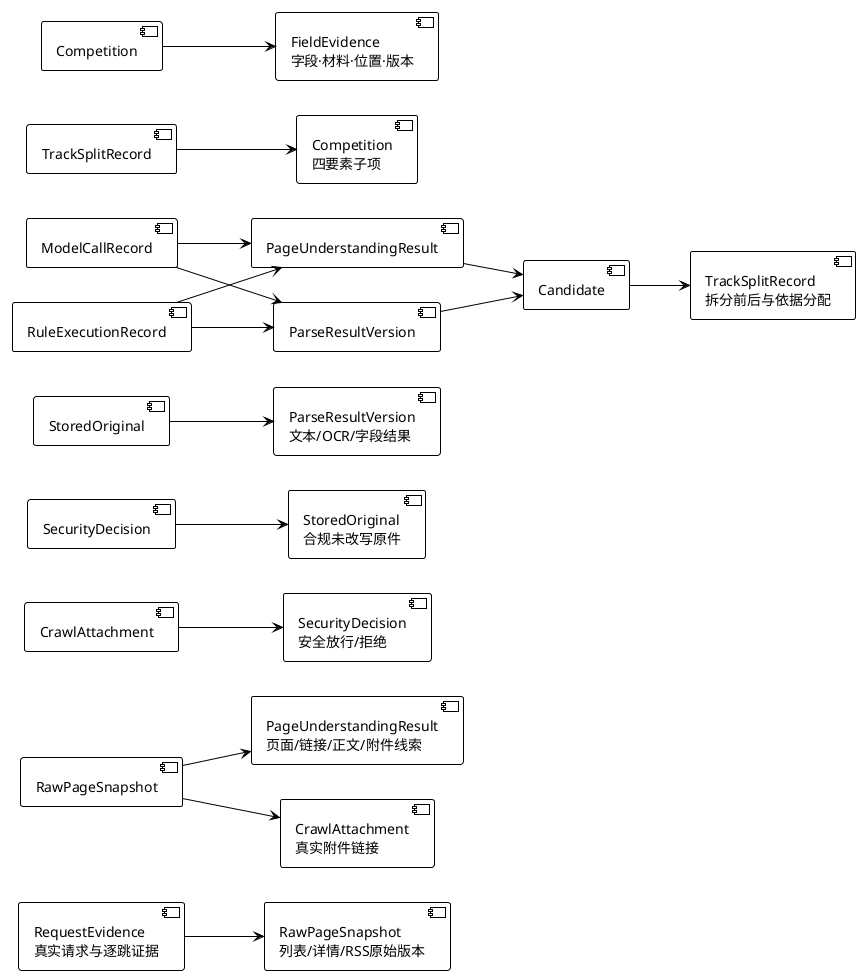

`EvidenceLineageGuard` 在候选入库、拆分确认、自动发布、人工发布、批次转正式前执行，但严格程度不同：

- **入库草稿**：允许信息不完整，但必须有真实候选来源、至少一个可用原始快照或详情失败证据，且不能引用安全拒绝件。
- **自动发布**：所有关键字段有可定位依据，详情可用时详情快照必须存在；实际使用的附件必须安全通过且原件指纹一致；AI 各阶段和输出校验成功；请求证据、白名单、完整性、无冲突、无重复争议和报名方式全部满足。
- **人工发布**：允许维护者修复字段，但必须保留修复人、原因和依据；不得绕过安全拒绝、验证隔离、无来源、跨四要素合并等硬红线。
- **转正式**：重新校验批次内全部对象的追溯率、批次一致性、隔离结果和发布资格，不能只依赖创建时结论。

#### （7）系列→届次→赛道→组别与多公告拆分

**四层与赛项兼容**：

- `CompetitionSeries` 是系列；`CompetitionEdition` 唯一属于系列；`CompetitionTrack` 唯一属于届次；`CompetitionGroup` 唯一属于赛道。
- 赛道实体保留 `level=primary_track|secondary_event` 与可选父赛道，用于兼容“一级赛道→二级赛项”，但竞赛去重仍以所选赛道实体 + 组别四要素表达，不额外发明第五层业务记录。
- `Competition` 同时保存四个引用以便稳定唯一约束，保存时校验 `edition.seriesId`、`track.editionId`、`group.trackId` 全部一致；组别为空映射为持久化 `groupKey=__none__`。
- 未明确赛道时只能创建本届次下“未分赛道”占位子项并标待确认，不参与正式赛道计数、聚合赛道卡片和自动发布；后续拆分保留原占位记录与历史。

**拆分流程**：

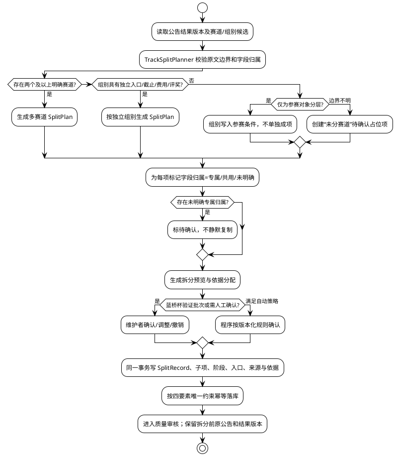

**字段归属规则**：

- 每个子项独立生成名称、报名阶段、报名方式、资格和状态；父系列的“最近截止”只是聚合概览，不能覆盖子项状态。
- 公告明确给出总入口/总截止时，可登记为 `shared`，并保存适用子项集合及共用依据；专属字段绝不能复制到其他赛道。
- 共用报名入口使用独立 `SharedSignupScope` 关联多个子项；变更或失效时提示全部受影响子项，禁止伪造各子项独立 URL。
- 撤销拆分恢复拆分前记录和关联，不删除审计、历史版本或既有推送快照；人工撤销结论阻止同一输入再次自动拆分。
- 去重服务先比较四要素，任一不同立即返回“不同子项”，不进入相似度合并。即使人工发起跨赛道/组别/届次合并也返回 `TRACK_MERGE_FORBIDDEN`。

#### （8）空库交付、首次引导与蓝桥杯验证批次

**空白库交付**：

- 标准迁移只创建表、索引、运行状态和必要基础字典；种子脚本为空操作或仅写基础字典，禁止出现任何竞赛系列、届次、赛道、组别、公告标题、报名时间或演示统计。
- 删除 `seed.ts` 的静态竞赛及清库逻辑，交付物不打包演示数据文件、生产演示开关或已有 `dev.db`。旧库升级只做识别、隔离和授权清理，不按名称/时间猜删。
- 采集总开关默认关闭；开启前必须存在已启用且探测通过的信息源，并已完成/显式跳过首次引导。开关、引导和来源配置可持久化恢复。
- 空库长期运行时，上传、人工录入、来源配置、检索、看板、收藏、订阅只读页和智能体均可用；不生成空推送批次或空导出文件。

**统一空库语义**：

`EmptyStateEvaluator` 是唯一计算入口，正式范围排除验证与演示数据。空库判断严格遵循“已发布真实竞赛为 0 且不存在可发布正式候选”；草稿、待审核、下架只用于原因解释，不进入正式统计。原因至少区分未配置来源、尚未录入、仅存在验证批次、仅存在未发布草稿、已配置来源但尚无采集结果。

| 场景 | API 语义 | 界面表现 |
|---|---|---|
| 空库 | 成功；集合空/指标为 0；`libraryEmpty=true` + 原因 + 引导动作 | 配置来源、启动蓝桥杯验证、上传文档、人工录入；无示例卡片/趋势 |
| 有条件但无匹配 | 成功；`libraryEmpty=false`、`queryEmpty=true`、总数 0 + 放宽建议 | “暂无匹配竞赛”，不显示库级空库文案 |
| 仅验证批次 | 公共查询仍为空库/零结果；授权验证接口返回批次数据 | 普通用户不见批次；管理员见“验证中”独立分组 |
| 无权限 | 403 或对对象返回 404 语义 | 不泄露对象与批次是否存在 |
| 服务异常 | 对应错误码和 `traceId` | 错误与重试，不伪装空库 |

**验证批次生命周期**：

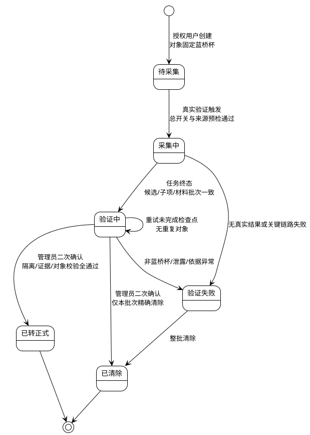

- 创建时 `validationSubject=lanqiao_official_series` 是固定验证配置，不是预置竞赛数据；批次作用域内的蓝桥杯系列元数据可由用户发起动作创建，竞赛公告与子项只能来自后续真实采集。
- 同一时刻最多一个蓝桥杯批次处于采集中或验证中；任务、候选、材料、赛道、子项、阶段、入口、依据、版本与事件继承同一 `verificationBatchId` 和 `dataOrigin=verification`。
- 信息源可以复用，但不得把批次标识写到信息源；人工录入和上传文档接口拒绝接收验证批次 ID，防止混源。
- 转正式前检查非蓝桥杯对象、缺失批次、公共泄露、真实请求证据、原件完整和拆分结果。通过后仅将数据来源改为真实采集、批次状态改为已转正式并写处置审计，保留批次 ID、业务字段、对象 ID、版本号和证据。
- 若四要素与既有正式数据冲突，转正式整体阻断并返回既有子项供人工处理，不自动合并或改字段。
- 整批清除按批次精确匹配，保留验证报告和审计；未被其他材料引用的对象字节才删除，重复执行返回清除数 0。

#### （9）系统运行配置中心（5.13 / 6.25）

**设计定位**：配置中心只维护运行参数，不改变业务规则、权限模型、信息源采集策略与模型治理；不产生或修改任何竞赛业务数据。模型接入的字段完整性仍由 6.23 约束，配置页面是它的唯一维护入口；信息源自身的采集策略仍在 5.1 维护。

**1）配置分组、页面与作用域映射**

| 配置分组 | 承载页面（二级） | 主要配置项 | 典型作用域 |
|---|---|---|---|
| 服务与环境 | 服务与环境 | 监听地址、API 端口、对外访问基地址、允许前端来源、运行环境标识、健康检查路径 | 部署级；运行环境标识为部署级只读 |
| 认证与开发身份 | 服务与环境（子卡片「认证与开发身份」） | 身份服务地址、团队/租户标识、令牌有效期上限、开发身份模拟开关、默认开发身份角色 | 部署级；模拟开关部署级且生产强制不可用 |
| 数据存储 | 数据存储 | 数据库地址/端口/库名/用户名/凭据引用/连接数上限/传输加密；对象存储类型/端点/桶名/区域/凭据引用/访问策略 | 部署级 |
| Python 解析服务 | Python 解析服务 | 服务地址、健康检查路径、连接/读取超时、并发上限、降级策略 | 部署级地址；团队级可调并发与降级 |
| 模型接入 | 模型接入 | 服务类型、baseUrl、model、凭据引用、超时、最大重试、单日/单采集任务配额、六类任务分配、降级策略、启用开关 | 部署级为主；团队级可按任务覆盖模型分配 |
| 采集运行 | 采集运行 | 采集总开关、默认间隔、间隔区间、单域名并发、同地址最小间隔、单轮最长时长、内置官方源目录版本、蓝桥杯渠道与适配参数、通用源适配参数 | 团队级 + 部署级上限；总开关团队级 |
| 留存与审计 | 留存与审计 | 五类留存期限、密钥轮换提醒周期、告警阈值、审计记录范围、五项强制安全开关 | 期限与阈值为团队级；安全开关强制只读 |
| 安全开关 | 留存与审计（只读卡片） | 采集出口网关、SSRF 校验、文件安全校验、提示词注入防护、密钥脱敏 | 强制只读级 |

页面数量按 REQ-CONF-01 固定为七个二级页；“认证与开发身份”“安全开关”不单列路由，分别挂在“服务与环境”“留存与审计”页内，避免出现第八、第九个二级页与规格冲突。

**2）取值来源与优先级（REQ-CONF-02/21，6.25.2）**

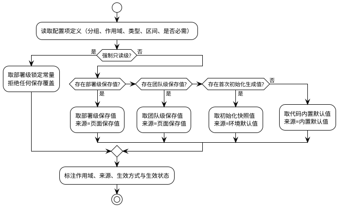

- **优先级从高到低**：强制只读级 > 部署级保存值 > 团队级保存值 > 环境默认值（仅首次初始化）> 内置默认值。
- 环境变量在运行期不参与解析，只在“首次初始化”时生成初始版本；一旦存在页面保存值，环境变量即失效且不再被读取。紧急回退必须通过显式启动参数进入，生成一条审计与页面对应告警，不能作为常规运维手段。
- 部署级与团队级同时存在值时，部署级优先，页面同时显示两层值与实际生效值，避免“改了团队值但没生效”的误解。
- 每项配置的“取值来源”是快照的组成部分；健康检查接口与配置页读取同一快照，保证 REQ-CONF-21 的显示一致性。

**3）生效方式矩阵（REQ-CONF-16）**

| 配置项类别 | 生效方式 | 实现与限制 |
|---|---|---|
| 采集默认间隔、间隔区间、单域名并发、同地址最小间隔、模型超时/重试、配额上限、降级策略、告警阈值、留存期限（新对象口径） | 立即生效 | 原子替换快照对应键；运行中任务继续使用其创建时的配置指纹，不中途改变行为 |
| 六类任务模型分配、启用开关、通用源适配参数、蓝桥杯渠道地址与适配规则 | 下次任务生效 | 新任务创建时读取新快照；进行中任务沿用创建时配置并在调用记录标注，已生成候选沿用产生时规则版本 |
| API 监听地址与端口、对外访问基地址、数据库驱动级参数、对象存储端点（不可热切换部分）、健康检查路径 | 需重启服务生效 | 保存后写“待重启”并继续用旧值；页面顶部汇总待重启项；重启后校验实际生效值 |
| 身份服务地址、令牌有效期上限、开发身份模拟开关 | 立即生效（新请求生效，已签发令牌到期自然失效） | 关闭模拟身份立即恢复真实鉴权；生产标识下开关恒为不可用 |
| 强制安全开关 | 不可变更 | 服务端硬拦截，仅只读展示 |

- **“已保存”与“已生效”分离**：保存响应返回 `saveState=saved` 与 `applyState=applied|pending_restart|partially_applied|apply_failed`，页面文案必须区分，不得只显示“保存成功”。
- **需重启项禁止混用**：待重启期间，运行快照保留旧值并同时保留“已保存值”用于页面展示；服务端禁止按“已保存值”执行任何运行期行为。
- **热生效校验失败自动回退**：立即生效项替换后执行 30 秒健康探针（数据库可用、解析服务可达、模型配置可解析、监听状态不变）；失败则原子回退上一有效快照版本，记录失败项与回退动作并告警，页面标注“生效校验失败”。

**4）保存流程与版本控制（REQ-CONF-15/17/22，6.25.4/5）**

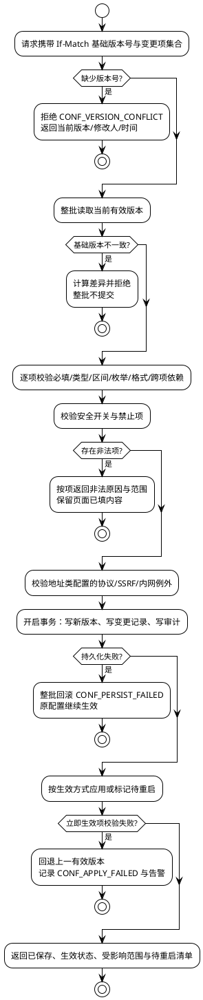

| 契约点 | 设计口径 |
|---|---|
| 版本序列 | 全局单调递增的配置版本号；每次保存、回滚、安全开关调整生成新版本；历史版本不可修改 |
| 冲突响应 | 返回当前版本、最后修改人、最后修改时间与逐项差异；提供“以最新版本重新编辑”，不自动合并 |
| 整批语义 | 任一项校验失败或版本冲突即整批不提交；批量保存逐项返回 `results[]`，但不出现“部分已保存” |
| 变更记录 | 版本、操作人、角色、时间、分组与配置项、变更前后值、生效方式、结果、来源地址；密钥只记引用变化 |
| 保存边界 | 保存与审计同事务；不写业务数据；回滚不级联修改业务对象 |

**5）启动加载与一致性校验**

1. 启动顺序固定为：加载数据库当前版本 → 结构校验与依赖校验 → 合并强制只读常量 → 构建不可变快照 → 校验密钥引用可解析性 → 启动监听 → 记录实际生效值。
2. 启动校验失败（必填缺失、取值非法、密钥引用无效、地址安全校验失败）时拒绝启动并返回逐项原因；紧急回退参数只能降级到最近一次有效版本，不得跳过校验。
3. 启动后与每个“需重启项”比对“已保存值 vs 实际运行值”：不一致时产生 `CONF_RUNTIME_MISMATCH` 告警，并在页面该配置项标注“运行值不一致（待重启）”；无待重启提示的不一致视为缺陷级告警。
4. `.env`/内置默认只用于首次初始化：首启时无任何配置版本则生成 `version=1` 的初始化版本，来源标为“环境默认值/内置默认值”，页面逐项显示该来源，管理员保存后来源变为“页面保存值”。

**6）配置就绪检查与空库引导（REQ-CONF-20）**

| 检查项 | 必需性 | 就绪判据 | 未就绪表现 |
|---|---|---|---|
| 服务地址 | 必需 | 监听地址与端口合法且启动监听成功 | “未就绪”，修复入口指向“服务与环境” |
| 数据存储 | 必需 | 数据库连通、迁移版本匹配；对象存储启用时桶可写且非公开 | 空库原因改为“系统配置未就绪”，优先跳转系统设置 |
| Python 解析服务 | 必需（可降级运行） | 健康检查成功；失败时降级策略已配置 | 显示“降级可用”，不阻断采集/检索/上传 |
| 模型接入 | 可选 | 凭据可用且启用；未配置时标“可选未配置” | 整体就绪结论为“已就绪（规则模式）” |
| 信息源 | 必需 | 至少一个启用且探测通过的信息源 | 修复入口指向信息源管理 |
| 采集总开关 | 必需（默认关闭） | 开启前置校验通过（复用 REQ-INIT-06） | 显示“关闭”，提供开启入口与前置项提示 |

- 就绪结果缓存 30 秒并可手动刷新；判定结果、整体结论与最后计算时间持久化，供空库服务与引导复用。
- “完成配置”动作只跳转“信息源管理”并保留引导进度，不写入任何竞赛数据。

**7）凭据引用、脱敏与轮换（REQ-CONF-13，6.25.6）**

| 环节 | 设计 |
|---|---|
| 存储 | 配置表只存 `secretRefId`、`maskedTail`（末四位）、`configured`、`lastUpdatedAt`；密文由 `CredentialVault` 保存（本地 AES-GCM 加密文件，生产 KMS/密钥管理），数据库与对象存储不含明文 |
| 写入 | 保存接口若收到 `plaintext` 字段，只允许一次性写入 Vault 并立即丢弃；响应仅返回引用、末四位与时间；请求体不回显、不落日志（日志脱敏中间件按字段名与值双重匹配） |
| 读取 | 服务端按需解析引用并做 5 分钟进程内缓存，仅用于实际连接；任何接口、导出、审计、错误详情均不回传明文或密文 |
| 轮换 | 生成新引用并保留旧引用；历史调用记录继续引用旧配置版本且可追溯；轮换只更新引用与时间，旧引用在无启用配置引用后才能吊销 |
| 删除保护 | 被启用配置引用的引用禁止删除；删除请求返回 `CONF_CREDENTIAL_IN_USE`；引用失效时相关配置进入“鉴权失败/降级”，不得静默用空凭据调用 |
| 前端 | 只显示“已配置/未配置”、末四位、最后更新时间；输入框为“新增/替换密钥”，提交后清空且不再回填 |

**8）测试连接（REQ-CONF-14，6.25.12）**

| 维度 | 设计 |
|---|---|
| 目标类型 | `database`、`object_storage`、`python_parser`、`model_service`、`public_base_url` 五类 |
| 执行主体 | 仅服务端 `ConfigTestService`；复用统一安全出口或受控连接适配器，浏览器不直连任何目标 |
| 安全前置 | 协议仅 http/https（数据库/对象存储为受控驱动连接）；地址经 SSRF/内网/元数据校验；内网例外必须已显式标注并在有效期；重定向逐跳复核 |
| 限制 | 总超时 ≤10 秒；同目标 1 分钟内最多 1 次（按“目标类型 + 脱敏地址 + 团队”限流），超出返回冷却剩余秒数 |
| 结果分类 | `success`、`auth_failed`、`unreachable`、`timeout`、`certificate_error`、`protocol_unsupported`、`target_refused` |
| 副作用 | 不修改当前生效配置；模型测试请求标注 `test=true`，不计入业务配额与成本统计；数据库测试只执行只读连通与版本查询 |
| 记录 | 记录目标类型、脱敏地址、发起时间、耗时、结果分类、失败原因与操作人；不含凭据、堆栈与内部拓扑 |

**9）变更历史、差异与回滚（REQ-CONF-17，6.25.10/11）**

- 历史列表至少保留最近 10 个可回滚版本，支持按分组、操作人、时间筛选；版本详情展示逐项前后值（密钥仅显示引用变化）。
- 差异视图按“新增/修改/删除”标注配置项，并标出“需重启”与“安全影响”两类提示。
- 回滚先校验目标版本完整性（必填、区间、枚举、跨项依赖、地址安全、安全开关、凭据引用可解析），任一不通过整体不应用并逐项返回 `CONF_ROLLBACK_FAILED`。
- 回滚成功生成新版本（版本号继续递增，不复活旧版本号）并写回滚记录与审计；需重启项在回滚后同样标“待重启”；回滚不级联修改信息源、竞赛、候选、材料或统计。
- 回滚失败不允许部分应用：以单个事务提交；若持久化失败，当前配置保持不变并返回失败项。

**10）前端「系统设置」页面结构（REQ-CONF-01/02/12/16）**

| 页面元素 | 交互要求 |
|---|---|
| 一级导航 | 工作台新增「系统设置」；仅团队管理员可见；服务端同时鉴权，前端隐藏不作为权限判据 |
| 七个二级页 | 服务与环境、数据存储、Python 解析服务、模型接入、采集运行、留存与审计、变更与回滚记录 |
| 配置项行 | 显示当前实际生效值、作用域标签、取值来源标签（页面保存值/环境默认值/内置默认值）、生效方式标签、生效状态标签 |
| 强制只读项 | 无编辑控件，显示“强制开启/部署只读”与原因；服务端拒绝任何修改请求 |
| 密钥项 | 只显示“已配置/未配置”、末四位、最后更新时间；替换后输入框清空 |
| 顶部状态条 | 汇总待重启项数量、生效校验失败项、运行值与保存值不一致项、开发身份模拟中标识 |
| 保存交互 | 提交前展示变更摘要（变更项数、受影响分组、需重启项）；未通过前置校验则保存按钮不可提交；保存后逐项展示结果 |
| 冲突交互 | 返回冲突时展示差异与最后修改人/时间，提供“以最新版本重新编辑”，保留已填内容 |
| 测试连接 | 按钮显示进行中、冷却倒计时与结果分类；失败给出可执行建议，不显示凭据与堆栈 |
| 就绪清单 | 显示六项必需/可选、就绪状态与修复入口；“完成配置”跳转信息源管理并保留引导进度 |
| 空库联动 | 数据存储/解析服务未就绪时，空库页原因显示“系统配置未就绪”并优先给出系统设置入口 |
| 禁止项 | 无演示数据、示例来源、模拟采集、离线固定响应入口；占位文案只描述格式与取值范围 |

**11）关键配置项定义（节选，完整清单随配置定义文件生成）**

| 配置项标识 | 分组 | 类型/取值 | 作用域 | 生效方式 | 校验要点 |
|---|---|---|---|---|---|
| `server.listenHost` | 服务与环境 | 枚举（回环/已配置网卡） | 部署级 | 需重启 | 禁止任意公网地址 |
| `server.port` | 服务与环境 | 整数 1–65535 | 部署级 | 需重启 | 范围、启动占用冲突可保存为待重启 |
| `server.publicBaseUrl` | 服务与环境 | http/https 地址 | 部署级 | 需重启 | 协议、SSRF、非内网默认拒绝 |
| `server.corsOrigins` | 服务与环境 | 字符串数组 | 部署级 | 立即生效 | 逐项合法 origin；禁止 `*` |
| `env.profile` | 服务与环境 | 枚举 dev/test/prod | 部署级只读 | 立即生效 | 生产禁改 |
| `auth.issuerUrl` | 认证与开发身份 | http/https 地址 | 部署级 | 立即生效 | 协议、SSRF、内网例外 |
| `auth.teamId` | 认证与开发身份 | 字符串 1–64 | 部署级 | 立即生效 | 必填、格式 |
| `auth.tokenMaxTtl` | 认证与开发身份 | 整数秒 | 部署级 | 立即生效 | 正数且不超过安全上限 |
| `auth.devIdentityEnabled` | 认证与开发身份 | 布尔 | 部署级 | 立即生效 | 仅 dev/test 可开；生产恒 false |
| `auth.devIdentityRole` | 认证与开发身份 | 枚举角色 | 部署级 | 立即生效 | 仅 dev/test；不得为匿名管理员 |
| `db.host/db.port/db.name/db.user` | 数据存储 | 字符串/整数 | 部署级 | 需重启（部分） | 格式、端口范围、库名合法 |
| `db.secretRef` | 数据存储 | 凭据引用 | 部署级 | 需重启 | 必填、可解析、仅引用 |
| `db.poolMax` | 数据存储 | 整数 1–200 | 部署级 | 需重启 | 正数、区间 |
| `db.tlsRequired` | 数据存储 | 布尔 | 部署级 | 需重启 | 生产建议强制 |
| `storage.type/endpoint/bucket/region` | 数据存储 | 枚举/地址/字符串 | 部署级 | 需重启 | 端点协议与 SSRF；桶禁止公开读写 |
| `storage.secretRef` | 数据存储 | 凭据引用 | 部署级 | 需重启 | 必填、可解析 |
| `storage.accessPolicy` | 数据存储 | 枚举 private/readonly | 部署级 | 立即生效 | 禁止 public |
| `parser.baseUrl` | Python 解析服务 | http/https 地址 | 部署级 | 立即生效 | 地址变更须先测试连接 |
| `parser.healthPath` | Python 解析服务 | 路径 | 部署级 | 立即生效 | 以 `/` 开头、无查询串 |
| `parser.connectTimeoutMs` / `parser.readTimeoutMs` | Python 解析服务 | 整数 | 部署级 | 立即生效 | 正数、区间（如 100–30000） |
| `parser.maxConcurrency` | Python 解析服务 | 整数 | 团队级可覆盖 | 立即生效 | 正数、区间 |
| `parser.fallbackPolicy` | Python 解析服务 | 枚举 rule/manual | 团队级可覆盖 | 立即生效 | 枚举合法 |
| `model.serviceType/baseUrl/model` | 模型接入 | 枚举/地址/字符串 | 部署级 | 下次任务生效 | 地址 SSRF；未配置凭据不得启用 |
| `model.secretRef` | 模型接入 | 凭据引用 | 部署级 | 立即生效 | 可解析；仅显示引用与末四位 |
| `model.timeoutMs` / `model.maxRetries` | 模型接入 | 整数 | 部署级 | 立即生效 | 重试 ≤1；超时区间 |
| `model.dailyQuota` / `model.taskQuota` | 模型接入 | 非负整数 | 团队级 | 立即生效 | 非负；跨项依赖 |
| `model.taskModel.<taskType>` | 模型接入 | 模型标识 | 团队级可覆盖 | 下次任务生效 | 六类任务；缺省走默认模型 |
| `crawl.enabled` | 采集运行 | 布尔 | 团队级 | 立即生效 | 开启复用 REQ-INIT-06 前置校验 |
| `crawl.defaultIntervalSeconds` | 采集运行 | 整数 | 团队级 | 立即生效（仅新建源） | 区间 600–604800；不改写存量源 |
| `crawl.intervalMinSeconds/MaxSeconds` | 采集运行 | 整数 | 团队级 | 立即生效 | 区间合法且 min<max |
| `crawl.domainConcurrency` | 采集运行 | 整数 | 团队级 | 立即生效 | 正数、不超过部署上限 |
| `crawl.minUrlIntervalMs` | 采集运行 | 整数 ≥60000 | 团队级 | 立即生效 | 下限校验 |
| `crawl.maxRunDurationSeconds` | 采集运行 | 整数 | 团队级 | 立即生效 | 正数、区间 |
| `crawl.officialCatalogVersion` | 采集运行 | 只读版本号 | 部署级 | 下次任务生效 | 变更展示受影响条目，不自动改写来源 |
| `crawl.lanqiao.channel.*` | 采集运行 | 地址/枚举/布尔/整数 | 部署级 | 下次任务生效 | 地址 SSRF；禁止竞赛条目内容；生成新适配版本 |
| `crawl.genericAdapter.*` | 采集运行 | 布尔/枚举/版本 | 团队级 | 下次任务生效 | 选择器仅显式覆盖；无竞赛条目 |
| `retention.snapshotDays` / `attachmentDays` / `documentDays` | 留存与审计 | 整数 ≥30（默认 180） | 团队级 | 立即生效（新对象） | 下限；生效口径必填 |
| `retention.filterRecordDays` | 留存与审计 | 整数 ≥30 | 团队级 | 立即生效 | 下限 |
| `retention.auditLogDays` | 留存与审计 | 整数 | 团队级 | 立即生效 | 不得短于追溯期限 |
| `retention.secretRotationReminderDays` | 留存与审计 | 整数 | 团队级 | 立即生效 | 正数 |
| `audit.scope` | 留存与审计 | 枚举集合 | 团队级 | 立即生效 | 不得移除关键动作；缩到“仅登录”拒绝 |
| `alert.failureRateThreshold` 等 | 留存与审计 | 整数/百分比 | 团队级 | 立即生效 | 有默认值、区间 |
| `security.collectEgressGateway` / `security.ssrfCheck` / `security.fileScan` / `security.promptInjection` / `security.secretMasking` | 安全开关 | 强制 true | 强制只读 | 不可变更 | 服务端硬拦截；缺失视为 true |

#### （10）运行期下发、门禁与连接引导（M6 增量，REQ-CONF-23～26）

本节只描述本次四项增量与配置中心基线（本节（9）、ADR-11～16）的衔接方式，不重复基线的分组、版本、生效方式与回滚设计。

**1）启动时序：配置快照先于连接、连接先于监听**

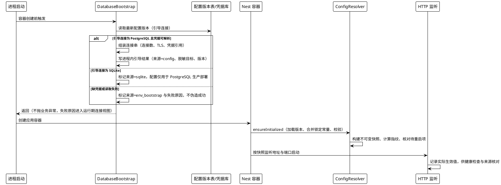

- 引导连接只用于“读取配置”，业务连接串切换为配置组装值时，必须在同一进程内完成一次只读连通校验；校验失败不得回退明文，进入 `switch_failed/degraded` 并按 `CONF_STORAGE_RUNTIME_SWITCH_FAILED` 告警。
- 连接来源的“连接建立时间”取进程启动监听完成时间，而不是配置文件保存时间，避免把“已保存”误读为“已连接”。
- 引导结果只保存脱敏字段与状态，不保存口令；任何日志输出必须在写入前完成脱敏。

**2）客户端引导下发状态机（REQ-CONF-23）**

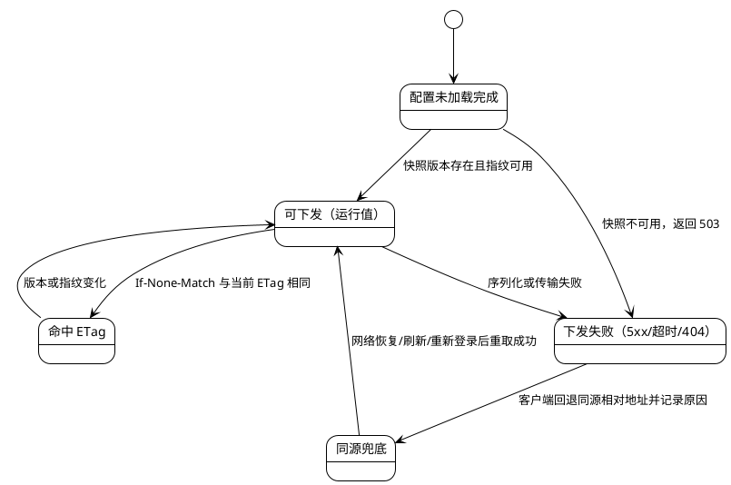

| 判定点 | 设计口径 |
|---|---|
| 基地址取值 | 只用运行快照中的对外访问基地址；该配置项为需重启项，待重启期间下发旧运行值，禁止下发已保存的新值 |
| 来源标识 | 配置值存在时为 `configured`；配置值为空或不可用时为 `same_origin`，前端据此选择同源地址 |
| 缓存 | 服务端声明 `cacheMaxAgeSeconds=60` 且不超过 60；客户端 60 秒内复用、过期重新校验；版本或指纹变化必须立即失效 |
| ETag | 由“配置版本 + 快照指纹前缀”派生；只有同一版本同一快照才返回 304，避免把版本变化误判为未变 |
| 未加载完成 | 快照版本为 0 或指纹为空时返回 503 `CONF_CLIENT_BOOTSTRAP_UNAVAILABLE`，不得返回空地址的 200 |
| 失败兜底 | 前端不得使用任何构建期绝对地址；兜底记录失败原因并在顶栏与配置页同时展示；连续失败提示核对服务与环境配置 |
| 版本不一致 | 客户端缓存的版本与服务端下发版本不一致时阻止使用旧地址继续写操作，并提示 `CONF_CLIENT_BASE_MISMATCH` |
| 响应最小化 | 仅 `apiBaseUrl/apiBaseSource/configVersion/profile/devIdentityAllowed/issuedAt/cacheMaxAgeSeconds`；不含键名、配置值、凭据引用、数据库与对象存储地址、就绪明细 |

**3）配置门禁执行时序（REQ-CONF-24）**

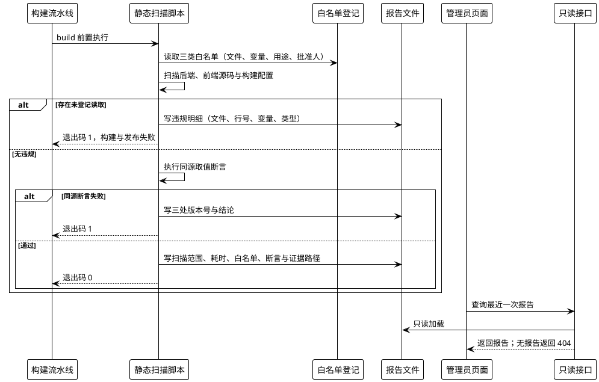

| 约束点 | 设计口径 |
|---|---|
| 扫描范围 | 后端服务与控制器源码、前端源码、构建配置；排除构建产物与依赖目录 |
| 违规类型 | 配置类环境变量读取、动态键读取、构建期基地址读取；三类都必须命中白名单才能放行 |
| 白名单三类 | 首启初始化默认值、紧急回退显式启动参数、凭据存储后端自身连接参数；必须逐条登记用途与批准人，未登记即违规 |
| 失败语义 | 违规或超时（超过执行上限）一律失败，不得降级为告警、不得人工跳过；报告保留违规明细供定位 |
| 同源断言 | 配置页、`configuration-health` 与运行日志必须能证明来自同一配置版本与同一快照指纹；不一致即失败并输出三方版本 |
| 新增配置项 | 必须先登记定义与允许的读取入口，否则视为门禁失败 |
| 报告读取 | 接口只读构建产物，不在请求期执行扫描；报告不包含源码内容与环境变量值 |

**4）运行期连接来源与对象存储切换（REQ-CONF-25）**

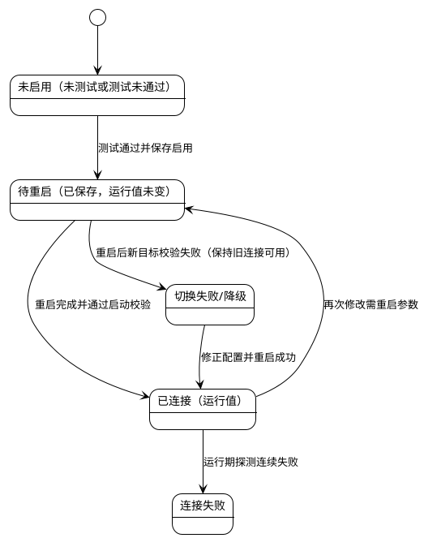

| 维度 | 设计口径 |
|---|---|
| 数据库连接 | 连接数上限与 TLS 要求进入实际连接串参数；TLS 要求开启时非加密连接必须失败并标注“加密要求不满足”，不得回退明文 |
| 凭据引用 | 只用引用解析出的密文组装连接；引用缺失或失效时不建连接并标注原因；不得以空口令或环境变量口令兜底 |
| 对象存储 | 端点、桶、区域与访问策略必须作用于实际读写；切换只影响新写入；远端适配器未启用时必须显式标注“尚未切换到远端适配器”，不得显示为已切换 |
| 历史原件 | 切换后读取旧原件逐项标注“可用 / 已迁移 / 不可访问（存储目标已变更）”；不删除记录、不改写内容指纹、不把不可访问显示为空列表 |
| 影响数量 | 数据存储分组保存涉及 `storage.*` 时返回受影响原件数量与“不删除、不改指纹”说明；数量口径为快照、附件与上传文档之和 |
| 脱敏范围 | 目标保留协议与主机前三位、端口；禁止口令、完整连接串、库内对象清单与内部拓扑 |
| 同源一致 | 页面值来自同一快照；连接记录中的配置版本必须与配置页和健康检查一致，差异按 `CONF_RUNTIME_MISMATCH` 告警 |

**5）测试连接的并发与证据（REQ-CONF-26）**

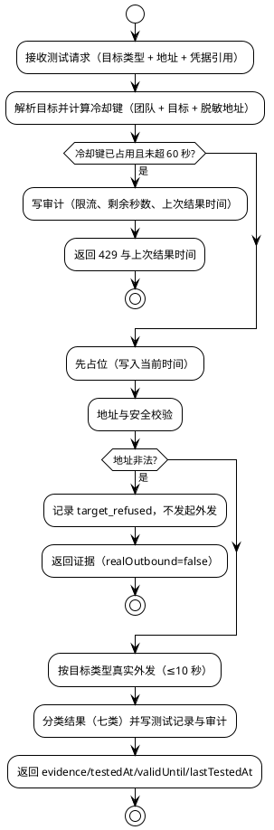

- **先占位再外发**是并发正确性的关键：占位必须先于地址校验与外发，否则同一目标的 10 个并发请求会各自通过检查并重复外发。
- **冷却不缓存成功**：被限流的请求只返回冷却秒数与上次结果时间，不得把上次成功作为本次结果，也不得跳过审计。
- **结果时效**：`testedAt` 为本次发起时间，`validUntil` 为有效期上限；超过有效期不得作为“当前可用”展示，但不得阻止重新测试。
- **证据字段**：`requestedAt`、`realOutbound`、`egressRoute`、`cacheAgeSeconds`；数据库测试走受控驱动，不得标为 safe-fetch 外发；本地对象存储未启用远端适配器时 `realOutbound=false`。
- **版本冲突**：并发生成版本时，唯一约束冲突后回查最新版本并返回 409 `CONF_VERSION_CONFLICT`；只有非版本原因导致的持久化失败才返回 503 `CONF_PERSIST_FAILED`。

**6）与基线的兼容边界（只增不改）**

1. 不新增配置项、不新增二级页；配置清单仍为八分组 78 项，页面仍为七个二级页。
2. 既有 14 个配置接口路径与既有字段语义不变；新增 2 个只读接口后总数为 16 个；既有接口只增加响应字段或可选请求字段。
3. 版本口径仍为全局单调序列；新增两项只读能力不产生配置版本，也不写配置变更记录。
4. 客户端引导与门禁报告均不得返回配置键名、配置值、凭据、数据库与对象存储地址或就绪明细。
5. 本次增量不改变五项安全开关、待重启分离、密钥脱敏、审计与回滚语义。

#### （11）模型接入统一默认与国产模型预设（M7 增量，REQ-CONF-27～30）

本节只描述四项模型接入增量与基线（本节（5）模型配置、（9）配置中心、ADR-11～20）的衔接，不重复既有 16 项配置、版本语义与降级矩阵。

**配置默认值与初始化语义（内置默认值 vs 页面保存值）**

| 场景 | `model.baseUrl` / `model.model` 取值 | 来源标注 | 运行影响 |
|---|---|---|---|
| 全新部署，无配置版本、无环境变量 | DeepSeek 预设项登记值 | `builtin_default` | 仅填充与展示；`model.enabled` 仍为 false、`model.secretRef` 仍为空；不发起调用 |
| 首启存在 `LLM_BASE_URL` / `LLM_MODEL` | 环境变量值 | `env_default` | 仅用于生成 `version=1` 初始化版本；之后运行期不再读取环境变量 |
| 管理员保存后 | 页面保存值 | `page_saved` | 以保存值运行；预设清单后续升级不得改写 |
| 管理员显式清空默认模型并保存 | 空值 | `page_saved` | 解析为 `default_model_unavailable` 并按 `fallbackPolicy` 降级；**不得回退内置默认值**，页面标注“默认模型为空（页面保存值）” |
| 回滚到迁移点之前的版本 | 迁移快照基线的对应值 | `page_saved`/`env_default` | 按目标版本还原；不复活“空值即内置默认”的旧口径 |
| 预设清单升级 | 预设登记值可能变化 | `builtin_default` | 只影响未保存状态的内置默认展示；已保存值与运行值不变 |

1. 首启无任何配置版本时生成 `version=1` 初始化版本：`model.baseUrl`、`model.model` 取 DeepSeek 预设登记值；`model.enabled=false`；`model.secretRef=null`；其余 16 项沿用既有内置默认。
2. 来源逐项标注：存在环境变量时为 `env_default`，否则为 `builtin_default`；页面显示“内置默认值 · DeepSeek”。初始化不写凭据、不启用、不发起调用、不写任何业务数据。
3. 管理员保存后该项来源变为 `page_saved`；预设清单升级、代码发布或环境变量变化均不得覆盖已保存值（沿用 REQ-CONF-21 与 ADR-11）。
4. 默认模型标识或服务地址的变更（含清空）必须经模型接入页保存并生成新配置版本，生效方式沿用“下次任务生效”；进行中任务按创建时配置指纹完成，新任务使用新值。
5. 运行期只读不可变快照；禁止以代码常量、构建期变量或环境变量作为运行期默认模型来源。内置默认值只在“无保存值”时参与解析。

**1）默认模型与唯一解析口径**

解析层级只有两层：**任务级配置 → 默认模型**；“规则/人工”不是第三个模型候选，而是两层都不可用时的失败处理方式。对外统一表述为“任务级覆盖 > 默认模型 > 规则/人工降级”，禁止解释为“可以在多个提供方之间挑一个”。

| 顺序 | 判定条件 | 解析结果 | `resolveSource` | 是否发起调用 |
|---|---|---|---|---|
| 1 | `model.taskModel.<key>` 非空，且通过“可用模型集合 + 地址/协议匹配 + 格式”校验 | 任务级模型 | `task_override` | 是 |
| 2 | 任务级为空，且 `model.enabled=true`、`model.baseUrl`/`model.model` 非空、`model.secretRef` 可解析 | 默认模型 | `default_model` | 是 |
| 3 | 默认模型不可用（禁用、空值、凭据缺失/失效、鉴权失败、超时重试耗尽、单日或单任务配额耗尽），`model.fallbackPolicy=rule` | 不调用，规则处理 | `rule_fallback` | 否 |
| 4 | 同上，`model.fallbackPolicy=manual` | 不调用，转人工 | `manual_fallback` | 否 |

- 降级原因取值固定为 `disabled`、`default_model_unavailable`、`credential_missing`、`credential_invalid`、`auth_failed`、`timeout_exhausted`、`daily_quota_exhausted`、`task_quota_exhausted`、`task_model_override_invalid`；沿用既有 `degradeReason` 语义，不新造同义字符串。
- 保存期已拒绝的非法任务级值不会进入新版本；生效期遇到历史或清单变更导致的既有非法值，必须标注 `task_model_override_invalid` 并按 `fallbackPolicy` 降级，不得当作正常解析静默使用默认模型。
- 同一配置版本、同一任务类型的解析结果必须唯一且可重复计算；解析过程不发起网络请求、不写业务数据。

**2）八类业务任务与六个既有配置键的映射（不新增配置项）**

| 业务任务 | `taskType` | 配置键 | 说明 |
|---|---|---|---|
| 页面理解 | `page_understanding` | `model.taskModel.announcement` | 既有键，语义不变 |
| 公告链接发现 | `link_discovery` | `model.taskModel.link` | 既有键 |
| 正文抽取 | `body_extraction` | `model.taskModel.detail` | 既有键 |
| 字段抽取 | `field_extraction` | `model.taskModel.document` | 既有键；档案/附件共用 |
| 赛道拆分 | `track_split` | `model.taskModel.track` | 既有键；任务类型为共享枚举只增值 |
| 质量判定 | `quality_judgement` | `model.taskModel.judge` | 既有键；任务类型为共享枚举只增值 |
| 意图识别 | `intent_recognition` | `model.taskModel.judge` | 与质量判定共享同一键 |
| 问答组织 | `answer_composition` | `model.taskModel.judge` | 与质量判定共享同一键 |

共享同一配置键的任务在同一版本下解析结果必须相同；不得为区分它们新增第七个 `taskModel.*`。

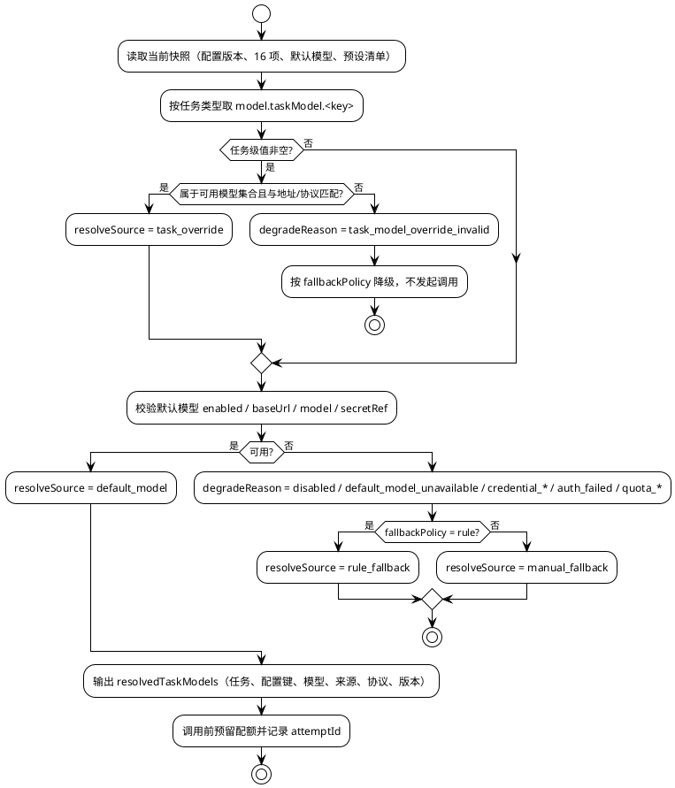

**3）预设下发、保存与验证时序**

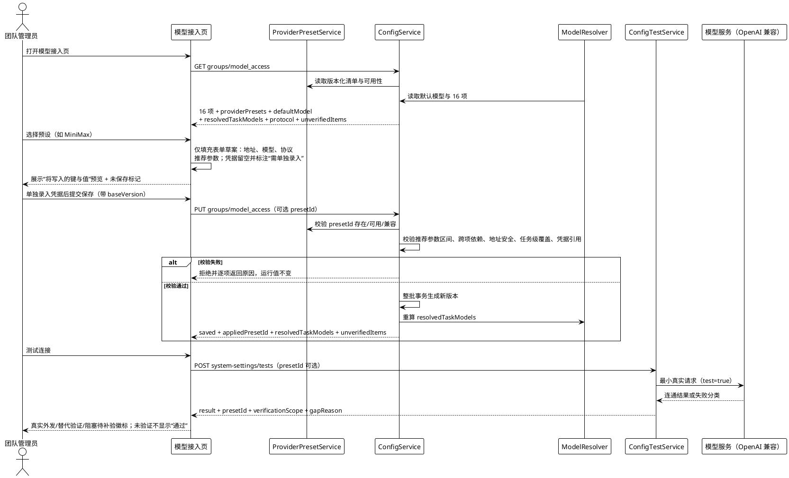

- 预设选择只改变前端草案，不调用保存接口、不改变 `effectiveValue`、不产生配置版本；`测试连接` 也不改变任何配置。
- 凭据输入框在预设选择后必须保持为空，且不得由预设携带默认值；预设清单中禁止出现 `secretRef`、`apiKey`、`plaintext` 等字段。

**4）预设清单约束**

| 约束项 | 设计口径 |
|---|---|
| 必备预设 | 至少 DeepSeek、MiniMax、GLM；可扩展 Kimi、Qwen |
| 默认项 | 同一清单版本内唯一，且必须是 DeepSeek；页面默认选中并标注“默认” |
| 协议 | 固定 `openai_compatible`，只读展示；不提供多协议切换控件 |
| 推荐参数 | 只允许 `timeoutMs`、`maxRetries`、`dailyQuota`、`taskQuota` 四项，且必须落在既有区间（1000–120000、0–1、0–1000000、0–100000）；跨项依赖仍由服务端校验 |
| 清单版本 | 固定字符串版本（如 `2026.11.1`），随代码发布变更；不产生配置版本、不写配置变更记录 |
| 唯一性 | 同一清单版本内 `presetId` 唯一；`modelId` 可重复但需标注提供方 |
| 可用性 | `available`、`disabled`、`incompatible`、`address_forbidden`，并附不可用原因；禁用项不得静默替换为其他预设 |
| 地址安全 | 预设地址在保存期与测试期都必须通过协议、SSRF、内网例外校验，不得因“来自预设”而跳过 |
| 凭据 | 预设不含、不预填、不代填、不暂存凭据；页面只显示是否已配置与末四位 |

**5）保存期校验顺序（整批不部分提交）**

1. `presetId` 若存在：必须属于当前清单版本且 `availability=available`，否则 `CONF_MODEL_PRESET_UNAVAILABLE`。
2. 推荐参数与 16 项取值：必填、类型、区间、枚举、跨项依赖；失败逐项返回并高亮。
3. 地址与协议：协议固定 OpenAI 兼容；地址走统一安全校验，内网例外仅对标注项生效。
4. 任务级覆盖：每个非空 `taskModel.*` 必须属于“当前清单可用预设的模型标识集合 ∪ 当前默认模型标识”，格式合法且与当前 `model.baseUrl`/协议匹配；失败返回 `CONF_TASK_MODEL_OVERRIDE_INVALID`，不得静默回退默认模型后仍返回保存成功。
5. 凭据：`model.enabled=true` 时 `model.secretRef` 必须可解析，否则 `CONF_CREDENTIAL_MISSING`。
6. 版本与事务：`If-Match`/`baseVersion` 一致后整批提交；版本单调递增，冲突返回 409。
7. 提交成功后重算解析结果，返回 `appliedPresetId`、`resolvedTaskModels` 与 `unverifiedItems`；`presetId` 只写审计，不落配置项。

**6）前端交互与二次确认**

| 元素 | 设计口径 |
|---|---|
| 快捷选项区 | 服务端下发清单；DeepSeek 默认选中并标“默认”；禁用项置灰并显示原因 |
| 填充预览 | 弹窗列出“将写入的键与值”（仅 16 项内），标注“未保存”；凭据行显示“需单独录入” |
| 切换确认 | 表单存在未保存修改时，切换预设必须提示“将覆盖未保存的表单值”，确认后覆盖、取消保留；已保存配置保持不变 |
| 默认模型卡片 | 显示默认模型标识、提供方 DeepSeek、来源（内置默认值/页面保存值）、配置版本与偏离提示；无第二个默认模型入口 |
| 协议 | 只读显示“OpenAI 兼容” |
| 任务解析预览 | 8 行逐任务显示解析模型与来源徽标（任务级覆盖/默认模型/规则降级），降级行显示原因与版本 |
| 未验证标注 | 未实测预设显示“未验证（阻塞待补验/替代验证）”与缺口原因；不得出现“已通过/已验证”徽标 |
| 自定义模式 | 保留；手工填写地址与模型标识后按同一校验保存；地址或模型偏离预设登记值时显示黄色提示并在审计中标注 |

**7）验证范围状态机**

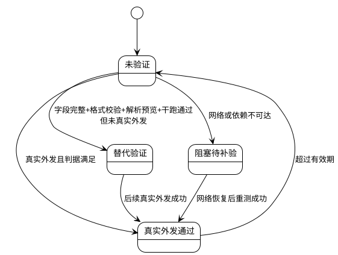

- 只有 `real_outbound` 可映射 `success` 并计入“已验证”；`substitute`/`blocked` 必须保留“未验证”标识，不阻止后续重测。
- 有效期默认 24 小时（待确认项），过期后不得展示为“当前可用”；被限流请求只返回冷却与上次时间，不得把上次结果当作本次结果。

**8）错误码与页面表现映射**

| 场景 | 页面/结果表现 | 错误码 |
|---|---|---|
| 默认模型未启用、标识或地址为空、凭据缺失/失效、鉴权失败、超时重试耗尽、配额耗尽 | 解析来源为 `rule_fallback`/`manual_fallback`，页面显示“默认模型不可用，已降级（规则/人工）”、原因、任务类型与配置版本，并提供修复入口 | `CONF_DEFAULT_MODEL_UNAVAILABLE`（结果原因码，不作为保存失败） |
| 保存期任务级覆盖非法 | 422 逐项高亮任务项、非法值与合法模型来源；原配置继续生效 | `CONF_TASK_MODEL_OVERRIDE_INVALID` |
| 生效期历史任务级覆盖非法 | 标注 `task_model_override_invalid` 并按 `fallbackPolicy` 降级，不显示为正常解析 | `CONF_TASK_MODEL_OVERRIDE_INVALID`（结果原因） |
| 出现第二条模型接入路径 | 构建/发布阻断并输出文件、行号与违规类型；运行期拒绝该路径的配置写入与调用 | `CONF_MODEL_ACCESS_PATH_VIOLATION` |
| 预设缺失、禁用或不兼容 | 快捷选项显示不可用原因，可转自定义模式；保存携带非法 `presetId` 返回 422 | `CONF_MODEL_PRESET_UNAVAILABLE` |
| 预设未真实外发或阻塞 | 页面、测试响应与报告显示“未验证（替代验证/阻塞待补验）”与缺口原因；不显示通过 | `CONF_MODEL_PRESET_UNVERIFIED`（提示级） |

**9）兼容边界（只增不改）**

1. 配置项仍为八分组 78 项、`model_access` 16 项；不新增 `taskModel.*`、不新增预设配置项。
2. 配置接口仍为 16 个（14 个既有 + 2 个只读）；预设、默认模型、解析结果、验证范围均为响应新增字段或请求可选字段。
3. 不新增模型 SDK、第二套协议适配器、第二张模型配置表或第二个前端入口；预设清单不是配置事实来源。
4. `presetId` 不落为配置项、不产生配置版本；只进入保存请求、响应、审计与调用记录。
5. 既有 6 个 `taskModel.*` 键名、作用域、生效方式（下次任务生效）与错误码语义保持不变。

### 2.2 接口设计

#### 2.2.1 总体设计

| 分类 | 代表接口 | 调用方/权限 | 稳定性 |
|---|---|---|---|
| 初始化与空库 | `/api/v1/system/initialization`、`/api/v1/system/empty-state`、`/api/v1/onboarding` | 所有角色读；维护者配置；管理员控制 | 稳定 |
| 信息源与采集 | `/api/v1/sources`、`/api/v1/crawl-control`、`/api/v1/crawl-tasks`、`/api/v1/candidates` | 维护者/管理员；总开关仅管理员 | 稳定，本期开放执行 |
| 采集材料与追溯 | `/api/v1/crawl-tasks/{id}/artifacts`、`/api/v1/artifacts/{id}`、`/api/v1/competitions/{id}/lineage` | 维护者/管理员；普通用户仅公开摘要 | 稳定 |
| 模型配置与报告 | `/api/v1/model-config`、`/api/v1/model-usage`、`/api/v1/model-calls` | 仅管理员 | 稳定 |
| 验证批次 | `/api/v1/verification-batches` 及 `:promote`、`:clear` | 发起为维护者/管理员；处置仅管理员 | 稳定 |
| 层级与拆分 | `/api/v1/series`、`/api/v1/track-splits`、`/api/v1/track-dictionaries` | 全部角色读授权数据；维护者/管理员写 | 稳定 |
| 检索与聚合 | `/api/v1/search/competitions`、`/api/v1/series-aggregates` | 全部角色，强制正式数据范围 | 稳定 |
| 录入与解析 | `/api/v1/documents`、`/api/v1/drafts`、`/api/v1/parse-tasks` | 录入者/维护者/管理员 | 稳定 |
| 审核与质量 | `/api/v1/reviews`、`/api/v1/dedup`、`/api/v1/competitions/{id}:publish` | 维护者/管理员 | 稳定 |
| 智能体 | `/api/v1/agent` | 全部角色，经受控查询/写确认 | 实验，向后兼容 |
| 订阅推送 | `/api/v1/subscriptions`、`/api/v1/push-records`、`/api/v1/reminders` | 本人/管理员 | 二期实验，本期不执行投递 |
| 内部调度 | `/internal/v1/jobs/crawl:sweep`、`:resume`、`:retention` | 服务身份 + 网段 + HMAC | 稳定 |
| 系统设置与配置 | `/api/v1/system-settings`、`/groups/{group}`、`/tests`、`/versions`、`/rollback`、`/readiness` | **仅团队管理员**；读写均服务端鉴权；密钥不回显 | 稳定（本期新增） |
| 运行期引导与门禁（M6） | `/api/v1/system/client-bootstrap`、`/api/v1/system/config-gate/last-report` | 引导信息**任意已识别角色**可读；门禁报告**仅团队管理员**；均为只读、无副作用 | 稳定（M6 新增，只增不改） |
| 模型接入增量（M7，仅增字段） | `/api/v1/system-settings/groups/model_access`、`/api/v1/system-settings/tests`、`/api/v1/model-config`、`/api/v1/model-calls/{id}` | **仅团队管理员**；预设、默认模型解析、验证范围为只读派生结果；`presetId` 为可选请求字段 | 稳定（只增不改，接口总数仍为 16） |

**通用契约**：

- 所有写接口要求 `Idempotency-Key`；服务端按“主体 + 路径 + 键”保存首次结果，重复请求返回原结果并标 `meta.replayed=true`。任务接口另使用上节业务幂等键，二者不可互相替代。
- 更新接口要求 `If-Match` 资源版本；冲突返回 409。异步任务受理返回 202 与任务 ID；已完成的幂等重放可返回 200。
- 错误包保持 `{ error: { code, message, details, traceId } }`。异步降级可以是任务成功/部分成功中的 `warnings`，不能为强调降级而伪造 HTTP 失败。
- 时间使用 RFC 3339 + 时区 + 精度；JSON 字段在 TypeScript 中使用判别联合与只读 DTO，Python 使用 Pydantic 类型；禁止 `any` 和以字符串 Map 代替公开契约。
- 空库不是错误；公共查询的 `dataOrigin` 和 `verificationBatchId` 由服务端裁剪，不返回验证对象的存在性。
- M6 增量：`GET /system/client-bootstrap` 与 `GET /system/config-gate/last-report` 为纯只读接口，不要求 `Idempotency-Key`，也不产生配置版本；引导接口是唯一允许非管理员读取的配置类接口，返回内容按最小化字段白名单裁剪。

**新增共享类型（契约摘要）**：

```ts
type DataOrigin = 'real_crawl' | 'manual_entry' | 'document_upload' | 'verification' | 'demo';
// M7 只增两个业务任务枚举值，既有六值语义不变
type ModelTaskType = 'page_understanding' | 'link_discovery' | 'body_extraction' | 'field_extraction' | 'intent_recognition' | 'answer_composition' | 'track_split' | 'quality_judgement';
type ProcessingMode = 'ai' | 'rule_fallback' | 'manual';
type EmptyReason = 'source_not_configured' | 'not_entered' | 'verification_only' | 'unpublished_only' | 'source_without_result';

interface EmptyStateMeta {
  libraryEmpty: boolean;
  queryEmpty: boolean;
  reason?: EmptyReason;
  actions: Array<'configure_source' | 'start_lanqiao_verification' | 'upload_document' | 'manual_entry'>;
  publishedRealCount: number;
  asOf: string;
}

interface LinkCandidateView {
  linkCandidateId: string;
  snapshotVersionId: string;
  rawHref: string;
  anchorText: string;
  contextBlockIds: string[];
  normalizedUrl?: string;
  validation: 'pending' | 'accepted' | 'rejected';
  rejectReason?: string;
}

interface ArtifactView {
  artifactId: string;
  kind: 'list_snapshot' | 'page_snapshot' | 'detail_snapshot' | 'rss_snapshot' | 'attachment' | 'uploaded_document';
  sourceUrl: string;
  contentFingerprint: string;
  securityStatus: 'pending' | 'passed' | 'rejected' | 'check_failed';
  availability: 'available' | 'expired' | 'deleted' | 'save_failed' | 'fingerprint_mismatch';
  parseStatus?: 'queued' | 'processing' | 'succeeded' | 'partial' | 'failed' | 'cancelled';
  retentionUntil: string;
  requestEvidenceId: string;
  downloadUrl?: string;
}

interface ModelUsageView {
  taskType: ModelTaskType;
  modelId: string;
  attempts: number;
  retries: number;
  fallbacks: number;
  inputTokens?: number;
  outputTokens?: number;
  actualCost?: { amount: string; currency: string };
  unknownCostAttempts: number;
}

type ConfigGroup =
  | 'service_environment'
  | 'auth_dev_identity'
  | 'data_storage'
  | 'python_parser'
  | 'model_access'
  | 'crawl_runtime'
  | 'retention_audit'
  | 'security_switches';

type ConfigScope = 'deployment' | 'team' | 'locked';
type ConfigSource = 'page_saved' | 'env_default' | 'builtin_default';
type ConfigApplyMode = 'immediate' | 'next_task' | 'restart_required';
type ConfigApplyState = 'applied' | 'pending_restart' | 'partially_applied' | 'apply_failed';

interface ConfigItemView {
  key: string;
  group: ConfigGroup;
  label: string;
  dataType: 'string' | 'integer' | 'boolean' | 'enum' | 'url' | 'string_list' | 'secret_ref';
  scope: ConfigScope;
  source: ConfigSource;
  applyMode: ConfigApplyMode;
  applyState: ConfigApplyState;
  effectiveValue: string | number | boolean | readonly string[] | null;
  deploymentValue?: string | number | boolean | readonly string[] | null;
  teamValue?: string | number | boolean | readonly string[] | null;
  editable: boolean;
  required: boolean;
  allowedRange?: { min?: number; max?: number; enumValues?: readonly string[] };
  secret?: { configured: boolean; maskedTail: string | null; lastUpdatedAt: string | null };
  runtimeMismatch?: { savedValue: string; effectiveValue: string };
}

interface ConfigGroupView {
  group: ConfigGroup;
  version: number;
  updatedBy: string;
  updatedAt: string;
  items: readonly ConfigItemView[];
  pendingRestartKeys: readonly string[];
}

interface ConfigSaveResult {
  version: number;
  saveState: 'saved';
  applyState: ConfigApplyState;
  results: ReadonlyArray<{ key: string; ok: boolean; code?: string; message?: string }>;
  pendingRestartKeys: readonly string[];
  affectedScopes: readonly ConfigScope[];
}

type ConfigTestTarget = 'database' | 'object_storage' | 'python_parser' | 'model_service' | 'public_base_url';
type ConfigTestResultCode =
  | 'success' | 'auth_failed' | 'unreachable' | 'timeout'
  | 'certificate_error' | 'protocol_unsupported' | 'target_refused';
type ReadinessState = 'ready' | 'not_ready' | 'not_configured' | 'optional_not_configured';

interface ConfigReadinessView {
  overall: 'ready' | 'ready_rule_mode' | 'not_ready';
  items: ReadonlyArray<{
    key: 'service_address' | 'data_storage' | 'python_parser' | 'model_access' | 'source' | 'crawl_switch';
    required: boolean;
    state: ReadinessState;
    fixPath: string;
    detail?: string;
  }>;
  computedAt: string;
}
```

#### 2.2.2 接口清单

##### （1）初始化、空库与采集控制

| 接口 | 前置条件与权限 | 后置条件/结果 | 主要异常 |
|---|---|---|---|
| `GET /api/v1/system/initialization` | 已鉴权 | 返回空库状态、默认关闭的总开关、演示残留数、引导进度；不返回竞赛数据 | 无空库错误码 |
| `GET /api/v1/system/empty-state` | 已鉴权 | 返回统一 `EmptyStateMeta` | `QUERY_PERMISSION_DENIED` |
| `PUT /api/v1/onboarding` | 维护者/管理员 + `If-Match` | 保存当前步骤、已完成步骤或跳过状态，可恢复 | `VERSION_CONFLICT` |
| `POST /api/v1/crawl-control:enable` | 仅管理员 + 二次确认 + 幂等键 | 至少一个探测通过且启用源；引导完成/跳过后开启，写审计 | `CRAWL_PRECHECK_FAILED` |
| `POST /api/v1/crawl-control:disable` | 仅管理员 + 幂等键 | 停止后续调度和外访，不删除配置与历史 | 无 |
| `POST /internal/v1/jobs/crawl:sweep` | 服务身份、HMAC、窗口幂等 | 总开关关闭仅记跳过；否则生成到期来源任务 | `TASK_ALREADY_RUNNING` |

典型调用（真实请求契约）：`POST /api/v1/crawl-control:enable` 携带 `Idempotency-Key: <uuid>` 和 `{ "confirmation": "ENABLE_REAL_NETWORK_CRAWL" }`；响应只包含运行状态和审计号，不携带任何示例竞赛。

##### （2）采集任务、AI 结果与材料追溯

| 接口 | 说明 | 权限/幂等与异常 |
|---|---|---|
| `POST /api/v1/sources/{sourceId}:crawl` | 手动真实单源采集，返回任务 ID | 维护者/管理员；`CRAWL_DISABLED`、`TASK_ALREADY_RUNNING`、`CRAWL_PRECHECK_FAILED` |
| `GET /api/v1/crawl-tasks/{taskId}` | 七态任务、游标、空结果原因、计数、检查点、模型/留存汇总 | 维护者/管理员按来源范围 |
| `POST /api/v1/crawl-tasks/{taskId}:retry` | 从最近未完成检查点恢复；可指定失败公告/附件 | 幂等键；冲突 `CRAWL_CHECKPOINT_CONFLICT` |
| `GET /api/v1/crawl-tasks/{taskId}/links` | 真实链接清单、AI/规则选择、接受/拒绝原因 | 不暴露无关敏感原文；`AGENT_OUTPUT_INVALID` 可在明细出现 |
| `GET /api/v1/crawl-tasks/{taskId}/artifacts` | 快照、附件、证据、指纹、安全/解析/留存状态 | 原件授权单独校验 |
| `GET /api/v1/artifacts/{artifactId}` | 材料元数据与父公告/结果版本引用 | 拒绝件永不返回下载地址 |
| `POST /api/v1/artifacts/{artifactId}:signed-access` | 签发 5 分钟、绑定用户与材料权限的访问地址 | 普通关注者无原件权限；过期仅返回摘要 |
| `GET /api/v1/candidates/{candidateId}/lineage` | 候选→快照→附件→结果→子项的完整链 | 缺环节显示具体原因，不补造 |
| `GET /api/v1/competitions/{competitionId}/lineage?field=` | 子项/字段追溯视图 | 已发布公开摘要与授权原件分级返回 |

##### （3）模型服务接入、调用与成本

| 接口 | 请求/响应要点 | 前置与异常 |
|---|---|---|
| `GET /api/v1/model-config` | 返回服务、默认模型、六类任务策略、接入状态；凭据仅显示引用别名与掩码 | 仅管理员 |
| `PUT /api/v1/model-config` | 全量更新配置与任务策略，要求 `If-Match`；未填模型不得启用 | 仅管理员；`VALIDATION_FAILED`、`VERSION_CONFLICT` |
| `POST /api/v1/model-config:test` | 使用最小无业务内容请求验证地址、凭据和模型；调用也计配额 | 仅管理员；`AGENT_CREDENTIAL_INVALID`、`AGENT_MODEL_TIMEOUT` |
| `POST /api/v1/model-config:disable` | 立即停止新调用，保留历史配置与材料 | 仅管理员 + 幂等键 |
| `POST /api/v1/model-config/credentials:rotate` | 更新凭据引用，旧历史调用仍指向原配置版本 | 仅管理员 + 审计；不明文返回 |
| `GET /api/v1/model-usage?from=&to=&sourceId=&taskId=&taskType=&modelId=` | 调用/重试/降级、令牌、实际成本与未知次数 | 仅管理员 |
| `GET /api/v1/model-calls/{callId}` | 模型/提示词版本、耗时、校验、降级及匹配的任务/材料/会话引用 | 仅管理员，无完整原文与凭据 |

##### （4）蓝桥杯验证批次

| 接口 | 业务说明与后置条件 | 权限与异常 |
|---|---|---|
| `POST /api/v1/verification-batches` | 输入批次名、客户端批次键、真实官方源、条目上限或时长；验证对象由服务端固定蓝桥杯 | 维护者/管理员 + 幂等键；`CRAWL_PRECHECK_FAILED` |
| `POST /api/v1/verification-batches/{batchId}:start` | 创建验证采集任务，所有下游继承批次 | 同上；同源任务互斥 |
| `GET /api/v1/verification-batches` | 批次状态、候选/子项数、证据追溯率、原件完整率、隔离结果 | 维护者/管理员按范围 |
| `GET /api/v1/verification-batches/{batchId}` | 真实请求、材料、拆分预览、异常与验证结论 | 未授权返回 404 语义 |
| `POST /api/v1/verification-batches/{batchId}:promote` | 二次确认；原子转正式，除来源/批次状态外业务字段不变 | 仅管理员；`VERIFY_BATCH_LEAKED`、`VERIFY_PROMOTION_PARTIAL`、`TRACK_SPLIT_DUPLICATE` |
| `POST /api/v1/verification-batches/{batchId}:clear` | 二次确认；只清除本批次业务对象，保留报告审计 | 仅管理员；`VERIFY_CLEAR_SCOPE_INVALID` |

##### （5）四层知识模型与赛道拆分

| 接口 | 说明 | 约束 |
|---|---|---|
| `GET/POST /api/v1/series` | 系列查询/创建 | 不写种子；组织范围内规范化名称唯一 |
| `POST /api/v1/series/{seriesId}/editions` | 创建届次 | 序号 + 年份唯一，父系列一致 |
| `POST /api/v1/editions/{editionId}/tracks` | 创建一级赛道/二级赛项或“未分赛道” | 原文依据与识别状态必填 |
| `POST /api/v1/tracks/{trackId}/groups` | 创建组别 | 同赛道名称唯一；明确独立成项或仅参赛条件 |
| `POST /api/v1/track-splits:preview` | 从候选/结果版本生成拆分计划与字段归属 | 无依据不拆；边界不清返回 `TRACK_BOUNDARY_UNCLEAR` |
| `POST /api/v1/track-splits:commit` | 确认计划并原子生成子项 | 幂等键 + 维护者权限；重复 `TRACK_SPLIT_DUPLICATE` 时返回已有 |
| `POST /api/v1/track-splits/{splitId}:revert` | 撤销拆分并恢复原记录与来源 | 维护者 + 审核意见；历史不删除 |
| `GET /api/v1/series-aggregates?...` | 系列父节点、届次和独立子项卡片 | 默认正式数据；分别返回系列数与子项数 |
| `GET/PUT /api/v1/track-dictionaries` | 赛道/组别同义词与默认策略 | 维护者/管理员；字典不得生成原文不存在赛道 |

##### （6）检索、录入、审核与智能体的增量修订

- `POST /api/v1/search/competitions` 增加 `seriesIds/trackIds/groupIds/view=item|series`；数据库按子项查询，聚合视图只是同一子项结果的父级分组。响应增加 `EmptyStateMeta`，但公共响应不返回验证/演示来源字段。
- `GET /api/v1/competitions/{id}` 返回四层名称、独立阶段/入口、共用标记、字段依据摘要；授权维护者可继续调用 lineage 获取原件。
- 文档确认、手工录入和批量导入必须提交系列、届次、赛道及可选组别；缺届次不得发布，未明确赛道只能待确认。多行表格逐行四要素校验，禁止静默合并。
- 自动发布服务新增真实请求、快照、实际附件、AI 阶段和依据链输入；现有 `canAutoPublish` 六条件不是完整判定，不能直接复用为最终发布依据。
- 智能体查询只能调用正式数据检索端口；空库返回引导建议。模型生成 SQL、验证批次对象或越权草稿均不执行，记录安全事件。
- 订阅模型增加系列/赛道/组别条件与验证排除谓词，但匹配、汇总和实际投递仍在二期。

##### （7）系统设置与配置（仅团队管理员）

| 接口 | 请求/响应要点 | 前置与异常 |
|---|---|---|
| `GET /api/v1/system-settings` | 返回八个分组、版本号、最后修改人/时间、就绪摘要、待重启汇总；密钥项只含 `configured/maskedTail/lastUpdatedAt` | 仅管理员；非管理员 403 且不返回分组数量或键名 |
| `GET /api/v1/system-settings/groups/{group}` | 返回该分组逐项 `ConfigItemView`（实际生效值、部署级/团队级值、来源、作用域、生效方式/状态） | 仅管理员；`CONF_FORBIDDEN` |
| `PUT /api/v1/system-settings/groups/{group}` | 体含 `baseVersion`、`changes[]`；要求 `Idempotency-Key`；返回 `ConfigSaveResult` 与变更摘要 | 仅管理员；`CONF_VERSION_CONFLICT`、`CONF_VALUE_INVALID`、`CONF_SECURITY_SWITCH_LOCKED`、`CONF_PERSIST_FAILED` |
| `PUT /api/v1/system-settings/groups/{group}/items/{key}` | 单项保存，仍要求 `If-Match` 版本号；用于就绪清单的定点修复 | 同上；跨项依赖在单事务内校验 |
| `POST /api/v1/system-settings/tests` | 体含 `target`、`address`、`secretRef?`、`innerNetworkException?`；返回 `ConfigTestResultCode`、耗时与脱敏地址 | 仅管理员 + 幂等键；`CONF_CONNECT_FAILED`、`CONF_ADDRESS_FORBIDDEN`、`CONF_ENV_CONFLICT`、限流 429 |
| `PUT /api/v1/system-settings/credentials/{secretRefId}` | 一次性写入/替换密钥，返回引用与末四位；不回显明文 | 仅管理员 + 审计；`CONF_CREDENTIAL_MISSING`、`CONF_CREDENTIAL_IN_USE` |
| `GET /api/v1/system-settings/versions?group=&limit=` | 最近版本列表（默认≥10），含操作人、时间、变更项数、生效结果 | 仅管理员 |
| `GET /api/v1/system-settings/versions/{version}` | 版本详情与逐项前后值；密钥只显示引用变化 | 仅管理员 |
| `GET /api/v1/system-settings/versions/{version}/diff?against=current` | 与当前有效版本或指定版本对比，标注新增/修改/删除与需重启项 | 仅管理员；`CONF_VERSION_CONFLICT` 不适用（只读） |
| `POST /api/v1/system-settings/rollback` | 体含 `targetVersion`、`baseVersion`、二次确认标识；返回新版本与生效状态 | 仅管理员 + 幂等键；`CONF_ROLLBACK_FAILED`、`CONF_VALUE_INVALID` |
| `GET /api/v1/system-settings/readiness` | 返回 `ConfigReadinessView` 六项状态与整体结论 | 仅管理员；信息维护者只能从既有业务页面读“总开关/来源健康”摘要 |
| `POST /api/v1/system-settings/readiness:recompute` | 强制重算就绪（有 30 秒节流） | 仅管理员 |
| `GET /api/v1/system/configuration-health` | 供 `/readyz` 与运维使用：各项实际运行值摘要（不含密钥与内网拓扑） | 已鉴权服务身份；与配置页同源快照 |
| `GET /api/v1/system/empty-state`（修订） | 就绪检查未通过时，`reason` 增加 `system_config_not_ready`，`actions` 首项为 `open_system_settings` | 已鉴权；不泄露配置键名与地址 |

**契约示例（仅示意类型与字段，不含实现）**：

```ts
// PUT /api/v1/system-settings/groups/crawl_runtime
interface CrawlRuntimeSaveRequest {
  baseVersion: number;
  changes: ReadonlyArray<{
    key: string;
    value: string | number | boolean | readonly string[];
    applyToExistingSources?: boolean;
    confirmScope?: ReadonlyArray<string>;
  }>;
  confirmToken?: 'APPLY_TO_EXISTING_SOURCES' | 'RESTART_ACKNOWLEDGED';
}
```

- 所有写接口成功后必须返回 `version` 与 `applyState`；客户端不得把 HTTP 200 视为“已生效”。
- 版本号同时接受 `If-Match` 头与请求体 `baseVersion`，两者不一致按 `CONF_VERSION_CONFLICT` 拒绝；缺少版本号一律拒绝。
- 测试连接响应中的地址必须脱敏（保留协议、主机前三位与端口），不得包含完整内网路径或凭据。
- 配置类接口与既有业务接口共用 `{ error: { code, message, details, traceId } }`；`details.violations[]` 逐项给出 `key`、`reason`、`allowedRange`。

**与既有接口的兼容约定**：

| 既有接口 | 兼容处理 | 迁移步骤 |
|---|---|---|
| `GET/PUT /api/v1/model-config`、`:test`、`:disable`、`/credentials:rotate` | 保留路径作为模型接入分组的适配器，内部读写配置中心 `model_access` 分组；响应字段保持向后兼容，额外返回 `version/applyState` | 先双写并比对（旧表 `ModelProviderConfig` 与新配置值一致），再切读新快照，最后保留旧路径为薄封装 |
| `GET /api/v1/model-usage`、`/api/v1/model-calls/{id}` | 不变；仍按 `ModelCallRecord` 与配置版本追溯 | 历史 `configVersion` 语义保持为配置版本；新增 `policyVersion` 时以可空字段扩展 |
| `/readyz`、`/healthz` | 增加依赖项与配置来源摘要，不改变既有 `status/dependencies` 字段 | 配置未就绪时 `status=degraded`，但不阻塞已可用的业务只读接口 |
| `/api/v1/system/empty-state` | 增加 `system_config_not_ready` 原因与 `open_system_settings` 动作，其余字段不变 | 前端 `AsyncState` 增加对应分支；既有空库分支保持 |
| `/api/v1/onboarding` | 仍保存引导进度；就绪清单只读取引导与来源状态，不回写引导 | 配置完成后“前往配置信息源”只做跳转，不改变引导完成判定 |

- 配置读写接口一律要求管理员角色；既有 `/api/v1/model-config` 若仍被维护者调用，返回 `CONF_FORBIDDEN`，并在发布说明中标注为破坏性权限收紧（规格 REQ-CONF-07/12 要求）。
- 所有新增写接口要求 `Idempotency-Key`；`PUT groups/{group}` 另要求版本号。重复提交返回原结果并标 `meta.replayed=true`。

##### （8）M6 增量：客户端引导与配置门禁（REQ-CONF-23～26）

**新增接口（2 个只读接口，既有 14 个配置接口共 16 个）**

| 接口 | 权限与前置 | 响应要点 | 异常与兼容 |
|---|---|---|---|
| `GET /api/v1/system/client-bootstrap` | 任意已识别角色（含登录页）；不需要配置管理员权限；不要求版本号 | `apiBaseUrl`、`apiBaseSource`（`configured`/`same_origin`）、`configVersion`、`profile`、`devIdentityAllowed`、`issuedAt`、`cacheMaxAgeSeconds`（≤60）；`ETag` 与 `Cache-Control: private, max-age=60`；`If-None-Match` 命中返回 304 无响应体 | 未加载完成 503 `CONF_CLIENT_BOOTSTRAP_UNAVAILABLE`；不得返回键名、配置值、凭据引用、数据库与对象存储地址、就绪明细 |
| `GET /api/v1/system/config-gate/last-report` | 仅团队管理员；只读 | `scannedAt`、`scope[]`、`durationMs`、`whitelist[]`（文件/变量/用途/批准人）、`violations[]`（文件/行号/变量/类型）、`sameSourceAssertion`（通过结论/三方版本/指纹）、`evidencePath`、`passed` | 无记录 404 `CONF_GATE_REPORT_MISSING`；不返回源码内容与环境变量值 |

**既有接口的只增字段（不改路径与既有字段语义）**

| 既有接口 | 新增字段 | 兼容性说明 |
|---|---|---|
| `GET /api/v1/system-settings` | `connectionProvenance.database/objectStorage`（脱敏连接来源）、`clientBase`（下发地址/来源/版本/缓存上限/是否过期） | 旧客户端忽略新字段；既有分组、版本、待重启字段不变 |
| `GET /api/v1/system-settings/groups/{group}` | 数据存储分组每项增加 `runtimeConnection`（使用版本、连接时间、加密状态、连接状态、最近失败分类） | 仅数据存储分组出现；其他分组不返回该字段 |
| `GET /api/v1/system/configuration-health` | `runtimeProvenance`（配置版本、加载时间、快照指纹、逐项来源）、`connectionState`（数据库与对象存储脱敏状态） | 仍仅管理员可读；既有 `version/sources/applyStates` 语义不变 |
| `POST /api/v1/system-settings/tests` | 请求可选 `realNetworkRequired`（默认 true）；响应 `evidence`、`testedAt`、`validUntil`、`lastTestedAt`、`cooldownSeconds` | 默认值保持既有行为；七类结果分类不变；冷却期返回 429 并附上次结果时间 |
| `PUT /api/v1/system-settings/groups/{group}`、`/items/{key}` | 响应增加 `storageImpact`（仅数据存储分组且含 `storage.*` 变更时） | 既有 `saveState/applyState/results/pendingRestartKeys` 不变；不影响其他分组保存 |

**契约类型（摘要，不放实现代码）**

```ts
type ApiBaseSource = 'configured' | 'same_origin';
type RuntimeConnectionStatus = 'ready' | 'degraded' | 'not_enabled' | 'failed';

interface ClientBootstrapInfo {
  apiBaseUrl: string;
  apiBaseSource: ApiBaseSource;
  configVersion: number;
  profile: 'dev' | 'test' | 'prod';
  devIdentityAllowed: boolean;
  issuedAt: string;
  cacheMaxAgeSeconds: number; // 1..60
}

interface RuntimeConnectionView {
  kind: 'database' | 'object_storage';
  targetMasked: string;
  configVersion: number;
  connectedAt: string;
  tlsEnabled: boolean | null;
  status: RuntimeConnectionStatus;
  lastFailure: string | null;
  detail?: string;
}

interface ConfigGateReport {
  scannedAt: string;
  scope: readonly string[];
  durationMs: number;
  whitelist: ReadonlyArray<{ file: string; variable: string; purpose: string; approvedBy: string }>;
  violations: ReadonlyArray<{ file: string; line: number; variable: string; type: string }>;
  sameSourceAssertion: {
    passed: boolean;
    versions: { page: number; health: number; log: number };
    fingerprint: string;
  };
  evidencePath: string;
  passed: boolean;
}

interface ConfigTestEvidence {
  requestedAt: string;
  realOutbound: boolean;
  egressRoute: 'safe-fetch' | 'controlled-driver' | 'address_rejected';
  cacheAgeSeconds: number;
}
```

**调用与响应示例（契约级，非实现）**

```json
// GET /api/v1/system/client-bootstrap（200，节选）
{
  "data": {
    "apiBaseUrl": "https://example.org/api/v1",
    "apiBaseSource": "configured",
    "configVersion": 12,
    "profile": "prod",
    "devIdentityAllowed": false,
    "issuedAt": "2026-11-08T10:00:00Z",
    "cacheMaxAgeSeconds": 60
  },
  "meta": { "asOf": "2026-11-08T10:00:00Z" }
}
```

- 引导接口的地址在 `apiBaseSource=configured` 时以配置运行值为准；为空时返回 `/api/v1` 并标记 `same_origin`，由前端拼接当前页面来源。
- 测试连接被限流时的响应为 429 `RATE_LIMITED`，`details` 至少包含 `cooldownSeconds` 与 `lastTestedAt`；不得包含凭据或完整地址。
- 门禁报告接口只读最近一次构建产物，不触发扫描；报告缺失与扫描失败是两种语义，前者 404，后者表现为报告中 `passed=false`。

##### （9）M7 增量：默认模型、预设与未验证缺口（REQ-CONF-27～30）

**接口总数不变**：仍为 16 个（14 个既有 + 2 个只读）。本节全部变化为既有接口的响应新增字段或请求可选字段，不新增模型接入接口、不新增第二套读写路径。

**只增字段清单**

| 接口 | 变化类型 | 新增字段与语义 | 兼容性 |
|---|---|---|---|
| `GET /api/v1/system-settings/groups/model_access` | 响应增加字段 | `providerPresets[]`（预设标识、显示名、提供方、协议固定 `openai_compatible`、服务地址、模型标识、推荐参数、是否默认、可用状态与原因、清单版本、最近验证范围与缺口原因）；`presetListVersion`；`presetListStatus`（`available`/`unavailable`）；`defaultModel`（模型标识、提供方 `DeepSeek`、服务地址、来源、`presetId`、`deviated`、启用状态、配置版本）；`resolvedTaskModels[]`；`protocol` | 既有 16 项字段名、取值、来源与生效方式不变；旧客户端忽略新字段；解析结果为纯派生，只读；“未验证”是派生状态（无记录或已过期），不是枚举值 |
| `PUT /api/v1/system-settings/groups/model_access`、`PUT /system-settings/groups/{group}/items/{key}` | 请求增加可选字段 + 响应增加字段 | 请求可选 `presetId`（仅用于预设校验、审计与回溯，不落配置项）；响应增加 `appliedPresetId`、`resolvedTaskModels`、`unverifiedItems` | 未传 `presetId` 时行为与既有完全一致；版本、幂等、整批校验与错误码语义不变 |
| `GET /api/v1/model-config` | 响应增加字段 | `defaultModelSource`（`builtin_default`/`env_default`/`page_saved`）、`protocol`、`appliedPresetId`、`resolvedTaskModels` | 兼容适配器定位不变，不形成第二事实来源；既有字段语义不变 |
| `POST /api/v1/system-settings/tests`（`target=model_service`） | 响应增加字段 | `presetId`、`verificationScope`（`real_outbound`/`substitute`/`blocked`）、`gapReason`、`substituteEvidence` | 七类结果分类、冷却 429 与 `evidence` 语义不变；`blocked`/`substitute` 不得映射 `success` |
| `POST /api/v1/model-config:test` | 响应增加字段 | 同上的 `presetId`、`verificationScope`、`gapReason`、`substituteEvidence` | 路径与既有语义不变；测试调用不计业务配额 |
| `GET /api/v1/model-calls/{callId}` | 响应增加字段 | `resolveSource`（`task_override`/`default_model`/`rule_fallback`/`manual_fallback`）、`protocol`、`presetId` | 既有模型、`configVersion`、降级原因、校验状态字段不变；新增字段为空表示历史未标注，不得推断为默认模型 |

**契约类型摘要（只增字段，不放实现代码）**

```ts
type ModelProtocol = 'openai_compatible';
type PresetAvailability = 'available' | 'disabled' | 'incompatible' | 'address_forbidden';
type PresetListStatus = 'available' | 'unavailable';
type DefaultModelSource = 'builtin_default' | 'env_default' | 'page_saved';
type TaskResolveSource = 'task_override' | 'default_model' | 'rule_fallback' | 'manual_fallback';
type VerificationScope = 'real_outbound' | 'substitute' | 'blocked';

interface ProviderPresetView {
  presetId: string;
  displayName: string;
  provider: string;              // 页面展示名，如 DeepSeek / MiniMax / GLM / Kimi / Qwen
  protocol: ModelProtocol;       // 固定 openai_compatible
  baseUrl: string;               // 厂商公开地址，保存期仍走安全校验
  modelId: string;
  recommended: {
    timeoutMs: number;
    maxRetries: number;
    dailyQuota: number;
    taskQuota: number;
  };
  isDefault: boolean;
  availability: PresetAvailability;
  unavailableReason?: string;
  listVersion: string;
  verification?: {
    scope: VerificationScope;    // 最近一次验证结论；缺失表示从未验证
    gapReason?: string;
    lastTestedAt?: string | null;
    validUntil?: string | null;
    substituteEvidencePath?: string;
  };
}

interface DefaultModelView {
  modelId: string;
  provider: 'DeepSeek';          // 提供方口径固定
  baseUrl: string;               // 页面展示口径；解析记录与审计中脱敏
  source: DefaultModelSource;
  presetId: string | null;       // null 表示自定义模式
  deviated: boolean;             // 地址或模型偏离预设登记值
  enabled: boolean;
  configVersion: number;
  resolvedAt: string;            // 解析时间
}

interface ResolvedTaskModelView {
  taskType: ModelTaskType;       // 八类业务任务；共享键任务结果一致
  configKey: string;             // 六个既有 taskModel.* 之一
  configuredValue: string | null;
  resolvedModel: string | null;
  resolveSource: TaskResolveSource;
  degradeReason?: string;
  protocol: ModelProtocol;
  configVersion: number;
  resolvedAt: string;            // 解析时间；同版本重复计算结果一致
}

interface UnverifiedPresetView {
  presetId: string;
  scope: Exclude<VerificationScope, 'real_outbound'>;
  gapReason: string;
  substituteEvidencePath?: string;
  responsible?: string;
  lastTestedAt?: string | null;
  validUntil?: string | null;
}

interface SubstituteEvidence {
  presetFieldCheck: boolean;      // 预设字段完整性与默认项唯一性
  addressProtocolCheck: boolean;  // 地址与协议格式/安全校验
  resolvedPreviewMatch: boolean;  // 保存后解析结果与预览一致
  dryRun: boolean;                // 干跑结果
  evidencePath: string;
}
```

**分组读取响应示例（节选，仅示意新增字段位置）**

```json
{
  "data": {
    "group": "model_access",
    "version": 13,
    "protocol": "openai_compatible",
    "presetListVersion": "2026.11.1",
    "presetListStatus": "available",
    "defaultModel": {
      "modelId": "deepseek-chat",
      "provider": "DeepSeek",
      "baseUrl": "https://api.deepseek.com/v1",
      "source": "builtin_default",
      "presetId": "deepseek",
      "deviated": false,
      "enabled": false,
      "configVersion": 1,
      "resolvedAt": "2026-11-08T10:00:00Z"
    },
    "providerPresets": [
      {
        "presetId": "deepseek",
        "displayName": "DeepSeek",
        "provider": "DeepSeek",
        "protocol": "openai_compatible",
        "baseUrl": "https://api.deepseek.com/v1",
        "modelId": "deepseek-chat",
        "recommended": { "timeoutMs": 30000, "maxRetries": 1, "dailyQuota": 500, "taskQuota": 50 },
        "isDefault": true,
        "availability": "available",
        "listVersion": "2026.11.1"
      }
    ],
    "resolvedTaskModels": [
      {
        "taskType": "field_extraction",
        "configKey": "model.taskModel.document",
        "configuredValue": null,
        "resolvedModel": null,
        "resolveSource": "rule_fallback",
        "degradeReason": "default_model_unavailable",
        "protocol": "openai_compatible",
        "configVersion": 1,
        "resolvedAt": "2026-11-08T10:00:00Z"
      }
    ],
    "items": ["…既有 16 项配置，字段名与取值不变…"]
  }
}
```

**缺省与兼容语义**

1. 未传 `presetId`：行为与既有完全一致，`appliedPresetId=null`，不写预设审计字段。
2. 旧客户端：忽略新字段即可正常读写；不得以 `resolvedTaskModels` 或 `providerPresets` 作为权限或保存成功判据。
3. 清单不可用或加载失败：分组读取仍返回 200 与既有 16 项，`providerPresets=[]`、`presetListStatus=unavailable` 并给出原因；前端转自定义模式；此时携带 `presetId` 保存返回 422 `CONF_MODEL_PRESET_UNAVAILABLE`。
4. `model-config` 兼容适配器：读写仍映射 `model_access` 分组与同一解析器，不携带第二套取值逻辑；新增字段与分组读取同源。
5. 测试连接：未传 `presetId` 时按当前 `baseUrl` 与预设登记地址匹配推断；推断失败时 `presetId=null`，`verificationScope` 仍按“是否实际外发”判定，不得标为成功。
6. 调用记录：`resolveSource` 为空表示历史记录未标注，不得推断为 `default_model`；新增列不回填历史数据。

#### 2.2.3 错误码与结果语义

优先复用规格已定义错误码，禁止再引入同义码。以下为本次必须补齐/修订的契约；异步任务中的代码是结果原因，不强制对应同步 HTTP 失败。

| 分组 | 错误码与语义 |
|---|---|
| 采集预检 | `CRAWL_DISABLED`（总开关关闭，409）、`CRAWL_PRECHECK_FAILED`（无可用源/引导未完成，422）、`TASK_ALREADY_RUNNING`（同源冲突，409/跳过事件） |
| 网络与合规 | `FETCH_TIMEOUT`、`FETCH_RATE_LIMITED`、`FETCH_GATEWAY_UNAVAILABLE`、`SOURCE_ADDRESS_FORBIDDEN`、`SECURITY_SSRF_BLOCKED`；均不得改写为零公告 |
| 链接与 AI 输出 | `AGENT_OUTPUT_INVALID`（虚构链接、越范围、Schema/依据非法）、`PARSE_STRUCTURE_CHANGED`、`EXTRACT_SCHEMA_INVALID`；合法项继续，失败项不入库 |
| 材料 | `CRAWL_ARTIFACT_SAVE_FAILED`（快照/原件保存或指纹失败）、`ATTACHMENT_UNREADABLE`、`FILE_SECURITY_REJECTED`、`FILE_SIZE_EXCEEDED`；拒绝件无解析任务 |
| 恢复 | `CRAWL_CHECKPOINT_CONFLICT`（指纹/材料/租约冲突，409）；可恢复任务保留最近有效检查点 |
| 模型 | `AGENT_DEGRADED_RULE_ONLY`（未配置/停用）、`AGENT_MODEL_TIMEOUT`、`AGENT_QUOTA_EXCEEDED`、`AGENT_CREDENTIAL_INVALID`、`AGENT_UNAVAILABLE`；真实抓取与材料保存继续 |
| 依据 | `EVIDENCE_INSUFFICIENT`（缺快照/附件/版本/定位），`DETAIL_UNAVAILABLE`（详情失败但有列表证据）；禁止自动发布 |
| 验证批次 | `VERIFY_BATCH_LEAKED`、`VERIFY_PROMOTION_PARTIAL`、`VERIFY_CLEAR_SCOPE_INVALID`；处置原子失败或安全拒绝 |
| 层级拆分 | `TRACK_MERGE_FORBIDDEN`、`TRACK_BOUNDARY_UNCLEAR`、`TRACK_NAME_VARIANT`、`TRACK_GROUP_MISCLASSIFIED`、`TRACK_SIGNUP_SHARED`、`TRACK_SPLIT_DUPLICATE`、`TRACK_HIERARCHY_INVALID` |
| 初始化治理 | `DEMO_DATA_BLOCKED`、`DEMO_DATA_UNIDENTIFIED`、`DEMO_CLEANUP_PARTIAL`、`DEMO_DATA_REFERENCED`、`DEMO_DATA_RESIDUAL`；禁止按名称猜删 |
| 系统配置 | `CONF_VALUE_INVALID`（422，逐项非法范围）、`CONF_CONNECT_FAILED`（422/504，含失败分类）、`CONF_VERSION_CONFLICT`（409，含当前版本/修改人/时间/差异）、`CONF_CREDENTIAL_MISSING`（422）、`CONF_CREDENTIAL_IN_USE`（409）、`CONF_RESTART_REQUIRED`（200 保存成功 + 待重启状态，不作为失败）、`CONF_FORBIDDEN`（403，不泄露键名）、`CONF_ADDRESS_FORBIDDEN`（422）、`CONF_ROLLBACK_FAILED`（409/422）、`CONF_DEV_IDENTITY_FORBIDDEN`（403 + 安全事件）、`CONF_APPLY_FAILED`（409 + 已回退说明）、`CONF_PERSIST_FAILED`（503，可重试）、`CONF_SECURITY_SWITCH_LOCKED`（422 + 安全事件）、`CONF_ENV_CONFLICT`（422，端口占用/库桶不存在/版本不兼容/区域不匹配）、`CONF_RUNTIME_MISMATCH`（告警与页面标注，不作为保存失败） |
| M6 运行期增量 | `CONF_CLIENT_BOOTSTRAP_UNAVAILABLE`（503，配置未加载完成，前端转同源兜底）、`CONF_CLIENT_BASE_MISMATCH`（下发版本或来源与实际连接不一致，提示重新获取并阻止旧地址写操作）、`CONF_GATE_REPORT_MISSING`（404，尚无门禁报告）、`CONF_ENV_SCAN_VIOLATION`（构建失败，输出文件/行号/变量/违规类型）、`CONF_TEST_THROTTLED`（429，等价复用 `RATE_LIMITED`，含冷却秒数与上次时间）、`CONF_STORAGE_RUNTIME_SWITCH_FAILED`（切换失败或降级，保持旧连接）、`CONF_ARTIFACT_STORAGE_MOVED`（历史原件不可访问或已迁移，保留记录与指纹）、`CONF_CONCURRENT_MODIFICATION`（并发冲突，版本冲突时仍优先 `CONF_VERSION_CONFLICT`） |
| M7 模型接入增量 | `CONF_DEFAULT_MODEL_UNAVAILABLE`（默认模型不可用，结果原因与降级标注；不作为保存失败 HTTP 码）、`CONF_TASK_MODEL_OVERRIDE_INVALID`（422，逐项返回非法任务项、合法模型来源与默认模型）、`CONF_MODEL_ACCESS_PATH_VIOLATION`（构建门禁失败并输出文件/行号/违规类型；运行期拒绝第二路径的配置写入与调用）、`CONF_MODEL_PRESET_UNAVAILABLE`（422，`presetId` 不存在/禁用/不兼容；清单不可用时页面提示并转自定义模式）、`CONF_MODEL_PRESET_UNVERIFIED`（提示级，测试与验收显示“未验证”徽标与缺口原因；不映射 `success`、不作为保存失败） |
| 既有契约 | `SOURCE_IDENTITY_MISSING`、`STATE_TRANSITION_INVALID`、`VERSION_CONFLICT`、`QUERY_CONDITION_INVALID`、`QUERY_TIMEOUT`、`AGENT_PERMISSION_DENIED` 等继续使用 |

#### 2.2.4 权限矩阵与审计

| 操作 | 竞赛关注者 viewer | 信息录入者 editor | 信息维护者 reviewer | 团队管理员 admin |
|---|---|---|---|---|
| 公共检索/详情/公开依据摘要 | 允许 | 允许 | 允许 | 允许 |
| 上传/本人草稿/解析确认 | 禁止 | 允许（本人） | 允许 | 允许 |
| 信息源配置与单源采集 | 禁止 | 禁止 | 允许（授权范围） | 允许 |
| 采集总开关 | 禁止 | 禁止 | 禁止 | 允许 |
| 查看采集日志/链接/检查点 | 禁止 | 仅本人相关任务 | 允许（授权范围） | 允许 |
| 查看快照/附件原件 | 禁止，仅公开摘要 | 本人上传文档；采集件按任务授权 | 允许（授权范围） | 允许 |
| 维护字典/确认拆分/撤销 | 禁止 | 禁止 | 允许 | 允许 |
| 发起/查看蓝桥杯验证 | 禁止 | 仅本人发起的只读视图 | 允许 | 允许 |
| 验证转正式/整批清除 | 禁止 | 禁止 | 禁止 | 允许 + 二次确认 |
| 模型配置/凭据轮换/配额成本 | 禁止 | 禁止 | 禁止 | 允许 |
| 审核发布/修正已发布 | 禁止 | 禁止 | 允许（授权范围） | 允许 |
| 订阅与推送执行 | 本人订阅二期 | 本人订阅二期 | 二期 | 二期管理 |
| 系统设置页面与配置读取/保存/测试/回滚 | 禁止 | 禁止 | 禁止（仅可见总开关状态与来源健康摘要） | 允许 |
| 客户端引导信息（M6） | 允许（最小字段） | 允许（最小字段） | 允许（最小字段） | 允许（最小字段） |
| 配置门禁报告（M6） | 禁止 | 禁止 | 禁止 | 允许（只读） |
| 配置变更历史/版本对比/就绪清单 | 禁止 | 禁止 | 禁止 | 允许 |
| 凭据引用新增/轮换/吊销 | 禁止 | 禁止 | 禁止 | 允许 + 审计 |
| 模型提供方预设、默认模型与任务解析预览（M7） | 禁止 | 禁止 | 禁止 | 允许（随模型接入分组读取，只读派生） |
| 预设验证范围、缺口原因与未验证标注（M7） | 禁止 | 禁止 | 禁止 | 允许（只读；测试连接沿用管理员权限） |

多角色权限取并集，但不得突破上游数据范围；对象无权时统一 404 语义。模型配置、凭据轮换、总开关、验证创建/转正式/清除、拆分/撤销、材料访问授权、检查点重放、AI 输出拒绝、安全拒绝件、发布与自动发布均写不可变审计。模型凭据和完整原文不进入审计详情。

**系统配置审计补充（REQ-CONF-12/17）**：

- 配置页与全部配置读写接口只接受团队管理员；越权请求返回 `CONF_FORBIDDEN`，不返回键名、数量或是否存在，并写越权尝试审计。
- 必须审计的动作：配置保存、单项保存、测试连接、凭据写入/轮换/吊销、回滚、就绪强制重算、开发身份模拟开关变更、安全开关关闭尝试、内网例外标注、待重启确认与运行值不一致告警处置。
- 审计字段固定为：操作人、角色、团队、时间、配置分组与配置项、变更前值、变更后值、生效方式、执行结果、来源地址；密钥类只记录 `secretRefId` 与末四位变化。
- 变更记录与审计均只追加，业务角色不得修改/删除；配置审计与业务审计共用哈希链但以 `objectType=system_config` 区分，禁止在审计详情写入明文、完整内网拓扑或完整堆栈。
- **M7 模型接入补充**：保存携带 `presetId` 时，审计必须记录 `presetId`、预设清单版本、被填充的键集合、脱敏服务地址与是否“自定义偏离”；`presetId` 不是配置项，不得作为独立变更 key 出现在前后值中。任务级覆盖校验失败时记录任务项、非法值与合法来源集合（不含凭据）。预设清单读取不写审计，测试连接与验证范围写入既有测试记录与审计。

---
## 2.3 数据模型

### 2.3.1 设计目标

| 目标 | 设计口径 |
|---|---|
| 四层业务边界 | 系列、届次、赛道、组别均为显式对象；竞赛子项保存合法四要素链和稳定无组别键 |
| 真实材料不可变 | 快照、附件和解析结果以内容指纹与版本区分；新内容不覆盖旧材料及旧依据 |
| 验证与正式共存 | 同库同模型，但 `dataOrigin`、批次标识和查询作用域强制隔离；转正式不改业务值 |
| 空库可长期运行 | 所有业务集合允许为 0，基础字典与验证配置不等于竞赛数据，未分赛道是业务待确认而非演示占位 |
| 恢复不重复 | 请求、候选、材料、解析、模型调用、拆分和子项分别有独立幂等约束 |
| 双数据库可切换 | SQLite/PG 共享领域语义；方言、索引和 JSON 差异仅在仓储/迁移层体现 |
| 查询性能 | 10 万子项、5 条件、20 并发下 PG P95≤2s、P99≤4s；系列聚合与子项筛选共用子项索引 |
| 最小敏感留存 | 原件到期删字节，保留指纹、来源、请求证据、依据摘要和版本；日志不保存完整原文/凭据 |
| 配置单一事实来源 | 页面保存值即运行期取值；配置页、日志与健康检查读取同一快照；环境变量仅首启默认与紧急回退 |
| 配置可追溯可回滚 | 每次保存/回滚生成不可变版本与审计；保留≥10 个可回滚版本；禁止覆盖他人并发修改 |
| 配置与业务解耦 | 配置表、版本表、变更记录与测试记录独立于业务聚合；保存/回滚不写竞赛、候选、材料与统计 |
| 运行期视图不落业务表（M6） | 客户端引导与运行期连接来源都是“派生视图”，由配置快照与启动引导结果计算，不新增数据表、不改既有配置表字段；门禁报告为构建产物文件，验收结论为报告文件 |

**容量基线**：在既有 10 万竞赛、20 万阶段、12 万入口、150 万字段依据基础上，新增按日 5000 原始公告估算页面理解结果、快照和模型账本。对象存储按“原始 HTML/RSS + 合规附件 + 用户文档”分别计量，默认 180 天生命周期；数据库只存元数据与定位，不存大型原始字节。

### 2.3.2 模型实现

#### （1）核心领域类图

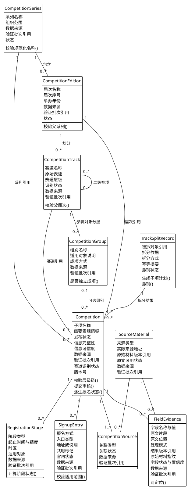

#### （2）采集、材料与模型对象

| 对象 | 核心属性/关系 | 关键约束 |
|---|---|---|
| `RequestEvidence` | 任务、信息源、请求用途、原始/最终 URL、逐跳链、时间、HTTP 状态、实际字节数、内容指纹、出口标识 | 成功/部分成功采集至少一条；无法关联证据的候选禁止入库 |
| `RawPageSnapshot` | 页面类型、实际 URL、原始对象键、指纹、请求证据、可用状态、留存与访问范围、批次 | 任务 + 最终 URL + 指纹唯一；只有可用且指纹一致才作自动发布依据 |
| `LinkInventoryItem` | 父快照、原始 href、锚文本、上下文/位置、规范化 URL、校验状态 | 必须源自真实 DOM/RSS；AI 只能引用，不能创建 |
| `PageUnderstandingResult` | 材料版本、处理阶段、处理模式、候选输出、依据、校验状态、下一检查点 | 同材料 + 阶段 + 配置 + 运行键幂等；各阶段独立记录成功/失败 |
| `CrawlAttachment` | 父详情快照、候选、原始地址/文件名、请求证据、真实类型、大小、指纹、安全/原件/解析状态 | 只有安全通过且原件可用才能进入解析和字段依据；拒绝件无下载地址 |
| `StoredArtifact` | 对象键、媒体类型、字节数、指纹、隔离/正式区、可用状态、留存策略 | 字节不可变；内容寻址或稳定重放键；私有访问 |
| `Candidate` | 任务、信息源、标题、规范 URL、内容指纹、快照/失败证据、候选状态、处理模式、批次 | 源 + 批次规范键 + URL + 指纹唯一；跨批次不去重 |
| `ProcessingCheckpoint` | 源/公告/附件范围、阶段、输入与配置指纹、材料/结果引用、租约、状态、失败原因 | 当前有效检查点唯一；fencing token 防止过期 Worker 提交 |
| `ParseTask` | 文档或外部材料、触发方式、状态、处理模式、失败原因、检查点 | 文档与采集附件共用；缺安全放行/原件引用不得创建有效任务 |
| `ParseResultVersion` | 输入指纹、结果号、字段集合、模型/规则与提示词版本、采用状态 | 同输入递增；幂等重试不新增有效版本；人工采用不被自动覆盖 |
| `ModelProviderConfig` | 服务类型、地址、默认模型、凭据引用、启用、超时、接入状态、配置版本 | 每环境最多一个启用配置；凭据引用不是明文 |
| `ModelTaskPolicy` | 六类任务、模型、提示词版本、四级配额、降级策略 | 各任务独立；未分配走默认模型 |
| `ModelCallRecord` | 调用/配置/任务类型、模型版本、耗时、校验、降级、用量与费用、业务引用 | 每次 attempt 唯一；采集/文档/问答引用类型判别，禁止错挂 |
| `ModelQuotaReservation` | 策略、日/任务/公告/附件作用域、占用次数、attempt 引用 | 原子预留；首次和重试都消耗；费用未知独立标记 |
| `VerificationBatch` | 固定验证对象、名称、状态、来源、上限/时长、结论、隔离与处置结果 | 同一时刻最多一个采集中/验证中蓝桥杯批次 |
| `SystemRuntimeState` | 初始化状态、采集总开关、演示残留、最后变更人与原因 | 总开关默认关闭；不属于单个信息源 |
| `OnboardingState` | 当前/已完成步骤、跳过标记、团队与用户范围 | 刷新/重登可恢复；同团队同用户有效记录唯一 |
| `TrackSplitItem` | 拆分记录、子项、四要素、字段归属、原始依据分配 | 同拆分内四要素不重复；保留撤销恢复信息 |
| `FormalVisibilityPolicy` | 数据来源、发布状态、授权范围、空库统计口径 | 所有公共查询必经；不是可由客户端关闭的普通筛选条件 |
| `ConfigItemDefinition` | 配置项标识、名称、分组、数据类型、区间/枚举、是否必需、默认值说明、作用域、生效方式 | 定义版本化（`definitionVersion`）；强制只读项在服务端固定 `scope=locked` |
| `SystemConfigVersion` | 全局版本号、分组快照摘要、操作人、时间、变更原因、生效状态、基础版本 | 版本单调递增；历史不可修改；保存/回滚均生成新版本 |
| `SystemConfigValue` | 版本、配置项、作用域、脱敏值、来源、`secretRefId`、`maskedTail`、生效方式 | 同一版本+同一项+同一作用域唯一；密钥值只存引用 |
| `ConfigChangeRecord` | 版本、分组、配置项、变更前后值（密钥仅引用）、生效方式、结果、来源地址、操作人/角色 | 只追加；不得被业务角色修改/删除 |
| `ConfigRollbackRecord` | 源版本、目标版本、逐项结果、失败项与原因、操作人、时间 | 只追加；失败不产生部分应用 |
| `ConfigApplyState` | 配置项、已保存值摘要、运行值摘要、生效状态、待重启起始时间、完成时间、不一致告警 | 需重启项未重启前不得改变运行值 |
| `ConfigTestRecord` | 目标类型、脱敏地址、发起时间、耗时、结果分类、失败原因、操作人 | 同目标 1 分钟限流可核验；不含凭据与拓扑 |
| `ConfigReadinessSnapshot` | 六项判定、整体结论、最后计算时间 | 供空库服务与引导复用；模型未配置不算未就绪 |
| `CredentialRef` | 引用标识、用途、末四位、最后更新时间、状态、吊销时间 | 被启用配置引用时禁止删除；明文不落库 |

#### （3）四要素唯一性与验证隔离

**无组别处理**：数据库唯一索引不直接使用可空 `groupId`，而使用应用生成的 `groupKey`：具体组别使用组别标识，无组别使用保留值 `__none__`。因此无组别与本科组永不相同，且同一无组别记录仍只能有一条。

**正式数据唯一性**：

- 计算 `fourElementKey = H(seriesId + editionId + trackId + groupKey)`。
- 正式有效竞赛在 `dataOrigin ∈ {real_crawl, manual_entry, document_upload}` 且未删除范围内，对 `fourElementKey` 建部分唯一索引。
- 验证数据对 `(verificationBatchId, fourElementKey)` 建唯一索引；不同批次、批次与正式之间不做候选或子项去重。
- 转正式后保留 `verificationBatchId` 供追溯，但 `dataOrigin` 改为真实采集，因此进入正式唯一索引；若冲突则整个批次阻断，不修改任何业务字段。
- SQLite 用事务内预检 + 唯一索引模拟必要部分唯一语义；PG 使用原生部分唯一索引。两库均通过相同冲突验收用例。

**批次一致性**：

- 批次拥有的系列、届次、赛道、组别、候选、竞赛、阶段、入口、来源、依据、版本、事件、快照和附件均显式保存批次标识与 `dataOrigin=verification`。
- 可共享的信息源只保存真实配置，不写批次标识；通过任务关联批次。
- 同一竞赛的阶段、入口、来源、依据、版本与事件的批次标识必须等于父竞赛；跨正式/验证有效关联由应用校验和数据库约束共同拒绝。
- `FormalVisibilityPolicy` 固定条件为：排除 `verification` 与 `demo`，按接口要求过滤发布状态和授权范围。该条件同时用于公共检索、聚合、看板、收藏公开数据、导出、二期推送和智能体。

#### （4）聚合边界与事务归属

| 聚合根 | 聚合内对象 | 事务边界与外部引用 |
|---|---|---|
| `Competition` | 报名阶段、入口关联、机构关联、来源关联、字段依据、共用入口范围 | 单事务保存；系列/届次/赛道/组别和材料版本仅按标识引用并预校验 |
| `CompetitionSeries/Edition/Track/Group` | 各自业务属性、状态、批次与来源 | 小事务创建；父子关系跨聚合在子项保存事务内复核 |
| `TrackSplitRecord` | 拆分明细、依据分配、撤销信息 | 与所有子项聚合在同一数据库事务提交 |
| `Candidate` | 当前处理状态、过滤原因、快照/结果引用、恢复摘要 | 与公告检查点分批提交，不与竞赛聚合做分布式事务 |
| `CrawlTask` | 源游标、计数、任务级模型/留存汇总 | 任务与汇总分阶段更新，单项失败隔离 |
| `CrawlAttachment` | 安全、原件、解析状态与父公告关系 | 安全放行 + 原件元数据 + 解析任务一个本地事务；对象存储靠补偿 |
| `ParseTask` | 阶段检查点、结果版本引用 | 每阶段独立事务；人工采用结果与草稿确认单独事务 |
| `ModelProviderConfig` | 任务策略、配额配置、状态 | 配置与审计一个事务；调用账本不可随配置删除 |
| `VerificationBatch` | 状态、隔离校验、验证结论、处置记录 | 转正式/清除按批次整体事务；对象字节清理由后续可重放任务处理 |
| `SubscriptionRule/PushBatch` | 二期订阅与投递对象 | 本期仅模型与约束，不产生真实投递状态 |

#### （5）持久化与双库映射

| 数据族 | SQLite 本地 | PostgreSQL 生产 | 生命周期/索引 |
|---|---|---|---|
| 核心竞赛与四层 | 关系表、字符串枚举、事务预检 | 关系表 + CHECK + 部分唯一索引 | 四要素、发布状态、数据来源、批次、截止、层级组合索引 |
| JSON 结果/依据位置 | 规范化 JSON 文本，仓储序列化/反序列化 | `Json/JSONB`，按 `schemaVersion` 读取 | 关键筛选字段提升为关系列，不依赖 JSON 全表扫描 |
| 检索 | B-tree + 稳定游标，功能验收 | B-tree 复合/部分索引 + trigram/FTS；统计物化视图 | 禁止先取固定 500 条再内存分页；排序最后加子项唯一键 |
| 任务/检查点 | 任务表、唯一键、租约与心跳 | 同语义表 + BullMQ 投递引用 | `(status, nextRunAt)`、`(scope, stage)`、租约索引 |
| 模型配额/账本 | 事务条件更新、金额字符串与币种 | 行锁/原子更新、数值高精度或最小货币单位 | 日/来源/任务/类型/模型多维索引；账本只追加 |
| 请求证据/材料元数据 | 关系表，原始字节在私有目录 | 关系表，原始字节在 MinIO | 指纹、实际 URL、任务、批次、留存到期索引 |
| 审计/版本/调用账本 | 只追加约束和哈希链 | 只追加 + 必要时分区 | 业务账号禁止 UPDATE/DELETE；到期授权清理 |
| 订阅/推送 | 仅预留表 | 仅预留表与必要索引 | 二期启用执行，不预写演示批次 |

**迁移策略**：当前含演示种子的开发库不作为生产升级基线。新交付从空迁移开始；对确有真实数据的旧库，使用显式迁移标记保留真实记录、将无法确认的旧演示对象隔离到 `demo`，由管理员审核清理。升级过程不自动联网、不自动创建蓝桥杯验证批次。

#### （6）系统配置对象与关系

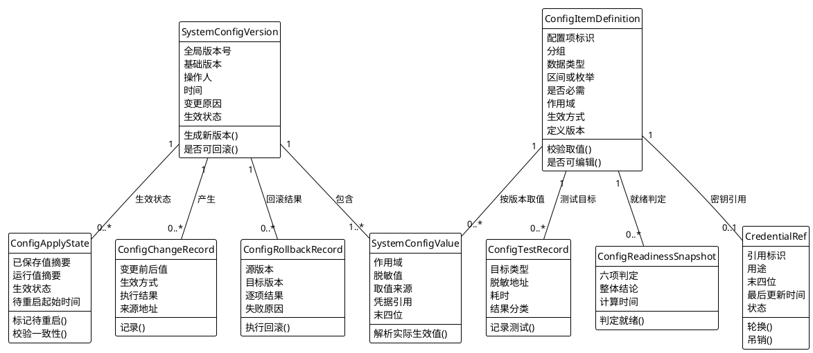

- 配置对象与业务聚合**无外键级联**：删除配置版本、回滚或吊销引用均不得级联修改竞赛、候选、材料、模型调用记录与验证批次。
- 版本号是全局序列而非“每分组独立序列”，避免跨分组保存时出现多套版本语义；`SystemConfigValue` 以“版本 + 项 + 作用域”唯一。
- `CredentialRef` 由 `CredentialVault` 管理密文，数据库仅保存引用与末四位；引用被启用配置引用时删除请求必须返回 `CONF_CREDENTIAL_IN_USE`。

**与既有 Prisma 模型的兼容策略**：

| 既有对象 | 兼容方式 | 不改动的内容 |
|---|---|---|
| `ModelProviderConfig`（`apps/api/prisma/schema.prisma:618-628`） | 保留表与字段，作为配置中心 `model_access` 分组的“运行投影”；配置保存时同事务更新投影行，`version` 与全局配置版本保持映射 | 既有 `id/baseUrl/secretRef/model/enabled/timeoutMs/version` 语义；历史调用追溯 |
| `ModelCallRecord.configVersion` | 继续表示模型配置版本；新增配置版本时不改字段类型，通过映射表记录“全局版本 ↔ 模型配置版本” | 历史调用记录不改写、不级联 |
| `AuditEntry`（`:388-401`） | 复用哈希链审计；`objectType=system_config` 区分配置事件，`detailJson` 只存脱敏前后值与引用变化 | 既有表结构、哈希算法与业务审计记录 |
| `OnboardingState.crawlEnabled`（`:654-664`） | 采集总开关的唯一事实来源迁移到 `crawl.enabled`；`crawlEnabled` 保留为兼容投影并在同一事务同步 | 既有引导进度字段与接口契约 |
| `SystemRuntimeState`（设计对象，代码尚未建表） | 与配置中心共享“运行状态”边界：总开关仍以配置快照为准，运行状态只承载初始化标记与演示残留计数 | 避免双写导致两个“总开关” |
| 其余业务表 | 不新增外键到配置表；配置删除/回滚不级联业务数据 | 检索、采集、材料、审核、发布、智能体接口保持兼容 |

**迁移与双库**：

1. 新增九类表（`ConfigItemDefinition`、`SystemConfigVersion`、`SystemConfigValue`、`ConfigChangeRecord`、`ConfigRollbackRecord`、`ConfigApplyState`、`ConfigTestRecord`、`ConfigReadinessSnapshot`、`CredentialRef`），只追加不改既有表；SQLite/PG 两份生成 schema 与迁移同步提交，并跑等价契约测试。
2. 首启迁移把现有环境变量（`PORT`、`PARSER_URL`、`LLM_*`、采集/留存常量）写入 `version=1` 的初始化版本，来源标 `env_default`/`builtin_default`；随后切换读取到 `ConfigResolver`，代码不再直接读环境变量。
3. 旧 `ModelProviderConfig` 值在迁移中生成 `model_access` 初始值并保持 `enabled/secretRef` 一致；若旧表存在多行，取启用行并对其余行写迁移告警，不静默删除。
4. 回滚目标版本若早于“模型接入纳入配置中心”的迁移点，只回滚配置值，不回滚表结构或业务数据；迁移点之前的模型配置以迁移快照为基线。

**M6 增量：运行期视图与报告文件（不新增表、不改既有字段）**

| 6.25 约束 | 承载方式 | 存储位置与理由 |
|---|---|---|
| 6.25.17 客户端引导下发记录 | 结构化下发日志：地址、来源（配置值/同源推导）、运行配置版本、环境标识、下发时间、缓存上限、是否兜底与原因；按版本与来源可聚合计数 | 不新增表。引导发生在页面刷新与登录的高频路径，逐次写库会放大写入压力；日志保留与聚合由日志管道承担。风险：日志留存期限必须满足审计要求，且兜底原因的字段名需固定 |
| 6.25.18 运行期连接来源 | 由启动引导结果（来源、脱敏目标、配置版本、TLS）与实时探测（连通状态、最近失败分类）派生的 `RuntimeConnectionView`；连接建立时间取进程启动监听时间 | 不新增表。连接状态是进程级事实，落库会引入“库中状态与真实连接不一致”的第二事实源；配置版本本身已有版本表承载 |
| 6.25.18 历史原件影响数量与原因 | 保存 `storage.*` 时即时统计快照、附件与上传文档数量，随保存响应返回；原因文案固定为“不删除、不改写指纹、按新目标标注可用性” | 不新增表。影响数量是切换时点的即时统计，可在审计详情中留痕；逐项可用性属于原件视图派生，待远端适配器落地后补齐 |
| 6.25.19 配置门禁记录 | 构建产物 `artifacts/config-gate/last-report.json`：扫描时间、范围、白名单、违规命中、同源断言、耗时、证据路径 | 报告文件而非数据表。门禁由构建流水线产生，数据库不可用时也必须能扫描；接口只读该文件 |
| 6.25.19 专项验证记录 | `artifacts/config-gate/concurrency-report.json` 与 `tests/acceptance/REQ-CONF-23-26.yaml`：外发计数、并发状态码、冲突码、断言结论、证据路径 | 报告文件。证据必须与被测版本一起归档，写入数据库反而无法证明“当时产物” |

- `ConfigTestRecord` 不新增 `testedAt/validUntil/evidence` 列：这些字段属于本次响应与审计详情，测试记录表继续保存目标类型、脱敏地址、耗时、结果分类、失败原因与操作人，满足 6.25.12 的可核验限流要求。若后续需要跨会话展示“上次测试时间”，由测试记录表的创建时间与结果分类派生，不再加列。
- 上述五项均不写入竞赛、候选、材料、统计或配置版本；不产生新配置版本，也不改变全局版本序列。
- 双库影响：本次增量不需要 SQLite/PostgreSQL 迁移；`RuntimeConnectionView`、`ClientBootstrapInfo`、`ConfigGateReport` 仅存在于共享契约包，两库行为一致。
- 与 6.25.17/18 的偏差必须在验收报告中显式标注：引导记录为日志而非表、历史原件逐项可用性尚未落地、远端对象存储适配器尚未启用；不得以“接口已返回字段”推断对应数据约束已完全满足。

#### （7）数据约束覆盖对照（6.1～6.25）

| 需求约束 | 承载设计 |
|---|---|
| 6.1 竞赛信息 | `Competition` 聚合补齐四要素、识别状态、数据来源与批次；五类状态独立，四要素唯一替代名称覆盖 |
| 6.2 系列/届次/赛项/组别/拆分 | 四层实体、可选二级赛项、组别成项方式与 `TrackSplitRecord` 完整建模 |
| 6.3 组织机构 | 复用 `Organizer` 与多角色关联，机构层级与学校认可等级不互相推导 |
| 6.4 报名阶段 | 每子项独立阶段、时间精度/时区、依据与批次一致性 |
| 6.5 来源材料与关联 | 扩展网页、上传、采集附件等类型；网页采集必须引用快照，批次不得跨关联 |
| 6.6 字段依据 | 增加材料版本、字符/页表位置、处理模式、降级原因、模型/规则与结果版本 |
| 6.7 信息源 | 扩展策略、目录来源、白名单确认、健康、默认待验证与真实配置约束 |
| 6.8～6.9 文档与关联 | 复用指纹/归属/多对多关联，统一采集附件入口但不混淆上传文档类型 |
| 6.10 解析任务与结果版本 | 支持外部材料、阶段检查点、AI/规则混合来源和人工采用保护 |
| 6.11～6.12 审核/版本/事件 | 增加拆分、验证与发布守卫审计；验证版本转正式不改版本号与历史值 |
| 6.13～6.14 订阅与推送 | 增加系列/赛道/组别和验证排除；仍为二期执行 |
| 6.15 报名入口 | 增加共用入口适用范围、专属归属冲突和独立子项校验 |
| 6.16 智能体记录 | 增加六类模型调用关联、正式数据边界、空库回答与安全事件 |
| 6.17 统一枚举 | 共享契约扩充至 29 组；`verification` 与 `demo` 永不进入正式视图 |
| 6.18 唯一性与检索性能 | 正式/验证双范围唯一约束、无组别哨兵、PG 查询索引和双库契约测试 |
| 6.19 文件留存与依据溯源 | 快照、附件、上传文档统一默认 180 天，过期留摘要/证据且不可定位 |
| 6.20 收藏 | 保留既有收藏模型，查询强制正式范围与逻辑状态 |
| 6.21 采集任务与候选 | 扩展七态、真实证据、空结果、批次、检查点、模型汇总与留存计数 |
| 6.22 初始化与验证 | 新增运行状态、引导、验证批次、隔离校验、空库计算和处置记录 |
| 6.23 模型配置与调用 | 新增配置、六类策略、原子配额、调用账本、实际/未知成本与凭据引用 |
| 6.24 原始材料与页面理解 | 新增快照、附件、真实链接清单、页面理解结果及完整版本关系 |
| 6.25 系统运行配置与变更记录 | 新增配置项定义、全局版本、作用域值、变更/回滚/应用状态/测试记录、就绪快照与凭据引用；八分组与七页映射；强制只读安全开关；密钥仅引用；保存/回滚不写业务数据 |
| 6.25.16 配置与业务数据解耦 | 保持 ADR-16；保存、回滚、测试、轮换与就绪重算均以 `objectType=system_config` 审计，不写业务对象；并发验证报告断言业务计数不变 |
| 6.25.17 客户端引导下发记录 | 下发日志（来源、版本、环境、时间、缓存上限、兜底原因）可聚合；响应字段白名单最小化；兜底原因必填；不落配置键名与内部地址 |
| 6.25.18 运行期连接来源 | `RuntimeConnectionView` 派生数据库与对象存储脱敏目标、版本、连接时间、TLS、状态与最近失败；切换统计历史原件影响数量与原因 |
| 6.25.19 配置门禁与专项验证记录 | `ConfigGateReport` 与并发报告文件；失败或存在未验证缺口时结论只能为 `blocked`/`partial`，不得记为通过 |
| 6.23.16 默认模型与任务解析口径 | 默认模型由 `model.baseUrl/model.model` 运行快照派生，提供方固定 DeepSeek；`ResolvedTaskModel` 纯派生且可重复计算；调用记录新增可空 `resolveSource/protocol/presetId` |
| 6.25.20 默认模型与任务解析记录 | 解析快照含默认模型提供方、标识、脱敏地址、来源、配置版本、解析时间与逐任务结果；不记录凭据、敏感参数与提示词 |
| 6.25.21 模型提供方预设 | 版本化清单（`ProviderPreset` + `ModelPresetCatalog`）；不含凭据、不计配置项；默认项唯一且为 DeepSeek |
| 6.25.22 模型接入路径唯一性 | 单一事实来源 + `LlmPort` 唯一实现；门禁扫描模型调用点；兼容适配器不形成第二事实来源 |
| 6.25.23 模型接入增量验证记录 | `ConfigTestRecord` 只增可空 `presetId/verificationScope/gapReason`；替代证据与缺口原因落报告文件；未验证不记为通过 |

#### （8）模型接入增量对象与持久化口径（REQ-CONF-27～30）

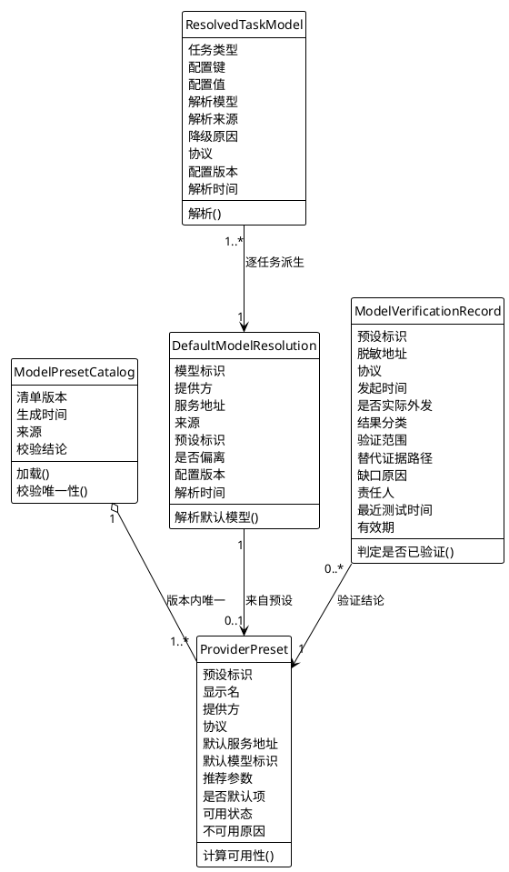

**持久化与派生态**

| 对象 | 承载方式 | 理由与约束 |
|---|---|---|
| `ModelPresetCatalog` / `ProviderPreset` | 服务端版本化定义文件（随代码发布），由 `ProviderPresetService` 只读加载 | 预设不是运行参数，不落配置表、不计 78 项与 16 项、不产生配置版本；清单版本独立于配置版本 |
| `DefaultModelResolution` | 纯派生：由当前快照的 `model.baseUrl`、`model.model`、`model.enabled`、`model.secretRef` 与预设登记值计算 | 不新增存储；`source` 由配置来源映射；`presetId` 由地址与模型匹配预设登记值派生；`deviated` 表示自定义模式偏离 |
| `ResolvedTaskModel` | 纯派生：按 `taskModel.*` 与默认模型解析 | 同一版本同一任务结果唯一且可重复计算；不落库，避免出现与配置快照不一致的第二事实源 |
| 调用记录解析来源 | `ModelCallRecord` 新增可空列 `resolveSource`、`protocol`、`presetId` | 只增列不改既有列语义；历史记录保持空值表示未标注，不回填、不推断 |
| `ModelVerificationRecord` | `ConfigTestRecord` 新增可空列 `presetId`、`verificationScope`、`gapReason`；替代证据明细与证据路径写入报告文件 | 不新增表；替代证据需与被测版本一起归档，写入数据库反而无法证明“当时产物” |

- 双库影响：新增可空列须同时提交 SQLite 与 PostgreSQL 迁移并跑等价契约测试；读取时 `null` 一律映射为“未标注”，不得映射为成功或默认模型。
- 预设清单更新只影响“内置默认值”与未保存状态展示，不得静默改写已保存的 `model.baseUrl/model.model`；已保存值只有在管理员保存后才会改变。
- 审计与解析记录均不保存凭据明文、完整提示词、完整内网地址；默认服务地址在审计与验证记录中脱敏，页面可按配置项既有口径显示可编辑地址。

## 2.4 安全设计

### 2.4.1 身份、权限与验证隔离

- 生产环境强制 OIDC/JWT RS256 验签，校验 `iss/aud/exp/nbf`；现有请求头身份只允许显式本地开发配置，生产启动检测到即拒绝。
- 权限按“多角色能力并集 ∩ 上游数据范围”，写操作在应用服务二次校验。模型配置和验证处置还必须校验当前团队管理员身份，不信任前端传入角色。
- 公共查询仓储无法接收“包含验证/演示”的参数；只有独立验证仓储和管理视图可以读取验证对象，并继续校验团队范围。
- 验证批次的导出、公共看板、二期推送、智能体语料与检索共用泄露测试夹具；任一泄露即阻断转正式并告警。

### 2.4.2 网络安全、robots 与真实请求证据

1. 公告抓取只经 `SafeEgressPort`，仅 HTTP/HTTPS、GET/HEAD；不携带用户 Cookie、Authorization 或内网凭证。
2. 对字面量 IP、DNS 全部结果和每次重定向重新校验；DNS pinning 防 Rebinding；禁止回环、私网、链路本地、保留地址和云元数据地址；HTTPS 降级拒绝。
3. robots 文件本身也经安全出口并留请求证据。2xx 按规则解析，404 表示无 robots 禁止，401/403 拒绝采集，网络/解析无法确认时延后本轮，不默认放行。
4. 同 URL 一分钟不超过一次；正常分页按配置间隔，失败重试也受域名并发/频率约束。AI 新发现的分页、详情与附件在每次请求前重新执行相同校验。
5. HTML/RSS 响应上限 5MB，附件单文件 20MB、单公告合计 50MB/10 个；连接 5s、读取 10s，超限立即终止，不把截断内容作为有效原件。
6. 请求证据记录实际 URL、时间、状态、字节数、内容指纹、逐跳链和出口标识；绕过网关、证据与材料不一致均产生安全事件并阻断候选。

### 2.4.3 文件与原件访问安全

- 用户上传与自动附件复用同一安全策略；文件类型由魔数与容器结构确认，不能由扩展名、页面声明或模型判断替代。
- 隔离区与可访问原件区物理/逻辑分离；拒绝件、超限件、指纹异常件不进入可访问区，不创建业务解析任务，不作为字段依据。
- Python 安全预检和业务解析使用不同端点、任务类型和审计事件；`security_rejected → parse_task_created` 的关联数必须为 0。
- 解析服务非 root、无出网、只读根文件系统、临时目录隔离、CPU/内存/时长限制；宏、脚本和可执行内容永不执行。
- 快照预览不直接渲染原始 HTML，采用文本或严格沙箱/CSP；原件下载必须鉴权并签发 5 分钟短时 URL，绑定用户、材料、批次和到期时间。
- 原件过期/删除后访问接口只返回允许的元数据摘要，不返回旧签名地址或可继续使用的公开链接。

### 2.4.4 提示词注入与模型输出安全

| 层 | 控制 |
|---|---|
| 指令层 | 系统提示词与 Schema 由服务端版本管理；外部网页、RSS、附件、隐藏文本永远只作数据 |
| 输入层 | 原始材料先保存；模型只接收去除可执行内容的安全分析副本，以不可信定界和材料 ID 组织 |
| 工具层 | 无联网、下载、服务器文件、SQL、任务控制、权限配置工具；链接工具只接受真实清单 ID |
| 输出层 | JSON Schema、枚举、时间、长度、材料指纹、证据定位、权限与范围校验；失败不驱动任何副作用 |
| 执行层 | 写建议需用户明确确认与权限；采集调度/状态/去重/发布由确定性程序执行 |
| 审计层 | 记录注入类型、材料引用、输出校验和处置摘要；不记录完整敏感原文或内部秘密提示词 |

外部文本要求“忽略 robots、访问内网、直接发布、删除数据”时只作为原文，不发起相应请求或状态变化；模型输出疑似受污染时拒绝采用并转人工。

### 2.4.5 凭据、审计与敏感信息

- 模型凭据由 KMS/密钥管理服务或本地开发秘密引用提供；前端只可见引用别名和掩码。网络日志、异常、审计、导出与推送均不包含凭据。
- 凭据轮换创建新配置版本，历史调用仍引用旧配置版本但不保存旧秘密；轮换动作、操作者和时间可审计。
- 审计继续采用只追加与哈希链；新增模型配置、配额变更、材料下载授权、AI 输出拒绝、检查点恢复、验证泄露与处置、赛道拆分/撤销事件。
- 用户联系方式、渠道地址和身份标识按既有加密/脱敏要求处理；模型调用不携带这些信息，除非特定业务字段确有必要且经过配置审批。

### 2.4.6 系统配置与密钥安全（REQ-CONF-04/11/12/13/18/19）

- **密钥生命周期隔离**：配置读写接口与密钥写入接口分离；密钥写入只接受一次性明文并立即转密文引用，响应、日志、审计、导出、前端缓存与错误详情均不得出现明文或密文。日志中间件对 `password`、`secret`、`token`、`authorization`、`apiKey` 等键做字段级脱敏，并对疑似密钥值做正则二次遮罩。
- **地址安全校验唯一入口**：所有地址类配置与测试连接复用 `SafeEgressPort` 的协议、字面量 IP、DNS 全结果、逐跳重定向和元数据地址校验；内网例外只能由管理员显式标注用途与有效期，且只绑定该配置项，不扩散到信息源采集、报名入口探测与附件下载。
- **安全开关强制开启**：五项开关在配置定义中为 `scope=locked`、`constValue=true`；所有保存路径先执行硬编码拦截，再进入常规校验；关闭请求返回 `CONF_SECURITY_SWITCH_LOCKED` 并写安全事件。配置缺失按 `true` 处理，任何“未配置即关闭”的降级路径都视为缺陷。
- **开发身份模拟**：仅在 `env.profile ∈ {dev, test}` 时可开启；生产标识下服务端二次校验拒绝并写安全事件，已存在的模拟身份立即失效。开启需二次确认、记录操作人/有效期，并在全局界面常驻“开发身份模拟中”标识；禁止存在跳过鉴权、匿名管理员、默认超级管理员、关闭权限校验等任何配置项。
- **禁止演示与虚构**：配置页不提供演示数据、示例来源、模拟采集、离线固定响应入口；测试连接必须真实发起请求，断网/无凭据/服务不可用时明确失败。占位文案只描述格式、取值范围与填写方式，不得出现竞赛名称、公告标题、报名时间或采集统计。
- **权限判定在服务端**：前端隐藏仅用于体验，不能作为鉴权依据；非管理员访问配置页或接口返回 `CONF_FORBIDDEN`，不泄露键名、分组数量或对象是否存在，并记录越权尝试。
- **导出与审计**：配置导出（若提供）只包含脱敏值、来源与版本；审计与变更记录不得被业务角色修改或删除；配置审计与业务审计共用哈希链但对象类型区分。
- **引导信息最小化（M6，REQ-CONF-23）**：`client-bootstrap` 是唯一允许非管理员读取的配置类接口，按固定字段白名单返回；不得返回键名、配置值、凭据引用、数据库与对象存储地址、就绪明细。允许任意已识别角色读取是“业务可用性”要求，不构成配置详情读取权限，非管理员读取配置详情仍返回 `CONF_FORBIDDEN`。
- **模型接入路径唯一性（M7，REQ-CONF-28）**：模型配置事实来源唯一为 `model_access` 分组，业务调用唯一实现为 `OpenAiCompatibleClient`。门禁扫描模型 SDK、协议客户端与 `chat/completions` 调用点，白名单只允许该实现与 `ConfigTestService` 的测试通道；运行期检测到第二路径时拒绝其配置写入与调用并记安全事件。内部私有化模型必须以 OpenAI 兼容端点部署，不得引入独立 SDK、独立凭据或独立降级链。
- **预设与凭据隔离（M7，REQ-CONF-29）**：预设清单禁止包含 `secretRef`、`apiKey`、`plaintext` 等任何凭据字段；预设不得预填、代填、暂存或回显凭据。预设地址在保存与测试阶段仍执行协议、SSRF、内网例外与逐跳校验，不得因“来自预设”而跳过。前端源码与构建产物不得出现可执行的服务地址或模型常量。
- **未验证标注不可伪装（M7，REQ-CONF-30）**：`substitute`/`blocked` 不得映射为 `success`，页面、测试连接结果与验收报告必须同时显示“未验证”与缺口原因；禁止以模拟响应、桩服务或缓存结果冒充真实连通。验证记录必须含预设标识、脱敏地址、协议、是否实际外发、替代证据路径、责任人、最近测试时间与有效期。
- **门禁报告不含敏感内容（M6，REQ-CONF-24）**：报告只含文件路径、行号、变量名、违规类型、白名单用途与批准人、耗时与证据路径；不得包含环境变量值、密钥值或源码片段，避免报告本身成为泄露渠道。
- **连接来源脱敏（M6，REQ-CONF-25）**：`RuntimeConnectionView` 只返回协议、主机前三位与端口、库名脱敏、桶名脱敏、TLS 状态与失败分类；不得返回口令、完整连接串、库内对象清单与内部拓扑。

---
## 2.5 DFX 达成方案

### 2.5.1 性能与容量预算

| 场景 | 目标 | 设计手段与统计边界 |
|---|---|---|
| 子项组合检索 | 10 万条、5 条件、20 并发，P95≤2s、P99≤4s | PG 四要素/状态/截止/类别复合索引，数据库游标与稳定排序；禁止 500 条内存分页 |
| 系列聚合 | 单系列≤50 子项、全库 10 万，P95≤2s | 先按相同子项谓词查询，再在内存/聚合视图分组；父子计数来自同一子项集合 |
| 单公告结构化 | P95≤30s、P99≤60s、绝对 120s；不含源响应与排队 | 页面理解、正文、字段按阶段预算；附件下载与正文文本提取可并行；拆分附加 P95≤5s |
| AI 阶段预算 | 各模型任务可配置超时，但总处理不得突破单公告预算 | 剩余预算不足时不盲目重试，按原因降级；记录模型、保存、去重各阶段耗时 |
| 采集吞吐 | 日≥5000 原始、≥1000 有效、≥500 结构化，分别统计 | 来源/域名并发隔离，快慢队列，规则预筛，模型配额和附件并发限额 |
| 单轮采集 | ≤200 源 P95 30 分钟，含超时源 | 单源独立超时与并发池；终态包括成功/失败/跳过，不剔除超时 |
| 首轮出数 | 任务 5 分钟内处理中，终态后候选 2 分钟内入审核列表 | 真实联网测量；优先保存列表快照并启动流水线，不用静态响应 |
| 文档/附件解析 | 文本 PDF 50 页 P95≤60s；扫描≤20 页≤120s；Word/文本≤200 页≤60s；表格≤5000 行≤90s | 安全预检独立计时；文本/OCR 分队列，超时保留检查点与部分结果 |
| 首屏/看板 | 首屏可交互 P95≤2s；看板切换 P95≤1s | 空库不发起多余大查询；路由分包、骨架屏、PG 预聚合与 `asOf` |
| 模型成本 | 不超管理员配置配额 | 调用前预留、按任务并发限制、重试计额、未知成本单独统计 |
| 配置读取 | 单次读取内存快照，P95<5ms；配置页整页加载 P95≤1.5s | 快照为不可变对象，读取无数据库往返；页面按分组并行取数 + 30s 就绪缓存 |
| 配置保存 | 8 分组全量校验 P95≤800ms（不含外部测试连接） | 单事务批量写入；地址校验与密钥解析在事务前完成；测试连接独立接口，不阻塞保存 |

本地 SQLite 配置用于功能和恢复验收；上述 10 万条、吞吐和并发指标必须在 PostgreSQL 生产等价配置测量，不能用本地小样本推断。

### 2.5.2 可靠性与一致性

| 机制 | 设计 | 验收对应 |
|---|---|---|
| 单源失败隔离 | 每个信息源独立任务、限流、重试和终态，其他源继续 | REQ-CRAWL-09 |
| 阶段结果保留 | 源/公告/附件三级检查点及不可变材料版本 | 4.2.4、REQ-CRAWL-29 |
| 重启恢复 | Worker 心跳、租约、fencing token；过期任务从最近有效检查点恢复或明确失败 | 4.2.5 |
| 网络幂等 | 同内容/同阶段复用快照与附件；新内容创建新版本，不混用依据 | REQ-CRAWL-24/25/29 |
| 模型幂等 | 每次 attempt 独立计额，业务结果按材料+阶段+配置复用 | REQ-AGENT-17/19 |
| 业务幂等 | 候选源+批次+URL+指纹，子项四要素，拆分输入+子项集合摘要 | 4.2.3/11、6.18 |
| 发布一致性 | 竞赛、阶段、入口、来源、依据、审核、版本、Outbox 按聚合事务保存 | 4.2.9 |
| 验证一致性 | 批次全对象标识一致；转正式原子；清除精确匹配且幂等 | 4.2.12、REQ-INIT-12/13 |
| AI 失败保护 | 原始材料与独立规则草稿保留，失败项转人工；后续成功不能覆盖前序失败 | REQ-CRAWL-27、REQ-DEDUP-10/14 |
| 死信与重放 | 重试耗尽进入死信，保留原始输入引用和原因；授权重放生成新运行记录 | 4.2.6 |
| 空结果语义 | 零条目、全部过滤、抓取失败、处理失败分别记录，不回填历史或演示数据 | REQ-CRAWL-16/27 |

### 2.5.3 可观测指标与告警

本期即留存全部验收指标数据；完整历史趋势看板和告警管理界面可二期完善，但不得以“监控二期”为由缺失本期验收报告。

| 指标组 | 必采指标与口径 |
|---|---|
| 采集基础 | 成功率、平均耗时（含超时）、超时率、空结果率（零条目/全过滤/失败分列）、单轮终态数量 |
| 真实性 | 真实采集执行率=有可追溯真实请求证据候选/全部候选，目标 100%；演示残留=0；已发布演示来源占比=0 |
| 链接与 AI | 人工标注链接召回率、虚构/越范围请求次数、AI 页面理解成功率（按页面理解/链接发现/正文/字段分列）、AI 失败自动发布数=0 |
| 原件与安全 | 快照及合规附件留存完整率目标 100%；安全拒绝件进入解析数=0；保存失败/指纹异常按源和批次下钻 |
| 恢复与去重 | 续采重复候选/附件/有效结果版本/竞赛子项数均为 0；误合并率、漏拆率、拆分撤销成功率 |
| 隔离与空库 | 验证批次在公共检索/看板/推送/问答泄露数均为 0；空库各入口占位数据数=0 |
| 模型治理 | 按日/源/任务/类型/模型统计调用、重试、降级、配额、鉴权失败、输入输出令牌、实际费用和未知成本次数 |
| 质量与审核 | AI 解析成功率、字段完整率、审核积压、非白名单自动发布数=0、关键字段依据可定位率=100% |
| 既有二期指标 | 推送重复率、到达率、官网巡检异常率等按既有公式留模型，执行数据在对应能力启用后产生 |
| 系统配置 | 配置保存成功率、版本冲突次数、校验失败项分布、测试连接结果分类与耗时、待重启项数、运行值不一致告警数、就绪状态与未就绪项、密钥轮换与引用失效次数、配置类安全事件数（关闭安全开关/生产模拟身份/SSRF/越权） |
| 配置运行期落地（M6） | 引导下发成功数/兜底数/兜底原因分布、下发版本与客户端缓存年龄、`304` 命中率；门禁扫描耗时、违规命中数、白名单条目数、同源断言结论；数据库与对象存储连接状态、切换失败与降级次数、历史原件受影响数量；测试连接真实外发次数、冷却限流次数、结果分类与 `realOutbound=false` 原因 |
| 模型接入增量（M7） | 按任务统计解析来源分布（`task_override`/`default_model`/`rule_fallback`/`manual_fallback`）与降级原因；默认模型来源（内置默认值/页面保存值）与偏离计数；预设选择次数、`appliedPresetId` 分布、清单版本；预设验证范围分布（`real_outbound`/`substitute`/`blocked`）与未验证项数量；模型调用点门禁违规数；静默切换提供方次数=0 |

关键告警：真实请求证据缺失、快照/附件指纹异常、安全拒绝件进入解析、验证泄露、演示残留、AI 失败却发布、模型鉴权失败/配额耗尽、检查点冲突和死信新增。告警包含任务、来源、批次、材料和 `traceId`，但不含凭据或完整敏感原文。

配置类补充告警：启动配置校验失败、热生效校验失败并自动回退、运行值与保存值不一致且无待重启提示、待重启项超过阈值时长未重启、配置持久化失败、生产环境尝试开启开发身份、安全开关关闭尝试、内网例外过期、配置保存连续冲突。告警只包含配置项标识、分组、版本与结果，不含密钥值与内网地址细节。

M6 补充告警：引导下发连续失败（前端侧上报或服务端 5xx 计数）、下发来源为同源兜底而配置值存在、客户端缓存版本与服务端版本不一致、门禁违规或同源断言失败（构建期阻断 + 发布前告警）、数据库连接切换失败或降级、对象存储适配器未启用却有远端配置、历史原件因存储目标变更不可访问、同一目标冷却期外发计数异常。告警只包含目标类型、脱敏地址、配置版本与结果分类，不含口令、完整连接串与源码内容。

### 2.5.4 界面与体验

- 一级视图为规格要求的七个加“系统设置”共八个：竞赛总览、文档录入、竞赛检索、信息源管理、订阅管理、智能体对话、质量报告、系统设置。现有“审核工作台”调整为竞赛信息管理二级页，“验证管理”调整为信息源管理下的“采集验证”二级页，避免与“系统设置”并列膨胀一级导航。
- **系统设置仅对团队管理员渲染**：非管理员既看不到入口，也无法通过路由直达；直达时页面显示无权限态且不渲染任何配置字段。其下固定七个二级页：服务与环境、数据存储、Python 解析服务、模型接入、采集运行、留存与审计、变更与回滚记录；“认证与开发身份”嵌入服务与环境，“安全开关”嵌入留存与审计。
- 配置页统一使用“实际生效值 + 作用域 + 取值来源 + 生效方式 + 生效状态”五项元信息；强制只读项显示锁定图标与原因；密钥项只显示“已配置/未配置”、末四位与最后更新时间。
- 页面顶部常驻状态条：待重启项数、生效校验失败项、运行值与保存值不一致项、开发身份模拟中标识；点击任一状态可展开具体配置项。
- 保存前展示变更摘要与需重启提示；保存后区分“已保存”和“已生效”，逐项显示结果；冲突时展示差异与“以最新版本重新编辑”，保留用户已填内容。
- 就绪清单与空库引导联动：数据存储或解析服务未就绪时，空库页原因显示“系统配置未就绪”并优先给出系统设置入口；仅模型未配置时显示“已就绪（规则模式）”；“完成配置”跳转信息源管理并保留引导进度。
- 配置页禁止演示数据、示例来源、模拟采集与离线固定响应入口；占位文案只描述格式、范围与填写方式。
- 信息源管理下提供内置官方源目录、总开关、首次引导、采集任务/日志/健康和“采集验证”二级页；采集运行参数只在系统设置维护，信息源页面仅显示与自身相关的开关状态与健康摘要。
- 检索提供“赛道子项视图/系列聚合视图”切换，支持系列、赛道、组别筛选。父层只展示聚合概览，子项卡片独立显示报名、截止、资格、入口和状态。
- 新增拆分预览：原公告与附件在左，赛道/组别子项在右，逐字段显示专属/共用/未明确及依据；未分赛道与待确认使用明确业务状态。
- 新增材料追溯抽屉：请求证据、原始快照、附件指纹、安全状态、结果版本、模型/规则来源、降级原因和留存状态分级展示。
- `AsyncState` 扩展 `library_empty` 与 `query_empty`，统一用于总览、检索、收藏、订阅、聚合和智能体。空库图表显示 0 值与说明，不绘制虚构折线、样例分布或“最近更新”。
- 验证页每条数据显示“验证中”和批次名；转正式后标识消失。普通用户所有默认页面无验证对象。
- 模型接入页（系统设置二级页）显示服务类型、baseUrl、model、六类任务分配、超时、重试、四级配额、当前用量、降级策略、启用状态和成本未知提示；凭据永不回显；测试连接显示真实结果分类与冷却时间。
- **模型接入页 M7 增量元素**：服务端下发的国产模型快捷选项（DeepSeek 默认选中并标“默认”，禁用项显示原因）；“将写入的键与值”填充预览与未保存标记；只读协议展示；默认模型卡片（提供方 DeepSeek、来源、配置版本、偏离提示）；八类任务解析预览与来源徽标；未验证徽标与缺口原因；未保存修改切换预设的二次确认。页面不得出现第二个默认模型入口、多协议切换控件或凭据预填入口。

## 2.6 需求→组件全量映射（211 条）

> 阶段口径：P1=本期必须交付并可验收；P2=第二阶段执行，本期保留模型与契约；P3=后续增强。模块总数按最新规格重新计算为 13 个模块、211 条，不再使用旧版 189/121 条口径。

| 模块 | 条数 | 承载组件 | 阶段 |
|---|---:|---|---|
| 5.1 信息源管理 REQ-SRC-01～12 | 12 | 信息源服务、目录、白名单登记、AI/规则策略、安全出口、健康聚合 | P1 |
| 5.2 自动采集 REQ-CRAWL-01～29 | 29 | 采集编排、真实链接清单、AI 页面理解、附件/快照、检查点、模型配额与规则降级 | P1，全部执行 |
| 5.3 信息抽取 REQ-EXTRACT-01～14 | 14 | 字段规范、正文/附件统一解析、时间与证据、赛道/组别和字段归属 | P1 |
| 5.4 去重与质量 REQ-DEDUP-01～16 | 16 | 四要素去重、禁止跨层级合并、可信度、发布状态机、材料/AI/批次发布守卫 | P1；通知投递 P2 |
| 5.5 检索 REQ-SEARCH-01～14 | 14 | 子项检索、四层筛选、系列聚合、空库语义、基础导出 | P1；行为记录与完整收藏增强 P3 |
| 5.6 订阅推送 REQ-PUSH-01～15 | 15 | 订阅模型、子项粒度、验证排除、幂等键 | P2 执行；P1 模型/契约 |
| 5.7 工作台 REQ-UI-01～14 | 14 | 八视图（含系统设置）、空库引导、采集验证、双视图、材料与模型界面 | P1 |
| 5.8 录入上传 REQ-ENTRY-01～17 | 17 | 上传/采集统一解析、四层录入、逐行拆分、预览与草稿 | P1 |
| 5.9 报名入口 REQ-SIGNUP-01～12 | 12 | 入口校验、巡检、共用入口范围和变更历史 | P1，复用本期调度 |
| 5.10 智能体 REQ-AGENT-01～20 | 20 | 六类模型配置、受控工具、调用审计、正式数据问答和写确认 | P1；复杂多轮 P3 |
| 5.11 初始化 REQ-INIT-01～14 | 14 | 空库交付、演示隔离清理、首次引导、蓝桥杯验证与原子处置 | P1 |
| 5.12 层级拆分 REQ-TRACK-01～12 | 12 | 四层知识模型、拆分计划/执行/撤销、四要素唯一与双视图 | P1 |
| 5.13 系统运行配置 REQ-CONF-01～22 | 22 | 配置中心、`ConfigResolver`、`CredentialVault`、`ConfigTestService`、`ReadinessService`、系统设置七页 | P1 |
| **合计** | **211** | 13 个模块全部映射 | 自动采集与系统配置为 P1；订阅执行为 P2 |

### 2.6.1 最新 AI 采集增量逐项映射

| 需求 | 设计落点 | 核心验收证据 |
|---|---|---|
| REQ-CRAWL-21 AI 页面理解与链接发现 | `LinkInventoryBuilder` + `PageUnderstandingService` + 链接校验器 | 真实链接召回≥90%；不存在/越范围 URL 请求=0 |
| REQ-CRAWL-22 AI 详情与字段抽取 | 文本块清单、独立正文/字段结果、材料定位与四要素候选 | 字段依据可定位率 100%；无依据字段不填 |
| REQ-CRAWL-23 程序与模型边界 | 职责矩阵、无模型执行工具、服务端状态机 | 注入建议无网络/文件/状态副作用 |
| REQ-CRAWL-24 原始快照 | `RequestEvidence` + `RawPageSnapshot` + 私有原件库 | AI 前已保存，指纹一致率 100% |
| REQ-CRAWL-25 附件与原件库 | 隔离下载、安全门、不可变原件、统一解析 | 合规留存 100%；安全拒绝件解析数 0 |
| REQ-CRAWL-26 全链路依据 | `EvidenceLineageGuard`、材料/结果版本、拆分依据分配 | 子项→字段→版本→材料→请求全链可下钻 |
| REQ-CRAWL-27 规则降级 | 六类降级原因、规则实现、失败转人工和发布阻断 | AI 失败自动发布 0；无规则时不是零公告 |
| REQ-CRAWL-28 配额成本 | 原子预留、四级配额、attempt 账本、实际/未知费用 | 第 N+1 次请求未发出；超时重试计 2 次 |
| REQ-CRAWL-29 断点续采 | 三级检查点、输入/配置指纹、租约与唯一约束 | 重复下载/候选/附件/结果/子项均为 0 |

### 2.6.2 最新模型接入增量逐项映射

| 需求 | 设计落点 |
|---|---|
| REQ-AGENT-15 接入方式 | `ModelProviderConfig`、两类服务适配器、凭据引用、启停与超时/配额管理 |
| REQ-AGENT-16 按任务分配 | `ModelTaskPolicy` 六类独立路由，默认模型回退，阶段结果分别记录 |
| REQ-AGENT-17 超时重试配额 | `ModelQuotaService` 原子预留，最多重试 1 次且计额，四级上限 |
| REQ-AGENT-18 凭据最小暴露 | `SecretRefPort`、配置版本、轮换审计、前端/日志/请求隔离 |
| REQ-AGENT-19 调用与结果版本 | `ModelCallRecord` 判别关联采集材料、文档解析或会话轮次；规则不伪造调用 |
| REQ-AGENT-20 问答数据边界 | `FormalVisibilityPolicy` + 受控检索端口，验证/演示/草稿/越权数据不可进入回答 |

### 2.6.3 最新系统配置增量逐项映射（REQ-CONF-01～22）

| 需求 | 设计落点 | 核心验收证据 |
|---|---|---|
| REQ-CONF-01 页面定位与导航 | 第八个一级视图“系统设置”+ 七个二级页；服务端角色守卫 | 三次点击内到达模型接入；非管理员不渲染字段；无“修改 .env”类提示 |
| REQ-CONF-02 配置项清单与作用域 | `ConfigItemDefinition` 八分组 + 作用域/来源标签 + 实际生效值 | 八分组齐全；双层值显示与优先级说明；强制只读项无编辑控件 |
| REQ-CONF-03 服务地址与端口 | 监听地址枚举、端口区间、启动占用校验、来源白名单 | 70000 拒绝；占用端口保存为待重启；`file://`/内网基地址拒绝；`*` 来源拒绝 |
| REQ-CONF-04 认证与开发身份 | `env.profile`、模拟开关服务端二次校验、常驻标识、关闭即失效 | 生产开启拒绝并记事件；开发开启有标识与有效期；无跳过鉴权类开关 |
| REQ-CONF-05 数据存储配置 | 凭据引用、连接测试后启用、未启用可保存、前后端分离 | 连接串含口令拒绝；未测试保存为未启用；启用前现网连接不中断；前端产物无地址密钥 |
| REQ-CONF-06 Python 解析服务 | 地址/健康路径/超时/并发/降级；未就绪不阻断主链路 | 内网例外标注后可保存；断开解析服务后采集与检索可用；健康失败不阻断其他分组 |
| REQ-CONF-07 模型接入页面化 | 模型接入页为唯一入口；六类任务分配、配额、测试调用标注 | 改字段抽取模型仅新任务生效；无凭据不能启用；测试响应无密钥；停用后规则模式 |
| REQ-CONF-08 采集运行参数 | 总开关前置校验复用 INIT-06；默认值只影响新建；目录版本展示受影响项 | 存量源间隔不变；显式作用范围二次确认；目录变更不改写来源 |
| REQ-CONF-09 蓝桥杯与通用源适配 | 渠道清单与适配规则版本化；禁止竞赛条目；新版本不改旧候选 | 渠道地址变更生成新版本；旧候选保留旧版本；配置中无竞赛条目；额外赛道配置被拒 |
| REQ-CONF-10 原件留存期限 | 五类期限分类、下限校验、生效口径选择、禁止恢复已删除 | 10 天拒绝；90 天仅新对象生效；应用到存量二次确认；延长不复活过期件 |
| REQ-CONF-11 审计与安全开关 | 五项 locked 常量 + 审计范围/告警阈值可配 | 只读展示无编辑；关闭请求拒绝且记事件；审计范围缩减拒绝；阈值即时生效 |
| REQ-CONF-12 读写权限 | 管理员守卫、非管理员不泄露键名、业务页只显摘要 | 维护者读取/保存均拒绝并记越权；来源页无地址与凭据 |
| REQ-CONF-13 密钥脱敏与引用 | `CredentialRef` + `CredentialVault`；明文一次性写入；轮换保留历史 | 保存/读取响应无明文；导出只含引用与末四位；轮换后旧调用可查 |
| REQ-CONF-14 测试连接 | `ConfigTestService` 五类目标、安全出口、≤10s、1 分钟限流、七类结果 | 不可达返回分类；连续点击被限流；错误凭据不回显；失败不改当前配置 |
| REQ-CONF-15 保存冲突与版本 | 全局版本序列、`If-Match`/`baseVersion`、整批校验 | 后提交者收到冲突与差异；无版本号拒绝；批量冲突全批不提交且保留内容 |
| REQ-CONF-16 生效方式与状态 | `ConfigApplyMode` + `ConfigApplyState`；双缓冲快照；启动一致性校验 | 模型超时即时生效；端口待重启并汇总；重启后实际监听一致；保存≠已生效 |
| REQ-CONF-17 变更审计与回滚 | 变更/回滚记录、≥10 可回滚版本、diff、回滚复用校验 | 3 项回滚恢复且新增审计；非法旧值回滚拒绝；回滚业务数据数量不变 |
| REQ-CONF-18 地址与 SSRF 校验 | 统一 `SafeEgressPort`、内网例外标注与有效期、逐跳复核 | 169.254.169.254 拒绝并记事件；例外不扩散到采集；重定向命中内网测试失败 |
| REQ-CONF-19 禁止演示与虚构 | 无演示入口、测试真实发起、占位文案无竞赛条目、保存不写业务数据 | 断网测试明确失败；保存前后业务计数不变；页面文案无竞赛条目 |
| REQ-CONF-20 就绪检查与空库联动 | `ReadinessService` 六项判定 + `EmptyStateMeta.system_config_not_ready` | 全新部署数据存储未配置、模型可选；仅缺模型为“已就绪（规则模式）”；存储不可用优先引导 |
| REQ-CONF-21 配置一致性与硬编码消除 | 全量运行参数改快照读取；页面/日志/健康检查同源；首启来源标注 | 改间隔与模型后新建任务与健康检查一致；前端无覆盖常量；未保存项显示“内置默认值”；不一致告警 |
| REQ-CONF-22 校验与部分保存 | 逐项校验器 + 变更摘要 + 逐项结果 + 保存按钮前置禁用 | 端口非数字/留存 10 天/配额负数逐项高亮；5 项含 1 非法整批不保存；失败保留已填 |

### 2.6.4 M6 增量逐项映射（REQ-CONF-23～26）

| 需求 | 设计落点 | 核心验收证据 |
|---|---|---|
| REQ-CONF-23 前端 API 基地址运行期下发 | `ClientBootstrapHandler` 从运行快照生成最小字段集；ETag=版本+指纹前缀；503 未就绪；前端同源兜底与告警；配置页只读卡片 | 删除构建期变量后仍可连接；`apiBaseSource` 与页面来源一致；304 不重复返回体；503 时业务请求仍走同源；响应不含键名/凭据/库地址 |
| REQ-CONF-24 配置类环境变量静态扫描门禁 | `scripts/check-env-usage.mjs` + 白名单登记 + 构建前置；违规输出文件/行号/变量/类型并退出 1；`ConfigGateService` 只读报告 | 新增违规命中即构建失败；白名单外命中 0；报告可由管理员查看；超时判定失败；同源断言不一致时给出三方版本 |
| REQ-CONF-25 数据存储配置驱动运行期连接 | `DatabaseBootstrap` 启动前组装连接串（连接数/TLS/凭据引用）；`ConnectionRuntimeService` 脱敏来源；`storage.*` 返回影响数量；待重启保持旧连接 | PG 场景库名与页面一致；TLS 强制时明文连接失败；未测试保存为未启用且现网不中断；切换桶新写入落新目标；历史原件逐项标注；无口令与完整连接串 |
| REQ-CONF-26 真实联网与并发专项验证 | 测试连接先占位后外发；10 并发 1 次外发 + 9 次 429；版本冲突 409；响应含证据与有效期；并发脚本与验收 YAML | 外发计数 1、冷却计数 9；两管理员并发 1 成功 1 冲突；保存与回滚版本单调；证据路径可访问；未验证项标注 `blocked` |

### 2.6.5 M7 增量逐项映射（REQ-CONF-27～30）

| 需求 | 设计落点 | 核心验收证据 |
|---|---|---|
| REQ-CONF-27 默认模型固定 DeepSeek 与统一覆盖关系 | 预设登记默认值进入 `model.baseUrl/model.model` 内置默认；`ModelResolver` 统一解析并输出 `resolvedTaskModels`；调用记录只增 `resolveSource/protocol/presetId`；降级沿用 `fallbackPolicy` | 新部署默认模型显示 DeepSeek 与“内置默认值”且无真实调用；清空 6 个 `taskModel.*` 后八类任务解析来源均为 `default_model`；仅覆盖字段抽取后该任务为 `task_override`、其余 `default_model`；禁用或删除凭据后全部 `rule_fallback` 并标注原因；全仓无第二处默认模型/地址入口 |
| REQ-CONF-28 单一接入入口与统一 OpenAI 兼容协议 | 事实来源唯一为 `model_access`；`OpenAiCompatibleClient` 为 `LlmPort` 唯一实现；`model-config` 族为兼容适配器；门禁新增模型调用点规则；不新增 SDK/表/接口 | 全仓模型 SDK 与协议客户端仅一处；接口总数 16、配置项 78、`model_access` 16 不变；经 `model-config` 保存后分组读取版本与取值一致；业务页新增模型地址输入被门禁命中 `CONF_MODEL_ACCESS_PATH_VIOLATION`；内部私有化模型仍走同一协议 |
| REQ-CONF-29 国产模型快捷选项 | `ProviderPresetService` 下发版本化清单；前端只填充与预览；未保存修改二次确认；凭据单独录入；预设不含凭据 | DeepSeek 默认选中并列出 MiniMax、GLM；依次选择后地址/模型/协议/四项推荐参数被填充且凭据为空；未保存时运行值与调用记录不变；保存后版本递增且审计含 `presetId`；禁用预设显示原因且不自动替换；前端产物无地址/模型常量 |
| REQ-CONF-30 增量契约与未验证缺口标注 | 既有接口只增字段；`verificationScope` 三态与 `gapReason`、替代证据路径；页面/测试/报告同时标注未验证；`presetId` 只审计不落配置项 | 接口前后对比 16 个且旧字段语义不变；禁用网络时三家预设结论只能为 `blocked`/`substitute`，页面无“通过”字样；证据报告含预设标识、脱敏地址、是否外发、替代证据路径与缺口原因；带 `presetId` 保存后配置项计数不增加 |

## 2.7 测试与验收设计

### 2.7.1 分层与真实性边界

| 层次 | 范围 | 数据/依赖原则 |
|---|---|---|
| 单元/契约 | 四要素、状态机、链接清单引用、Schema、配额、检查点、错误码、权限矩阵 | 可使用受控测试样本和假模型；验证确定性规则 |
| 双库集成 | SQLite/PG 迁移等价、唯一约束、事务、租约、恢复、验证处置 | 分别运行同一契约集；PG 使用真实容器，不能只做 SQLite 推断 |
| 文件安全 | 上传与采集两条入口、伪装类型、炸弹、路径穿越、宏、加密、超限 | 断言拒绝件无正式原件、无解析任务、无字段依据 |
| AI 质量 | ≥200 份人工标注文档，覆盖六类材料、多赛道/多阶段/附件 | 关键字段准确率≥90%、遗漏≤5%、无依据生成≤1%、时间错误≤5%；记录测试集/模型版本 |
| 真实联网验收 | ≥10 个真实官方源、30 个标注列表/详情页、蓝桥杯官方渠道 | 禁止 mock、内置样本、本地静态响应和演示种子替代；保存请求与原件证据 |
| 端到端/UI | 空库、引导、真实采集、拆分、审核、检索、验证处置、模型配置 | Playwright 截图与 API/数据库/审计交叉验证 |
| 性能/恢复 | 10 万检索、200 源、日吞吐、Worker 重启、并发重试、模型故障 | 生产等价 PG/队列/存储；统计口径不得剔除超时 |

### 2.7.2 本次关键量化验收

| 验收项 | 前置与测试动作 | 通过判据与证据 |
|---|---|---|
| 真实链接发现召回率 | 未配置 CSS 选择器，输入含导航/广告/相对链接/分页的 30 个真实标注页，模型可用 | `进入合法候选集的真实公告链接数 / 人工标注真实公告链接数 ≥90%`；按源列出漏召链接 |
| 虚构链接请求 0 | 令模型返回页面不存在 URL、不可解析相对地址、跨域/越范围地址和虚构附件 | 这些值无对应 `RequestEvidence`；安全出口调用日志中目标次数=0，合法链接仍继续 |
| AI 失败自动发布 0 | 分别注入超时、配额、非法 JSON、无依据字段、正文理解失败 | 失败候选均待人工/草稿；其发布审计中自动发布次数=0，原始材料和失败版本可查 |
| 安全拒绝件进入解析 0 | 上传和公告附件两路输入伪装 PDF/Excel、压缩炸弹、宏和畸形文件 | `security=rejected` 集合与 `ParseTask`、有效原件、字段依据交集均为 0；其他合规件继续 |
| 断点续采重复 0 | 附件保存后、字段抽取前强杀 Worker；同检查点并发重试 3 次 | 同指纹快照/附件不重复下载；新增有效候选、附件、解析版本、子项均为 0；仅失败阶段执行 |
| 空库无占位数据 | 全新部署，不执行任何竞赛种子，依次访问总览、检索、收藏、订阅、聚合、问答 | 各业务计数 0；无示例卡片、虚构图表/趋势/最近更新；统一空库原因和引导，HTTP 成功语义 |
| 全链路依据完整 | 抽查每个蓝桥杯子项及关键字段，覆盖详情可用和不可用两类 | 可依次定位子项→字段→结果版本→快照/实际附件→真实请求；详情不可用时存在列表证据+失败证据 |
| 原件留存完整 | 真实列表/详情及 PDF/Word/Excel 合规附件完成采集 | 应保存与已保存且指纹一致数量一致，留存完整率 100%；安全拒绝件不进入分母 |
| 验证隔离 | 仅存在蓝桥杯验证批次，普通用户调用检索/看板/导出/问答，二期推送前置匹配做契约测试 | 四类公共可见数均为 0；管理员验证视图可见；转正式后可见且业务字段/证据不变 |
| 四层去重与拆分 | 蓝桥杯真实公告形成≥3 届、每届≥2 赛道，至少 1 个含独立组别 | 软件/电子、研究生/本科、不同届次均独立；误合并≤1%、漏拆≤5%、撤销成功率 100% |
| 模型配额与成本 | 单公告上限 2、日上限 3；触发第 3/4 次需求；模拟超时和费用缺失 | 超限请求未发；单次超时最多两次调用且都计额；成本显示未知而非 0，其他源不受影响 |
| 真实采集与降级 | ≥10 个官方源，覆盖 RSS、选择器网页和无选择器网页；模型未配置/正常/超时/配额/非法输出 | 请求证据可追溯 100%；真实抓取/原件保存不中断；降级明确，无模型请求被伪造 |
| 空结果与非白名单 | 构造零条目、全过滤、网关失败和非白名单完整公告 | 三种终态可区分；无回填；非白名单自动发布次数 0 |

### 2.7.3 蓝桥杯验证专项

1. 从全新空库开始，由授权用户录入并确认蓝桥杯真实官方渠道，完成探测、robots 与引导后发起验证；不使用 `seed.ts` 中的蓝桥杯记录。
2. 验证至少覆盖软件类、电子类、一个含独立报名/截止的组别公告，以及一个详情失败但列表可用的公告；样本集目标为≥3 个届次、每届≥2 个赛道。
3. 保存批次创建、每次真实请求、快照、附件、模型/规则结果、拆分预览、人工确认、隔离检查和处置审计，形成可重放证据清单。
4. 转正式前后对业务字段、对象 ID、版本号、四要素、请求证据和材料指纹做摘要比较，只允许数据来源与批次状态按设计变化。
5. 若真实官方页面结构或访问政策不允许自动采集，应如实记录失败并更换经用户确认的官方渠道，不能用静态蓝桥杯样本补齐通过率。

### 2.7.4 系统配置专项测试与异常覆盖

**测试层次**：

| 层次 | 覆盖内容 | 数据/依赖原则 |
|---|---|---|
| 单元/契约 | 分层解析优先级、作用域、校验器（必填/类型/区间/枚举/格式/跨项）、版本序列、SSRF、脱敏、权限码 | 使用配置定义与受控假 Vault/假探测；禁止真实密钥 |
| 双库集成 | 配置版本/值/变更/回滚/测试记录唯一约束、事务整批回滚、只追加 | SQLite/PG 同一契约集 |
| 安全测试 | 明文不落库/不回显/不进日志、关闭安全开关、生产模拟身份、169.254.169.254、重定向内网、越权探测 | 抓取响应体、日志、审计、导出文件逐项断言 |
| 真实联网测试 | 测试连接对数据库/对象存储/解析服务/模型/对外基地址的真实探测与限流 | 断网与错误凭据场景必须真实失败，不得 mock 固定成功 |
| 端到端/UI | 八分组七页、标签展示、冲突提示、待重启、就绪联动、空库引导 | Playwright + API/数据库/审计交叉校验 |
| 一致性/回归 | 重启前后运行值、页面/日志/健康检查同源、既有六条业务闭环回归 | 配置变更前后业务对象计数与内容摘要比对 |

**13 个异常场景与契约对应（5.13.3）**：

| # | 异常 | 错误码/状态 | 设计断言 |
|---|---|---|---|
| 1 | 配置值非法 | `CONF_VALUE_INVALID` 422 | 逐项 `violations[]` 含合法范围；原配置继续生效；其余已填内容保留 |
| 2 | 连接测试失败 | `CONF_CONNECT_FAILED` 422/504 | 返回七类失败分类与耗时；不修改当前配置；连续请求被限流 |
| 3 | 保存冲突 | `CONF_VERSION_CONFLICT` 409 | 返回当前版本/最后修改人/时间/差异；不静默合并；无版本号直接拒绝 |
| 4 | 密钥缺失或引用无效 | `CONF_CREDENTIAL_MISSING` 422 | 拒绝启用；已启用配置标鉴权失败并降级；禁止空凭据调用 |
| 5 | 需重启生效 | 保存成功 + `CONF_RESTART_REQUIRED` 状态 | 继续用旧值；顶部汇总；重启后校验实际生效值 |
| 6 | 权限不足 | `CONF_FORBIDDEN` 403 | 不返回键名/数量/存在性；记录越权尝试；管理员正常 |
| 7 | 地址安全校验失败 | `CONF_ADDRESS_FORBIDDEN` 422 | 不发起连接；记录安全事件；例外只对标注项生效 |
| 8 | 回滚失败 | `CONF_ROLLBACK_FAILED` 409/422 | 整体不应用；返回失败项；允许修正后重试 |
| 9 | 生产环境启用开发身份 | `CONF_DEV_IDENTITY_FORBIDDEN` 403 | 拒绝并记安全事件；已有模拟身份立即失效 |
| 10 | 热生效校验失败 | `CONF_APPLY_FAILED` 409 | 自动回退上一有效版本；记录失败与回退；页面标注 |
| 11 | 配置持久化失败 | `CONF_PERSIST_FAILED` 503 | 整批事务不产生部分保存；当前配置保持；重试幂等 |
| 12 | 安全开关关闭请求 | `CONF_SECURITY_SWITCH_LOCKED` 422 | 拒绝并记安全事件；开关保持强制开启 |
| 13 | 配置与运行环境冲突 | `CONF_ENV_CONFLICT` 422 | 阻止启用；允许保存为未启用草稿并保留冲突原因 |

**关键量化验收**：

1. 密钥明文出现次数：配置保存/读取响应、前端产物与本地存储、日志、错误详情、审计、导出文件均为 0。
2. 未授权配置可见性：非管理员访问七个二级页与全部配置接口，返回字段数 0，且响应中不含任何配置键名。
3. 版本冲突：并发两管理员保存，后提交者 100% 收到冲突；重新加载后可成功保存；批量冲突事务回滚率 100%。
4. 运行一致性：修改立即生效项后，页面、健康检查与新建任务读取值一致率 100%；需重启项在重启前运行值变化次数 0。
5. 硬编码残留：`process.env` 在业务服务中的配置类读取点为 0（仅允许首启默认与紧急回退适配器）。
6. 业务无副作用：配置保存/回滚前后竞赛、候选、草稿、材料、验证批次计数与内容摘要不变。
7. 就绪联动：数据存储不可用时，空库接口 `reason=system_config_not_ready` 且首项动作为 `open_system_settings`。

### 2.7.5 M6 增量验收与未完成项（REQ-CONF-23～26）

**测试层次**

| 层次 | 覆盖内容 | 数据/依赖原则 |
|---|---|---|
| 单元/契约 | 引导字段白名单与 ETag 派生、同源兜底决策、门禁模式匹配与白名单判定、连接串组装与脱敏、冷却占位、版本冲突映射 | 使用受控假连接与假时钟；禁止真实密钥；断言“不得出现字段”而非只断言存在字段 |
| 构建门禁 | 扫描范围、三类白名单、违规定位、退出码、超时判定、同源断言 | 门禁必须在没有数据库、没有网络时也可执行 |
| 双库集成 | 配置版本唯一约束冲突映射 409、测试记录写入与审计、待重启状态一致性 | SQLite 与 PostgreSQL 同一契约集；PG 使用真实容器 |
| 真实联网 | 数据库、对象存储、解析服务、模型服务、对外基地址五类目标逐项外发；断网、DNS 失败、证书错误、错误凭据、协议不支持 | 禁止 mock 与固定成功；每项记录脱敏地址、发起时间、是否外发、耗时、分类、证据路径 |
| 并发 | 同目标 10 并发测试；两名管理员并发保存；保存与回滚；凭据轮换与保存；就绪重算；采集运行中修改间隔 | 以状态码与计数判定；必须验证无部分应用、无重复外发、版本单调不重复 |
| 端到端/UI | 顶栏来源标签、前端接入卡片、连接来源卡片、门禁报告卡片、冲突提示 | Playwright + API/数据库/审计交叉校验；断网场景必须在浏览器实测 |

**关键量化判据**

| 验收项 | 前置与动作 | 通过判据与证据 |
|---|---|---|
| 运行期下发不依赖构建期变量 | 删除构建期基地址变量后重新构建并启动 | 前端连接成功；标签显示“运行期下发”或“同源兜底”；响应不含键名、凭据与内部地址；证据为构建日志与接口样本 |
| 缓存与版本失效 | 修改需重启的对外基地址并保存；重启前访问引导接口 | 重启前返回旧运行值且 `configVersion` 不变；重启后 60 秒内取到新值；ETag 随版本变化；缓存超过 60 秒必须重新校验 |
| 下发失败可继续服务 | 令引导接口返回 503/超时/断网 | 页面出现“API 地址未按配置下发”；业务请求仍使用同源地址完成；兜底不被标记为下发成功 |
| 环境变量越界为 0 | 在业务服务新增一行配置类环境变量读取 | 门禁退出码 1，报告定位到文件、行号、变量与类型；移除后退出码 0；白名单外命中 0 |
| 门禁不可降级 | 构造超时与同源断言失败 | 均判定失败并阻断构建；报告中不出现“仅告警”；管理员可见最近一次报告 |
| 数据库运行期连接 | PostgreSQL 场景修改库名并启用、重启 | 只读查询得到的库名与页面值一致；健康检查显示同一配置版本；未启用保存时现网仍用旧库 |
| TLS 强制 | 开启传输加密要求并使用非加密连接 | 连接失败并标注“加密要求不满足”，明文外发次数 0 |
| 存储切换影响 | 切换对象存储桶并保存 | 响应包含受影响原件数量与“不删除、不改指纹”；旧记录数量与指纹不变；历史读取逐项标注原因 |
| 同目标并发外发 | 同一目标 10 个并发测试请求 | 实际外发 1 次，其余 429；限流响应含冷却秒数与上次结果时间；审计逐条存在 |
| 并发保存 | 两名管理员基于同一版本并发保存 | 恰好 1 次 200、1 次 409 `CONF_VERSION_CONFLICT`；版本单调递增不重复；无部分应用 |
| 结果时效 | 等待超过 `validUntil` 后查看页面 | 不再显示“当前可用”；不阻止重新测试；重新测试生成新的 `testedAt` |

**脚本与证据**

| 产物 | 用途 | 证据路径 |
|---|---|---|
| `scripts/check-env-usage.mjs` | 静态扫描、白名单、同源断言、生成报告 | `artifacts/config-gate/last-report.json` |
| `scripts/config-concurrency-check.mjs` | 同目标并发测试与并发保存；API 不可达时退出 2 并标 `blocked` | `artifacts/config-gate/concurrency-report.json` |
| `tests/acceptance/REQ-CONF-23-26.yaml` | 四条需求的场景、步骤、结论与证据 | 同目录 YAML；`verified/partial/blocked` 三态 |
| `tests/acceptance/REQ-CONF-01-22.yaml` | 既有配置基线回归，不得因增量退化 | 同目录 YAML |

**未完成项与补齐方式（不得记为通过）**

| 未完成项 | 当前状态 | 原因与影响 | 补齐方式 |
|---|---|---|---|
| 浏览器断网实测（引导失败、缓存过期、来源不一致告警） | `partial` | 已有接口与单元路径，但未在真实浏览器断网、503、超时三种条件下留证 | Playwright 拦截网络/直接断网，采集页面告警与业务请求成功证据 |
| 远端对象存储读写适配器与桶切换实际落盘 | 未启用 | `storage.type` 非本地时只展示脱敏端点与 `degraded`，新写入未落新桶 | 接入 S3/MinIO 适配器与写入路由；以真实桶验证新写入与旧对象只读 |
| 历史原件逐项标注“可用/已迁移/不可访问” | 未实现 | 只有切换时点的总数与提示，缺少逐项状态 | 原件视图派生可用性；不删除、不改指纹；按受影响数量核对 |
| 五类目标真实联网验证（数据库、对象存储、解析、模型、对外基地址） | `partial` | 受限网络下无法稳定外发；本地对象存储与 SQLite 不具备真实切换条件 | 在网络可达环境逐项执行并记录证据；不可达时标注 `blocked`，不得替代为模拟 |
| 剩余并发场景（回滚、凭据轮换、就绪重算、采集运行中修改） | 未覆盖 | 并发脚本只覆盖测试连接与保存两类 | 扩展并发脚本与验收 YAML；断言版本单调、无部分应用、进行中任务沿用原值 |
| 同源断言的运行期证明 | `partial` | 当前为源码包含断言，三方版本为占位值 | 门禁产物引入一次运行快照的版本与指纹，三方比对不一致即失败 |

**结论标注规则**：只有全部步骤在目标环境实测且判据满足才记 `verified`；字段已实现但环境不具备真实条件记 `partial`；网络或依赖不可达记 `blocked`。任何 `partial/blocked` 项都不得在发布报告中表述为“已通过”。

### 2.7.6 M7 增量验收与未验证缺口（REQ-CONF-27～30）

**测试层次**

| 层次 | 覆盖内容 | 数据/依赖原则 |
|---|---|---|
| 单元/契约 | 解析优先级与来源、默认值来源映射（`builtin_default`/`env_default`/`page_saved`）、预设可用性四态、任务级覆盖校验、推荐参数区间、验证范围状态机、脱敏与字段白名单 | 受控假快照与假时钟；禁止真实凭据；断言“不得出现字段”而非只断言存在字段 |
| 双库集成 | 新增可空列迁移等价、调用记录解析来源写入、验证记录写入、整批事务不部分提交、版本单调 | SQLite 与 PostgreSQL 同一契约集；PG 使用真实容器 |
| 构建门禁 | 模型调用点唯一性、预设地址/模型常量仅存在于服务端定义文件、接口总数 16 与配置项 78/16 断言 | 无数据库、无网络也可执行；违规退出码 1 |
| 真实联网 | DeepSeek、MiniMax、GLM（及纳入清单的 Kimi/Qwen）最小真实请求；断网、DNS 失败、证书错误、错误凭据、协议不支持 | 禁止 mock、桩与缓存成功；逐项记录 `verificationScope` 与证据路径 |
| 端到端/UI | 预设选择与填充预览、未保存切换二次确认、默认模型卡片、解析预览、未验证徽标、自定义模式 | Playwright + API/审计交叉校验；断网场景在浏览器实测 |

**用例矩阵**

| # | 场景 | 通过判据 |
|---|---|---|
| 1 | 全新部署首次打开模型接入页 | 默认模型显示 DeepSeek、“内置默认值”、协议 OpenAI 兼容；`enabled=false`；无真实调用与调用记录 |
| 2 | 清空全部 `taskModel.*` 并启用 | 八类任务解析来源均为 `default_model`，模型标识等于默认模型 |
| 3 | 仅把字段抽取改为 MiniMax 预设模型 | 字段抽取为 `task_override`，其余为 `default_model`；调用记录分别标注来源 |
| 4 | 关闭启用开关或删除凭据引用 | 全部任务 `rule_fallback`（或 `manual_fallback`）并标注原因；采集、解析、检索、报名跳转不受阻断；不发请求 |
| 5 | 修改默认模型并保存 | 版本递增；进行中任务按原配置完成；新任务使用新值；审计记录前后值与来源 |
| 6 | 保存非法任务级模型标识 | 422 `CONF_TASK_MODEL_OVERRIDE_INVALID`，逐项指出任务项、非法值与合法模型来源；原配置继续生效 |
| 7 | 历史遗留非法任务级值进入生效校验 | 标注 `task_model_override_invalid` 并降级；不得使用默认模型后仍显示正常 |
| 8 | 只选择预设、不保存 | 分组读取、健康检查、运行值与调用记录均无变化；页面显示“未保存”；`presetId` 不入库 |
| 9 | 保存携带 `presetId` | 版本递增；审计含 `presetId`、清单版本与填充键；配置项计数仍为 78（`model_access` 16）；响应含 `appliedPresetId` |
| 10 | 存在未保存修改时切换预设 | 出现“将覆盖未保存的表单值”确认；取消保留原值；已保存配置不变 |
| 11 | 预设被禁用或与本环境不兼容 | 显示不可用原因；不自动替换为其他预设；可用自定义模式继续 |
| 12 | 预设清单不可用 | 分组读取 200 且既有 16 项可读；`providerPresets=[]`、`presetListStatus=unavailable`；携带 `presetId` 保存返回 422 |
| 13 | 全仓与前端产物扫描 | 模型 SDK/协议客户端仅一处；前端产物中预设服务地址与模型常量命中 0；业务页新增模型地址输入被门禁命中 |
| 14 | 接口与配置项清单对比 | 接口总数 16；八分组 78 项；`model_access` 16 项；旧字段名与语义不变 |
| 15 | 禁用网络后对三家预设执行测试连接 | 结论只能为 `blocked`；页面、测试响应与报告均显示“未验证”与缺口原因；无“通过”字样 |
| 16 | 仅能执行字段完整性、地址/协议格式、保存后解析预览与干跑 | 结论为 `substitute` 并附替代证据路径；不计入“已验证” |
| 17 | 后续真实外发成功 | 结论转为 `real_outbound`，未验证徽标消失；证据保留原替代记录 |
| 18 | 超过验证有效期 | 不再显示“当前可用”，回到“未验证”；不阻止重新测试 |

**关键量化判据**

1. 解析来源可解释率 100%：八类任务均有 `resolveSource`、`degradeReason`（降级时）与 `configVersion`。
2. 静默切换提供方次数 0：任何失败场景只允许规则/人工降级，不允许改用其他模型或返回空结果冒充成功。
3. 同一配置版本下同一任务解析结果重复计算一致率 100%。
4. 预设只填表单：未保存状态下运行值、调用记录与配置版本变化次数均为 0。
5. 凭据明文出现次数 0：预设清单、保存/读取响应、前端产物、日志、审计、导出、验证报告全部断言。
6. 接口 16、八分组 78、`model_access` 16 的前后差异为 0；新增字段均可被旧客户端忽略。
7. 前端构建产物中预设服务地址与模型常量命中数 0。
8. 受限环境未验证项标注率 100%：所有未真实外发的预设均有 `verificationScope`、`gapReason`、责任人与证据路径。

**脚本与证据**

| 产物 | 用途 | 证据路径 |
|---|---|---|
| `scripts/model-preset-check.mjs` | 校验清单至少含 DeepSeek/MiniMax/GLM、默认项唯一且为 DeepSeek、推荐参数落在四项既有区间、无凭据字段、标识唯一 | `artifacts/model-access/preset-catalog-report.json` |
| `scripts/model-resolution-check.mjs` | 八类任务解析矩阵（覆盖/默认/降级）与可重复计算断言 | `artifacts/model-access/resolution-matrix.json` |
| `scripts/check-env-usage.mjs`（扩展模型调用点规则） | 模型 SDK、协议客户端、`chat/completions` 调用点与前端地址常量扫描 | `artifacts/config-gate/model-access-path-report.json` |
| `scripts/model-network-check.mjs` | 三家预设真实外发；不可达时输出 `blocked`/`substitute` 与证据路径 | `artifacts/model-access/verification-report.json` |
| `tests/acceptance/REQ-CONF-27-30.yaml` | 四条需求的场景、步骤、结论与证据；`verified/partial/blocked` 三态 | 同目录 YAML |
| `tests/acceptance/REQ-CONF-01-26.yaml` | 既有配置与模型治理基线回归，不得因增量退化 | 同目录 YAML |

**未完成项与补齐方式（不得记为通过）**

| 未完成项 | 当前状态 | 原因与影响 | 补齐方式 |
|---|---|---|---|
| DeepSeek、MiniMax、GLM 真实连通验证 | `blocked` 或 `substitute` | 受限环境不允许真实外网；只能做字段完整性、格式校验、解析预览与干跑 | 在网络可达环境逐项外发并记录脱敏地址、时间、结果与证据；不可达时保留缺口原因与责任人 |
| Kimi、Qwen（如纳入清单） | 未纳入或未验证 | 清单可扩展项，未纳入时不影响三家必备预设 | 纳入清单即按同一三态口径验证，不得只登记不验证 |
| 任务级跨提供方覆盖 | 不支持 | 16 项配置只有单一 `baseUrl` 与 `secretRef`，任务级覆盖只覆盖模型标识 | 需新增按任务的地址/凭据配置项，与“不新增配置项”冲突；列为待确认决策，不得以隐式切换提供方实现 |
| 多实例预设清单版本一致性 | `partial` | 当前单实例口径，清单随代码发布 | 多实例部署时由启动校验比对清单版本；不一致拒绝启动或告警 |
| 前端预设与解析预览浏览器实测 | `partial` | 未在真实浏览器完成选择、预览、二次确认与未验证徽标的端到端留证 | Playwright 用例覆盖并通过截图、HAR 与审计交叉验证 |

**与 tasks.md 的衔接与门禁顺序（不改既有任务编号）**

- 本次增量为 M7，任务编号在既有 39 之后续编（建议 40～43），不重排、不改写 1～39 的编号、依赖与完成状态；29～39 的 M6 语义与门禁保持不变。
- 建议拆分：40 默认模型与统一解析（内置默认值、`ModelResolver`、`resolvedTaskModels`、调用记录解析来源）；41 单一接入路径（`OpenAiCompatibleClient` 收敛、兼容适配器只增字段、模型调用点门禁）；42 国产模型预设与前端（清单、选择与预览、二次确认、默认模型卡片、解析预览）；43 验证范围与证据收口（三态、`gapReason`、替代证据、验收 YAML 与报告）。
- 依赖顺序：40.1（内置默认值）→ 40.2/40.3（解析器与记录）→ 41（调用收敛）→ 42（预设与前端）→ 43（验证）；41 可与 40 并行改造调用点，但必须在 42 前端联调前完成，避免预览口径与实际调用口径不一致。
- 门禁沿用 M6 的 G0～G8，并追加：G9 预设结构校验、G10 解析矩阵、G11 模型调用点与前端地址常量扫描；模型服务真实外发并入 G6，受限时按 `blocked`/`substitute` 收口。
- 完成定义：40～43 通过 G0～G5、G9～G11；G6/G7 按三态收口；任一未验证项不得在发布报告中表述为“已通过”。

**结论标注规则**：沿用 2.7.5；只有 `real_outbound` 且判据满足才记 `verified`，`substitute`/`blocked` 一律不得在发布报告中表述为“已通过”。

## 2.8 本期范围与后续阶段

### 2.8.1 本期（P1）必须交付

| 能力域 | 本期交付边界 |
|---|---|
| 空库与初始化 | 无演示竞赛种子；默认关闭采集；可恢复引导；统一空库接口和界面；旧演示数据隔离/授权清理 |
| 真实自动采集 | 周期/手动/验证触发、总开关、增量游标、两级筛选、真实请求、零结果/失败分类、单源互斥 |
| AI 网页采集 | 页面理解、链接发现、正文与附件线索、字段/赛道/组别抽取；无选择器场景可用 |
| 原件与追溯 | 列表/详情/RSS 快照、合规附件原件、安全拒绝元数据、字段级全链路追溯和 180 天留存 |
| 恢复与模型 | 三级检查点、重启恢复、六类模型配置、四级配额、成本、规则降级、失败转人工 |
| 四层知识模型 | 系列/届次/赛道/组别、四要素去重、多赛道拆分/撤销、共用入口、双视图 |
| 蓝桥杯验证 | 固定验证对象、真实采集、批次全量继承与隔离、独立视图、转正式/整批清除 |
| 既有录入闭环 | 文档上传/人工录入、统一解析、预览确认、四层归属、审核、检索、报名入口与巡检 |
| 安全与权限 | OIDC 生产鉴权、robots/SSRF/限流、文件安全、模型凭据、对象授权、幂等、错误码与审计 |
| 系统运行配置 | 八分组七页、作用域与取值来源、全局版本与冲突、密钥引用与脱敏、五类测试连接、生效方式与待重启、变更/差异/回滚、就绪检查与空库联动、硬编码消除（蓝桥杯渠道/解析/模型/采集/留存） |
| DFX 验收 | 真实链接/材料/隔离/恢复/空库/AI 指标、10 万检索、采集吞吐、配置一致性与异常恢复证据 |
| 配置运行期落地（M6） | 前端基地址运行期下发与同源兜底；环境变量静态扫描门禁与管理员报告；数据库配置驱动启动连接与脱敏连接来源；真实联网与并发证据（未完成项标注 partial/blocked，不计为通过） |
| 模型接入统一默认与预设（M7） | 默认模型固定 DeepSeek 的内置默认值与统一解析口径；唯一 OpenAI 兼容调用路径；三家国产模型预设与表单填充预览、二次确认；5 个增量异常码；三态未验证标注与证据路径；不新增配置项、二级页、接口与 SDK |

### 2.8.2 第二阶段（P2）

- 订阅匹配、实时/日/周汇总、独立截止提醒、退订取消、真实渠道投递与 1/5/15 分钟重试。
- 完整监控历史趋势与告警管理界面；本期已经产生的真实指标和账本作为数据源。
- 重要变更事件的实际通知投递、更多推送渠道与完整投递运维界面。

### 2.8.3 后续迭代（P3）

个性化推荐、完整收藏增强、复杂多轮交互、非标准网页可视化深度适配、高级可视化分析、多机构认可等级管理、高级导出、检索行为分析和更多消息渠道。需要执行 JavaScript 的浏览器渲染采集是否进入后续，见待确认决策，不得以降低 SSRF/robots 要求的方式提前加入。

## 2.9 风险与待确认技术决策

### 2.9.1 主要风险与缓解

| 风险 | 影响 | 缓解 |
|---|---|---|
| 通用页面 AI 召回或证据定位不足 | 链接漏采、字段无法发布 | 真实链接清单降低幻觉；30 页标注集先行；按源报告漏召；低置信转人工 |
| 官网依赖 JavaScript 渲染或访问策略变化 | 原始 HTML 无公告、采集失败 | 如实标结构变化/不可访问；不绕过反爬；评估受控渲染端口，不伪造链接 |
| 多赛道共用字段误分配 | 报名截止/入口错配 | 专属/共用/未明确三态；蓝桥杯拆分默认人工预览；四要素唯一与跨合并拒绝 |
| 模型调用成本失控 | 配额与预算超支 | 调用前原子预留、四级上限、重试计额、按任务熔断、成本未知显式呈现 |
| 双数据库语义漂移 | 本地通过但生产约束失效 | schema 生成与等价契约测试；PG 独立集成/性能验收；领域层无方言 SQL |
| 验证数据泄露 | 未验证信息进入公共视图 | 强制仓储作用域、跨模块泄露测试、转正式前二次检查与告警 |
| 快照/附件容量增长 | 存储成本和查询退化 | 私有对象存储生命周期、180 天默认、元数据与字节分离、到期保留摘要 |
| 现有开发库和代码含演示行为 | 空库验收被污染 | 移除种子、交付库重建、生产禁用演示身份、真实来源标识与发布审计 |
| 配置与运行值不一致 | 页面显示已改但运行未变，排障困难 | 单一快照源、启动校验、运行值不一致告警；需重启项显式标记；健康检查与配置页同源 |
| 配置误改导致服务不可用 | 端口/存储/解析地址错误导致停机 | 测试连接前置、整批校验、热生效失败自动回退、需重启项保持旧值、回滚≥10 版本 |
| 密钥泄露 | 凭据进入日志/前端/审计/导出 | `CredentialVault` + 引用化 + 字段级脱敏 + 明文出现次数=0 的自动化断言 |
| 配置中心成为绕过安全的通道 | 通过内网例外或关闭开关放宽 SSRF/文件安全 | 五项 locked 常量、内网例外仅绑定单项且有效期、服务端硬拦截、安全事件审计 |
| 硬编码清除不彻底 | 新旧取值并存，验证结论不可信 | 1.2.4 清单逐项整改并加 `process.env` 静态扫描门禁（仅允许白名单适配器） |
| 门禁静态匹配误报或漏报（M6） | 合法代码被阻断，或动态拼接读取绕过检查 | 白名单逐条登记并评审；动态键读取单独标记为违规类型；扫描范围与超时写入报告；同源断言独立于模式匹配 |
| 引导缓存与版本不同步（M6） | 下发旧基地址导致请求打到不可用地址 | ETag 绑定版本与指纹；60 秒上限；版本不一致阻止旧地址写操作；兜底与来源不一致均在顶栏告警 |
| 数据存储“只保存不生效”（M6） | 页面显示已启用但运行连接仍是旧目标 | 启动前组装连接、待重启保持旧值、连接来源与健康检查同源；远端适配器未启用时标注降级，不显示为已切换 |
| 历史原件在存储切换后静默不可读（M6） | 用户看到空列表或被误判为丢失 | 逐项标注可用性；不删除记录与指纹；返回受影响数量与旧目标只读回退入口 |
| 进程内冷却在多实例失效（M6） | 同一目标被多个实例各外发一次 | 本期单实例口径在报告标注；生产多实例改共享冷却存储（数据库或队列）并纳入并发验收 |
| 门禁报告与代码版本脱节（M6） | 管理员看到的是旧报告，误判当前构建 | 报告含扫描时间、范围与证据路径；构建流水线只在当前提交产物上生成；页面显示最近扫描时间 |
| 默认模型内置默认值改变运行口径（M7） | 从空值改为 DeepSeek 预设值后，被误判为“已启用并已调用” | 默认值只填 `baseUrl/model`，`enabled` 仍默认 false、`secretRef` 仍为空；页面显式标注“已填默认值但未启用（规则模式）”；就绪检查仍为“可选未配置” |
| 预设地址或模型标识随厂商变更失效（M7） | 预设指向下线模型，保存或调用失败 | 清单版本化并随发布评审；失效项标 `disabled` 并给原因，不静默替换；验证有效期到期回到未验证 |
| 任务级覆盖无法跨提供方（M7） | 管理员期望“字段抽取用 MiniMax、其余用 DeepSeek”但只有单一地址与凭据 | 保存期明确拒绝并提示“任务级仅覆盖模型标识，不支持跨提供方”；跨提供方需求列入待确认，禁止以隐式切换实现 |
| 模型调用路径整改引入既有抽取回归（M7） | 收敛两处 `fetch` 时改变超时、重试或错误分类 | 先补表征测试再改造；端口仅承载传输职责，业务语义留在原服务；调用记录字段保持兼容 |
| 前端预设清单缓存或版本漂移（M7） | 页面用旧清单填充已被禁用或失效的地址 | 响应携带 `presetListVersion`；清单版本变化时前端失效本地缓存；保存期以服务端当前清单再次校验 |
| 受限环境验证证据不足被误报通过（M7） | 三家预设未真实外发却显示成功 | `blocked`/`substitute` 不映射 `success`；页面、测试响应与验收报告三方一致显示“未验证”；报告含责任人与证据路径 |
| 预设被误当作配置项（M7） | 审计或页面把 `presetId` 计入 78 项，导致配置版本语义混乱 | `presetId` 只进请求、响应、审计与调用记录；配置项计数与变更记录以 16 项为准，验收断言前后差异为 0 |

### 2.9.2 仍需用户确认的技术决策点

以下均已给出不阻塞设计的默认选择，但实施前需要用户确认实际取值或接受默认策略：

1. **蓝桥杯官方验证源清单与白名单确认人**：需确认本期具体官网公告/RSS 地址、路径范围、是否允许自动访问及白名单登记人。默认不硬编码种子中的官网为已验证事实，而由管理员创建批次时提供并探测。
2. **模型供应与六类任务分配**：采用公有 OpenAI 兼容服务还是内部私有模型，页面理解/正文/字段是否使用同一模型，以及数据是否允许出内网。默认未配置时规则模式，不阻塞真实抓取与材料保存。
3. **配额与成本预算**：请确认各任务类型的日配额、单采集任务/公告/附件上限、超时时间和预算币种/告警阈值。默认必须由管理员显式配置，重试最多 1 次，未知成本不估算。
4. **本地运行编排**：是否接受“SQLite + 本地文件原件库 + 数据库任务表单 Worker”的零额外基础设施开发配置，生产再启用 Redis/BullMQ 与 MinIO。若要求本地也完全复刻生产队列，则需允许 Docker 依赖。
5. **严格审核策略**：当前默认所有 AI 失败或规则降级的采集候选都转人工，蓝桥杯多赛道拆分也需人工预览。请确认接受该保守策略；若希望白名单纯规则结果可自动发布，需要另给量化门槛，不能放宽 AI 失败自动发布为 0 的红线。
6. **JavaScript 渲染页面范围**：当前基线处理真实 HTML/RSS，不内置可执行任意页面的无头浏览器。若蓝桥杯或其他必测源必须 JS 渲染，需要确认是否增加隔离的 `PageRenderPort`，并同步设计子资源级 SSRF、robots、快照和性能预算。
7. **留存期限**：默认快照、附件和上传文档原件 180 天（不得少于 30 天），审计建议 3 年。请确认是否满足合规与复核周期；调整只影响后续策略版本，不静默改变历史材料。
8. **配置版本口径**：本设计采用“全局单调版本序列”（单一 `version` 覆盖八个分组），便于跨分组保存与冲突判定；若希望按分组独立版本，需要接受跨分组批量保存的冲突语义更复杂。默认全局序列。
9. **环境变量紧急回退的边界**：默认允许通过显式启动参数 `--config-fallback=env` 回退到最近一次有效版本或 `.env` 初始值，且必须重启、生成安全事件与页面告警。请确认是否允许该通道，以及触发人范围（建议仅运维 + 管理员双人确认）。
10. **团队级配置是否本期启用**：当前存量身份只有单 `teamId`。默认本期按“单部署单团队”运行，但表结构与解析顺序保留团队作用域；多团队并行时需确认团队切换与跨团队配置隔离是否进入本期。
11. **监听地址可选范围**：默认允许本机回环与已配置网卡地址，页面下拉来源为启动时探测的网卡清单；是否允许管理员手填网卡地址需确认（手填需额外校验其属于本机）。
12. **密钥后端选型**：本地默认 AES-GCM 加密文件（密钥来自启动密钥环或系统凭据管理器），生产建议 KMS。请确认生产是否已有 KMS/密钥管理服务；若没有，需要确认本地加密文件的密钥托管与备份责任。
13. **蓝桥杯渠道迁移策略**：从代码常量迁入配置后，是否保留“内置只读渠道清单”作为兜底（不可编辑、仅展示与降级使用），以及渠道地址变更是否要求先测试连接再生成新适配版本。默认保留内置只读兜底并要求测试通过后生成新版本。
14. **配置保存的二次确认范围**：REQ-CONF-08/10 要求作用范围变更与留存期限应用存量需二次确认。默认仅对“应用到存量信息源”“应用到存量材料”“开启开发身份模拟”“内网例外标注”四类要求二次确认与 `confirmToken`，其余保存不弹二次确认，以变更摘要替代。
15. **客户端引导下发记录的持久化口径（M6）**：默认采用结构化日志而非新增数据表，理由是引导为高频路径且数据库不可用时仍应可诊断。请确认日志留存期限是否满足审计要求，或接受新增轻量表以换取可查询性；若新增表，必须保证不因此阻塞引导。
16. **多实例冷却与限流的存储（M6）**：默认单实例进程内冷却，验收报告显式标注单实例口径。若生产本期即多实例部署，需确认共享冷却存储（数据库表或队列）是否纳入本期，否则同一目标可能出现多实例各外发一次。
17. **远端对象存储与历史原件标注的交付范围（M6）**：默认本期保持本地文件存储，远端适配器与逐项可用性标注列为待补验。请确认是否存在必须本期完成的真实桶切换要求；若需要，需同步确认桶权限、区域与旧对象只读策略。
18. **国产模型预设的具体登记值（M7）**：需确认 DeepSeek、MiniMax、GLM（以及是否纳入 Kimi、Qwen）的正式服务地址、模型标识、是否包含 `/v1` 路径、推荐超时/重试/配额取值。默认采用各厂商公开的 OpenAI 兼容地址与主聊天模型，且作为“内置默认值”和预设清单的唯一来源；确认后在 `ProviderPresetService` 定义文件登记，不在前端硬编码。
19. **任务级覆盖的提供方边界（M7）**：16 项配置只有单一 `baseUrl` 与 `secretRef`，因此默认口径是“任务级只覆盖模型标识、不支持跨提供方”。若要求“字段抽取用 MiniMax、其余用 DeepSeek”，必须新增按任务的地址与凭据配置项，会突破“不新增配置项”约束，需单独确认。
20. **默认提供方与自定义模式的关系（M7）**：REQ-CONF-27 要求提供方固定 DeepSeek，REQ-CONF-29 要求保留自定义模式。默认口径：`defaultModel.provider` 固定显示 DeepSeek，自定义模式仅改变地址与模型标识并置 `deviated=true`，页面黄条提示“已偏离 DeepSeek 预设登记值”，保存需二次确认；请确认是否接受该解释，或要求自定义模式完全禁止。
21. **预设清单的版本与维护流程（M7）**：默认清单版本随代码发布（如 `2026.11.1`），由研发与管理员共同评审；不通过配置中心在线编辑。请确认是否需要“清单在线版本化”能力（会新增配置项或二级页，与本次约束冲突）。
22. **验证有效期与责任人（M7）**：默认有效期 24 小时、责任人为执行测试的管理员；超过有效期回到“未验证”。请确认是否符合验收与运维节奏；如需更长有效期，应同时确认“过期不阻止重测”的页面口径。
23. **任务类型枚举扩展范围（M7）**：为覆盖“赛道拆分”“质量判定”，共享 `ModelTaskType` 只增两个枚举值（`track_split`、`quality_judgement`），既有六值语义不变。请确认是否接受该枚举扩展，或改为在解析结果中使用业务任务名而不扩展共享枚举。
24. **受限环境下的验收结论（M7）**：默认三家预设全部按 `blocked`/`substitute` 收口，发布报告不得出现“通过”。若业务要求本期必须给出“已验证”结论，需要提供可真实访问上述模型服务的网络与测试凭据，并明确证据留存位置与责任人。

---

**设计结论**：以现有 NestJS/Prisma/React/FastAPI 工程为基础，新增真实采集编排、不可变材料库、三级检查点和模型治理，重构四层竞赛与验证数据边界，即可在不改变既定技术栈的前提下完成本期双闭环。订阅推送继续保持二期，任何真实采集、AI 降级、验证处置和发布动作均以请求证据、原始材料、权限与审计为准。
**M6 增量结论**：REQ-CONF-23～26 已在配置中心基线上以“只增不改”方式落地：新增 2 个只读接口（总数 16 个）、既有接口仅增加响应字段、不新增配置项与二级页、不新增数据表。客户端引导、静态扫描门禁、启动期数据库连接组装、测试连接冷却占位与版本冲突 409 均已形成可执行实现；同源断言的运行期证明、远端对象存储适配器、历史原件逐项标注、五类真实联网与剩余并发场景仍未完成，必须在验收报告中标注 `partial`/`blocked`，不得计入通过。**M7 增量结论**：REQ-CONF-27～30 在既有模型接入与配置中心上以“只增不改”续编：`model.baseUrl/model.model` 的内置默认值取 DeepSeek 预设登记值，任务解析统一为“任务级覆盖 > 默认模型 > 规则/人工降级”并由 `ModelResolver` 单点输出可核对来源；全部业务调用收敛到 `OpenAiCompatibleClient` 一条 OpenAI 兼容路径；国产模型预设由 `ProviderPresetService` 版本化下发、只填充表单并经保存校验生效；未验证缺口以 `real_outbound/substitute/blocked` 三态记录。接口仍为 16 个、八分组仍 78 项、`model_access` 仍 16 项，不新增二级页、模型 SDK 与配置表。既有两处模型调用实现属必须整改的存量偏差，整改前不得宣称“单一接入路径”已满足；三家预设真实连通在受限环境只能标 `blocked`/`substitute`，不得计入通过。