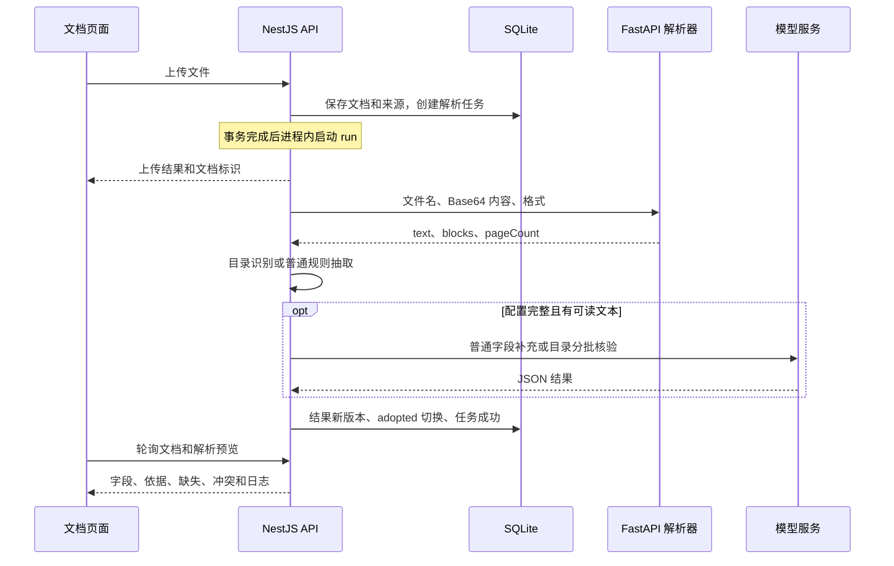

# 01 · 运行流程与调用链

[返回总览](README.md) · [技术优势](02-技术实现与优势.md) · [优化方案](03-问题痛点与优化方案.md) · [项目表达](04-项目包装与答辩表达.md)

源码基线与证据编号见总览。本文解释当前运行方式；未实现的工作流、消息消费和优化另文说明。

## 1. 先理解三个边界

Web 是操作入口，负责上传、核对、筛选和任务展示。NestJS API 协调业务状态、数据持久化、网络采集、模型调用与权限。FastAPI 解析器负责把文件转成文本和位置，不负责决定哪些竞赛可以发布。

共享包 `packages/contracts` 约定 TypeScript 两端的数据类型、枚举、错误码和配置结构。Python 通过 HTTP JSON 接入，并没有自动共享同一份运行时类型校验。数据库由 Prisma 使用 SQLite；NestJS 内部虽然分很多服务，部署形态仍主要是一个业务 API 加一个解析进程。[E01、E03、E14]

```text
浏览器 React
  → Nginx /competition/api/ → NestJS /api/v1
      → Prisma → SQLite
      → StorageService → 本地或配置的对象存储适配器
      → ParserClient → FastAPI /v1/parse
      → 模型服务 /chat/completions
      → 受限公网网页与无头浏览器
```

## 2. 启动：先接通数据，再建立运行配置

API 从 `main.ts::bootstrap` 开始，先执行数据库引导，再创建 Nest 应用，设置 `/api/v1`、全局 ValidationPipe、异常过滤器、响应转换器和退出钩子。随后初始化配置解析器，读取 CORS、端口和监听地址并启动。[E01、E10]

配置初始化涉及版本快照和待重启项处理，不能把它理解为每次业务调用都重新读取 `.env`。但全局 ValidationPipe 的存在，也不能证明每个接口都严格校验：不少控制器参数是接口类型或 `Record<string, unknown>`，运行时没有 DTO 装饰器元数据，需要检查各业务入口实际做了什么。[E01、E08]

浏览器从 `main.tsx` 挂载 App，根据四个工作区路由进入总览、采集、竞赛库或设置。`api.ts` 先从同源 `system/client-bootstrap` 获得运行期 API 地址，缓存 60 秒、合并并发引导请求；引导请求有 3 秒超时，失败回到同源地址，并短暂缓存失败状态。普通业务请求经同一个封装处理响应与错误，但尚无统一超时和取消参数。[E01]

部署网关提供 Basic Auth，清除身份模拟请求头，将子路径 API 转发到本机端口。生产 API 使用配置的部署身份。这个边界说明目前更接近受保护的共享管理工作区，而不是具备独立账号体系的多租户产品。[E12、E16]

## 3. 链路 A：上传一份通知，形成可核对的竞赛信息

### 3.1 受理和去重

入口是 `DocumentsPage → POST documents → DocumentsController.upload → DocumentService.upload`。[E02、E15]

一次最多 10 份文件。服务检查单文件 20 MB、批次 50 MB及文件格式，对文件内容计算 SHA-256，在 `ownerKind + ownerId + fingerprint` 范围查重；数据库也有对应唯一约束。重复上传返回已有文档，删除中的相同文件则拒绝受理。

新文件先保存原件，再在事务中创建文档与来源记录，然后记录审计并提交解析任务。因此文件系统与数据库并非同一事务：原件写入成功、数据库创建失败时，仍可能留下孤立对象。这是后续补偿任务应处理的场景。

### 3.2 任务记录与实际执行

`ParseService.enqueue` 在事务里确认文档可用、复用该文档已有的 queued/processing 任务，创建任务并更新文档解析状态。事务完成后调用 `void this.run(...)` 启动异步处理。[E03]



这里的“异步”表示 HTTP 返回与后台处理分开。实际没有独立消息队列消费者，也没有查到启动时扫描并接管中断解析任务的实现。数据库任务记录不能单独保证进程重启后的恢复。

### 3.3 解析器负责什么

`ParserClient.parse → FastAPI /v1/parse` 把二进制以 Base64 放进 JSON。解析器使用 PyMuPDF、python-docx、openpyxl 处理 PDF 文字层、DOCX、XLSX，并处理文本/CSV；输出 text 和 blocks，位置包含 PDF 页码、Word 段落/表行、Excel 工作表/行等。[E03]

部分 PDF 赛题表可额外调用表格提取，不能据此说所有普通文档都使用了表格结构识别。位置也不是完整精确高亮：PDF 当前 bbox 是 null。图片分支返回空文本；没有真实 OCR。旧 `.doc/.xls` 不能按 DOCX/XLSX 能力宣传。

解析服务不可用时，文本和 CSV 可由 Node 直读；PDF、Word、Excel 会明确失败。解析器返回 415/422 时不会默默按文本处理，防止错误降级掩盖格式问题。

### 3.4 普通通知与学校目录走不同分支

普通通知：`ExtractionService.extract → extractFields → 可选 callLlm → merge`。规则先提取名称、主办方、报名时间、对象等字段，发现多个截止时间时保留冲突候选。模型最多接收普通文档前 8000 字符，补充规则缺失项，通常不覆盖已有明确规则字段；模型失败保留规则结果。[E04]

需要注意两个边界：名称有单独合并规则；普通模型补充尚未严格验证 snippet 是否真出现在原文。因此“已有字段级依据”不等于“所有模型字段已被程序证明为原文事实”。

学校目录：`extractDocumentCatalog` 识别目录标题、序号、跨行名称和 A/B/C 认定。每批最多 24 行并以 8000 字符为分批阈值，模型返回后逐项对比行数、序号唯一性、名称与等级。正常模型核验不替换原始行；任何一批失败，保留规则提取目录并标记核验未完成。[E04、E05]

这一差异很关键：一份学校目录含多场竞赛，目录未提供的主办方、报名时间不应由模型补猜。目录的 A/B/C 属于学校认定，保存到 `schoolRecognitionLevel`，与 `level` 区分。

### 3.5 采用新结果与人工确认

`ParseService.run` 保存 `ParseResultVersion` 新版本，在同一事务中取消旧版本 adopted、采用新版本、标记任务及文档成功。过程日志记录解析来源、文本量、模型配置、耗时和部分 token 信息。[E03]

人工确认进入 `confirmFromParse` 或 `confirmCatalog`。服务检查文档归属、可用状态、当前采用版本，以及没有正在执行的新解析任务；随后事务写入竞赛、来源、文档关联、字段依据、竞赛版本和 Outbox 事件。[E08]

普通确认的 `resultVersionId` 是可选校验，目录确认强制匹配，因此两条入口的防陈旧程度并不完全相同。确认可保存草稿，也可在具备 editor/reviewer/admin 角色时直接发布。**不能把全项目描述成“所有资料必须先进入审核队列”。**

## 4. 链路 B：输入竞赛名称，发现当年官网资料

### 4.1 启动任务与重复合并

`AgentDiscovery → POST agent/discovery-runs → CompetitionDiscoveryService.startRun` 立即返回 runId；页面轮询 `GET agent/discovery-runs/:runId`。[E06、E15]

服务在内存 Map 中维护任务。相同用户和目标的运行中任务会复用，`discover` 也按“用户、名称、年份”合并同一进行中的采集 Promise，后来调用者可以接收已产生的日志和页面。完成记录与可保存选择结果有 30 分钟生命周期；记录集合限制为 100。

这能避免同进程重复采集，但不跨进程共享，也不构成结果缓存或重启恢复。全局运行上限也不等于每用户公平限额。

### 4.2 搜索、候选和访问波次

`collect` 并行查询 Brave、搜狗，并读取本人已核验信息源；缺少官网候选时追加必应简称搜索。另有受配置控制的固定线索表，默认关闭。因此不能宣传为“完全没有人工站点知识”的通用搜索系统。[E06]

候选 Map 按 URL 归并，排除已访问地址、明显其他年份和校内通知线索。候选带名称匹配、来源、官网候选、翻页信息等属性，并根据已识别官网来源提高访问优先级。

每轮最多给模型 18 个候选；模型只能返回候选编号、翻页跳过项和是否停止。程序检查编号合法性，并限制一个波次最多访问 4 个不同主机。模型无效后切回规则选择；尚无可保存字段且仍有高相关候选时，程序可以拒绝模型过早停止。

总采集时限为 4 分钟、无进展阈值 90 秒。这些是循环中的停止检查，正在进行的请求/模型调用不一定被总预算立即取消，不能表述为严格 4 分钟硬截止。

### 4.3 HTTP 优先，动态页面用受限浏览器

`readPage → readRemote → SafeEgressService.fetch` 检查地址、DNS 公网结果、robots、域名间隔和响应大小。该发现链路开启 `pinAddress`，实际连接使用已检查 IP；重定向每跳重新检查，阻止 HTTPS 降级。[E07]

静态正文不足时用 `browseDiscoveryPage`。浏览器只允许受控 GET 资源，限制资源类型、请求数、总字节、会话时间和并行浏览器数量；只暴露筛选出的导航控件，排除表单内控件以及报名、登录、提交、删除、支付等动作。页面网络通过受保护读取函数提供，WebSocket 关闭，Service Worker 禁用。

这是浏览器辅助采集的约束机制。信息源采集的 `CrawlerService` 使用 `fetchRaw` 默认参数，与名称发现的地址固定、逐跳 robots 机制并不完全相同，应分别描述。

### 4.4 核验事实后才允许选择保存

`inspectDiscoveryPage/verifyPage` 判断竞赛身份、赛事年份和 general/regional/campus 范围；通知年份不匹配或无法确认时拒绝提取，首页和列表主要用来找通知。官方赛道目录、赛题和赛程还会进入专用提取逻辑。[E06]

对已有竞赛采集后，服务器保留完整候选结果、actorId、competitionId 和当时竞赛版本。客户端保存只提交 `runId + pageUrl + keys`，`selectedFields` 从服务器结果挑回字段；不会直接信任浏览器传入一个任意字段值。

`saveDiscoveryFields` 再做 URL/日期检查，以 `id + versionNo + 可访问范围` 条件更新并递增版本。写入失败会回滚；成功同时写来源、引用片段、版本与事件。由控制器推进该选择结果的版本，允许同一轮结果继续保存其他来源。[E08]

## 5. 链路 C：信息源采集与验证批次

`CrawlerController → CrawlerService.crawlSource` 创建持久化抓取任务，读取列表、保存请求证据和页面快照、筛选详情候选、逐个处理详情与附件，再调用抽取和赛事入库逻辑。[E13]

这是配置好信息源后采集公告的另一条路径，不是名称发现的同一个 worker。一般详情处理为顺序执行；某些站点有专用公告接口与赛事层级逻辑。

`TrackSplitService` 区分系列、届次、赛道与组别，计算四要素键。其兜底届次推断包含默认规则，不应解释成所有赛事届次都已经被官方证据确认。

验证批次为蓝桥杯专用：批次数据以 verification 标记进入，普通检索限定 formal 且排除 demo；人工提升时事务更新数据来源和批次状态。这提供了验证数据隔离，但不是通用、多租户测试沙箱，也不能保证所有统计入口都自动排除验证数据。

## 6. 链路 D：审核发布，再按条件查询

主发布路径是 `ReviewPage → CompetitionsController.publish → CompetitionService.publish`。控制器限制 reviewer/admin，服务验证 pending_review 状态，再以旧状态与 versionNo 做条件更新；同一事务写状态、审核记录和发布事件。[E08、E12]

`canAutoPublish` 的六条件返回结果，在当前 publish 中用于审核注释与事件标志。**auto.allowed 为 false 并不会阻止人工 publish**，且此处部分参数是固定值，所以不应把该函数描述成全局强制发布闸门。

检索主链：`SearchPage → POST search/competitions → CompetitionService.search → Prisma 条件过滤 → 最多取 500 条 → 赛道汇总与卡片计算 → 内存二次过滤排序 → offset 切页`。[E08、E15]

已实现公开/工作区范围、类别、级别、可信度、报名状态和时间筛选，以及 facets、隐藏结果统计和放宽建议。但 total/facets 的统计范围受候选上限限制，nextCursor 实际是 Base64 编码的 offset，不是数据库键集游标。

对话检索是 `AgentService.parseConditions → CompetitionService.search` 的规则条件转换，返回简短模板结论；当前 citations 为空。模型辅助采集确实存在，但不能由此推导“所有对话都是大模型推理”或“已有向量 RAG”。[E12]

## 7. 横向链路：配置怎样影响业务

设置页提交 `baseVersion`，部分保存请求结合 If-Match 和幂等键。后端校验配置定义、类型、范围、跨项关系、凭据引用及安全开关，再检查数据库最新版本，事务创建新快照与变更记录。[E10]

立即生效项更新运行值，待重启项保留旧运行值并标记 pending_restart；解析器从运行值读取配置。探针失败时尝试创建回退版本。探针目前主要检查数据库可用性及部分凭据可用性，不是每个配置目标的真实联网验收。

凭据明文进入本地 AES-256-GCM 加密库，业务配置只保存引用和尾号。浏览器不需要获得模型 API Key。[E11]

## 8. 应记住的六个结论

1. 文档解析、名称发现、信息源采集是三条相关但未统一的执行路径。
2. 解析器提取文本与位置，规则/模型产生候选，人工选择才进入业务写入。
3. 名称发现让模型选候选，地址、并发、范围和写入由程序约束。
4. 多表事务和版本校验已有实现，但文件存储、审计和外部模型不在同一事务。
5. 数据库有 Outbox 和任务模型，不代表已经有事件投递、消息确认或重启续跑。
6. 现有部署是受保护的共享工作区，真实多用户鉴权和全入口对象授权仍需完善。
