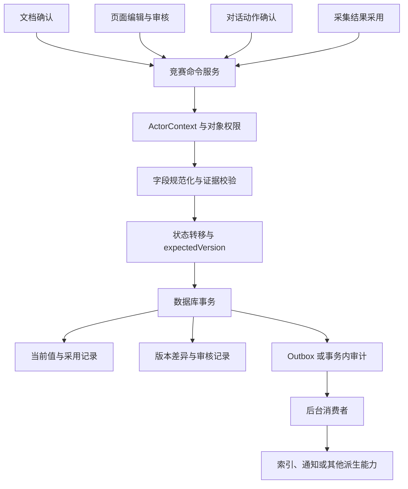

# 03 · 问题痛点与优化方案

[返回总览与证据表](README.md) · [现有调用链](01-运行流程与调用链.md) · [现有优势](02-技术实现与优势.md) · [答辩表达](04-项目包装与答辩表达.md)

**本篇是设计分析，不代表以下方案已完成。** 静态定位能确认代码路径与部分行为，涉及身份、并发、生产负载的影响仍应在隔离环境验证。本次只运行核验记录中注明的局部纯函数探针。

## 1. 优化排序：先消除错写、漏查和中断，再谈吞吐

| 顺序 | 痛点 | 当前证据 | 预期交付及优先级 |
| --- | --- | --- | --- |
| 1 | 不同入口的权限、状态与发布语义不一致 | 对话 confirm 只带 actorId，未经过页面的角色守卫；存在直接 update | 统一命令服务与授权策略，P0 |
| 2 | 模型字段和时间可能有值但不可信 | 普通模型 snippet 未做原文定位，日期推导存在边界 | 引用校验、字段规范化、时间边界与陈旧确认统一，P0 |
| 3 | 异步任务受重启影响，重复执行规则不完整 | `void run`、内存 Map、固定 v1 任务键 | 持久化任务、租约、幂等与补偿，P1 |
| 4 | 多表写入后事件未投递，审计失败影响响应语义 | Outbox 有 create 未查到投递循环；审计在事务外 | 可恢复 Outbox 消费和审计完整性，P1 |
| 5 | 检索有候选截断、状态过期与响应竞态 | `take:500` 后内存过滤；SearchPage 无新旧响应隔离 | 查询语义统一、数据库分页、客户端取消，P1 |
| 6 | 模型预算与日志分散 | LlmService 与 ExtractionService 两条调用路径 | 统一网关、预算预占、分块、可回放评测，P1/P2 |
| 7 | 采集与配置的约束未覆盖所有路径 | 网络调用参数不同；配置应用是多步骤 | 网络策略统一、配置应用可恢复和可观测，P2 |

P0 表示可能影响正确性/写入边界、适合最先收敛；P1 表示核心流程规模化与恢复；P2 表示前置机制稳定后补齐。它们是本次建议的工作顺序，不是已确认的线上事故等级。

## 2. 优化调用关系：所有入口汇入同一套业务命令

### 2.1 为什么仅给控制器加角色不够

页面发布从 `CompetitionsController` 进入，带 RolesGuard；对话确认从 `AgentController` 进入，只使用 AuthGuard。`AgentService.confirmAction` 可以调用 publish，删除分支更是直接把 publishStatus 改为 unpublished。普通服务调用不会再次经过另一个控制器的装饰器。[E08、E12]

因此应把**对象权限、允许状态、版本条件和事实要求**放进实际执行写入的应用服务。控制器仍可保留入口角色校验，但不能成为唯一保护层。

当前部署身份由网关和配置决定，是否存在可利用权限差异与部署策略有关；静态结论是入口保护不一致，不能直接宣称线上已发生越权。

### 2.2 建议的目标调用链



建议命令接口是设计示意：

```typescript
type ConfirmCommand = {
  commandId: string;
  competitionId: string;
  expectedVersion: number;
  actor: { userId: string; roles: string[]; teamId?: string };
  evidenceSelectionId: string;
  action: 'save_draft' | 'submit_review' | 'approve' | 'unpublish';
};
```

按顺序实现：先提取 policy；让对话动作携带完整 actor 并调用统一命令；再把文档直发、官网保存接入同一版本和授权规则。明确“文档确认直发”是否继续保留为特殊角色能力，避免在重构时悄悄改变产品流程。

**验收标准：** 同一 actor 对同一对象，从页面与对话入口得到一致的允许/拒绝结果；失败不改变竞赛；重复 commandId 返回同一业务结果；过期版本不覆盖新值；未实现动作返回未执行，不能统一写 executed=true。

## 3. 证据、模型与时间：先保护事实的适用范围

### 3.1 模型字段应是候选，引用校验通过后才可采用

当前普通模型合并可把缺失字段设为 explicit，但没有强制验证引用在原文中存在，也没有证明引用支持该字段值。[E04]

建议分四层，而不是只追加一句 Prompt：

1. **结构层：** 运行时 schema 限制字段 key、类型、长度、confidence 枚举，拒绝未知字段与不合格响应。
2. **引用层：** 模型返回 blockId 和引用片段；程序在同一文本块中定位，限定允许的空白/换行归一化，禁止用“所有非字母数字删除”之类过度宽松比较掩盖差异。
3. **语义层：** 时间、URL、主办方等字段用专用规则规范化；引用存在只是必要条件，还要确认它属于本届、对应赛道/地区，且上下文表达的是报名截止而非结果公布。
4. **采用层：** 校验失败进入 to_confirm；不同来源冲突保留多个候选，不覆盖高可信现值；人工修改写明采用者、理由及原候选。

模型置信度、来源可信度、字段完整性应分开保存：它们回答的是不同问题。规则分数也不应展示成正确率。

建议新增不可变的 EvidenceCandidate 与 AdoptionRecord，当前 Competition 保存查询所需的采用值。旧依据不覆盖，版本记录保存全部实际变化字段。字段适用范围至少包括赛事/届次、赛道、地区；学校认定还需要学校和认定版本。

**验收标准：** 伪造 quote、其他年份 quote、校内报名日期、同名赛事与缺少等级的目录均不被静默采用；人工更正后可回查“原文是什么、采用值是什么、谁更改”。

### 3.2 时间推导要有明确的判定顺序

`deriveRegistrationStatus` 当前先判断已过截止，再判断 7 天内截止，之后才看未来开始。若今天为 11 月 17 日，开始为 11 月 19 日、截止为 11 月 20 日，会得到 closing_soon，而非 not_started。[E09]

建议先校验起止有效性，再按产品定义处理：已截止 → 未开始 → 即将截止 → 报名中。对 `start > end` 单独标记数据异常，不能靠分支顺序给出貌似合理状态。

`parseDateTime` 当前用 Date.UTC 构造而没有往返验证，类似 2 月 30 日会滚到 3 月。应校验月份、当月天数、时分秒及支持的时区，未知时区不可默默当 UTC。按日截止应明确当前口径为 23:59:59，是否需要包含最后一秒的毫秒由产品统一决定。

统一函数给查询、详情、看板和赛道汇总使用；使用明确 asOf 计算，避免同一请求内多次获取现在时间产生边界漂移。

**验收标准：** 开始前、起止同日、跨年、按日/按秒、非法日期、未知时区和起止颠倒各有固定时间的断言；列表与详情在同一 asOf 返回相同状态。

### 3.3 把“确认当前版本”设为所有采用入口的不变量

普通文档确认允许不传 resultVersionId，虽然事务里会检查 adopted，仍缺少强制证明“用户看见并核对的就是这个版本”。目录确认已强制匹配，两条行为应统一。[E08]

同时避免按 normalizedName 跨个人草稿或不同届次误合并。匹配应先限制拥有者/工作区与届次，再明确同名的合并决策；需要修改已发布项时走修订命令，而非让普通导入隐式决定覆盖。

**验收标准：** 新解析完成后，旧核对页即使省略版本参数也必须被拒绝；同名不同届次、不同用户草稿不互相覆盖。

### 3.4 合并后重算派生字段，已发布项修改要有修订语义

`ExtractionService.merge` 修改 fields 后仍展开原 rule 返回，missing、conflicts、competitionName 等派生信息没有统一重算。模型补上了字段，预览仍可能保留旧缺失列表；冲突候选与模型补值也可能同时存在。建议集中建立 normalize/validate/derive 阶段，所有来源候选合并后再计算展示与质量，保留人工尚未解决的冲突。[E04]

官网补全写主办方、参赛对象、报名地址或截止后，当前没有对所有父项统一重算 completeness/credibility；有赛道的部分摘要另算质量，容易使不同视图采用不同口径。应以已采用事实为唯一输入，统一派生完整性、可信度和报名状态，并在同一业务提交中更新查询投影。[E08、E09]

另外，官网保存范围允许修改已发布竞赛，当前操作不自动转回待审。产品需明确哪些变更允许直接修订、哪些需要审核；建议关键报名时间、对象或入口的改动创建 revision，审核前保留旧发布版本，审核后切换发布指针。若选择允许特定角色直改，则记录明确修订动作、原因和完整差异，不能称其为“全部变更重新审核”。

**验收标准：** 模型补值后缺失列表与实际字段一致；冲突仍需显式解决；补齐关键字段后各页面质量一致；已发布信息修改遵循明确的修订策略，公众不会看到未获允许的中间版本。

## 4. 任务恢复与幂等：把“有状态表”变成“能接管执行”

### 4.1 当前存在两类不同问题

解析任务持久化，但执行 Promise 在进程内；官网发现则连运行状态和可保存选择也主要在 Map 内。重启后前者可能卡在 processing，后者 runId 丢失。[E03、E06]

此外解析任务键：非 reparse 使用 `${documentId}:v1`，数据库字段有唯一约束。已有任务结束后，再发普通 user_request 会再次尝试创建同一个键；如果未复用成功结果或转为新运行键，可能触发唯一冲突。reparse 使用 Date.now 也不能作为严格的并发唯一性证明。[E03、E14]

### 4.2 按当前规模先实现数据库任务租约

无需先引入 Redis。建议在既有 ParseTask/CrawlTask 基础上补齐：`leaseOwner、leaseUntil、heartbeatAt、nextAttemptAt、maxAttempts、inputFingerprint、configVersion、resultRef`。名称发现增加持久化 run/selection，记录截止时间和 actor 归属。

```text
受理：事务创建 queued 任务与命令结果 → 返回 taskId
领取：worker 条件更新 queued/租约过期任务 → processing + leaseOwner
执行：按阶段处理、续租、保存检查点
完成：同一事务保存结果并更新 succeeded
失败：分类后有限重试，或转 failed/dead_letter
恢复：启动/定期扫描到期租约，以检查点判断从哪里继续
```

单 SQLite worker 应短事务领取、事务外处理外部 I/O；租约仍需匹配 owner 才可完成，避免过期旧执行者覆盖新执行者。队列并发受解析器、浏览器和模型预算共同限制，不能只看 Node 请求并发。

### 4.3 幂等键必须表达“重复”的业务含义

- 相同文档、提取配置/模型版本不变的普通识别，可复用成功结果。
- 用户明确重识别用新的 run UUID，输入指纹另存；“新执行”和“内容相同”不要共用一个字段。
- 写入采用命令用 commandId；同一结果重试只产生一次版本与事件。
- 结果键包含来源内容指纹、解析器版本、Prompt/schema 版本及必要的模型配置，避免错误复用旧结果。

重试分类：可恢复网络错误、429、部分 5xx 采用有上限的退避和抖动；格式非法、引用失败、权限不足直接返回业务错误。创建竞赛、发布、付费调用等有副作用步骤不得盲目重试。

**验收标准：** 在领取后、解析后、结果事务前终止 worker，重启后可完成；同任务两个 worker 只有一个有效完成；同命令重试不增加业务记录；租约过期旧 worker 的结果被拒绝；无消费者时 queued 状态可观察且不伪装 processing。

## 5. Outbox、审计和存储：补全跨边界失败处理

### 5.1 Outbox 的价值与未完成部分

关键业务事务已经写 OutboxEvent，可避免“业务提交了但事件创建失败”。当前业务源码未查到扫描 pending 并投递、更新 deliveredAt 的消费者，也没有由此触发的完整订阅推送。[E08、E14]

下一步用 worker 领取事件、按订阅目标投递，成功后标记；失败记录重试时间和次数，耗尽进入死信。对外副作用实现至少一次投递，消费者按 eventId 去重。消费者可能“处理成功但确认丢失”，所以不能声称只靠 Outbox 就实现恰好一次。

通知推送开放前还需独立补齐用户身份、订阅条件快照、渠道配置、发送记录和退订；事件表不能替代这些产品能力。

### 5.2 审计不应改变已提交命令的成功语义

当前很多业务先提交事务，再 await audit.record；若审计失败，客户端可能看到错误，但业务已经成功。应选择事务内写轻量审计记录，或事务内写 audit Outbox 后异步展开，并明确“已提交但响应丢失”的查询机制。

当前审计哈希计算使用随机 nonce，但存储字段没有保留该 nonce，序列化内容也未作为完整载荷保存；单凭库内字段无法直接重算同一个 hash。同时 lastHash 在落库前更新，并发与写入失败可能使链条分叉。[E14]

如需要可验证审计链：保存规范化 payload（含 nonce、序列号、时间与版本）、在事务中串行获取前驱并写入，增加离线校验器；更高等级的篡改发现还需独立可信锚点。当前只能称为带 prevHash 的审计记录，不能称为不可篡改日志。

### 5.3 保留删除协议，补偿上传孤儿和存储来源

现有 deleting 状态和可重试删除值得保留。上传增加“暂存对象—数据库引用—完成标记”或孤儿对象清理；数据库创建失败不应长期留下无归属文件。存储切换时应为对象记录 backend/targetVersion，避免只根据当前全局目标寻找所有历史对象。[E02]

文件签名密钥建议独立配置、生产缺失时拒绝签发，不能依赖开发默认值；比较采用恒定时间函数。权限仍要校验对象归属，签名不代替身份。

**验收标准：** 审计/存储故障时响应与实际提交状态一致；重试不重复业务动作；对象清理只处理无引用且超过保留窗口的内容；校验器能检出更改过的审计载荷。

## 6. 检索优化：先保证查全和排序，再优化速度

### 6.1 当前 500 条截断改变了结果语义

`search` 没有数据库稳定排序，先取 500 条，再计算赛道摘要、二次过滤、排序和分页。即使所有 SQL 条件正确，第 501 条也可能是最符合条件或最早截止的一条，但没有机会参加后续比较。返回 total/facets 也不代表全库。[E08]

因此加缓存只能缓存一个受截断的结果，不能解决漏查。先定义完整查询语义，再决定缓存。

### 6.2 建立可查询的读模型

当前赛道信息有一部分保存在 discoveryTracks 的 FieldEvidence JSON 中。建议将需要筛选/排序的字段投影到明确的赛道/阶段表或查询摘要表：竞赛、赛道、届次、scope、effectiveDeadline、时间精度、采用版本和 asOf。

筛选在 SQL 中完成；父项是否命中用关联 EXISTS，父项汇总规则与详情共用。状态最好根据 now 与起止时间推导；若为索引而物化状态，需要明确过期刷新和查询兜底，不能长期依赖导入时的 registrationStatus。

按排序方式设计稳定顺序，例如 `(effectiveDeadline, id)`；复杂默认排序还须包含 rank 等完整排序键，并明确定义空日期的位置。游标携带版本化的排序键及筛选条件指纹。total/facets 在相同范围内单独聚合，若有意限量估算，接口须明确 approximate。

先用当前 SQLite 的查询计划验证复合索引，比如公开数据的状态/截止组合；待数据量、写并发或语言检索需求实测达到瓶颈，再考虑 PostgreSQL/FTS/搜索引擎。无需先假定 Elasticsearch 是正确答案。

### 6.3 客户端同时修复新旧请求竞争

`SearchPage` 直接对每次 query 发请求并 setResult，没有取消或请求序号；输入 A 后输入 B，若 A 后返回，页面可能回到旧结果。`DocumentsPage` 已用请求序号防护，可以复用思路。[E15]

请求层支持 AbortSignal；搜索按产品体验加防抖，条件变化重置游标，只允许当前请求更新 result/state/error。旧请求失败也不能覆盖新请求的成功状态。发现轮询已有 active 标记和定时器清理，继续保留，不必重复设计。

**验收标准：** 构造超过 500 条、最优结果在旧上限外的数据，仍能查到并正确排序；跨页无重复/遗漏；相同 asOf 的列表与详情状态一致；A 慢 B 快时最终始终展示 B。

## 7. 模型调用统一：成本、上下文和质量要一起治理

### 7.1 先统一两条调用路径

`LlmService` 记录调用、按 taskType 统计当天条数；`ExtractionService` 直接调 requestModelCompletion，日志主要在 ParseTask trace，并未自动经过前者的配额与记录。因此当前不能说所有模型调用均有统一预算。[E04、E11]

建议统一 ModelGateway：调用前完成任务路由、schema、预算预占、超时与取消，调用后统一记录模型、Prompt 版本、配置、tokens、耗时、原因和结果验证状态。正文提取保留专用算法，但请求从网关发出。

配额需指定 user/team/task/run 和业务时区；用事务原子预占，成功结算，失败按规则释放。现在“count 后再调用”在并发下可能超额，dailyQuota 还是每任务类型计数，不能解释为全局限额。

### 7.2 用结构化分块替代普通正文前缀截断

以 PDF 页、Word 段落、Excel 行或标题段为块，先检索字段锚点和上下文，再对缺失/冲突字段调用模型。跨块结果保留候选与出处；不能让每块各自生成一个最终日期后直接取最后一个。

普通文档前 8000 字符可作为明确降级策略，但界面要展示覆盖范围。目录按行分批已经更接近结构化输入，可以为可疑行、缺等级、序号断裂单独调用模型，降低无价值的全量重复核验。

缓存键至少覆盖内容指纹、提取任务、模型、Prompt/schema 版本和关键配置；租户隔离须明确。只有内容没变不代表不同 Prompt 的结果可以复用。

### 7.3 用真实样本评测，而不是用“有 JSON”当成功

建立离线标注集：普通通知、目录、多截止冲突、年份不明、校内选拔、跨年赛程、扫描件、动态网页。分别统计字段准确性、引用可定位率、无依据字段率、目录漏行/改名率、模型降级率和单任务 tokens。明确分母、人工标注规则与版本，不把配置阈值写成收益。

**验收标准：** 所有业务模型调用均有关联记录；并发预算不超预占上限；正文尾部的关键字段可以被结构化选中；引用不成立时不采用；离线评测能按模型/Prompt 版本重放比较。

## 8. 网络和配置：把局部约束提升为全入口不变量

### 网络

发现路径使用 pinAddress 和逐跳 authorizeUrl；普通 crawler 的 fetchRaw 默认没有固定连接 IP，robots 主要检查初始目标，附件路径也需统一审核。应统一 EgressPolicy，对重定向每跳应用地址、robots、限流和总预算，并把采集原因、最终地址、指纹、策略版本写进请求证据。[E07、E13]

现有限流器是进程内“读最后时间—等待—写时间”，并发等待者可能同时放行。先用每主机串行 Promise 队列或原子预留 nextAllowedAt 解决单进程并发；多实例后再引入共享限流。浏览器/模型/解析器都用同一个 run budget 传递剩余时间与取消信号。

### 配置

版本快照写入已有唯一约束，可作为并发冲突基础。下一步关注“快照已提交、apply 状态未写完”及两个进程的运行值差异，增加 applying/applied/failed 状态、应用任务与恢复扫描。回退前确认仍是待回退版本，避免自动回退覆盖其他管理员随后保存的新版本。[E10]

autoRevert 目前失败只记日志，错误载荷中的 revertedToVersion 不能无条件理解为已完成回退。接口应返回真实 resultingVersion 与回退结果。配置探针与真实连接测试分开展示，多进程时记录 instanceId + appliedVersion。

**验收标准：** 保存后进程被中断可恢复应用状态；A 版本探针失败时不能覆盖已提交的 B 版本；前端明确显示保存版本、运行版本、待重启项和回退失败。

## 9. 可实施的四个工作包

| 工作包 | 修改范围建议 | 完成条件 |
| --- | --- | --- |
| A · 正确性与写入边界 | competition/agent 服务、授权策略、确认 DTO、time/extraction、相关测试 | 同入口权限一致、强制版本、引用候选、时间边界通过 |
| B · 任务与提交恢复 | parse/discovery、任务 schema、worker、Outbox、审计、存储补偿 | 中断接管、幂等、失败可重试、事件可重放、审计可解释 |
| C · 查询完整性 | 赛道/阶段读模型、competition search、SearchPage、查询测试 | 超上限数据查全、稳定游标、状态一致、无陈旧响应 |
| D · 模型与配置治理 | ModelGateway、预算/记录、提取分块、EgressPolicy、配置应用状态 | 全路径预算、样本评测、全入口网络策略、配置恢复 |

每包先完成隔离环境验收，再考虑部署。这里没有给出天数或性能改善百分比，因为团队人数、交付周期、数据规模和负载尚未提供。

## 10. 验证证据应该怎样留下

正确性报告保存输入样本 ID、预期/实际、源码版本和运行环境；任务报告保存故障点、租约与恢复轨迹；检索报告保存数据规模、查询条件、结果完整性与查询计划。用户授权压测后，再补并发、吞吐、P50/P95/P99、错误率、CPU/内存和上游调用占比。

只有这些数据存在，才能把“查全了”“中断能恢复”“重复不会重复写”写成验收结果；性能变化则要求相同环境、相同数据和可比负载下的前后结果。
