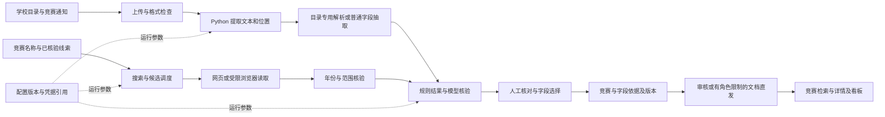

# 方湖观澜：运行流程、技术优势与优化设计

分析日期：2026-11-17（Asia/Shanghai）。分析基线为当前 `competition-sj` 源码；当前目录无 Git 历史。本文面向项目讲解、答辩与技术面试，目标表达供理解掌握后选用，个人职责另由本人确认。

本次范围是项目机制分析与表达，不改动业务实现。源码事实、静态风险与未实现方案分别标注。历史部署结果引用已有记录，本次没有重新访问线上、恢复运行数据或运行压测。

## 先看结论

项目最适合定位为：**面向高校竞赛资料的、带字段依据和人工核对流程的信息采集与治理平台。** 核心价值是让“找到的一篇通知”变成“能核对来源、区分适用范围、能审核发布的一组竞赛信息”。

业务难点集中在事实边界：学校 A/B/C 认定与赛事行政级别不同；校内选拔截止与全国报名截止不同；发布日期与赛事年份不同；一场赛事的不同赛道可能有不同时间。系统的辨识度来自对这些差异的处理，以及规则、模型、人工三者之间的职责分配。

当前已有机制足以支撑较扎实的项目介绍，但端到端可靠性仍有缺口。优先级应是：统一写操作和对象权限 → 校正字段与时间语义 → 持久化任务与事件消费 → 修正检索完整性 → 统一模型预算，再按测量结果决定是否扩容。

## 阅读顺序

| 材料 | 要解决的问题 |
| --- | --- |
| [01-运行流程与调用链](01-运行流程与调用链.md) | 系统如何启动，文档与官网信息怎样流入竞赛库，前后端与解析器怎样协作 |
| [02-技术实现与优势](02-技术实现与优势.md) | 每项机制解决什么痛点、为什么有价值、当前边界在哪里 |
| [03-问题痛点与优化方案](03-问题痛点与优化方案.md) | 按影响优先级定位问题，给出目标调用链、实现步骤和可验收标准 |
| [04-项目包装与答辩表达](04-项目包装与答辩表达.md) | 项目简介、四条主亮点、两分钟讲解、面试追问和主张审计 |
| [核验记录](verification.json) | 本次源码哈希、文档链接检查及纯函数探针结果 |

核验脚本为 [verify.mjs](verify.mjs)，在项目根目录使用 Node 22.14+ 执行 `node --experimental-strip-types docs/02_architecture/deep-dive/verify.mjs`。它只读取源码、运行目录/时间纯函数并写本目录核验报告，不启动应用。

## 全局流程

图中合并的是业务概念。上传解析、名称发现和信息源采集在代码中是不同路径，并没有统一的持久化工作流引擎。

## 证据使用方式

各文档用 `E01…E16` 引用同一份证据表，符号名比行号更稳定。相对链接指向真实源码；本次哈希记录用于识别后续源码变化。测试文件证明有这些测试场景；本次没有重跑完整 Vitest 套件，不能把历史 141 项通过写成本次结果。

| 编号 | 源码入口与阅读符号 | 证明的事实 |
| --- | --- | --- |
| E01 | [main.ts](../../../apps/api/src/main.ts) `bootstrap`；[app.module.ts](../../../apps/api/src/app.module.ts)；[App.tsx](../../../apps/web/src/App.tsx)；[api.ts](../../../apps/web/src/lib/api.ts) | 启动、依赖绑定、工作区路由、客户端引导与请求封装 |
| E02 | [document.service.ts](../../../apps/api/src/services/document.service.ts) `upload/delete`；[file-security.ts](../../../apps/api/src/domain/file-security.ts)；[storage.module.ts](../../../apps/api/src/platform/storage.module.ts) | 指纹去重、原件存储、删除状态、签名下载 |
| E03 | [parse.service.ts](../../../apps/api/src/services/parse.service.ts) `enqueue/run`；[parser-client.service.ts](../../../apps/api/src/services/parser-client.service.ts)；[main.py](../../../apps/parser/app/main.py) | 进程内解析执行、分阶段日志、多格式文本和位置、文本降级、图片空分支 |
| E04 | [extraction.service.ts](../../../apps/api/src/services/extraction.service.ts) `extract/extractCatalog/merge`；[rule-extractor.ts](../../../apps/api/src/domain/rule-extractor.ts) | 规则先行、模型补充、冲突候选、失败保留规则结果 |
| E05 | [document-catalog.ts](../../../apps/api/src/domain/document-catalog.ts)；[document-catalog.test.ts](../../../apps/api/src/domain/document-catalog.test.ts)；[recognition-catalog.txt](../../../apps/api/src/domain/fixtures/recognition-catalog.txt) | 多竞赛目录、跨行名称、学校认定等级和真实 71 行测试样本 |
| E06 | [competition-discovery.service.ts](../../../apps/api/src/services/competition-discovery.service.ts) `discover/collect/chooseNavigation/verifyPage/selectedFields`；[competition-discovery.ts](../../../apps/api/src/domain/competition-discovery.ts) | 多搜索源、候选集合、并发调度、年份范围核验、服务端候选选择 |
| E07 | [safe-fetch.ts](../../../apps/api/src/platform/safe-fetch.ts)；[discovery-browser.ts](../../../apps/api/src/platform/discovery-browser.ts)；[rate-limiter.service.ts](../../../apps/api/src/platform/rate-limiter.service.ts) | 公网请求检查、可选地址固定、重定向检查、浏览器资源与动作限制、进程内间隔控制 |
| E08 | [competition.service.ts](../../../apps/api/src/services/competition.service.ts) `confirmFromParse/confirmCatalog/saveDiscoveryFields/publish/search`；[publish-state-machine.ts](../../../apps/api/src/domain/publish-state-machine.ts) | 事务写入、版本校验、发布路径与检索上限 |
| E09 | [quality.ts](../../../apps/api/src/domain/quality.ts)；[time.ts](../../../apps/api/src/domain/time.ts) | 完整性、可解释可信度、时间精度和状态推导 |
| E10 | [config.service.ts](../../../apps/api/src/config/config.service.ts) `persist/applyVersion/rollbackTo`；[config-resolver.service.ts](../../../apps/api/src/config/config-resolver.service.ts) | 配置快照、版本冲突、保存值与运行值、重启生效和回退 |
| E11 | [credential-vault.service.ts](../../../apps/api/src/config/credential-vault.service.ts)；[llm.service.ts](../../../apps/api/src/services/llm.service.ts)；[model-completion.ts](../../../apps/api/src/config/model-completion.ts) | 加密凭据、模型任务路由、调用记录和服务商参数适配 |
| E12 | [auth.module.ts](../../../apps/api/src/platform/auth.module.ts)；[agent.controller.ts](../../../apps/api/src/controllers/agent.controller.ts)；[agent.service.ts](../../../apps/api/src/services/agent.service.ts)；[competitions.controller.ts](../../../apps/api/src/controllers/competitions.controller.ts) | 部署身份、角色校验差异、规则对话与动作执行 |
| E13 | [crawler.service.ts](../../../apps/api/src/services/crawler.service.ts)；[verification.service.ts](../../../apps/api/src/services/verification.service.ts)；[track-split.service.ts](../../../apps/api/src/services/track-split.service.ts) | 信息源采集、快照、赛事层级、验证批次与正式数据隔离 |
| E14 | [schema.prisma](../../../apps/api/prisma/schema.prisma)；[audit.module.ts](../../../apps/api/src/platform/audit.module.ts) | SQLite、唯一约束、索引、事件表与审计哈希实现 |
| E15 | [DocumentsPage.tsx](../../../apps/web/src/pages/DocumentsPage.tsx)；[AgentDiscovery.tsx](../../../apps/web/src/components/AgentDiscovery.tsx)；[SearchPage.tsx](../../../apps/web/src/pages/SearchPage.tsx) | 文档请求序号、发现轮询清理、搜索响应竞态差异 |
| E16 | [部署状态](../../../DEPLOYMENT_STATUS.md)；[nginx-locations.conf](../../../deploy/nginx-locations.conf)；[package.json](../../../package.json) | 历史部署验收、Basic Auth、子路径代理及声明的构建流程 |

## 交付边界

- 技术定位按现有 TypeScript / Python 项目组织，可面向全栈或 AI 应用工程岗位调整重点。
- 没有个人职责资料，因此不把系统能力自动表述成“本人主导全部建设”。
- 没有新增性能实测，因此不提供 QPS、P95、准确率或节省人力的虚构数字。
- 改进方案全部留在第三份文档，不混入已实现亮点。`verification.json` 中的探针只验证注明的局部行为。
