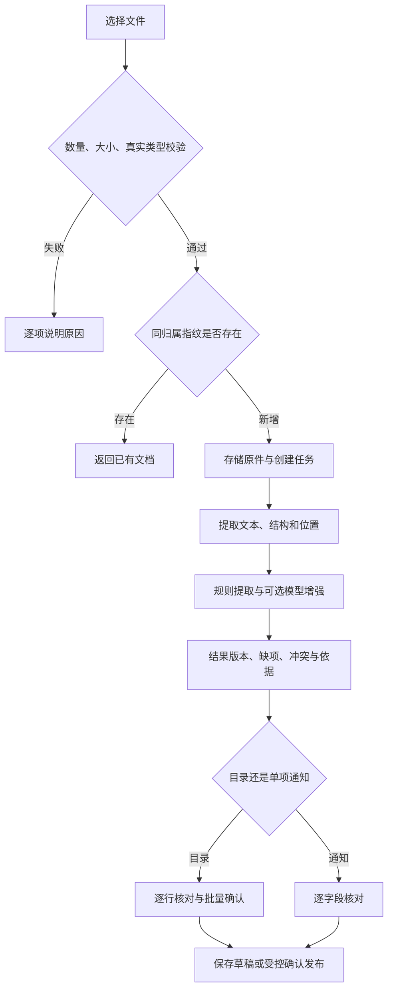
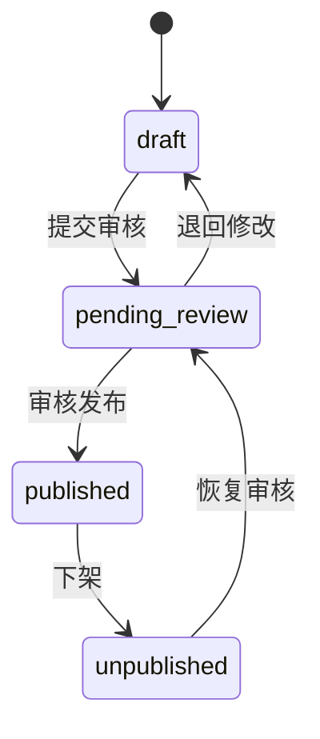
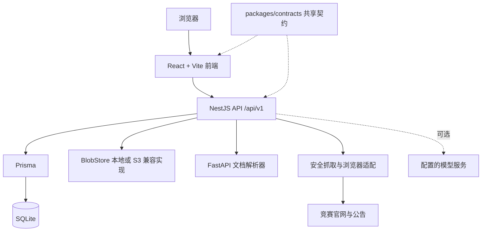
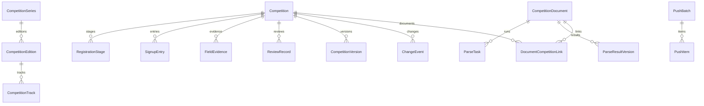

# 方湖观澜：产品功能与技术设计说明书

> 学科竞赛信息智能感知平台｜功能规划、页面排版、业务规则与技术实现
>
> 文档版本：1.0｜编写日期：2026-11-17｜时区：Asia/Shanghai
>
> 事实范围：`competition-sj` 当前本地源码；历史材料仅作为背景。本次未重新登录线上系统、查询线上数据库或进行性能测试。
>
> 文档用途：产品评审、前后端开发、页面设计、测试验收与后续交接。本文中的目标、拟定接口和迭代建议，不代表功能已经交付。

## 阅读导航

1. [产品定位与设计结论](#1-产品定位与设计结论)
2. [现状与功能边界](#2-现状与功能边界)
3. [用户角色与使用场景](#3-用户角色与使用场景)
4. [功能需求与优先级](#4-功能需求与优先级)
5. [信息架构与页面导航](#5-信息架构与页面导航)
6. [页面布局与视觉排版](#6-页面布局与视觉排版)
7. [逐页面设计说明](#7-逐页面设计说明)
8. [核心字段与数据表达](#8-核心字段与数据表达)
9. [业务流程与状态机](#9-业务流程与状态机)
10. [系统架构与技术选型](#10-系统架构与技术选型)
11. [数据模型与一致性](#11-数据模型与一致性)
12. [接口设计与契约](#12-接口设计与契约)
13. [采集、解析与智能能力](#13-采集解析与智能能力)
14. [权限、安全与审计](#14-权限安全与审计)
15. [非功能要求与指标](#15-非功能要求与指标)
16. [测试与验收](#16-测试与验收)
17. [部署、备份与运维](#17-部署备份与运维)
18. [分阶段实施计划](#18-分阶段实施计划)
19. [已知问题与技术债](#19-已知问题与技术债)
20. [技术文档自身的排版规范](#20-技术文档自身的排版规范)
21. [评审决策与完成标准](#21-评审决策与完成标准)
22. [源码依据与接口索引](#22-源码依据与接口索引)

## 1. 产品定位与设计结论

### 1.1 一句话定位

方湖观澜面向高校竞赛参与者与管理人员，把分散在学校文件、竞赛官网和官方通知中的信息，整理成**可以检索、能够核对来源、经过审核、保留变更记录的竞赛资料库**。

产品的核心价值是降低“找比赛、辨别是否适合、确认当年安排、核对报名入口”的成本。自动采集和模型提取是形成资料的工具，最终交付物是可靠、清楚、可追溯的竞赛信息。

### 1.2 应优先形成的业务闭环


闭环成立的标准不是“成功访问了多少个网页”，而是：用户可以找到一项竞赛，理解其适用对象与报名阶段，并定位到支撑关键字段的原始资料。

### 1.3 本文建议采用的产品决策

| 决策 | 建议 | 原因与影响 |
| --- | --- | --- |
| 首版形态 | 优先完善管理工作台与只读竞赛查询 | 现有采集、审核、检索链路已经具备代码基础 |
| 核心信息单元 | 赛事系列、届次、赛道、报名阶段分别表达 | 同名赛事每年变化，赛道之间也可能采用不同安排 |
| 来源要求 | 关键字段必须有来源，无法确定时明确缺失原因 | 防止历史信息、校内通知或模型推断混入全国赛事事实 |
| 人工与自动化关系 | 自动提取生成候选，审核负责发布；受控直发保留独立权限与审计 | 当前代码存在确认并发布路径，不能把所有入口都描述为强制双人审核 |
| 页面组织 | 延续现有四个一级工作区，按任务组织二级导航 | 减少改版成本，并使录入、查询、审核、配置各有入口 |
| 数据增长 | 先修正查询范围和分页，再考虑专用搜索组件 | 当前查询有取前 500 条再过滤的实现限制 |
| 智能能力 | 规则模式可独立运行，模型增强可选 | 配置或模型故障不应阻断基础录入和查询 |
| 订阅通知 | 放入后续迭代，先补齐规则、调度、去重和投递记录 | 当前页面明确说明不会发送消息 |
| 多用户上线 | 先补真实身份、对象级权限与写操作授权 | 现有部署身份与角色配置不等于完整的账号体系 |
| 技术投入 | 保持现有应用边界，按实际瓶颈增加 Worker 或数据库能力 | 不为文档完整而引入暂时不需要的基础设施 |

### 1.4 产品边界

本系统负责信息采集、结构化、核验、查询和更新提示。报名动作最终由官方渠道或学校组织流程完成。

学校 A/B/C 类认定必须来自对应学校的文件，且与赛事行政级别、学科分类、平台可信度分开展示。系统不能自行认定评优资格、获奖价值或学分归属。

社交社区、在线支付、代报名、比赛作品托管、在线评审和通用聊天机器人不纳入当前主线。若未来增加，应独立说明业务负责人、数据边界和投入收益。

## 2. 现状与功能边界

### 2.1 状态说明

- **已有实现**：源码中存在相关页面、接口或服务逻辑；不代表本次已完成线上验收。
- **部分实现**：主要链路存在，但有范围限制、缺少关联能力或尚未完成端到端核验。
- **结构预留**：存在模型、枚举、占位页面或少量读接口，尚不构成完整业务能力。
- **建议新增**：本文提出的目标设计，需开发与测试后才能对外承诺。
- **历史记录**：来自已有报告；只代表其记录时间及统计范围。

### 2.2 功能现状清单

| 模块 | 源码现状 | 当前可以确认的范围 | 后续重点 |
| --- | --- | --- | --- |
| 总览分析 | 已有实现 | 统计卡、趋势、分类分布、临近截止与质量概览 | 统一统计范围、时区与刷新规则 |
| 文档上传 | 已有实现 | 单批最多 10 个、单个 20 MiB、批次 50 MiB；指纹去重 | 上传进度、大文件内存边界与格式说明 |
| 文档解析 | 已有实现 | PDF 文字层、DOCX、XLSX、CSV、TXT/Markdown 等路径 | 复杂表格、长文档与能力探测 |
| DOC / XLS 旧格式 | 部分实现 | 扩展名被分类，但实际走 OOXML 校验和解析器 | 暂应提示转 DOCX/XLSX，或另建转换链路 |
| 图片与扫描件 OCR | 结构预留 | Python 依赖声明有 OCR 可选项，但当前图片分支返回空文本，未见实际 OCR 调用 | 接入识别引擎后独立验收，不能仅安装依赖就宣称支持 |
| 学校竞赛目录导入 | 已有实现 | 目录解析、学校认定等级及批量确认接口 | 保持原行、年度与认定文件版本 |
| 识别运行详情 | 已有实现 | 任务状态、历史运行、阶段日志、模型配置快照 | 重启恢复与失败重试策略 |
| 官网发现与字段补充 | 已有实现 | 名称发现、页面读取、字段选择保存、部分赛事专用适配 | 来源覆盖、身份校验、持久化任务与公平配额 |
| 信息源管理 | 已有实现 | 添加、探测、启停、手动采集与健康信息 | 变更编辑、归属授权与调度器 |
| 定时采集 | 结构预留/需补齐 | 存在频率配置和 schedule 类型；本次未发现独立持续调度执行器 | 明确执行器、抢占、补偿与运行证据 |
| 验证批次 | 已有实现 | 创建、采集、查看、转正式、清理 | 转正前报告与状态边界复核 |
| 竞赛检索 | 已有实现但有限制 | 条件查询、状态范围、分页结果、分布和宽松建议 | 移除取前 500 条限制；补齐声明但未真正执行的筛选项 |
| 赛事详情 | 已有实现 | 概况、赛道、报名阶段、入口、来源、字段依据与变更 | 信息主次、旧信息提示、赛道级日期表达 |
| 审核发布 | 已有实现 | 草稿、待审核、发布、退回、下架、恢复；另有确认并发布入口 | 统一所有写入口的授权和发布门槛 |
| 收藏 | 已有实现 | 收藏/取消收藏接口与详情操作 | 独立“我的收藏”列表与失效提示 |
| 对话检索 | 部分实现 | 规则识别条件、库内搜索、会话与动作确认 | 语义能力、引用完整性、写动作权限 |
| 订阅与推送 | 结构预留 | 规则和推送数据模型、只读页面；对话路径可写入简单订阅规则 | 完整配置、调度、退订、幂等投递与失败处理 |
| CSV 导出 | 部分实现 | 固定字段导出，内部查询 limit=100 | 与当前筛选一致、导出范围与公式注入防护 |
| 配置中心 | 已有实现 | 分组编辑、凭据引用、测试、版本差异、回滚、就绪检查 | 核验每项配置的真实生效路径 |
| 身份权限 | 部分实现 | 开发身份模拟、部署身份、角色守卫 | 多用户登录、会话、对象级授权和团队隔离 |
| 生产环境 | 历史记录 | 2026-11-17 部署报告记载 Nginx、systemd、SQLite 与解析服务 | 本文未重新验证线上状态；不沿用旧统计作为当前数据 |

源码入口见第 22 节和独立的[源码核查索引](SOURCE_AUDIT.md)。

### 2.3 不能由界面文字推导出的能力

1. 质量报告页面中的“准确率 ≥90%”等是目标文字，并非本次获得的测量结果。
2. 存在 `OutboxEvent`、`DeadLetterTask`、`ProcessingCheckpoint` 不代表已有完整消息队列、持久化 Worker 或自动恢复系统。
3. 存在“官方来源”类型、可信度分数或 `whitelist` 字段，不代表来源已经过独立的官方身份认证。
4. `/readyz` 返回数据库可用，不代表模型、OCR、官网访问、对象存储及全部功能均可用。
5. 现有历史报告中的 71 项学校目录、某次检索条数、测试数量均有时间和范围限制；本文不把它们当成当前全量数据。

## 3. 用户角色与使用场景

### 3.1 目标角色

以下为目标权限设计；现有角色守卫只是实现基础，具体差异见第 14 节。

| 角色 | 主要目标 | 首页重点 | 核心操作 |
| --- | --- | --- | --- |
| 查询用户 / viewer | 找到适合自己的比赛 | 检索、临近截止、收藏 | 看已发布信息、核对来源、收藏、跳转官方入口 |
| 资料编辑 / editor | 把资料整理成可审核记录 | 我的文档、待完善草稿、失败任务 | 上传、采集、修订自有或授权资料、提交审核 |
| 审核人员 / reviewer | 判断资料是否足以发布 | 待审队列、冲突、关键缺项 | 比对依据、退回、发布、下架与恢复审核 |
| 系统管理员 / admin | 保证平台可运行且可追踪 | 就绪状态、失败率、配置变更 | 配置、凭据、信息源策略、角色授权和运维 |

管理员权限不应自动抹去个人草稿或团队边界；如需管理访问，应另有明确授权和审计。

### 3.2 关键使用场景

**场景 A：学生找比赛。** 输入“计算机、正在报名”，查看结果卡中的参赛对象、届次和最近截止；进入详情核对赛道级安排，最后跳转官方入口。对尚未公布的时间，页面提示“待公布”，不生成倒计时。

**场景 B：老师导入学校目录。** 上传只有名称和 A/B/C 认定的 PDF，核对目录行数、合并单元格和分类，批量形成草稿；后续逐项补采主办方、适用对象和当年通知。目录导入完成不等于报名信息完整。

**场景 C：编辑补全单项赛事。** 从草稿进入官网采集，指定目标年度/届次，查看候选官网与公告；按字段对比现值和候选值，选择有依据的值保存；若赛事已发布，关键变更按目标流程重新审核。

**场景 D：审核者发现截止冲突。** 右侧比较学校通知和全国官网，识别“校内报名截止”与“官方报名截止”的不同范围；保留两个阶段，不用一个日期覆盖另一个。

**场景 E：管理员诊断模型失败。** 在运行详情查看是否启用、使用的模型和配置版本、是否截断、失败分类与规则降级结果；在配置中心测试连接并保存新版本，不在运行日志中展示密钥。

### 3.3 用户任务的完成条件

查询用户完成的是“知道这是什么比赛、我是否可能符合条件、何时行动、去哪里核实”；编辑完成的是“形成带依据的候选信息”；审核者完成的是“作出可追踪的发布判断”；管理员完成的是“能够解释系统为何可用或不可用”。页面应围绕这些结果安排内容。

## 4. 功能需求与优先级

优先级：P0 为可信业务闭环与开放访问前必需项；P1 为提升日常效率的功能；P2 为扩展能力。每个需求均应区分已有代码与待开发差距。

### 4.1 P0：可信录入、核验与查询

| 编号 | 功能 | 需求描述 | 验收重点 |
| --- | --- | --- | --- |
| F-01 | 身份与数据范围 | 当用户请求个人、团队或未发布资料时，系统必须校验身份和对象范围 | 他人草稿、文档、会话、任务、版本和导出均不可越权 |
| F-02 | 文件上传 | 支持多文件、逐项结果、同人指纹去重与明确的格式限制 | 10 个/20 MiB/50 MiB 边界、中文文件名、重复文件和错误提示 |
| F-03 | 可追踪解析 | 每次解析形成独立任务及结果版本，保留阶段与降级原因 | 重复点击复用活动任务；旧结果不能覆盖新结果 |
| F-04 | 目录批量导入 | 识别学校目录行、学校认定及来源位置 | 行数可核对；合并单元格不造成认定级别串行；未推断官网和日期 |
| F-05 | 赛事身份识别 | 官网候选必须同时核对赛事名称、届次/年度和内容范围 | 同名赛事、往届公告、校内选拔、主办方新闻被正确区分 |
| F-06 | 字段依据 | 关键字段同时保存值、状态、来源、原文和位置 | 点击字段可解释“为什么是这个值”，人工修改有标记 |
| F-07 | 缺失与冲突处理 | 未提及、待确认、解析失败、不适用分别表达 | 不用空字符串或统一“暂无”掩盖不同原因 |
| F-08 | 审核发布 | 普通编辑提交审核；审核者作出发布或退回决定 | 状态转换合法；退回/下架有原因；特殊直发有单独授权 |
| F-09 | 竞赛检索 | 支持真实生效的条件、清楚的结果范围、稳定分页 | 已发布与工作区范围分开；不会遗漏第 501 条之后的数据 |
| F-10 | 详情页 | 清晰呈现赛事、当届、赛道、报名阶段及入口 | 全国与校内安排分开；日期精度、时区和来源清楚 |
| F-11 | 失败恢复 | 外部站点、解析器或模型失败时给出分类与下一步 | 已保存资料保留；可重试；重启后不永久卡在处理中 |
| F-12 | 配置就绪 | 配置页面、运行连接和健康信息使用一致的生效语义 | 保存不等于生效；需重启/下任务生效均有明确提示 |

### 4.2 P1：管理效率与可用性

| 编号 | 功能 | 建议内容 | 关键约束 |
| --- | --- | --- | --- |
| F-13 | 待完善队列 | 按缺项、年份未确认、证据不足和冲突分类 | 缺项原因来自业务字段或任务结果，可跳转处理 |
| F-14 | 收藏与最近查看 | 独立收藏页、状态变化提示、已下架说明 | 用户范围隔离；收藏不赋予未发布数据访问权 |
| F-15 | 高级筛选 | 目标年度、学校认定、学历、年级、团队方式 | 先实现后展示；未知资格不能直接判断为“符合” |
| F-16 | 变更比较 | 新旧字段并排、对应来源、采纳/保留/待审 | 发布数据的关键字段更新进入受控流程 |
| F-17 | 批量操作 | 批量启动采集、提交审核、受控导出 | 逐项授权、数量上限、部分失败和操作报告 |
| F-18 | 质量工作台 | 缺失率、有效证据率、来源过期和积压时长 | 指标具备分子、分母、范围和统计时间 |
| F-19 | 持续采集调度 | 到期任务、域名限速、重试与任务恢复 | 单源互斥、进程重启恢复、来源策略与资源上限 |
| F-20 | 查询一致导出 | 按当前条件和权限导出，显示实际条数 | 完整分页或异步导出；CSV 内容安全处理 |

### 4.3 P2：扩展能力

| 编号 | 功能 | 应包含的子能力 | 实施前提 |
| --- | --- | --- | --- |
| F-21 | 订阅与通知 | 规则增删改、通知偏好、实时/汇总、退订、投递历史 | 账号、时区、可靠调度与消息幂等 |
| F-22 | OCR | 扫描 PDF、图片、旋转校正、置信度与页面定位 | 识别引擎接入、资源隔离和专用评测集 |
| F-23 | 对话增强 | 可解释条件解析、条件编辑、结果引用和澄清 | 搜索契约先完整，写操作复用业务授权 |
| F-24 | 匹配推荐 | 根据显式个人条件解释推荐理由 | 用户授权、资格未知值处理、推荐效果评估 |
| F-25 | 数据规模升级 | 数据库迁移、数据库内分页、可选全文检索 | 先记录真实瓶颈、索引与查询计划 |

### 4.4 首版不应抢先建设的内容

在数据依据和审核链路尚未稳定时，大规模个性化推荐、社区、积分体系、复杂大屏和多级微服务拆分都无法解决当前核心问题。应优先使每条展示信息都能解释、修正和持续维护。

## 5. 信息架构与页面导航

### 5.1 延续现有四个工作区

```text
方湖观澜
├─ 总览分析
│  ├─ 竞赛总览                         /overview
│  └─ 质量报告                         /overview/quality
├─ 信息采集
│  ├─ 文档录入                         /collection
│  │  └─ 文档运行详情                   /collection/documents/:documentId/runs
│  ├─ 官网采集                         /collection/web
│  ├─ 信息源                           /collection/sources
│  └─ 采集测试                         /collection/testing
├─ 竞赛库
│  ├─ 竞赛检索                         /library
│  ├─ 竞赛审核                         /library/review
│  ├─ 对话检索                         /library/assistant
│  └─ 订阅管理                         /library/subscriptions
├─ 赛事详情                             /competitions/:id
└─ 系统设置（管理员）                   /settings/*
   ├─ 模型接入
   ├─ 服务与环境
   ├─ 数据存储
   ├─ Python 解析服务
   ├─ 采集运行
   ├─ 留存与审计
   └─ 变更与回滚记录
```

以上路径和设置分类来自当前 `App.tsx`、`SettingsPage.tsx`。收藏、待完善队列、个人中心如新增，应先定义路由和权限，再加入菜单。

### 5.2 导航规则

1. 一级导航表达工作领域，二级导航表达具体任务，页面内标签表达同一对象的不同信息。
2. 保留已有旧路由重定向，包含查询参数和文档定位，避免历史书签失效。
3. 从文档进入竞赛草稿时，返回应恢复原文档列表或查询条件。
4. 从检索进入详情后，返回应恢复关键词、筛选、排序和页位置。
5. 菜单隐藏只是界面行为，接口必须独立授权。
6. 若面向学生开放独立只读入口，默认进入竞赛检索；管理人员默认进入总览或待办。

### 5.3 每个页面的固定说明

每页应有清晰标题、一句话用途、当前数据范围、一个主要动作，以及在必要时展示的数据时间。例如竞赛检索页可写：

> 查询已发布竞赛，按学科、报名状态与时间筛选。赛事安排以对应届次的官方通知为准。

管理工作区则应写明“全部可见”包含哪些状态，不使用容易误解为全库权限的“所有数据”。

## 6. 页面布局与视觉排版

本节同时回答“界面如何排版”和“业务信息先展示什么”。现有值与建议值分开说明，本文不修改页面代码。

### 6.1 全局框架

现有桌面外壳为 **252 px 侧栏 + 自适应主区**，含顶栏、工作区标题和二级导航；样式已具备明暗主题与多个响应式断点。

建议继续使用这一框架。桌面内容区内边距采用 24 px，卡片间距以 16–24 px 为主；表单和详情可读行宽控制在约 65–85 个拉丁字符的量级，中文页面以实际视觉检查为准。超宽屏不要无限拉长正文，应限制主体最大宽度并居中。

推荐布局逻辑：

```text
应用侧栏 │ 顶栏：当前位置 / 全局搜索 / 主题 / 用户
         │ 工作区标题 + 用途说明 + 主要动作
         │ 工作区二级导航
         │ 条件或状态提示
         │ 页面主要内容
         │ 分页 / 数据时间 / 辅助说明
```

### 6.2 字体与层级

| 层级 | 现有或建议规格 | 使用场景 |
| --- | --- | --- |
| 主字体 | 沿用现有 Inter、Noto Sans SC、PingFang SC、Microsoft YaHei、系统字体回退链 | 正文、表单、导航；不要求所有字体已安装 |
| 等宽字体 | 沿用 JetBrains Mono、Consolas 等回退链 | 任务 ID、错误码、配置版本和数字对齐 |
| 页面标题 | 建议 24–28 px，600–700 字重 | 每页一个主标题 |
| 分区标题 | 建议 16–18 px，600 字重 | 卡片、表单分组、详情小节 |
| 正文 | 现有基准 14 px；行高 1.55 | 描述、字段值、一般表格 |
| 次级说明 | 建议 12–13 px | 来源、更新时间、帮助文字 |
| 统计数字 | 建议 28–34 px | 少量核心指标，附单位和口径 |

标题负责组织，不用大字号重复同一数值。长中文名称允许两行，不能让关键赛道、届次仅依赖鼠标悬停才能看到。

### 6.3 色彩与状态

沿用现有主色 `#4f6ef7`、背景 `#f4f5f7`、正文 `#101828`，通过现有 CSS 变量适配暗色。色彩值是当前源码事实，不代表完成对比度认证。

| 信息类型 | 建议表达 | 注意事项 |
| --- | --- | --- |
| 主要动作 | 主色实心按钮 | 一个局部操作区尽量只有一个视觉主动作 |
| 正常/通过 | 绿色 + 文字 | 区分“审核通过”与“官网可访问” |
| 待确认/缺失 | 橙色 + 原因 | 不把所有待确认项渲染成严重错误 |
| 冲突/失败 | 红色 + 可执行处理动作 | 提供来源比较或重试，不只显示“出错” |
| 历史/未开始/中性 | 灰蓝色 + 状态文字 | 保持可读，不用低对比度隐去信息 |
| 即将截止 | 醒目日期 + 文字标签 | 必须有明确日期依据；未知日期无倒计时 |

发布状态、报名状态、完整性、可信度、入口状态是不同维度。不要把五种徽章全堆在标题前；结果卡优先放报名状态和发布时间状态，其他信息放辅助行。

### 6.4 按内容选择展示形式

| 内容 | 推荐形式 | 选择原因 |
| --- | --- | --- |
| 学生浏览竞赛 | 卡片或紧凑列表 | 便于快速比较名称、对象、截止与入口 |
| 编辑批量管理 | 原生数据表格 | 状态、批量选择、排序和密集操作更高效 |
| 竞赛详情 | 分组字段 + 简短段落 + 阶段表格 | 不同类型信息各用适合的结构 |
| 字段核对 | 并排比较或右侧依据抽屉 | 降低现值、候选值和原文之间的切换成本 |
| 时间趋势 | 折线图 | 必须说明日期粒度和统计口径 |
| 分类对比 | 水平条形图 | 长分类名可读，数值轴从零开始 |
| 长原文、规则说明 | 可折叠正文 | 保持首屏聚焦，同时保留核对能力 |
| 多阶段安排 | 表格或有实际时间语义的时间轴 | 明确阶段、适用对象、开始、截止和来源 |

图表必须与当前查询范围一致。若只有一两个数字，直接用数字和文字，不为占满页面增加图形。

### 6.5 响应式与可访问性目标

目标断点可沿用并整合现有 1180/900/640 px 等布局规则，具体以组件行为验证为准：宽屏使用侧栏和双栏；中屏缩窄导航、部分区块换行；窄屏使用单栏，筛选改抽屉，依据区按需展开。

目标包括：键盘可完成关键流程、焦点可见、输入有真实标签、错误与字段关联、按钮有明确动作名称；颜色之外同时提供文字。异步结果使用适当的状态播报，减少动画偏好下关闭非必要动效。状态表格可横向滚动，但页面主体不应产生非预期横向溢出。

### 6.6 五类通用状态

| 状态 | 页面内容 | 下一步 |
| --- | --- | --- |
| 加载中 | 稳定占位或阶段进度，避免内容跳动 | 长任务可离开后返回 |
| 真正空库 | 原因说明与初始化入口 | 添加信息源或上传文件 |
| 筛选无结果 | 已选条件、清空/放宽建议 | 保留用户条件以便调整 |
| 请求失败 | 用户可读原因、错误追踪号 | 可重试；保留已填写内容 |
| 无权限 | 明确对象不可访问 | 返回有权页面；不泄漏对象内部信息 |

## 7. 逐页面设计说明

### 7.1 竞赛总览

**用途：** 管理人员快速判断数据规模、近期行动与质量问题。

建议顺序为“关键统计 → 近期截止与待办 → 趋势和分类 → 质量摘要”。首屏统计以已发布、待审核、待完善、即将截止等 4–6 项为限。学生视图突出报名动态，管理员视图再展示任务健康度。

趋势图必须标记按发现、入库还是发布统计，以及 7/30/90 天范围。现有实现中发现和入库口径都使用 `createdAt`，不能把两条相同来源的指标解释为独立采集时间。

临近截止列表至少显示竞赛名、届次/赛道、阶段、明确截止、报名入口状态。待办点击后进入带有对应条件的队列，而不是仅跳转到没有筛选的列表。

### 7.2 文档录入

**用途：** 从文件形成可确认的候选资料。

页面上方为上传区，说明真实支持格式、数量和体积；下方为“我的文档”列表。每行展示文件名、格式、大小、上传时间、最近任务、关联竞赛和操作。

上传结果按文件反馈，不能因一个文件失败而把其他文件显示为全部失败。重复文件应提示已存在及对应记录；同名但内容不同的文件应有不同指纹和记录。

识别完成后先进入核对：普通通知显示字段核对面板，学校目录显示行表格及导入数量。主动作根据权限和流程显示“保存草稿”或“确认并发布”，两者不能共用模糊的“确认”标签。

删除前提示影响范围：删除原件是否影响来源查看、解析历史及已发布记录。具体行为遵循现有删除服务和回归用例，不能在未核对依赖时承诺级联删除竞赛。

### 7.3 文档运行详情

**用途：** 解释一次识别经历了什么、输出是什么、为什么降级。

建议左侧为历史运行列表，右侧为选中运行的摘要、配置快照、阶段日志和结果入口。移动端历史列表折叠为选择器或横向紧凑列表。

每次运行至少显示：任务 ID、触发方式、状态、开始/结束、耗时、解析来源、模型是否实际调用、模型名、配置版本、输入字符数、发送字符数、截断情况与失败码。

日志记录处理事件和可核验结果，不记录模型内部推理、API Key 或整篇原始正文。没有调用模型应明确写“规则模式”，不要展示暗示模型已工作的装饰性进度。

### 7.4 官网采集

**用途：** 找到目标赛事的可靠资料并生成候选字段。

推荐采用“目标输入 → 运行进度 → 候选页面 → 字段选择”的任务布局。目标应包含赛事名，以及必要时的年度/届次；已有关联竞赛时带出当前信息。

候选来源卡展示标题、域名、公告年份、身份核对结果、抓取时间与错误原因。对已知反爬或 robots 限制，展示“自动访问受限”，提供人工打开核对入口。

保存区按字段显示现值、候选值和原文引用。默认不覆盖人工确认值；发现冲突先比较。用户保存的是所选字段及其依据，不是整个页面所有字符串。

### 7.5 信息源管理

**用途：** 维护可持续访问的官方站点或公告源。

建议使用表格：名称、类型、地址、归属、是否验证、启用状态、最近成功、连续失败、频率和操作。添加后先探测再启用；“探测通过”只说明可访问或可处理，不等于官方身份得到认证。

连续失败或结构变化应进入待处理状态。采集频率展示计划值，同时展示调度器是否运行、最近实际执行和下一次计划；没有执行器时不显示误导性的“自动监控中”。

### 7.6 采集测试

**用途：** 在不污染正式竞赛库的情况下验证信息源、规则与解析结果。

布局为批次列表、批次摘要、问题表、候选详情。摘要包含发现数、抓取成功数、解析数、候选数、缺项数和失败分类，并说明各阶段计数不能相互替代。

“转正式”操作展示将转入的记录及目标状态；验证成功不自动等于发布。“清理批次”需确认影响和保留的审计范围。正式检索、总览、通知均默认排除验证数据。

### 7.7 竞赛检索

**用途：** 用最少操作找到可进一步核实的比赛。

桌面推荐“左侧筛选约 240–280 px + 中间结果主列”，右侧分布在宽屏按需出现。搜索框与排序位于结果顶部，已选条件以可移除标签展示。管理者提供“已发布”与“全部可见”范围切换。

卡片信息建议按以下顺序：

1. 竞赛名称、年度/届次和重要状态。
2. 主办方、学科、学校认定等辅助信息。
3. 参赛对象摘要和赛道数量。
4. 最近有效报名截止，注明是哪个阶段或赛道。
5. 信息完整性提示、更新时间与详情入口。

“官方未公布”“尚未核实”“没有匹配结果”应使用不同文案。列表不把平台可信度分数当作获奖含金量。资格未知时显示“条件待核实”，不得暗示符合。

现有关键词实际主要匹配名称、描述和分类；即使输入框写有“主办方”，也需补实现和测试后才能承诺支持主办方关键词检索。

### 7.8 竞赛详情

**用途：** 让用户形成参赛判断，并能核对每项关键信息。

推荐采用“顶部摘要 + 主体内容 + 依据侧区”，桌面主辅宽度约 2:1，窄屏改为单列和依据抽屉。首屏优先显示名称/届次、参赛对象、最近截止、阶段范围、报名方式和资料更新时间。

正文顺序建议：赛事简介 → 参赛对象 → 赛道/组别 → 报名与比赛安排 → 报名入口 → 奖项与规则 → 来源与变更。管理操作集中在独立区，普通查询用户不占用首屏空间。

多赛道赛事必须逐项表达科目、适用人群、报名时间、比赛时间和对应通知。父赛事“最近截止”只是摘要；不能把最早一个赛道的截止解释为全赛事统一截止。

报名按钮随方式变化：网页方式“前往官方报名”，学校统一方式“查看校内安排”，邮箱方式显示地址与材料要求，待公布方式显示禁用态和原因。跳转前可提示外部域名及最近核验时间；登录要求和 403 不直接判无效。

依据侧区显示字段、值、原文片段、材料、位置、提取方式、人工修订标记和抓取时间。对于无法定位的材料，明确说明定位粒度，不伪造精确页内坐标。

### 7.9 竞赛审核

**用途：** 快速发现发布风险并形成可追踪决策。

推荐三部分：左侧队列，中部竞赛字段，右侧来源对比；屏幕不足时使用两栏并可展开依据。队列按等待时长、关键冲突和截止临近排序，提供我的草稿与待审核模式的清楚区别。

每个关键字段应能看到“现值 → 候选值 → 依据 → 处理结果”。退回、下架必须填写原因；发布前给出关键缺项和来源范围摘要。是否允许缺项发布应有显式规则，不能把“信息不完整”误解为系统错误。

本地代码存在有权限人员确认文档并直接发布的路径；若目标流程要求编辑与审核职责分离，需通过后端收敛写入口实现，不能仅更改按钮文字。

### 7.10 对话检索

**用途：** 将自然语言转换为用户看得懂、能编辑的条件。

页面应展示用户问题、识别出的条件、检索范围、结果卡与放宽建议。回答引用已发布记录及其来源，不生成没有入库依据的新赛事信息。

当前实现以关键词规则和数据库搜索为主，引用数组存在空实现；不能宣传为已完成的开放域问答或完整 RAG 系统。发布、下架、创建订阅等动作即使有确认按钮，也必须再执行服务端角色、范围、状态和幂等校验。

### 7.11 订阅管理

当前页面应继续清楚显示“推送待开放”，并解释已有规则不等于会收到消息。未来完整页面需要：规则列表、条件编辑、频率与时区、渠道绑定、启停与退订、测试通知、历史批次与失败原因。

若规则包含“截止前三天”，必须定义执行时区、同一变更是否重复通知、截止延长后的新提醒、已下架赛事处理和渠道重试上限。

### 7.12 质量报告

**用途：** 为维护工作提供依据，而不是只展示漂亮比例。

上方展示范围、统计时间和样本规模，中部展示实际指标，下方展示目标与评测结果。实际观测值和目标阈值必须分区，未测量时写“未评测”。

建议重点指标：关键字段缺失率、证据覆盖率、按时间范围确认的公告覆盖率、失败任务分类、待审时长、入口状态与来源陈旧程度。各指标均可点击进入问题记录。

### 7.13 系统设置

**用途：** 解释配置是什么、来自哪里、何时生效、失败如何恢复。

沿用现有七组页面，每组按“当前生效值 → 修改区 → 测试 → 保存结果”组织。配置表保留来源、作用域、生效方式和只读原因。密钥仅显示引用和是否配置，不提供明文回显。

保存前基于配置版本检查并发修改。连接测试只验证指定目标，不应顺带改写配置。回滚先展示差异与受影响组件；回滚产生新的版本记录，历史版本不可原地编辑。

当前 CORS 在应用启动时读取，配置元数据却标记为即时生效；应核验并统一实现与提示，否则用户可能误以为保存后连接策略已经改变。

## 8. 核心字段与数据表达

### 8.1 竞赛资料字段字典

下表同时包含当前字段与推荐补充的业务维度；“建议”项不能直接视为现有数据库列。

| 字段组 | 关键字段 | 展示与校验规则 |
| --- | --- | --- |
| 身份 | name、series、edition、track、parentId | 名称与届次分开，保留原始名称；合并需明确身份依据 |
| 范围 | 年度、届次、全国/地区/学校、适用院校 | 目标维度；部分现有信息分散在关联对象和依据中，需统一表达 |
| 分类 | category、level、schoolRecognitionLevel | 学科、赛事级别、学校认定三个概念不可互换 |
| 内容 | description、比赛内容/任务、赛道与科目 | 保留摘要与原文依据；过滤页脚和版权等非业务文本 |
| 主办 | organizers、role | 主办、承办、协办角色分开，学校通知发布部门不自动成为全国赛事主办方 |
| 对象 | eligibility：学历、年级、专业、地区、组队、跨校 | 三值判断：符合/不符合/未知；只有明确规则才能得出结论 |
| 阶段 | stages：name、stageType、applicableTo | 区分学校选拔、官方报名、材料提交、比赛和结果公布 |
| 时间 | start/end 的 at、precision、timezone、rawText | 原文到日期，或到具体时分秒；无依据不补年份 |
| 报名 | signupMethod、entries、note、contact | 网页、邮箱、学校统一、线下、待公布分别呈现 |
| 质量 | completeness、credibility、siteStatus | 分别表达完整性、来源/审核启发式评分和入口访问状况 |
| 发布 | publishStatus、publishedAt、versionNo | 发布状态与报名状态独立；版本用于并发控制与追踪 |
| 数据治理 | dataOrigin、demoFlag、verificationBatchId、deletedAt | 正式、验证、演示及逻辑删除进入统一查询策略 |
| 来源 | sources、documentLinks、capturedAt | 来源标题、URL/文档、获取时间与归属 |
| 证据 | fieldEvidence：snippet、location、confidence、method | 不只存链接，应能说明字段与片段之间的关系 |
| 建议补充 | 证据对应年度、人工确认人/时间、失效原因、下一复核时间 | 逐步从 JSON 或隐含约定整理为明确契约 |

### 8.2 字段状态与界面文案

| 状态 | 语义 | 推荐文案 | 用户动作 |
| --- | --- | --- | --- |
| explicit | 原文明确给出 | 正常显示值 | 可查看依据 |
| unmentioned | 已读材料未提及 | 本材料未说明 | 补充其他官方材料 |
| not_applicable | 本事项不适用 | 不适用，并附原因 | 无需强行补值 |
| to_confirm | 候选存在但未确认 | 待核实 | 比较与人工确认 |
| unrecognized | 找到相关内容但未可靠解析 | 识别不确定 | 查看原文或重试 |

“尚未公布”是业务原因，“未解析成功”是处理结果，不能都映射成同一个空值。建议为缺失原因增加明确代码与说明；当前枚举不足时通过契约扩展完成。

### 8.3 时间表达原则

保留原文、标准时间、精度、时区以及阶段范围。仅给日期时，界面展示日期精度，不伪装为官方给出了 23:59:59。内部如采用当日结束作为计算约定，必须标记为系统约定，而非原文事实。

目标状态推导次序为：有效起止与范围校验 → 已截止 → 尚未开始 → 七天内截止 → 报名中；缺少足够依据时为待定。当前 `time.ts` 中“七天内截止”早于“尚未开始”的判断，需要增加尚未开放但即将截止的边界用例。

赛事年度、公告发布时间、报名年份和比赛年份可能不同。例如某届赛事在上一自然年开始报名，不能简单要求全文所有年份都等于目标年。应核对届次及公告明确覆盖的时间范围。

### 8.4 学校认定与多赛道范围

学校目录中的组合行先保留原样。只有官方资料或学校文件明确支持时再拆分；拆分应保留父项、原行序号和认定适用范围。

学校认定至少应可追溯到学校、文件标题、版本/年份与原行。若文件只认定父赛事，子赛道不能自动继承为确定认定，应标注适用范围待核实。

## 9. 业务流程与状态机

### 9.1 文档录入流程



关键约束：保存必须携带当前解析结果版本；文档删除、重新识别或竞赛并发更新后，旧核对页不能静默覆盖新状态。

### 9.2 官网补采流程

目标赛事及届次 → 发现候选站点 → 安全抓取 → 验证身份与范围 → 提取候选字段 → 比较现值 → 选择采用 → 校验竞赛版本 → 保存字段、来源与变更。

异常分支需保留具体原因：超时、robots 禁止、反爬、无法确认赛事、年份/届次不明、扫描件无文字、解析器不可用、正文无该字段、字段与现值冲突。候选来源无结果不能自动写入“该比赛不存在”。

### 9.3 发布状态机



这是现有领域状态机的主路径。代码中的“确认并发布”属于另一类已存在的写入路径，目标设计应将其定义为单独授权的受控捷径，或根据治理要求收敛到主路径。

审核发布时应记录操作者、时间、版本、意见和资料范围。若资料缺项但仍允许发布，应对查询用户显示缺项，不把缺项填成推测事实。

### 9.4 已发布信息更新：建议流程


当前 `saveDiscoveryFields` 已保存字段、版本及部分变更，但不能据此断言已有完整的“已发布快照 + 待审修订”双版本发布机制。若要保证线上稳定，应补充这一层。

### 9.5 验证数据转正式

创建验证批次 → 受控采集 → 核对候选和报告 → 选择转正式 → 保留批次来源 → 按审核规则形成正式草稿/待审记录。验证库清理与正式记录删除是不同操作，需分别定义保留策略。

### 9.6 长任务恢复：目标要求

任务状态应至少涵盖 queued、processing、succeeded、partial、failed、canceled。当前部分枚举已有，取消和恢复的完整操作仍需验收。

目标执行器应记录心跳、租约和尝试次数；Worker 异常后回收超时租约，对已完成阶段采用检查点或幂等记录避免重复写入。现有解析是进程内触发，发现任务也使用内存 Map，不能承诺进程重启后自动续跑。

## 10. 系统架构与技术选型

### 10.1 当前工程架构



此图表达源码中的组件边界，并不表示图中每个可选后端都已在生产启用。Nginx、systemd 和子路径部署见第 17 节。

### 10.2 版本依据

下表来自清单约束，`^`、`>=` 为声明范围，不能作为实际安装版本证明。当前锁文件或已安装环境另行决定最终版本，本次不追求或宣称“最新版本”。

| 层次 | 当前声明 | 职责 |
| --- | --- | --- |
| Node / 包管理器 | Node `>=22.14.0`；pnpm `10.32.1` | 工作区安装、开发、构建和 API 运行 |
| Web | React `^19.0.0`；React Router `^7.1.1` | 组件和页面路由 |
| Web 构建 | Vite `^6.0.7`；TypeScript `^5.7.3` | 开发服务器、类型检查与打包 |
| 图表 | ECharts `^5.5.1` | 趋势、分布与质量可视化 |
| API | NestJS `^11.0.6` | 控制器、服务装配、守卫与生命周期 |
| 数据访问 | Prisma / Client `^6.2.1` | 模型、查询与事务 |
| Python | `>=3.11` | 文档解析服务运行环境 |
| 解析库 | FastAPI、PyMuPDF、python-docx、openpyxl | 格式解析；具体声明见 pyproject.toml |
| 可选 OCR | PaddleOCR / PaddlePaddle 依赖预留 | 当前业务代码尚未形成 OCR 调用链 |
| API 测试 | Vitest `^3.2.4` | 领域、服务与配置等回归测试 |

### 10.3 模块职责

| 目录 | 当前职责 | 建议边界 |
| --- | --- | --- |
| `apps/web/src/pages` | 13 个页面组件 | 处理页面状态和布局，不复制领域状态机 |
| `apps/web/src/components` | 核对、采集、图表和基础 UI | 沉淀统一空态、错误态、字段与依据组件 |
| `apps/web/src/lib` | API 客户端、格式化 | 统一解包、错误与运行期引导 |
| `apps/api/src/controllers` | HTTP 接口和部分角色约束 | 参数转换、入口授权、返回契约 |
| `apps/api/src/services` | 采集、解析、竞赛、审核等业务编排 | 事务、对象授权、幂等和流程编排 |
| `apps/api/src/domain` | 时间、质量、归一化、提取和发现规则 | 保持尽可能可独立测试的确定性逻辑 |
| `apps/api/src/platform` | 数据库、鉴权、审计、存储和安全网络 | 为业务提供统一基础能力 |
| `apps/api/src/config` | 配置定义、解析、测试、凭据与就绪 | 清楚区分保存值、实际运行值和来源 |
| `apps/parser/app` | 文件到文本、结构与位置 | 无权发布竞赛或调用业务写接口 |
| `packages/contracts/src` | 共享类型、状态、错误码和配置契约 | 每次字段变化同步调用端与校验 |
| `deploy` / `scripts` | 安装、发布、配置检查与验收脚本 | 发布脚本和数据变更脚本分开使用 |

### 10.4 技术取舍

**继续使用现有前后端技术栈。** 当前主要问题在领域边界、权限与信息质量，重写技术栈不会直接改善这些问题。按模块缩小大型服务的职责即可。

**保留单体 API，逐步抽离长任务执行。** 上传、检索、审核和配置仍可在一个服务内；采集、解析、OCR 与通知适合从 API 请求生命周期中独立出去。单机阶段可先用数据库任务表与独立 Worker，不必立即引入多个新中间件。

**SQLite 适用于当前单机形态，但迁移不是修改一行 provider。** 升级 PostgreSQL 时应处理迁移脚本、数据类型、大小写与排序、唯一约束、并发事务、备份恢复和全链路回归。待写入并发、多实例需求或运维要求明确后再决定迁移时点。

**先修正数据库查询，再考虑全文检索。** 当前搜索先取 500 条再内存筛选，优先把权限、过滤、排序与分页尽可能下推数据库；有实测需求后再评估全文索引、专用搜索或向量检索。

## 11. 数据模型与一致性

### 11.1 当前模型分组

本次静态统计 `schema.prisma` 有 **50 个 model**。它们代表结构定义，不代表相关子系统全部完工。

| 分组 | 模型 |
| --- | --- |
| 赛事身份 | CompetitionSeries、CompetitionEdition、CompetitionTrack、CompetitionGroup |
| 赛事资料与来源 | Competition、Organizer、CompetitionOrganizer、RegistrationStage、SignupEntry、SourceMaterial |
| 文档与提取 | CompetitionDocument、DocumentCompetitionLink、ParseTask、ParseResultVersion、FieldEvidence、Draft |
| 审核与历史 | ReviewRecord、CompetitionVersion、ChangeEvent、TrackSplitRecord |
| 信息源与采集 | SourceDefinition、CrawlTask、Candidate、VerificationBatch、RequestEvidence、RawPageSnapshot、CrawlAttachment、ProcessingCheckpoint |
| 对话与个人数据 | AgentSession、AgentTurn、Favorite |
| 订阅投递 | SubscriptionRule、PushBatch、PushItem |
| 审计与可靠性 | AuditEntry、OutboxEvent、IdempotencyRecord、DeadLetterTask |
| 模型运行与引导 | ModelProviderConfig、ModelCallRecord、OnboardingState |
| 配置中心 | ConfigItemDefinition、SystemConfigVersion、SystemConfigValue、ConfigChangeRecord、ConfigRollbackRecord、ConfigApplyState、ConfigTestRecord、ConfigReadinessSnapshot、CredentialRef |

### 11.2 核心关系



图中只展示关键现有关系，未列出全部可选外键和多对多中间对象。具体空值、级联行为与唯一约束以 schema 为准。

### 11.3 一致性要求

1. **竞赛修订事务：** 字段、来源、依据、版本及变更应在同一业务事务中保持一致；外部网络调用放在事务外。
2. **乐观并发：** 保存使用 `versionNo` 或结果版本，条件更新失败后要求重新读取和比较，不静默覆盖。
3. **文档确认：** 关联文档状态、任务和当前 `resultVersionId`，防止删除中或过期结果被确认。
4. **操作幂等：** 上传指纹、目录行确认、重复采集与动作确认各自定义幂等范围和有效期。
5. **发布快照：** 目标机制分开维护当前发布内容与候选修订，关键变更经过审核再替换公开版本。
6. **事件事务：** 数据变更与 outbox 事件同事务落库；消费者提交后再确认，重复消费也不会重复发送。
7. **来源生命周期：** 原件过期、删除或不可访问时保留必要的来源元数据与影响说明；具体内容留存遵循授权和保留策略。
8. **软删除：** 所有检索、详情、任务、导出和来源接口遵循统一删除范围，而非各处自行拼接条件。

### 11.4 数据结构优化建议

对频繁过滤的字段逐步从 JSON 中提取类型明确的列或子表，例如资格条件、届次范围、证据校验状态与任务租约。保留原始 JSON 作为原文结果或扩展快照，但不要用不可查询的字符串承载所有业务规则。

来源独立性不能仅按 URL 数量计算。建议记录发布主体、原始公告、转载关系和域名证明；一个公告的多个转载页面仍只构成一份原始证据。

多团队隔离应先统一 principal、team 和对象归属策略，再决定是否新增租户字段与索引。现有少数 `ownerId/teamId` 字段不能替代端到端隔离验证。

## 12. 接口设计与契约

### 12.1 现有约定

API 前缀是 `/api/v1`。通常成功返回 `{ "data": ... }`，错误返回 `{ "error": { "code", "message", "details", "traceId" } }`。下载文件和 CSV 直接返回字节流；控制器本身已含 `data` 的响应不会被重复包裹。

前端统一使用 `lib/api.ts`。运行期客户端引导负责提供 API 基地址，部署在子路径时必须同时验证静态资源、深层路由和 API 代理。

当前存在全局 ValidationPipe，但不少请求体仍使用 TypeScript 接口或内联类型；它们不会自动提供完整运行时字段校验。新增或整治接口应使用实际 DTO 校验类或等效的运行时 schema。

### 12.2 主要现有接口

下表是已存在的控制器路径，均省略 `/api/v1`。权限列概括当前显式守卫或用户上下文，不等于已完成对象授权审计。

| 方法 | 路径 | 作用 | 当前入口要点 |
| --- | --- | --- | --- |
| GET | `/system/client-bootstrap` | 获取客户端引导 | 由设置控制器单独处理 |
| GET | `/healthz`、`/readyz` | 存活与基础依赖探测 | API 控制器无通用 AuthGuard，外层网关可另行限制 |
| POST / GET | `/documents` | 上传 / 个人文档列表 | 带当前用户；上传表单字段为 `files` |
| DELETE | `/documents/:documentId` | 删除文档 | 带当前用户 |
| GET | `/documents/:documentId/file` | 原件下载 | 当前用户与 `exp`、`sig` 参数 |
| POST | `/documents/:documentId/parse` | 创建/复用识别任务 | trigger 可为 user_request / reparse |
| GET | `/documents/:documentId/runs` | 运行历史 | 当前用户范围 |
| GET | `/parse-tasks/:taskId/preview` | 候选结果预览 | 当前用户范围 |
| POST | `/parse-tasks/:taskId/confirm` | 单项资料确认 | 支持 publish；角色校验与审核路径需统一 |
| POST | `/parse-tasks/:taskId/catalog/confirm` | 目录批量确认 | 使用 CatalogConfirmInput |
| POST | `/agent/discovery-runs` | 开始官网发现 | 名称或 competitionId；带用户和角色 |
| GET | `/agent/discovery-runs/:runId` | 读取发现进度 | 运行由内存维护并检查用户 |
| POST | `/competitions/:competitionId/discovery-fields` | 保存采集选择 | 显式 editor / reviewer / admin |
| POST | `/search/competitions` | 条件检索 | SearchQuery 与当前用户、角色 |
| GET | `/competitions/:competitionId` | 竞赛详情 | 带用户；需按目标权限统一复核 |
| GET | `/competitions/:competitionId/versions` | 版本列表 | 入口需补齐与详情相同的对象范围校验 |
| GET | `/reviews/queue` | 审核队列 | reviewer / admin |
| POST | `/competitions/:competitionId/submit-review` | 提交审核 | 当前用户上下文 |
| POST | `/competitions/:competitionId/publish` | 审核发布 | reviewer / admin |
| POST | `/competitions/:competitionId/reject` | 退回草稿 | reviewer / admin |
| POST | `/competitions/:competitionId/unpublish` | 下架 | reviewer / admin |
| POST | `/competitions/:competitionId/restore` | 恢复为待审 | reviewer / admin |
| POST | `/competitions/:competitionId/favorite` | 收藏切换 | 当前用户上下文 |
| POST / GET | `/sources` | 添加 / 列出信息源 | 当前用户上下文 |
| POST | `/sources/:sourceId/crawl` | 手动采集 | reviewer / admin |
| POST | `/verification-batches/:batchId/promote` | 验证数据转正式 | reviewer / admin |
| POST | `/agent/query` | 对话检索 | 当前用户上下文 |
| POST | `/agent/actions/:actionId/confirm` | 确认对话写动作 | 需补服务端统一角色与对象授权 |
| GET | `/subscriptions`、`/push-records` | 规则/记录读取 | 二期结构，不能视为完整投递服务 |
| GET | `/exports/competitions` | CSV 导出 | 目前内部固定检索 limit=100 |
| GET / PUT | `/system-settings/groups/:group` | 配置读取/保存 | 设置控制器与方法角色约束见源码 |
| POST | `/system-settings/tests` | 配置连通性测试 | 不应把测试成功等同于全部能力可用 |
| POST | `/system-settings/rollback` | 配置回滚 | 版本差异、权限与原因 |

完整静态路由清单见 [SOURCE_AUDIT.md](SOURCE_AUDIT.md)。本表不替代 OpenAPI 或字段级接口说明。

### 12.3 检索请求示例

以下是使用现有字段的合成示例，不是线上真实数据：

```http
POST /api/v1/search/competitions
Content-Type: application/json
```

```json
{
  "scope": "published",
  "keyword": "计算机",
  "registrationStatus": ["open", "closing_soon"],
  "includeExpired": false,
  "includeLowCredibility": false,
  "sort": "deadline_asc",
  "limit": 20
}
```

结果结构示意：

```json
{
  "data": {
    "items": [],
    "page": { "total": 0, "limit": 20, "nextCursor": null, "hasMore": false },
    "facets": {},
    "relaxSuggestions": ["尝试减少筛选条件"],
    "asOf": "2026-11-17T00:00:00.000Z"
  }
}
```

`cursor` 当前是 Base64 编码偏移量，并非天然稳定的键集游标。数据变化会影响翻页结果；改造时需定义稳定排序及唯一 ID 的并列排序规则。

### 12.4 解析确认与并发

确认请求需要使用预览中的 `resultVersionId`，目录确认还应按共享契约提交明确选中的目录项。字段名、可选项及 publication 参数应以 `types.ts`、`document-catalog.ts` 和对应服务为准，不复制不完整的伪请求到调用代码。

版本过期时返回可识别业务错误，并保持用户已选字段供重新比较。涉及最终发布或消息发送的动作，建议增加请求幂等键；当前不能一概宣称所有写接口都已有幂等保障。

### 12.5 建议新增接口：尚未实现

以下为拟定契约，实施时可调整命名，但必须同步权限、校验与测试。

| 拟定接口 | 目标 |
| --- | --- |
| `GET /me/favorites` | 个人收藏及合法可见状态 |
| `POST /competitions/:id/revisions` | 为已发布记录创建候选修订 |
| `POST /competition-revisions/:id/approve` | 审核候选修订并更新发布快照 |
| `GET /maintenance/incomplete-competitions` | 按缺项和原因列出维护队列 |
| `POST /subscriptions` / `PATCH /subscriptions/:id` | 完整订阅增改，带 owner 校验 |
| `POST /subscriptions/:id/test` | 有限次数的测试投递 |
| `POST /export-jobs` / `GET /export-jobs/:id` | 大结果集按权限异步导出 |
| `GET /system/capabilities` | 明确文字解析、OCR、模型、调度与通知的真实可用状态 |

账号接入方式应在身份 ADR 中确定后再定义登录/回调接口，不在本文中把 JWT、Cookie 或 SSO 某一种方式当作既成事实。

## 13. 采集、解析与智能能力

### 13.1 采集的分层策略

1. **来源层：** 用户提供官网或已探测信息源优先；搜索结果只作为线索。
2. **访问层：** HTTP/HTTPS、地址/DNS/跳转校验、体积和超时限制、robots 与域名节流。
3. **身份层：** 赛事名、届次、年份、主办方与导航关联证明共同判断。
4. **内容层：** 排除目录壳页、登录页、验证码页、页脚和不相关通知。
5. **提取层：** 文本、表格、附件，分别保留获取和解析结果。
6. **选择层：** 只保存经过选择或规则允许采用的字段，保留来源片段和范围。

外站访问应统一走安全出口，而不是各业务自行 fetch。模型地址、解析器地址、对象存储和公共采集目标属于不同可信配置域，不能简单共用一种网络放行规则。

### 13.2 文档解析的真实能力

当前 Python 解析器限制输入 20 MiB；PDF 最多 400 页，文本结果截断阈值为 2,000,000 字符；XLSX 每个工作表最多遍历 5000 行。以上为源码中的硬边界，不是吞吐性能承诺。

DOCX 可以提取段落和表格行，XLSX 返回工作表/行位置，PDF 文字块保留页/行，但 `bbox` 当前为空。CSV 现走文本路径，不等于完成复杂 CSV 引号、编码和类型推断；非 UTF-8 文件需要进一步支持与测试。

当前 `declaredType` 虽在请求中存在，实际类型检测还结合文件名/部分文件头；API 和解析器应形成一致的真实格式判断。旧 DOC/XLS 文件与 OOXML 容器不同，应明确不支持或先转换。

### 13.3 规则与模型的职责

规则适合明确格式、日期、链接、学校目录与可重复测试的提取；模型适合半结构化表达的辅助识别。模型输出仍要通过字段白名单、类型校验、证据比对和领域约束。

当前普通文档模型调用只发送正文前 **8000 字符**。因此“已调用模型”不代表全文都已覆盖；尾部报名要求和附件可能遗漏。长文档改造应按章节或页面分块，携带位置，再跨块合并与冲突检测。

现有合并逻辑优先保留规则明确识别的字段，但模型片段并不自动证明其确实存在于原文。目标流程应验证片段可定位、字段值与片段一致、时间适用当前届次；无法对齐时降为待确认。

### 13.4 防止无依据生成

文档、网页与附件均为不可信输入。提示词应明确只提取原文，但提示词不是完整安全边界：模型无业务凭据、不得自行发布、不得根据正文指令调用写入工具；只返回受限结构，由服务端校验后形成候选。

来源受限、字段缺失、模型失败均保留真实原因。没有原文的主办方、费用、截止和资格条件不能靠常识补齐。对话引用也必须回到实际记录与可访问材料。

### 13.5 可信度与完整性

现有可信度是启发式加分：官方/RSS 类型可加 40 分，文档/人工来源可加 20 分；完整性、来源一致性和人工审核另行加分。存在冲突时有分数上限。该分数不是概率，也不是学术或法律意义的权威认证。

部分业务调用把独立来源数固定为 1，来源类型也依赖入库分类；因此不能仅靠分数证明“多源交叉验证完成”。页面应展示得分依据，并把“来源类型”“经过认证的官方身份”区分开。

现有完整性主要检查竞赛名称、主办机构、报名方式、最近截止和参赛对象，并会参考字段待确认状态。若学校目录不包含这些内容，应为“部分缺失”，而不是为凑完整率填值。

### 13.6 故障与降级矩阵

| 故障 | 当前依据或建议行为 | 用户可见说明 |
| --- | --- | --- |
| 模型未配置 | 当前可退规则提取 | 本次为规则模式，列出未调用原因 |
| 模型超时/无效 JSON | 当前保留规则结果并记录 trace | 模型增强失败，候选结果可继续核对 |
| Python 解析器不可用 | TXT/CSV 可回退直读；复杂格式无法可靠回退 | 启动解析器、换文本文件或人工处理 |
| 图片/扫描 PDF | 当前无实际 OCR 提取 | 未检测到可靠文字层，需 OCR 或人工材料 |
| 外站 403/412 | 结合内容和策略分类 | 自动访问受限，允许人工核对，不直接判入口失效 |
| robots 禁止 | 遵守来源访问策略 | 不自动读取，等待人工核对或其他授权来源 |
| 当前年度公告未找到 | 保留历史来源并明确年份 | 目标届次尚未核实，禁止沿用旧日期 |
| 服务重启 | 当前内存任务不保证恢复 | 目标要求检测未完成任务并提供受控重试 |

## 14. 权限、安全与审计

### 14.1 当前身份模式

现有 AuthGuard 可在开发环境读取模拟身份头；生产 profile 会拒绝相关模拟头，并使用配置的部署身份和角色。部署报告与 Nginx 模板显示外层采用 HTTP Basic Auth，且清除模拟身份头。

这可以保护单一管理入口，但不构成每个学生/编辑拥有独立账号、会话和撤销机制的完整系统。多用户开放前，应选择学校 SSO、可信身份代理或明确的账号系统，并在 API 层形成稳定 principal。

### 14.2 目标权限矩阵

| 操作 | viewer | editor | reviewer | admin |
| --- | --- | --- | --- | --- |
| 查询已发布赛事与公开依据 | 允许 | 允许 | 允许 | 允许 |
| 管理个人收藏/订阅 | 仅本人 | 仅本人 | 仅本人 | 仅本人或独立授权 |
| 上传文件与管理个人草稿 | 按产品策略开通 | 自有/授权 | 自有/授权 | 自有/授权 |
| 查看他人个人原件 | 拒绝 | 默认拒绝 | 审核所需且获授权 | 独立管理授权 |
| 修改竞赛候选字段 | 拒绝 | 授权范围 | 授权范围 | 授权范围 |
| 提交审核 | 拒绝 | 自有/授权 | 自有/授权 | 自有/授权 |
| 审核发布、下架、恢复 | 拒绝 | 默认拒绝 | 允许 | 允许 |
| 受控确认并直发 | 拒绝 | 默认拒绝或另授权限 | 按策略 | 按策略 |
| 系统配置、凭据与回滚 | 拒绝 | 拒绝 | 默认拒绝 | 允许 |
| 全局审计/任务列表/批量导出 | 拒绝 | 授权范围 | 授权范围 | 允许并审计 |

角色矩阵是目标要求，当前需逐项核对。对话动作、导出、版本、审计和任务列表不得形成旁路。

### 14.3 现有防护与待验证事项

已有代码包括：公共抓取的协议和地址检查、DNS 地址检查、跳转校验、大小与超时限制；文件扩展名/部分魔数及 OOXML 解压体积检查；下载签名；角色守卫；凭据引用与脱敏；变更审计。

这些是防护基础，不代表完整渗透测试结论。特别需要核对：PDF 文件头检测的格式一致性、压缩包总展开量与条目数、浏览器子资源是否统一受控、每条写路径是否授权、Cookie 身份方案下的 CSRF、所有动态输入的运行时校验以及导出公式注入。

### 14.4 对话写操作

当前动作确认路径既检查会话归属，也可触发发布、下架或写订阅，但角色/对象校验没有统一覆盖所有动作，且不是所有操作都复用标准状态机。

整改目标：先校验动作是否未执行，再校验角色和对象范围，然后调用与人工操作完全相同的业务命令，最后在事务或幂等机制下记录执行结果。用户确认只是意愿确认，不能替代权限判断。

### 14.5 审计的实际保障

审计应覆盖上传、字段修订、采集采用、审核、直发、下架、恢复、导出、凭据、配置和管理访问。至少记录主体、动作、对象、时间、结果、版本与 traceId。

当前审计代码包含 hash/prevHash，但生成哈希所用随机 nonce 未完整落入可重放的规范载荷，且存在内存 lastHash 与并发顺序问题。应先明确可重算的序列化内容、持久序号与事务串行机制，再提供链完整性校验；不能把页面上的“每日校验”文字当作已实现的防篡改保证。

### 14.6 留存与敏感数据

上传原件、网页快照、模型请求摘要和审计具有不同用途与保留周期。当前文档保留天数默认 180 是配置默认值，不代表过期清理任务已经完整运行。

密钥不进入文档、截图、日志、源码或 API 回显。公开展示依据应受文档归属和内容授权限制；必要时仅公开最少片段，保留管理员受控查看原件的方式。

## 15. 非功能要求与指标

以下均为**建议验收目标**，不是实测承诺。应记录硬件、数据库规模、并发、样本与测量方法后决定最终门槛。

### 15.1 性能与资源目标

| 范围 | 建议目标或要求 | 测量方式 |
| --- | --- | --- |
| 普通查询 | 约定环境中 1000/10000 条记录分档，P95 响应先以 1 秒为候选目标 | 热/冷缓存分开，记录查询条件与并发 |
| 竞赛详情 | 普通详情读取 P95 候选目标 800 ms | 排除外站采集耗时，记录关联对象数量 |
| 首屏体验 | 基础页面优先可读，图表/日志等延迟加载 | 记录浏览器、网络、构建方式与性能轨迹 |
| 长任务 | 创建后快速返回 ID，进度可查询 | 无界外部调用不占用同步请求等待 |
| 上传 | 网关、API、解析器限制一致，按边界拒绝 | 1 个/10 个、最大单文件和最大批次组合 |
| 采集 | 域名限速、任务配额、总时长及下载上限 | 持久任务计数与限流事件 |
| OCR/浏览器 | 独立资源与并发限制，避免拖垮 API | 峰值 RSS、CPU、超时与排队时间 |

若沿用部署报告所述的小内存单机，OCR、浏览器与多任务并发应从较低配额起步，再按测量扩容；报告中的内存数值不视为本次测量。

### 15.2 提取质量目标

建议建立至少 200 份有人工标注的评测材料，覆盖文字 PDF、扫描 PDF、DOCX、XLSX、学校目录、复杂表格、跨年、多赛道和冲突公告。独立划分调试与验收集合，避免只测试已经写过专用规则的赛事。

| 指标 | 建议目标 | 必须明确的定义 |
| --- | --- | --- |
| 关键字段准确率 | ≥90% | 正确提取的非空关键字段 / 所有提取出的非空关键字段 |
| 关键字段遗漏率 | ≤5% | 原文有明确答案但未提取的关键字段 / 原文明确存在的关键字段 |
| 无依据字段生成率 | ≤1% | 无法由原文支持的非空字段 / 全部提取非空字段 |
| 时间解析错误率 | ≤5% | 年份、阶段、时区或精度错误的时间字段 / 有标注答案的时间字段 |
| 误合并率 | ≤1% | 系统判为同一实体但实际不同的实体对 / 系统合并的实体对 |
| 漏合并率 | ≤5% | 真实应合并但未合并的实体对 / 真实应合并的实体对 |
| 证据定位通过率 | 单独设门槛并报告 | 定位片段确实支持字段的记录 / 被检查的证据记录 |

必须同时报告分母和绝对错误数量。准确率、召回、缺失率不能共用模糊口径；规则模式与模型模式、不同文件类型分组报告。

### 15.3 可运维性目标

系统应能回答：哪项任务失败、失败在哪个阶段、使用哪个配置版本、影响哪些记录、能否重试、重试会否重复写入。错误追踪号应贯穿入口、业务、解析器和模型调用，但不包含密钥与整篇正文。

RPO/RTO 应在恢复演练后确定；可把 RPO 24 小时、RTO 2 小时作为初期讨论目标，但在验证前不得写成服务承诺。订阅与提醒上线后，应重新评估更细的恢复目标。

## 16. 测试与验收

### 16.1 当前测试能力与本次边界

项目声明了 API Vitest、工作区 typecheck、构建、配置门禁和若干验收脚本。Web 的 test 脚本当前只输出 build-time checks 提示，不能解释成完整组件或端到端测试覆盖。

本次只进行文档与源码静态核对，不执行数据库变更、数据补采或生产发布脚本。没有重新运行应用全套测试，因此不引用历史通过数作为本次结果。

### 16.2 建议分层

- 领域单元测试：日期、状态机、完整性、可信度、身份归一化、目录行和赛道规则。
- 服务集成测试：事务、并发版本、对象授权、重复确认、删除与原件生命周期。
- 解析器测试：真实格式、损坏/加密/扫描件、超大文本、表格与编码。
- API 契约测试：运行时 DTO、角色、归属、返回结构、错误码和分页。
- 页面端到端：上传到发布、采集到保存、查询到报名入口、设置到实际生效。
- 部署回归：子路径、深层路由、代理、下载原件、配置引导、权限头处理和回滚。

### 16.3 关键验收用例

| 用例 | 关联需求 | 操作与预期 |
| --- | --- | --- |
| AT-01 | F-01 | 用户请求他人的文档、运行与原件，均被拒绝且不泄漏元数据 |
| AT-02 | F-01 | 直接请求他人草稿详情/版本，与列表权限一致 |
| AT-03 | F-02 | 恰好及超过 10 文件、20 MiB 单文件、50 MiB 批次，边界结果一致 |
| AT-04 | F-02 | 同人同文件指纹复用；同名异内容不被误去重 |
| AT-05 | F-02 | 上传旧 DOC/XLS 时给出真实限制，不错误展示解析成功 |
| AT-06 | F-03 | 重复点击识别仅有一个活动任务；重新识别产生新运行版本 |
| AT-07 | F-03 | 旧预览在新识别完成或文档删除后确认，被拒绝并提示刷新 |
| AT-08 | F-04 | 学校目录含合并分类单元格，导入行数与等级逐行对应 |
| AT-09 | F-04 | 原文件只有名称和学校认定，未凭空生成主办、截止或官网 |
| AT-10 | F-05 | 往届公告、校内选拔、同名赛事不会覆盖当前全国赛事字段 |
| AT-11 | F-05 | 跨年报名且届次正确的公告，不因年份不同被简单误杀 |
| AT-12 | F-06 | 每个被采用关键字段可定位到支持它的原文或明确说明定位限制 |
| AT-13 | F-07 | 未提及、识别失败、待确认与不适用分别显示 |
| AT-14 | F-08 | 非审核角色通过直接接口与对话动作均不能绕过发布权限 |
| AT-15 | F-08 | 退回/下架无原因被拒绝；恢复进入待审核而非直接发布 |
| AT-16 | F-09 | 构造超过 500 条且目标位于后段，查询仍能命中并正确统计分页 |
| AT-17 | F-09 | 每个可见筛选项均有后端实现；未知资格不判符合 |
| AT-18 | F-10 | 不同赛道和校内/全国截止分别展示，不相互覆盖 |
| AT-19 | F-10 | 未开始但七天内截止的阶段，不误显示已开放 |
| AT-20 | F-10 | 仅日期精度不伪称官方具体时刻；时区与原文保留 |
| AT-21 | F-11 | 模型断开仍返回规则候选，并明确未完整使用模型 |
| AT-22 | F-11 | 扫描件未接 OCR 时，不显示“已成功识别全部内容” |
| AT-23 | F-11 | 中途重启 Worker/API，任务能检测、恢复或失败重试，不永久处理中 |
| AT-24 | F-12 | 两人基于同一配置版本保存，后者能得到并发冲突提示 |
| AT-25 | F-12 | 修改 CORS、端口或解析地址后，界面显示与运行行为一致 |
| AT-26 | F-16 | 已发布赛事关键变更先形成修订，旧版本查询保持稳定 |
| AT-27 | F-20 | 按当前筛选导出超过 100 条，结果完整且不存在越权与公式执行内容 |
| AT-28 | F-21 | 重复事件/重试不重复投递；停用规则后不再排入新通知 |
| AT-29 | F-01 | 审计、全局任务、来源、导出和动作确认均按角色与归属检查 |
| AT-30 | F-10 | 403、需登录和网络超时分别分类，不能全部显示“入口失效” |
| AT-31 | F-09 | 窄屏、键盘、返回列表与深链场景下，条件和定位行为正确 |
| AT-32 | F-12 | Nginx 请求体上限与产品上传批次说明一致，失败提示可理解 |

用例通过情况应另附执行日期、环境、命令、样本、实际结果和证据。本文只给验收规范，没有把这些用例标为已通过。

## 17. 部署、备份与运维

### 17.1 当前记录与目标部署

`DEPLOYMENT_STATUS.md` 在 2026-11-17 记录了 `/competition/` 子路径、Nginx Basic Auth、API 监听 3011、解析器监听 8011、systemd 双服务、SQLite 与共享上传目录。它还记录模型关闭和未安装 OCR 大依赖。

这些是历史部署信息，本次未联网复验。本文不复制账号、私钥路径或凭据内容。更换部署方案或对外开放前，应重新生成验收报告。

目标目录应保持发布包不可变、共享数据可持久写入，例如 releases、current、shared/database、shared/uploads、shared/logs 和配置凭据目录。数据、密钥及日志不得因切换 release 丢失。

### 17.2 本地开发步骤

前提是满足 Node、pnpm 和 Python 清单版本。执行前核对环境示例并仅填写本机配置；以下命令未在本次重新执行。

在项目根目录：

```powershell
pnpm install
pnpm --filter @competition/contracts build
pnpm --filter @competition/api prisma:generate
pnpm typecheck
```

首次初始化**新的本地开发库**，确认 DATABASE_URL 指向可初始化的本地数据库后再执行：

```powershell
pnpm db:push
```

`db:push` 不是生产迁移或数据恢复方案；`db:seed` 可能写入初始化资料，按明确用途单独执行。

启动 Python 解析器需在 `apps/parser` 目录运行，并使用 Python ≥3.11 的解释器；示例：

```powershell
cd apps/parser
py -3.11 -m venv .venv
.\.venv\Scripts\python.exe -m pip install -e .
.\.venv\Scripts\python.exe -m uvicorn app.main:app --host 127.0.0.1 --port 8000
```

另开终端回到项目根目录运行 `pnpm dev`。Web 开发配置为 127.0.0.1:5173，并代理 `/api` 到 127.0.0.1:3000。根脚本 `dev:parser` 没有自动切到解析器目录，不能直接假设在根目录执行一定能导入 `app.main`。

### 17.3 构建与检查

| 命令 | 用途 | 使用说明 |
| --- | --- | --- |
| `pnpm typecheck` | 工作区类型检查 | 不等于运行时参数和权限验证 |
| `pnpm --filter @competition/api test` | API 单元/服务回归 | 按测试配置确认数据库隔离 |
| `pnpm gate:env` | 环境变量使用门禁 | 构建链路已有调用 |
| `pnpm gate:selfcheck` | 配置门禁自检 | 检查脚本规则自身 |
| `pnpm check:same-source` | 配置同源检查 | 先阅读脚本所需运行环境 |
| `pnpm build` | contracts、API、Web 构建 | 前置环境门禁；会生成构建产物 |
| 解析器 pytest | Python 回归 | 先安装 test 可选依赖，再按现有测试文件运行 |

采集补全、审核应用和部署脚本可能修改数据或远端服务，应与只读验证分开标记。技术文档不应建议为了“检查项目”无差别执行 scripts 下所有文件。

### 17.4 健康检查分层

- 存活：进程可响应，不主动触发完整业务。
- 基础就绪：数据库和必要连接可用，明确哪些依赖降级。
- 功能能力：PDF、表格、OCR、模型、采集出口、调度和通知分别声明。
- 业务探测：用专用测试资料验证一次完整链路，结果与正式数据隔离。

当前 `readyz` 的总体状态主要根据数据库计算，解析器探测失败可能只反映为依赖 degraded；监控需解析具体字段，不能只看 HTTP 200。

### 17.5 备份与回滚

备份应包含数据库一致性快照、原件和快照索引、配置版本与可恢复的凭据管理材料。数据库文件与附件关联必须能在同一恢复点解释，不能只保留 ZIP 源码。

SQLite 热备份需使用一致性备份方法，或停写后复制；若启用 WAL，不应只复制主文件而忽略一致性。恢复在隔离目录演练，检查原件哈希、来源链接、最近版本、权限和配置状态。

应用回滚与数据回滚分开：切换 release 只回退程序；数据库结构变更应有兼容窗口和独立恢复方案。回滚前保存当前数据，避免以旧库覆盖新写入。

### 17.6 需要立即对齐的配置

现有 Nginx 模板 `client_max_body_size 25m`，而 API 文档批次上限为 50 MiB；两者不一致。应决定降低产品批次限制还是提高网关与后端内存承载，并用 multipart 开销后的实际请求验证。

监听地址、端口、代理前缀、API 基址、下载签名与跨域规则必须连同前端路由一起验证。生产任务和大文件内存不能只按空载 RSS 估算。

## 18. 分阶段实施计划

### 阶段 0：确认基线与修复关键一致性

交付：本说明书、源码索引、权限矩阵、数据范围规则、已知问题清单和首版验收样例。

开发重点：统一所有发布/下架写入口授权；核对版本、任务和审计数据的范围；明确真实格式与 OCR 边界；修正上传网关限制和配置生效提示。退出标准是相关权限与边界测试通过，而不是界面改完。

### 阶段 1：可信资料库闭环

交付：上传/目录导入、字段依据核对、缺项原因、官网补采、审核、检索和详情的完整流程。

开发重点：数据库内完整查询与分页、年份/届次/范围核对、赛道级时间、关键变更受控发布。退出标准是使用一套真实但获准使用的样本，从输入到发布到查询可重复完成，并能追溯每个关键字段。

### 阶段 2：维护效率与可靠任务

交付：待完善队列、收藏、批量处理、查询一致导出、持久任务 Worker 与采集调度。

开发重点：租约、幂等、重试、断点、任务配额与可观测性。退出标准包含重启恢复和重复执行测试，不以存在任务表作为完成证明。

### 阶段 3：通知与 OCR

交付：完整订阅生命周期、通知投递记录、OCR 能力与独立资源限制。

前提：真实身份、可靠事件消费、留存策略和专项评测准备完成。退出标准是投递去重、退订、故障补偿和扫描件评测通过。

### 阶段 4：按测量扩展

依据实际查询和写入压力决定 PostgreSQL、多实例或搜索组件；依据用户任务完成率决定推荐与对话增强。每项升级需有基线、收益指标、迁移与回退方案，不预设必须全部建设。

本文不提供没有人员和工时依据的固定交付日期。排期时应按阶段拆成可验收任务，标明负责人、依赖、样本和退出条件。

## 19. 已知问题与技术债

以下来自静态代码核对，表示需整改或验证的差距，并非已复现的线上事故。本次不修改这些业务实现。

| 编号 | 发现 | 影响 | 建议优先级与措施 |
| --- | --- | --- | --- |
| G-01 | 身份主要是模拟/部署身份，缺少完整多用户会话 | 多人使用时难以建立可靠个人与团队边界 | P0：确定身份接入与撤销机制 |
| G-02 | 对话动作与部分写路径的授权/状态检查不统一 | 可能绕过人工入口的治理规则 | P0：统一业务命令与对象授权 |
| G-03 | 部分版本、审计、全局任务等入口缺少明确同范围过滤 | 列表与详情、元数据之间可能出现权限不一致 | P0：逐对象补授权并建立负面测试 |
| G-04 | 检索 findMany `take: 500` 后内存过滤分页 | 超过候选上限时可能漏结果，计数不是全库计数 | P0：数据库内过滤、排序、计数和分页 |
| G-05 | 搜索契约有 organizers/多项 eligibility，实际覆盖不完整；关键词未真正包含主办关系 | 界面承诺与实际结果不一致 | P0/P1：补实现或减少显示选项 |
| G-06 | 已发布记录可直接保存补采字段，缺少完整候选修订层 | 关键事实可能未经新审核就变化 | P0：建立发布快照与修订流程 |
| G-07 | 解析进程内触发，官网发现依赖内存 Map | 服务重启、扩容会丢失运行上下文 | P1：持久任务与 Worker，先提供失败检测 |
| G-08 | 有采集频率与 schedule 语义，未见完整独立调度器 | 配置频率不保证真的周期执行 | P1：明确调度执行与运行证据 |
| G-09 | OCR 依赖有声明，但未见实际调用；旧 DOC/XLS 走 OOXML | 格式支持与用户期待不一致 | P0 说明/P2 实现：能力提示和独立验收 |
| G-10 | 普通文档模型仅取前 8000 字符，模型证据未完整校验回原文 | 尾部遗漏、模型字段依据不足 | P1：分块与证据对齐 |
| G-11 | 临近截止判断先于尚未开始 | 特定未开放阶段可能误报可报名 | P0：修正推导次序与边界测试 |
| G-12 | 可信度依赖类型标记，部分独立来源数固定为 1 | 容易被误解为已完成官方认证或多源验证 | P1：身份证明与独立来源归并 |
| G-13 | 确认并发布与普通审核路径并存 | 角色职责和发布门槛不一致 | P0：显式直发权限或统一收敛 |
| G-14 | CSV 固定 limit=100，未沿用全部查询与角色上下文 | 导出内容与可见结果不一致 | P1：统一搜索命令、完整导出和内容净化 |
| G-15 | 全局 ValidationPipe 与内联 TS 类型混用 | 字段约束不一定在运行时执行 | P0：DTO/schema 与恶意输入用例 |
| G-16 | CORS 元数据标记即时生效，但启动闭包捕获来源列表 | 配置页面与实际网络行为可能不同 | P0：动态读取或改成需重启 |
| G-17 | Nginx 25m 与 API 50 MiB 批次限制冲突 | 合法批次可能在网关被拒绝 | P0：对齐限制并做端到端边界测试 |
| G-18 | 审计哈希规范载荷未完整保存，顺序依赖内存状态 | 无法直接承诺可重算的单链完整性 | P1：可重放载荷、序号与独立验证 |
| G-19 | 总览部分统计使用存储状态，部分检索动态汇总；趋势按 UTC 日切分 | 数量、日期口径可能与 Asia/Shanghai 业务日不一致 | P1：统一统计快照、时区及范围 |
| G-20 | 前端 test 仅输出提示；质量目标未见对应完整评测结果 | 构建通过无法证明用户流程和准确率达标 | P1：分层测试与样本标注 |
| G-21 | 根 dev:parser 脚本缺少明确工作目录 | 按脚本名启动可能导入失败 | P1：脚本修正并验证新机器操作 |

发现顺序不代表实施顺序。优先处理访问边界、错误公开与数据可靠性，然后完善效率和扩展能力。

## 20. 技术文档自身的排版规范

### 20.1 文档应该介绍什么

一份可交给开发和设计执行的说明，至少包含：项目定位与边界、现状、用户任务、需求优先级、信息架构、逐页布局、字段字典、流程与状态、架构、数据模型、接口、异常、安全、非功能指标、测试、部署和迭代计划。

介绍顺序应从“解决什么问题”到“用户怎么用”，再到“系统怎么做”，最后给出“如何确认完成”。只列技术栈或页面名称无法成为实施依据；只写愿景也无法指导验收。

### 20.2 每个功能的标准描述模板

| 项目 | 要回答的问题 |
| --- | --- |
| 功能目标 | 哪种角色，在什么情况下，需要完成什么任务？ |
| 当前状态 | 已有、部分、预留还是规划？依据是什么？ |
| 入口与权限 | 从哪里进入？谁可看、谁可写、对象归属是什么？ |
| 输入 | 哪些字段、格式、默认值、上限与必填条件？ |
| 主流程 | 从触发到保存或返回结果经过哪些可见步骤？ |
| 页面排版 | 首屏、主栏、辅栏、按钮、表格与依据怎样安排？ |
| 业务规则 | 状态转换、去重、并发、来源与时间范围如何判断？ |
| 异常 | 无数据、无权限、失败、冲突、过期与降级如何处理？ |
| 数据与接口 | 影响哪些实体、契约和事件？ |
| 验收 | 用什么样本和步骤，什么结果算通过？ |

### 20.3 Markdown 与正式文档版式

当前交付采用 Markdown，便于版本比较、源码链接和后续拆分。正文用段落解释规则，比较项用表格，顺序操作用列表，流程和关系用 Mermaid；不把整页正文塞进表格。

如后续另行导出 Word/PDF，建议：A4；页边距约 2.5 cm；中文正文 10.5–11 pt、行距约 1.4–1.5；一级标题 16–18 pt、二级 13–14 pt；代码 9–10 pt 等宽字体。封面、版本记录、自动目录、页码、表头跨页重复、图表编号和内部交叉引用均应使用原生功能。

当前没有生成或视觉验收 Word/PDF，这些仅为后续版式建议。超宽数据表应拆为主题表或横向附录；标题后不孤留在页末，图和说明保持相邻。

### 20.4 文案规范

- 用“发现候选来源”替代未被证明的“已确认官网”。
- 用“本材料未说明报名截止”替代模糊的“暂无”。
- 用“按日期精度计算的剩余时间”表达系统约定，不把约定写成官方事实。
- 用“目标 ≥90%，尚未完成评测”替代无证据的“准确率达 90%”。
- 用“已保存，下一任务生效”或“需重启”替代不准确的“设置成功”。
- 用“草稿已保存”“已提交审核”“已发布”区分不同结果。
- 用业务可理解的失败原因，另附技术错误码和追踪号供排查。

### 20.5 维护与拆分

本文是综合设计基线。接口、表结构或单模块细节明显增长后，分别拆到 API、数据库、模块设计与运维文档；综合文档保留摘要和链接，避免多处复制同一规则。

每次变更同时更新现状、需求、契约、验收和源代码索引。记录设计版本与适用源码快照；项目没有 Git 时可使用文件哈希清单作为本次静态证据，但不替代长期版本控制。

## 21. 评审决策与完成标准

### 21.1 下一轮应明确的决策

| 议题 | 本文默认方案 | 改变方案的条件 |
| --- | --- | --- |
| 服务对象 | 管理工作台优先，学生只读查询可独立开放 | 有明确多用户运营与身份接入要求 |
| 发布治理 | 普通编辑提交、审核者发布；直发另授权 | 负责人确认单人维护或强制双人分离 |
| 数据质量 | 有依据才填写，允许明确缺项 | 无需改变，缺项策略仅影响是否可发布 |
| 已发布变更 | 关键字段通过候选修订审核 | 少数低风险字段可制定自动采用白名单 |
| 任务架构 | 优先数据库任务与单独 Worker | 测量证明需要其他队列或多节点能力 |
| 数据库 | 保留现有单机方案，先修查询 | 并发、多实例、运维目标明确要求迁移 |
| 消息与 OCR | 后续分期且单独验收 | 出现明确首版场景和资源预算 |
| 交付格式 | Markdown 源文档 | 另有正式评审模板、Word/PDF 需求 |

### 21.2 产品首版完成标准

首版应满足：用户能查询合法公开的当届赛事；编辑能从材料形成带依据的草稿；审核者能作出有记录的发布判断；管理员能解释配置与任务状态；失败可处理、缺项不伪造、来源可回看、越权被拒绝。

具体以 F-01 至 F-12 及对应验收用例为准。通知、OCR、真实多账号和任务恢复如未完成，应明确标记限制或暂不开放相应场景。

### 21.3 本次文档完成标准

文档应具备明确状态分类、逐页设计、可验证需求、源码依据和已知差距；全部本地链接可定位，结构和示例无未替换占位符。静态检查结果存放于 `project-os/evidence/T-20261117-TECHDOC/`。

本次交付完成的是设计与静态核查，不代表本文建议功能已实现，也不代表线上运行状态被重新确认。

## 22. 源码依据与接口索引

| 主题 | 主要依据 |
| --- | --- |
| 工程与版本 | [根 package.json](../../package.json)、[Web 清单](../../apps/web/package.json)、[API 清单](../../apps/api/package.json)、[Python 清单](../../apps/parser/pyproject.toml) |
| 页面与现有导航 | [App.tsx](../../apps/web/src/App.tsx)、[pages](../../apps/web/src/pages)、[styles.css](../../apps/web/src/styles.css) |
| 数据实体 | [schema.prisma](../../apps/api/prisma/schema.prisma) |
| 发布、查询、字段采用 | [competition.service.ts](../../apps/api/src/services/competition.service.ts)、[发布状态机](../../apps/api/src/domain/publish-state-machine.ts) |
| 数据范围 | [发现/工作区范围](../../apps/api/src/domain/competition-discovery-access.ts)、[auth.module.ts](../../apps/api/src/platform/auth.module.ts) |
| 上传和删除 | [document.service.ts](../../apps/api/src/services/document.service.ts)、[file-security.ts](../../apps/api/src/domain/file-security.ts) |
| 解析和增强 | [parse.service.ts](../../apps/api/src/services/parse.service.ts)、[extraction.service.ts](../../apps/api/src/services/extraction.service.ts)、[Python 解析器](../../apps/parser/app/main.py) |
| 发现与采集 | [competition-discovery.service.ts](../../apps/api/src/services/competition-discovery.service.ts)、[crawler.service.ts](../../apps/api/src/services/crawler.service.ts) |
| 证据、状态与接口类型 | [types.ts](../../packages/contracts/src/types.ts)、[enums.ts](../../packages/contracts/src/enums.ts)、[目录契约](../../packages/contracts/src/document-catalog.ts) |
| 时间与质量 | [time.ts](../../apps/api/src/domain/time.ts)、[quality.ts](../../apps/api/src/domain/quality.ts)、[dashboard.service.ts](../../apps/api/src/services/dashboard.service.ts) |
| 对话与订阅 | [agent.service.ts](../../apps/api/src/services/agent.service.ts)、[订阅页面](../../apps/web/src/pages/SubscriptionsPage.tsx)、[misc.controller.ts](../../apps/api/src/controllers/misc.controller.ts) |
| 配置与网络 | [config-items.ts](../../apps/api/src/config/config-items.ts)、[main.ts](../../apps/api/src/main.ts)、[safe-fetch.ts](../../apps/api/src/platform/safe-fetch.ts) |
| 审计与存储 | [audit.module.ts](../../apps/api/src/platform/audit.module.ts)、[blob-store.ts](../../apps/api/src/platform/blob-store.ts) |
| 历史部署与网关 | [部署记录](../../DEPLOYMENT_STATUS.md)、[Nginx 模板](../../deploy/nginx-locations.conf) |
| 本次静态定位、全量模型/路由索引 | [SOURCE_AUDIT.md](SOURCE_AUDIT.md) |

源码索引记录文件、行号与 SHA-256，便于后续确认文档适用于哪个本地版本。若代码变化，应重新核对，不能机械复用旧行号和历史通过结果。
